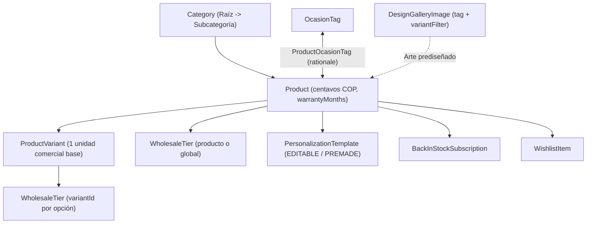
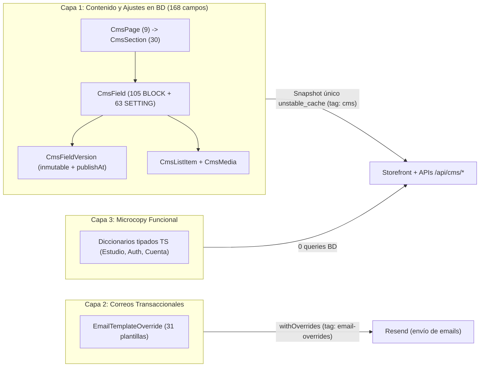

# Catálogo y Sistema de Contenidos (CMS v2) — Lucams Shop

> **Documento vivo.** Describe el modelo de datos del catálogo comercial, las variantes gemelas sin imán (`-NOMAG`), las escalas por volumen, la arquitectura CMS v2 de 3 capas, las APIs públicas preparadas para RAG/CDN y el flujo de sincronización segura entre STG y PRD.

---

## 1. Modelo de Datos del Catálogo (`packages/db/prisma/schema.prisma`)

El catálogo se distribuye en módulos especializados dentro de `apps/web/features/{products,categories,ocasiones,wishlist,back-in-stock,cart}/` y expone dos capas de lectura que comparten los predicados canónicos de visibilidad (`apps/web/features/products/storefront-visibility.ts`) y el filtro SQL de rango de precio sobre variantes activas (`apps/web/features/products/price-filter.ts`, acotado a `INT4` `MAX_PRICE_CENTS` y aplicado **antes** de `take`/`skip` y `count`): una capa SSR para la tienda (`public-service.ts`, que consulta stock en vivo en listados y PDP deduplicado con `React.cache()`) y una capa cacheada para APIs y asistentes (`apps/web/lib/catalog.ts`, con `unstable_cache` y tag `"catalog"`). Tanto `searchStorefrontProducts` como `searchCatalog` soportan además búsqueda por **SKU de variante activa** (`ProductVariant.isActive = true AND deletedAt IS NULL`), respaldada por índices sin sequential scans verificados con `EXPLAIN (ANALYZE)`.

### Entidades principales

- **`Category` (`features/categories/`)**:
  - **Jerarquía de 2 niveles**: relación padre-hija (`parentId` con `onDelete: Restrict`). `assertValidParent` impide ciclos, referencias a categorías eliminadas y niveles nietos (máximo raíz -> subcategoría), y `softDeleteCategory` bloquea archivar una raíz mientras conserve subcategorías activas o productos asociados. En tienda, las subcategorías sin productos activos y las raíces vacías se podan automáticamente del árbol de navegación y el conteo del padre consolida los productos de sus hijas.
  - **Contenido editorial SEO y visual**: `richDescription` (Markdown extendido renderizado en `/productos?categoria=X` y subcategorías), `useCase` (casos de uso semánticos), `icon` (resuelto contra 17 iconos curados de `lucide-react` en `lib/category-visuals.ts`) y `gradient` (8 gradientes Tailwind de marca).
  - **Curaduría de grilla y redirecciones**: `visibleFilters` (arreglo de hasta 9 claves canónicas definidas en `lib/visible-filters.ts`; vacío muestra todos los filtros), `featuredProductSlug` (fija un producto destacado en primera posición sin duplicarlo en la paginación) y `defaultSort` (`recent`, `price_asc`, `price_desc`, `featured`). Renombrar `slug` desde `/admin/categorias` crea automáticamente reglas `UrlRedirect` `301` para la raíz y sus subcategorías. _(Las columnas `activeFrom` y `activeUntil` existen en esquema como reserva futura sin filtro activo en tiempo de ejecución)._
- **`OcasionTag` y `ProductOcasionTag` (`features/ocasiones/`)**:
  - Etiquetas transversales que cruzan categorías (por ejemplo, bodas, grados, Día de la Madre o aniversarios), con `description` semántica, `monthHint` (`1..12` para rotación estacional), `suggestedQuantityRange` (`{ min, ideal, max }`) y ciclo completo de archivado/restauración en `/admin/ocasiones`.
  - La tabla pivote `ProductOcasionTag` añade `rationale` (justificación comercial por par producto-ocasión), alimentando el índice `/ocasion`, las páginas `/ocasion/[slug]`, el filtro combinado `/productos?ocasion=...&q=...` y el motor de recomendación.
- **`Product` y `ProductVariant` (`features/products/`)**:
  - **Importes enteros y gobernanza de costos**: `basePrice`, `compareAtPrice`, `cost` y `ProductVariant.price` / `compareAtPrice` se almacenan siempre en **centavos COP (`Int`)** con restricciones SQL `CHECK >= 0`. La edición de `Product.cost` está centralizada en `/admin/costos` para `SUPERADMIN` y `OPERATIONS_MANAGER` (`catalog:write`), contrastando el costo unitario declarado frente a la receta de materiales (`ProductMaterial` / `/admin/materiales`), mientras que `FINANCE_ANALYST` (`finance:read`) consulta márgenes en modo de solo lectura estricta y la ficha `/admin/productos/[id]` muestra el costo como referencia conectada sin sobrescribirlo.
  - **Herencia de precio, promoción y galería**: el precio efectivo de una opción es `variant.price ?? product.basePrice` (cada escritura de variantes recalcula `syncProductBasePrice` con el menor precio activo). El precio tachado promocional se evalúa por variante (`resolvePromoDisplay`). No existe una tabla separada de imágenes: `Product.images` y `ProductVariant.images` son arreglos `String[]` en Supabase Storage; si `variant.images` está vacío, la opción hereda la galería del producto.
  - **Dimensiones físicas y compuerta logística (`shipping-schemas.ts`)**: `Product.physicalSpecs` almacena material, espesor (`thicknessMm`), gramaje (`weightGrams`), dimensiones de empaque (`widthCm`, `heightCm`, `depthCm`), contenido (`includes[]`) y origen (`"CO"`). Una variante puede sobrescribir dimensiones logísticas en `attributes._shipping`. `assertProductsQuotable` **impide activar (`isActive = true`) cualquier producto en `/admin/productos` si carece de peso y dimensiones válidas** para cotizar en Aveonline.
  - **Atributos tipados de opción física base (`variant-schemas.ts`, `ADR-209`)**: cada `ProductVariant` activa modela exclusivamente atributos físicos sobre **`1` unidad comercial base** (`1` pieza en separadores, bola navideña, mini libros, tiras y calendario; `1` pack de `6` en fotoimanes Polaroid y Cuadrados; `1` set en abecedario y vocales). `ProductVariant.attributes` describe la geometría de corte y renderizado 300 DPI (`sizeCm`, `aspectRatio`, `shape`, `cornerRadiusPx`, `noFold`, `facesPerUnit`), los slots base del diseño (`photoSlots` de `1..60`, `quantity` de `1..500`), el soporte magnético (`magnet: boolean`) y parámetros de sets de letras (`language`, `letterCount`, `pricePerTile`). Las antiguas variantes multi-cantidad se conservan **pausadas (`isActive = false`, `deletedAt = null`)** en una sección colapsable de solo lectura en `/admin/productos/[id]` para proteger la trazabilidad de `OrderItem`, y quedan excluidas de la tienda y de `/admin/inventario`. Al guardar en admin, `mergePreservingUnmanagedAttributes` preserva intactas las llaves técnicas internas.
  - **Garantía modular y tiempos operativos**: `Product.warrantyMonths` (`1..120`, con restricción SQL `CHECK` y base `1 mes`) se congela de forma inmutable en `OrderItem.warrantyMonths` al comprar (`ADR-106`, ver [`./post-sale-and-support.md`](./post-sale-and-support.md)). `productionDays`, `shippingDaysMin` y `shippingDaysMax` alimentan los estimados operativos de preparación y tránsito. _(Las columnas `minimumQuantity` y `maximumQuantity` se persisten y exponen en APIs de catálogo)._
  - **Modalidad de cumplimiento (`ADR-208`)**: `Product.fulfillmentMode` distingue `MADE_TO_ORDER` (disponible por `isActive`, sin validar, descontar o revertir `ProductVariant.stock`) y `PHYSICAL_STOCK` (stock atómico real). `publishedOnStorefront` participa en todos los gates públicos de tienda (`public-service`, `lib/catalog`, búsquedas trigrama, `sitemap.xml` y feed Merchant); `safetyStock >= 0` reserva unidades con paridad 1:1 en todos los canales —incluida la tienda web `lucamsshop.com` (catálogo, PDP, carrito, checkout, decremento atómico `stock - safetyStock >= qty`, B2B, wishlist, `back-in-stock`), `/admin/inventario` y Google Merchant— usando siempre `disponible neto = max(0, stock - safetyStock)`, exclusivo de productos físicos. El Paso 1B (`20261127180000_normalize_made_to_order_stock_zero`) normalizó a `0` el stock legado de las variantes `MADE_TO_ORDER` y retiró `MADE_TO_ORDER_STOCK` del seed canónico.
- **`WholesaleTier` (`features/cart/volume-pricing.ts`, `ADR-124`, `ADR-209`)**:
  - Única fuente de descuentos automáticos por volumen en `/admin/mayorista`, abierta a compradores invitados y autenticados. La lectura corresponde a `MAYORISTA_READ` (`SUPERADMIN`, `OPERATIONS_MANAGER`, `MANAGER`, `FINANCE_ANALYST`) y toda escritura a `MAYORISTA_WRITE` (`SUPERADMIN`, `OPERATIONS_MANAGER`, `MANAGER`); la eliminación exige step-up MFA. La pantalla permite crear, editar en línea, activar/desactivar y eliminar niveles por producto completo o por opción específica (`variantId`), mostrando el porcentaje de ahorro informativo y validando margen y monotonicidad frente a las opciones hermanas.
  - Cada tramo exige `minQty >= 2` y **no puede superar el tope del selector de ese producto** (`maxSelectorUnitsForProduct`: `15` unid. en separadores/bola/mini-libros/tiras/nombre, `6` packs en fotoimanes, `4` sets en calendario, `10` packs en letras y `100` en stock físico directo; los descuentos corporativos desde `25+` pertenecen a `/empresas-y-eventos`). Aplica **sombra estricta de 3 niveles**: **`opción (variantId) > producto (productId) > global (null)`**, y ningún tramo puede superar el precio efectivo de su opción/producto de referencia.
  - La escala se evalúa **únicamente por tanda individual** (`qty × designUnits` de esa línea del carrito, nunca sumando líneas separadas) y viaja sellada en `CartItem.unitPrice` y `OrderItem.unitPrice` antes de cupones o Puntos Lucams.
  - **Bloque «Ahorra llevando más»:** toda la PDP comparte `components/volume-tiers-note.tsx` alimentado por `VariantVolumeTiersNote` (`resolveVisibleVolumeTiers` reactivo a la opción seleccionada). Cuando un tramo coincide exactamente con el máximo del selector (ej. `6` en un tope de `6` packs), se formatea sin `+` (`6 packs` / `15 unid.`). Reporta solo ahorro real por volumen; la promoción `compareAt` aparece como precio tachado por opción, nunca como ahorro de escala. Sin ahorro real no se muestra el bloque (Ley 1480).
- **Modelado de packs, sets, tandas y kits (sin tablas `Combo` / `ComboItem`, `ADR-209`)**:
  - El esquema no utiliza tablas `Combo` ni `ComboItem`. Las presentaciones comerciales se modelan sobre `Product` + `ProductVariant` + `WholesaleTier` mediante tres patrones:
    1. **Opción física base + escala mayorista**: cada opción activa representa `1` unidad comercial base (`1` pieza, `1` pack de `6` imanes con `attributes.photoSlots = 6` o `1` set) resuelta en servidor por tamaño e imán (`photo-pack-resolve.ts`), mientras que el precio decreciente por llevar `2+` packs o piezas vive en `WholesaleTier`.
    2. **Tandas multi-unidad + copias iguales**: el comprador diseña hasta `15` unidades distintas en una tanda del Estudio (`1..6` packs en fotoimanes, `1..4` sets en calendario, `1..10` sets en letras; `MAX_DESIGN_SLOTS = 60`) y elige cuántas copias iguales de esa tanda desea (`qty >= 1` hasta `100` unidades físicas por línea / `16` packs), sellando `OrderItem.designUnits` al confirmar el pedido.
    3. **Cajas de regalo compuestas**: un `Product` cuyo arreglo `physicalSpecs.includes` detalla las piezas incluidas.
- **`DesignGalleryImage`, `WishlistItem` y `BackInStockSubscription`**:
  - `DesignGalleryImage`: arte prediseñado administrable en `/admin/disenos` (`SUPERADMIN` y `OPERATIONS_MANAGER` bajo `production:manage_AssetsCatalog`, en paridad con `/admin/plantillas` y sets de fichas A–Z) por `tag`, con soporte de doble cara (`imageUrl`, `imageUrlB`), filtro por atributos de variante (`variantFilter`) y miniaturas públicas con marca de agua cacheadas bajo el tag `"gallery-thumbs"`. Las purgas físicas irreversibles (productos archivados sin pedidos, prediseñados archivados sin diseños asociados y plantillas sin uso) exigen **step-up MFA reciente (`≤ 10 min`)** + confirmación escrita `"ELIMINAR"`.
  - `WishlistItem`: lista de favoritos por cliente autenticado (`/mi-cuenta/favoritos`, única por `(customerId, productId)`).
  - `BackInStockSubscription`: suscripción «Avísame cuando vuelva» solo para `PHYSICAL_STOCK` publicado y agotado en disponible neto (`20 req/h/IP`), registrando consentimiento `ConsentScope.BACK_IN_STOCK`; `MADE_TO_ORDER` nunca genera estas suscripciones. El cron `GET /api/cron/back-in-stock` notifica en orden FIFO y **limita el número de correos enviados al disponible neto total repuesto** (`sum(max(0, stock - safetyStock))`) para no avisar en exceso cuando entran pocas unidades.

---

## 2. Variantes Gemelas sin Imán (`-NOMAG`)

Varios productos del catálogo (fotoimanes, tiras, separadores y calendarios) se ofrecen tanto imantados como en acabado tarjeta/papel sin imán sobre la misma ficha `Product`:

- **Convención de SKU y atributos**: la variante sin imán comparte producto con su par magnético, utiliza sufijo `-NOMAG` en su SKU y declara `attributes.magnet = false` (frente a `true` en su gemela). Ambas comparten imágenes de portada (`COVER_SIGNATURE_IGNORED_KEYS` ignora `magnet`). Polaroid y Cuadrados declaran `magnet: true` explícito y «Con imán» se enuncia en PDP, Estudio, carrito, pedidos y taller. Cuadrados conserva 2 gemelas base `-NOMAG` inactivas (`5×5` y `7×7 cm`) al mismo precio en los tres ambientes (`ADR-203`, `ADR-209`), activables desde `/admin/productos`.
- **Comportamiento en PDP y catálogo**: `VariantSelector` (`app/producto/[slug]/variant-selector.tsx`) expone la dimensión «¿Con imán?» (`Con imán` / `Sin imán`) y **preselecciona siempre «Con imán» por defecto**, salvo enlace directo `?variant=` o agotamiento exclusivo de la opción imantada.
- **Comportamiento en Estudio y carrito**: `magnet` se guarda en la raíz de `canvasData` y `Design.metadata.variantId`. Si `magnet === false`, el Estudio adapta el sustantivo de la pieza (`resolveSlotNoun` nunca la llama «imán»), oculta las escenas 3D magnéticas (`fridge`, `board`, `memo`) y elimina el dorso negro de ferrita (`ADR-180`). Al agregar al carrito, el servidor resuelve sin ambigüedad la opción base por `sizeCm + magnet` (`photo-pack-resolve.ts`).
- **Comportamiento en taller y producción**: en `features/personalization/production-spec.ts`, cuando `attrs.magnet === false`, la orden de trabajo y el archivo `LEEME.txt` omiten el paso de laminado magnético e imprimen la advertencia explícita `SIN imán (esta variante no lo lleva)`.

---

## 2A. Experiencias físicas específicas (`ADR-199`/`ADR-200`/`ADR-201`)

`personalizationSchema.experience` permite modelar geometría especializada sin cambiar `PersonalizationKind` ni crear migraciones Prisma. `features/personalization/product-experience.ts` es la fuente defensiva compartida por PDP, Estudio, carrito, 3D y taller.

- **Bola Navideña Personalizada (`bola-navidena-personalizada`, `NAV-BOLA-8`):** variantes sin imán ($10.000) y con imán ($11.000; ambos diseños imantados), con inserto circular plano dúplex de 8 cm y `shape = circle`. `facesPerUnit = 2` y `backOptional = false` exigen caras A/B sin duplicar la unidad comercial. El 3D usa un único inserto; previews, carrito, pedidos, posventa, correos y taller conservan la terminología dúplex.
- **Mini Libros Magnéticos (`mini-libros-magneticos`, `MINI-LIBRO`):** cuatro variantes — dos tamaños × con/sin imán. Carátula extendida **7,1 × 5 cm** (tapas de 3,3 cm) o **5 × 2,5 cm** (tapas de 2,25 cm), lomo/grosor 0,5 cm. La variante sin imán conserva el sufijo `-NOMAG`; con imán se muestra ferrita en el reverso.
- **Modelo comercial (`ADR-209`):** variantes de una sola pieza con `quantity = 1` y `photoSlots = 1`, hasta **15 diseños distintos por tanda** en el Estudio (30 lienzos A/B en la bola o 15 carátulas en mini libros, con réplica rápida) y multiplicador de copias iguales hasta **100 unidades físicas por línea**. `unitSlots = photoSlots × facesPerUnit`: dos caras agregan un lienzo, no otra unidad comercial. `volumePricingByPhysicalUnit` aplica `WholesaleTier` sobre el total de la tanda (`qty × designUnits`), incluso cuando cada unidad de la tanda usa otra carátula.
- **Configuración comercial:** precio base de **$10.000 COP**, promociones de **3 por $27.000** y **5 por $40.000** a nivel producto, paquete de **8 × 8 × 8 cm / 200 g** y stock made-to-order. La bola está activa en los tres ambientes; los mini libros permanecen inactivos fuera del catálogo de referencia. La logística se edita en Detalles/Empaque o en cada variante; el seed no inventa valores pendientes ni sobrescribe tramos existentes.
- **Activos canónicos:** `generate-new-product-assets.mjs` crea portadas y SVG; `seed-templates.mjs` registra 7 plantillas (1 bola + 6 mini libro; la bola conserva solo «Foto circular»); `seed-new-product-gallery.mjs` siembra 20 prediseñados con masters y miniaturas protegidas.

---

## 3. Arquitectura CMS v2 de 3 Capas (`ADR-082`, `ADR-187`)

Lucams separa estrictamente el contenido administrable, los encabezados de correos y el microcopy funcional de interfaz en tres capas para evitar claves rotas, consultas redundantes y riesgos de seguridad:

### Capa 1 — Contenido editorial, páginas legales y ajustes (`CmsPage` -> `CmsSection` -> `CmsField`)

Las tablas legadas (`CmsBlock` y `SiteSetting`) fueron consolidadas en un único modelo jerárquico relacional manteniendo intacta la interfaz de lectura en `apps/web/lib/cms.ts` (`getCmsBlock`, `getSiteSetting`, `getSettingValue`, `getCmsList`, `getCmsImage`). El mapa canónico en `packages/db/scripts/cms-site-map.mjs` declara exactamente **9 contenedores (`CmsPage`), 30 secciones (`CmsSection`) y 168 campos (`CmsField`: 105 `BLOCK` + 63 `SETTING`)**:

| #   | Slug (`CmsPage`) | Título en Admin                  | Ruta pública   | Secciones |  Campos | `BLOCK` | `SETTING` |
| --- | ---------------- | -------------------------------- | -------------- | --------: | ------: | ------: | --------: |
| 1   | `inicio`         | Página principal                 | `/`            |         8 |      36 |      33 |         3 |
| 2   | `navegacion`     | Encabezado y pie de página       | —              |         2 |       5 |       5 |         0 |
| 3   | `ayuda`          | Centro de ayuda                  | `/ayuda`       |         2 |      16 |      16 |         0 |
| 4   | `contacto`       | Contacto                         | `/contacto`    |         2 |       8 |       8 |         0 |
| 5   | `legales`        | Páginas legales                  | —              |         2 |      17 |      17 |         0 |
| 6   | `checkout`       | Checkout                         | —              |         3 |      18 |      18 |         0 |
| 7   | `sistema`        | Modo mantenimiento               | `/maintenance` |         1 |       2 |       2 |         0 |
| 8   | `seo`            | SEO (Google)                     | —              |         1 |       6 |       6 |         0 |
| 9   | `global`         | Ajustes del sitio (`SUPERADMIN`) | —              |         9 |      60 |       0 |        60 |
|     | **Total**        |                                  |                |    **30** | **168** | **105** |    **63** |

- **Snapshot único cacheado (`cms-snapshot-v2`)**: `apps/web/lib/cms.ts` descarga los 168 campos activos y su `publishedVersion` en **una sola consulta Prisma** cacheada con `unstable_cache` (`tags: ["cms"]`, `revalidate: 3600`). Los errores de red se capturan fuera de la caché para jamás memorizar respuestas vacías, cayendo siempre al `fallback` en código (_Regla de Oro_).
- **Efectos de temporada y logo estacional**: la sección «Efectos de temporada» de `inicio` aloja `home.seasonal.snowfall` (caída de nieve a pantalla completa vía `<Snowfall>` en el layout raíz — nunca en `/admin` ni `/estudio`, respeta `prefers-reduced-motion`), y `site.logo` cubre además del header y el panel admin el **logo grande del hero** de la portada, para variantes estacionales sin despliegue.
- **Versionado inmutable y publicación programada**:
  - Toda edición inserta una fila append-only en `CmsFieldVersion` (`version = max + 1`). En campos `BLOCK`, guardar borrador no altera `publishedVersionId` hasta publicar explícitamente; en campos `SETTING`, el guardado crea versión y publica en el acto.
  - `scheduleCmsFieldPublish` permite fijar `CmsFieldVersion.publishAt` en hora de Bogotá (`UTC-5`, mínimo 1 minuto en el futuro). El cron `GET /api/cron/cms-publish-scheduled` (cada 5 minutos, con omisión en SQL si no hay pendientes) publica las versiones vencidas e invoca `revalidateTag("cms", "max")`. Las acciones del panel invalidan al instante mediante `updateTag("cms")` (además del botón manual «Actualizar caché» en `/admin/contenido`).
- **Listas tipadas (`CmsListItem`) y Mediateca (`CmsMedia`)**:
  - Los campos con `metadata.listSchema` se editan como filas de formulario sin manipular JSON crudo y se serializan en una nueva `CmsFieldVersion`.
  - `CmsMedia` gestiona activos en el bucket público `cms-media` (máx. `5 MB`, validación por magic bytes, conversión a WebP `<= 2000 px` y `alt` obligatorio WCAG 1.1.1). `deleteCmsMedia` **bloquea el borrado si el ID está referenciado en cualquier versión actual o histórica** (`CmsFieldVersion.body`), evitando enlaces rotos al revertir versiones.
- **Delegación de 21 parámetros operativos**: aunque residen en `CmsField` (`global`), 21 ajustes con reglas de negocio complejas están bloqueados en `/admin/contenido/paginas/global` y delegados a sus módulos dueños (todos exclusivos `SUPERADMIN`):
  - `/admin/envios` (6 claves de Envío Lucams y reglas de peso por transportadora).
  - `/admin/fidelizacion` (10 claves de Puntos Lucams e Invita y gana).
  - `/admin/carritos/configuracion` (5 claves de recuperación de carritos abandonados).

### Capa 2 — Plantillas de correo transaccional (`/admin/email-templates`)

El módulo `/admin/email-templates` (`SUPERADMIN`) administra `EmailTemplateOverride` sobre las **31 plantillas registradas** en `apps/web/features/emails/registry.ts`, permitiendo personalizar `SUBJECT`, `PREHEADER` y `HEADING` con interpolación segura de variables `{campo}`, vista previa HTML aislada con CSP sandbox y envío de correo de prueba `[PRUEBA]`, cacheado bajo el tag `"email-overrides"`. Para el inventario completo de plantillas y webhooks de entrega, consulta [`../integrations/resend-and-emails.md`](../integrations/resend-and-emails.md).

### Capa 3 — Microcopy funcional en código TypeScript

Los textos puramente operativos de controles, validaciones y accesibilidad viven tipados en código sin viajes a base de datos: Estudio (`app/estudio/[slug]/studio-texts.ts`), Autenticación (`app/(auth)/auth-texts.ts`), Mi Cuenta (`app/mi-cuenta/account-texts.ts`) y la base estructural del Checkout (`app/checkout/checkout-texts.ts`, que hidrata únicamente 10 claves comerciales desde el CMS).

### Guarda AST de paridad, tokens dinámicos y edición visual en vivo

- **Gate AST en CI (`apps/web/lib/cms-sitemap-parity.test.ts`)**: recorre el árbol sintáctico TypeScript de todo `apps/web` y falla el build si: (a) cualquier llamada o componente JSX (`<CmsText>`, `<CmsMarkdown>`, `<CmsSetting>`, `getCmsBlock`, `getSettingValue`, `getPageSeo`, etc.) consume una clave ausente de `cms-site-map.mjs`, (b) existe cualquier campo en `cms-site-map.mjs` sin consumidor real en código, o (c) el conteo difiere de `9` páginas / `168` campos o aparece una variante inválida de marca.
- **Resolución de tokens legales y operativos (`resolveCmsTokens` en `lib/cms-tokens.ts` + `lib/consumer-law.ts`)**: interpola **17 tokens dinámicos** para que las páginas legales, FAQs y avisos nunca queden desfasados frente a los parámetros reales:
  - _Buzones oficiales_: `{{email_contacto}}`, `{{email_habeas_data}}`, `{{email_retracto}}`, `{{email_security}}` (`security@lucamsshop.com`).
  - _Tiempos y operación_: `{{fab}}` (`PRODUCTION_DAYS_DEFAULT`), `{{entrega}}` (`DELIVERY_DAYS_ESTIMATE`), `{{total}}`, `{{cobertura}}`, `{{cutoff_lucams}}`, `{{ciudad}}` (contextual).
  - _Constantes legales (`lib/consumer-law.ts`)_: `{{garantia_base}}` (`1 mes`), `{{garantia_respuesta_dias}}` (`15` días hábiles), `{{retracto_dias}}` (`5` días hábiles), `{{retracto_reembolso_dias}}` (`15` días calendario), `{{entrega_max_legal_dias}}` (`30` días calendario), `{{habeas_consulta_dias}}` (`10` días hábiles) y `{{habeas_reclamo_dias}}` (`15` días hábiles).
- **Visual Live Edit Overlay y vista previa SERP (`apps/web/components/cms/`)**:
  - `<CmsText>` y `<CmsMarkdown>` (este último blindado con `ReactMarkdown` + `remarkGfm` + `rehypeSanitize`, sin HTML crudo) son Server Components de costo cero en el navegador público.
  - Cuando un administrador con rol `SUPERADMIN` o `CMS_EDITOR` y MFA `aal2` activa `POST /api/admin/cms/edit-mode` (cookie `HttpOnly` `lucams_cms_edit=1` por 8 h, revalidada en servidor en cada request mediante `isCmsEditMode()`), los bloques emiten `data-cms-key` y `<CmsEditOverlay>` resalta cada texto en la tienda real para saltar con un clic a su editor en `/admin/contenido`.
  - Además, `/admin/contenido` ofrece `<PagePreviewPanel>` (iframe en vivo para rutas 1:1) y tarjeta interactiva de **vista previa Google SERP** al editar `<title>` y `meta description` en `seo.page.*`.

---

## 4. APIs Públicas de Catálogo, Cupones y CMS

Todas las rutas son `GET`, aplican limitación de tasa por hash de IP (`ipKey`, sin guardar IPs en claro por Ley 1581), respetan el filtro CORS central de `apps/web/proxy.ts` y operan de forma idéntica en modo `"catalog"` y `"full"`.

### 4.1 Endpoints de catálogo (`/api/catalog/*` — 9 rutas) y cupones públicos (1 ruta)

| Endpoint                            | Parámetros principales                                                                                                                                                                                   | `Cache-Control` HTTP                  | Data Cache / Tag             | Rate limit (IP) |
| ----------------------------------- | -------------------------------------------------------------------------------------------------------------------------------------------------------------------------------------------------------- | ------------------------------------- | ---------------------------- | --------------- |
| `GET /api/catalog/categories`       | —                                                                                                                                                                                                        | `public, max-age=3600, s-maxage=3600` | Tag `"catalog"` (`3600 s`)   | `30 req / 60 s` |
| `GET /api/catalog/products`         | `categoria`, `subcategoria`, `ocasion`, `priceMin`, `priceMax` (SQL sobre variantes activas, `[0..INT4]`), `isPersonalizable`, `sort`, `limit`, `offset` → devuelve `products`, `count` y `total` exacto | `public, max-age=300, s-maxage=300`   | Tag `"catalog"` (`300 s`)    | `30 req / 60 s` |
| `GET /api/catalog/products/[slug]`  | Path: `slug` (`404` si no existe o está pausado)                                                                                                                                                         | `public, max-age=3600, s-maxage=3600` | Tag `"catalog"` (`3600 s`)   | `60 req / 60 s` |
| `GET /api/catalog/ocasiones`        | —                                                                                                                                                                                                        | `public, max-age=3600, s-maxage=3600` | Tag `"catalog"` (`3600 s`)   | `30 req / 60 s` |
| `GET /api/catalog/ocasiones/[slug]` | Path: `slug` (incluye hasta 12 productos asociados)                                                                                                                                                      | `public, max-age=3600, s-maxage=3600` | Tag `"catalog"` (`3600/300`) | `30 req / 60 s` |
| `GET /api/catalog/search`           | `q` (mín. 2, máx. 120 chars; búsqueda difusa `pg_trgm` + `unaccent` + SKU de producto/variante activa), `limit` (`1..50`)                                                                                | `public, max-age=300, s-maxage=300`   | Directo PostgreSQL           | `60 req / 60 s` |
| `GET /api/catalog/recommend`        | `ocasion[]`, `destinatario`, `precioMin`, `precioMax`, `personalizable`, `exclude[]`, `limit` (`1..30`)                                                                                                  | `public, max-age=600, s-maxage=600`   | Tag `"catalog"` (`300 s`)    | `60 req / 60 s` |
| `GET /api/catalog/filters`          | `categoria` (opc.), `subcategoria` (opc.) — devuelve facetas y rango real de precios                                                                                                                     | `public, max-age=3600, s-maxage=3600` | Tag `"catalog"` (`3600 s`)   | `30 req / 60 s` |
| `GET /api/catalog/templates`        | `productSlug` (**requerido**), `mode` (`EDITABLE` \| `PREMADE`)                                                                                                                                          | `public, max-age=3600, s-maxage=3600` | Tag `"catalog"` (`3600 s`)   | `60 req / 60 s` |
| `GET /api/coupons/public`           | — (solo cupones con `isPublic = true`, activos y dentro de vigencia `validFrom..validTo`)                                                                                                                | `public, max-age=600, s-maxage=600`   | Tags `["catalog","coupons"]` | `30 req / 60 s` |

### 4.2 Endpoints de CMS (`/api/cms/*` — 4 rutas, errores RFC 7807 `application/problem+json`)

Las 4 rutas comparten el bucket de tasa `api-cms` (**`30 req / 60 s` por IP**):

| Endpoint                    | Parámetros principales                                              | `Cache-Control` HTTP                                               | Comportamiento clave                                                                                  |
| --------------------------- | ------------------------------------------------------------------- | ------------------------------------------------------------------ | ----------------------------------------------------------------------------------------------------- |
| `GET /api/cms/blocks`       | `category` (opc.: `LEGAL`, `HOME`, `FAQ`, `SUPPORT`, etc.)          | `public, max-age=300, s-maxage=3600, stale-while-revalidate=86400` | Lee `cms-snapshot-v2` e interpola `resolveCmsTokens` en título y cuerpo.                              |
| `GET /api/cms/blocks/[key]` | Path: `key` (`404` si no existe o no está publicado)                | `public, max-age=300, s-maxage=3600, stale-while-revalidate=86400` | Devuelve un bloque publicado individual con tokens resueltos.                                         |
| `GET /api/cms/settings`     | `category` (opc.: `CONTACT`, `BUSINESS`, `LEGAL`, `COMMERCE`, etc.) | `public, max-age=300, s-maxage=3600, stale-while-revalidate=86400` | Filtrado por lista blanca estricta `PUBLIC_SETTING_KEYS` (26 claves; oculta NIT, alertas y internos). |
| `GET /api/cms/search`       | `q` (**requerido**, `2..120` chars)                                 | `public, max-age=60, s-maxage=300, stale-while-revalidate=3600`    | Búsqueda `pg_trgm` + `unaccent` sobre bloques publicados (`LIMIT 20`).                                |

---

## 5. Sincronización Operativa STG -> PRD (`ADR-126`)

Dado que los IDs `cuid()` pueden diferir entre ambientes y la curaduría editorial/visual se valida primero en STG, `packages/db/scripts/` provee herramientas idempotentes basadas en claves naturales y protegidas por `scripts/lib/env-guard.mjs`:

1. **`sync-catalog-stg-to-prd.mjs`**:
   - Sincroniza en orden de claves foráneas: `Category`, `Product`, `ProductVariant`, `WholesaleTier` (clave natural `productSlug|variantSku|minQty`), la jerarquía CMS y `PersonalizationTemplate`, usando claves naturales y versiones CMS append-only.
   - **`--only=<slug>` (`ADR-203`):** limita la promoción a la cadena de categorías, el producto, sus variantes, sus escalas `WholesaleTier` y sus plantillas; el CMS queda intacto.
   - Antes de tocar PostgreSQL verifica las imágenes destino, copia desde STG únicamente los objetos faltantes (`upsert: false`) y reescribe el host de Supabase.
   - **`ProductVariant.stock` y `safetyStock` jamás se sincronizan**. Las variantes nuevas entran con ambos en `0` para carga manual; `fulfillmentMode` y `publishedOnStorefront` sí se alinean como configuración comercial. Tampoco se copian `Coupon` ni `AdminUser`.
2. **`sync-gallery-stg-to-prd.mjs`**: sincroniza `DesignGalleryImage` por `id` y luego `(tag, name)`, conserva las FKs de `DesignAsset.galleryImageId`, copia masters faltantes y reescribe el host público.
3. **`homologate-catalog-from-prd.mjs` (PRD → LOCAL/STG):** copia estados y contenido de productos compartidos, galería y objetos faltantes. Las `-NOMAG` se excluyen; las filas exclusivas del destino solo se reportan y `stock`/`safetyStock` nunca se sincronizan.
4. **Guardarraíles (`--apply` y `env-guard.mjs`):** los scripts son `DRY-RUN` por defecto, bloquean credenciales cruzadas y exigen `LUCAMS_ALLOW_DESTRUCTIVE_REMOTE=1` + `--apply` para escribir en PRD. Tras aplicar cambios se refresca `catalog` desde admin o se espera el TTL.

---

## Documentos Relacionados

- Arquitectura general, RLS y caché: [`../ARCHITECTURE.md`](../ARCHITECTURE.md)
- Estudio de Personalización y plantillas 300 DPI: [`./studio-and-production.md`](./studio-and-production.md)
- Carrito, precios por volumen, cupones y checkout: [`./checkout-payments-shipping.md`](./checkout-payments-shipping.md)
- Garantías modulares (`warrantyMonths`) y derecho de retracto: [`./post-sale-and-support.md`](./post-sale-and-support.md)
- Plantillas de correo y proveedor Resend: [`../integrations/resend-and-emails.md`](../integrations/resend-and-emails.md)
- Procedimientos operativos y sincronización entre ambientes: [`../OPERATIONS.md`](../OPERATIONS.md)
- Marco legal de información pública y Ley 1480 / Ley 1581: [`../COMPLIANCE.md`](../COMPLIANCE.md)
