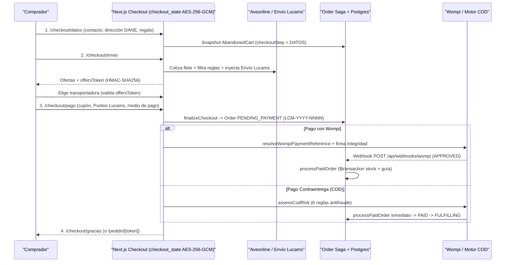
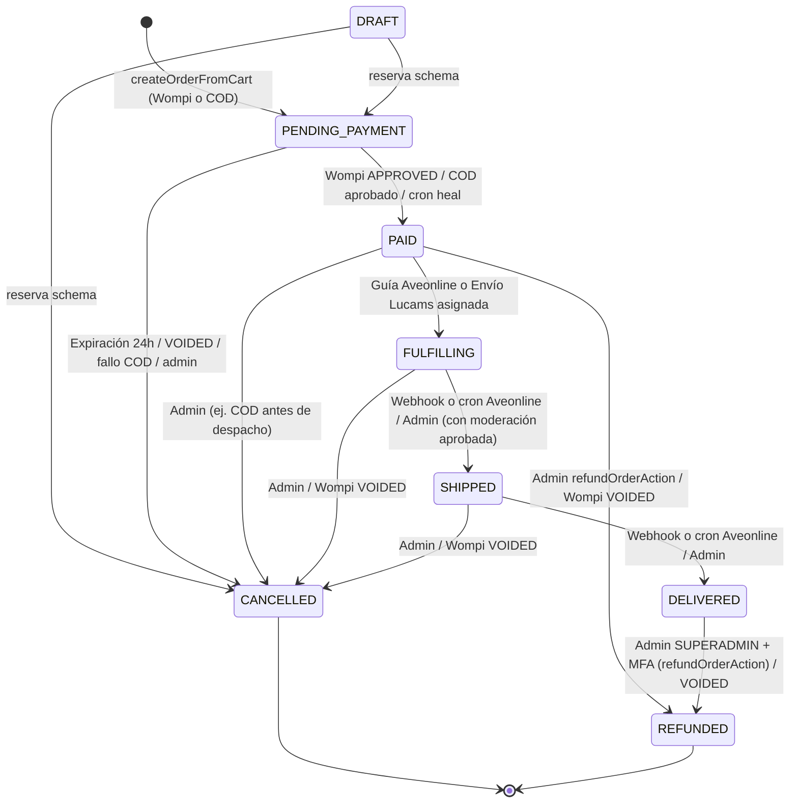

# Carrito, Checkout, Pagos, Envíos y Costeo — Lucams Shop

> **Documento vivo.** Describe el ciclo de vida del carrito de compras, el checkout en 3 pasos, la evaluación antifraude y conciliación de contraentrega (COD), la saga transaccional de órdenes, el costeo unitario por recetas de taller y el puente de ingresos cobrados en finanzas.

---

## 1. Ciclo de Vida del Carrito (`Cart`, `CartItem`, `AbandonedCart`)

El dominio de carrito vive en `apps/web/features/cart/`, `apps/web/lib/cart-session.ts` y las rutas `apps/web/app/carrito/`. Todos los precios e importes se operan en **centavos COP (`Int`)**.

### Sesión `cart_session` y auto-reparación de identidad

- **Cookie `cart_session` (`apps/web/lib/cart-session.ts`)**: almacena un UUID v4 (`randomUUID()`, 122 bits de entropía, mapeado 1:1 a `Cart.sessionId @unique`) con atributos `HttpOnly`, `SameSite=Lax`, `Secure` en producción, `Path=/` y vigencia de **30 días** (`maxAge: 2592000`).
- **Persistencia post-compra y limpieza en logout**: `clearCartSession()` borra la cookie al cerrar sesión (protección en dispositivos compartidos), pero **no** la rota al completar un pago para no romper `/checkout/gracias` ni la recuperación al re-loguearse. Si el comprador vuelve a agregar productos con una cookie cuyo `Cart` quedó con `deletedAt != null` tras pagar, `ensureCart` (`features/cart/service.ts`) preserva primero el snapshot histórico en `AbandonedCart` y revive la fila `Cart` vaciando sus `CartItem` anteriores.
- **Aislamiento y auto-sanado (`CART_IDENTITY_MISMATCH`)**: `assertCartIdentity(cart, customerId)` exige `cart.customerId === null || cart.customerId === customerId`. Si una acción de adición (`addToCartAction` o `addPersonalizedToCartAction` en `app/carrito/actions.ts`) detecta que la cookie apunta al carrito de otro cliente, invoca `rotateCartSession()` —emitiendo un nuevo UUID sin tocar el carrito ajeno en base de datos—, registra `cart.identity_mismatch.healed` y reintenta la operación una única vez.

### Fusión al iniciar sesión y recuperación al re-login

Al autenticarse por contraseña, código OTP o callback PKCE (`/auth/callback`), el sistema reconcilia el carrito y los borradores del Estudio:

1. **Con cookie `cart_session` presente (`mergeAnonCartIntoCustomer`)**:
   - Si el carrito de la cookie pertenece a otro `Customer` distinto, aborta sin tocar datos ajenos y devuelve el `sessionId` del cliente autenticado (o un UUID nuevo).
   - Ejecuta **`adoptAnonDraftDesigns`** (`ADR-155`): busca todos los `Design` en estado `DRAFT` anónimos de esa sesión con avance real (`designHasMeaningfulProgress` en `features/personalization/design-progress.ts`) y transfiere tanto los diseños como sus `DesignAsset` al `customerId`, incluso si aún no estaban agregados al carrito.
   - Si el cliente ya tenía un `Cart` vivo propio, consolida en una `$transaction` las líneas equivalentes (`sameLineContent` en `features/cart/design-identity.ts`: misma `variantId` y mismo hash `designIdentity`) respetando `MAX_QTY_PER_ITEM = 99` por fila, transfiere los diseños referenciados (`adoptSessionDesigns`), migra `AbandonedCart.cartId` si corresponde y aplica `delete` físico al carrito anónimo absorbido.
2. **Sin cookie `cart_session` (`recoverCustomerCartSessionId`, `ADR-171`)**:
   - Cuando el cliente inicia sesión tras haber cerrado sesión antes (salvo flujos de recuperación de contraseña `type === "recovery"`), busca su `Cart` vivo más reciente con ítems (`deletedAt: null`) y restaura su `sessionId` en la cookie para no dejar carritos duplicados huérfanos.

### Validación en tiempo real, escalas por volumen y barrera anti-reprice

- **Comprabilidad y stock físico**: cada lectura del carrito (`toDetail()`) filtra variantes inactivas o eliminadas mediante `isPurchasableVariant` (`features/products/storefront-visibility.ts`). Las altas y cambios de cantidad rechazan `stock <= 0` (`STOCK_UNAVAILABLE`), acotan la cantidad a `Math.min(99, variant.stock)` y contabilizan unidades físicas reales (`inventoryUnitsForOrderItem` para sets y multi-unidad).
- **Escalas mayoristas automáticas (`WholesaleTier`)**: `applyVolumePricing` (`features/cart/volume-pricing.ts`) recalcula `CartItem.unitPrice` en cada alta o ajuste de cantidad. Si un producto define escalas propias (`productId != null`), estas hacen sombra total sobre las escalas globales (`productId = null`); gana el mayor `minQty <= qty` y nunca aplica un tramo que encarezca el precio base (`tier.unitPrice < baseUnitPrice`). Los packs y diseños multi-unidad se modelan directamente sobre `ProductVariant` y `Design` (no existen tablas `Combo` ni `ComboItem`; ver [`./catalog-and-cms.md`](./catalog-and-cms.md)).
- **Resolución server-side de variante (`photo-pack-resolve.ts`)**: al agregar un diseño personalizado de foto-pack (`canvasData.version === 2` con `photoSlots`), `addPersonalizedToCart` lee `Design.canvasData` desde Postgres y resuelve en servidor la `ProductVariant` exacta (`photoSlots + sizeCm + magnet`), ignorando cualquier `variantId` desactualizado o manipulado por el cliente.

### Cupones (`Coupon` y `CouponUsage`)

La validación y el cálculo residen en `apps/web/features/coupons/redemption.ts`:

- **Tipos (`CouponType`)**: `PERCENT` (`1..100`, redondeo `Math.floor` sobre el subtotal elegible), `FIXED` (centavos COP acotados al subtotal elegible) y `FREE_SHIPPING` (`value = 0`, descuenta el 100 % de `shippingCost`).
- **Reglas comerciales**: vigencia `validFrom..validTo`, `isActive`, cupo global (`usedCount < maxUses`), tope por comprador (`maxUsesPerCustomer` cruzado simultáneamente por `customerId` **y** `lower(email)` para impedir evasión alternando invitado y cuenta), filtros `appliesToCategories` y `appliesToProductSlugs`, cantidad mínima de unidades elegibles (`requiresMinQuantity`) y subtotal mínimo del carrito (`minOrder`).
- **Control de concurrencia en base de datos**:
  - **Por cliente**: el trigger `BEFORE INSERT ON "CouponUsage"` (`coupon_usage_per_customer_limit`) toma locks transaccionales determinísticos `pg_advisory_xact_lock` sobre los hashes de `(couponId, lower(email))` y `(couponId, customerId)` antes de verificar el conteo, abortando con `ERRCODE = '23505'` (`isCouponPerCustomerLimitError`) si se supera el límite.
  - **Global**: `CouponUsage` se inserta y `Coupon.usedCount` se incrementa de forma condicional atómica únicamente cuando la orden pasa a `PAID`. Si dos pagos en Wompi agotan en paralelo el último uso, el descuento ya cobrado al comprador se respeta sin corromper `usedCount` y la orden marca `needsReconciliation = true`.

### Retención y recuperación de carritos abandonados

- **Purga automática (`features/cart/cart-retention.ts`)**: se ejecuta en lotes (`BATCH_SIZE = 500`) al inicio del cron `GET /api/cron/purge-anon-designs` antes de barrer diseños sin pedido:
  - Carritos vivos vacíos (`deletedAt: null`, sin ítems ni `AbandonedCart`): **7 días** (`PURGE_EMPTY_CART_AFTER_DAYS = 7`).
  - Carritos vivos inactivos (`deletedAt: null`, sin `AbandonedCart`): **60 días** (`PURGE_STALE_CART_AFTER_DAYS = 60`).
  - Registros `AbandonedCart`: **90 días** desde `createdAt` (`PURGE_ABANDONED_CART_AFTER_DAYS = 90`).
- **Captura y seguimiento (`features/cart/recovery-service.ts`)**: al guardar el correo en `/checkout/datos`, `recordAbandonedCartEmail` vincula el `Contact` CRM, congela `itemsSnapshot` y `subtotalCents`, y avanza `checkoutStep` de forma monotónica (`"DATOS" -> "ENVIO" -> "PAGO"`). El registro se cierra (`closedReason`) con `"ORDER_PAID"`, `"QUOTE_CREATED"` o `"CART_EMPTIED"`.
- **Recordatorios y enlace mágico (`GET /api/cron/cart-recovery` y `/carrito/recuperar/[token]`)**:
  - Gobernado por ajustes editables en `/admin/carritos/configuracion` (`CART_RECOVERY_ENABLED`, `CART_RECOVERY_MODE` `"automatic" | "manual"`, `CART_RECOVERY_IDLE_HOURS = 4`, `CART_RECOVERY_MAX_REMINDERS = 1` hasta 5, `CART_RECOVERY_INTERVAL_HOURS = 24`).
  - Verifica no-supresión comercial (`EmailSuppression` — ver [`../integrations/resend-and-emails.md`](../integrations/resend-and-emails.md)), genera un token aleatorio de 24 bytes `base64url` y persiste solo su SHA-256 en `AbandonedCart.recoverTokenHash`.
  - `GET /carrito/recuperar/[token]` (`60 req/min/IP`) valida propiedad, fusiona cualquier ítem o diseño actual de la sesión hacia el carrito recuperado (`mergeCartsAdopt`), restaura la cookie `cart_session` y redirige a `/carrito`. La operación manual y el diagnóstico viven en `/admin/carritos`.

---

## 2. Checkout en 3 Pasos (`/checkout/datos` → `/checkout/envio` → `/checkout/pago` → `/checkout/gracias`)

### Sesión efímera `checkout_state` y bandera tributaria

- **Cookie `checkout_state` (`apps/web/lib/checkout-session.ts`)**: `HttpOnly`, `SameSite=Lax`, `Secure` en producción y TTL de **60 minutos** (`TTL_SECONDS = 3600`). Su contenido (`step`, `contact`, `address`, `billing`, `gift`, `shippingSelection`, `shippingOffers`, `paymentMethod`, `couponCode`, `loyaltyPoints`, `updatedAt`) viaja **cifrado y autenticado con AES-256-GCM** usando IV aleatorio de 96 bits y clave derivada `SHA-256("checkout-session:" + CSRF_SECRET)`, validando además expiración lógica al abrir. Se destruye al cerrar un pedido COD (`finishCheckoutSession()`) o al montar `<ClearCheckoutSession />` en `/checkout/gracias`.
- **`BILLING_DOCUMENT_ENABLED = false` (`apps/web/features/checkout/billing-document.ts`)**: Lucams Shop opera hoy como persona natural no responsable de IVA ni de facturación electrónica DIAN. Para cumplir la Ley 1480 (no ofrecer en interfaz un soporte fiscal que aún no se emite; ver [`../COMPLIANCE.md`](../COMPLIANCE.md)), esta constante oculta el bloque tributario en `/checkout/datos` y fuerza `wantsInvoice = false` (`Order.dianStatus = NOT_REQUIRED`). El modelo y validadores (`billingDocumentType`, `billingDocumentNumber`, `billingName`, `dianCufe`, `dianXmlUrl`) ya están implementados y listos para activarse cuando cambie el régimen tributario.

### Direcciones estructuradas colombianas, DANE Divipola y código postal MinTIC

Definidas en `apps/web/features/checkout/destination-types.ts` y `schemas.ts` mediante la unión discriminada `AddressSchema`:

- **Destino urbano (`kind: "urban"`)**: nomenclatura vial colombiana estructurada (`viaType`, `viaNumber`, `viaBis`, `viaCardinal`, `cruceNumber`, `cruceCardinal`) combinada con los **5 subtipos** de `DESTINATION_TYPES`: `casa`, `edificio`, `conjunto_torres`, `conjunto_casas` y `oficina` (exigiendo apartamento/torre/casa/oficina según corresponda).
- **Destino rural (`kind: "rural"`)**: exige `vereda`, permite `finca` y `altPhone` (celular alternativo de 10 dígitos con señal en la vereda) e impone una `referencia` descriptiva de al menos `RURAL_REF_MIN_LENGTH = 20` caracteres.
- **Formateo y geocodificación nacional**: `composeAddressLine` construye la línea estandarizada para la guía y `deriveAddressName` etiqueta las direcciones guardadas del cliente. El selector geográfico (`apps/web/lib/dane-divipola.ts`) contiene los 32 departamentos más Bogotá D.C. (`"11"`), ~180 municipios con código DANE Divipola de 5 dígitos y autocompletado del **código postal nacional MinTIC de 6 dígitos** (dataset `ixig-z8b5`). Cuando el municipio pertenece a `LUCAMS_ZONE_CITIES` (`apps/web/lib/lucams-zones.ts`, Bogotá `"11001"` con sus 20 localidades), `saveDatosAction` exige seleccionar `localityId`.

### Flujo de regalo («¿Lo recibe otra persona?»)

- **Campos persistidos (`GiftSchema` y `Order`)**: `isGift` (`Boolean`), `recipientName`, `recipientPhone` y `giftMessage` (máximo 280 caracteres; forzado a `null` si `isGift === false`). Los datos del comprador (`email`, `phone`, `billingName`) permanecen intactos en la raíz de `Order`.
- **Separación comprador vs. destinatario**:
  - `resolveShipmentRecipient` (`features/orders/shipment-recipient.ts`) emite la guía de transporte a nombre y teléfono de `recipientName` / `recipientPhone` (quien recibe al mensajero), manteniendo el correo del comprador para notificaciones.
  - `resolveOrderContactTx` protege el grafo CRM para no sobrescribir el nombre del comprador con el del homenajeado, y `/pedido/[token]` exige verificar el correo del comprador antes de abrir trámites posventa (ver [`./post-sale-and-support.md`](./post-sale-and-support.md)).
- **Empaque y correos sin precios**: cuando `isGift === true`, el correo `order-confirmation` oculta todos los precios unitarios y la tabla de totales (conservando únicamente el aviso del monto a entregar en efectivo si el medio de pago es `COD`). En paralelo, `order-admin-notification` y `/admin/pedidos/[number]` despliegan al taller el aviso destacado: **«Es regalo: empacar SIN factura ni precios visibles»** junto al texto de la tarjeta.

### Cotización logística firmada con HMAC (`offersToken`)

- **Sello anti-manipulación (`sealShippingOffersPayload` / `openShippingOffersPayload`)**: `/checkout/envio` firma las tarifas obtenidas con `HMAC-SHA256` (`CSRF_SECRET`, TTL 60 min) atando `{ offers, cartHash, destKey, quotedAt }`, donde `cartHash` es la huella exacta `variantIdxqty@unitPrice` y `destKey` es `deptCode:cityCode`. Tanto el Paso 2 (`saveShippingSelectionStep`) como el Paso 3 (`finalizeCheckout`) verifican la firma y recalculan `cartHash` y `destKey` en servidor, impidiendo alterar precios de flete o inyectar transportadoras tras cambiar el carrito o la ciudad.
- **Reglas de transportadoras y «Envío Lucams» (`/admin/envios`)**:
  - Antes de firmar el `offersToken`, `quoteShipping` consulta Aveonline (ver [`../integrations/aveonline.md`](../integrations/aveonline.md)) con dimensiones por variante y valor declarado por unidad física, y filtra el resultado contra `SHIPPING_DISABLED_CARRIERS` y `SHIPPING_CARRIER_RULES` (`minWeightKg` / `maxWeightKg` evaluados sobre el paquete consolidado `computePackedPackage`).
  - Si `LUCAMS_SHIPPING_ENABLED === "true"` y la localidad del comprador está activa en `LUCAMS_SHIPPING_ZONES`, inyecta la oferta propia **«Envío Lucams»** (`carrier = "lucams"`, `contraentrega: false`, tarifa `LUCAMS_SHIPPING_PRICE_COP` por defecto `1_000_000` centavos, equivalentes a 10.000 COP). Su promesa de entrega suma 1 día hábil si la compra ocurre desde las **12:00** hora Bogotá (`LUCAMS_SHIPPING_CUTOFF_HOUR = 12`), sirve como respaldo resiliente si Aveonline falla en Bogotá y vuelve a validarse en vivo dentro de `finalizeCheckout`.

### Contraentrega (COD): elegibilidad, motor antifraude y conciliación

- **Compuertas de elegibilidad**:
  1. Setting global `COD_ENABLED === "true"` (fail-closed en UI y en `finalizeCheckout`).
  2. Transportadora con recaudo habilitado (`shippingSelection.contraentrega !== false`; «Envío Lucams» propio no admite COD).
  3. Verificación Cloudflare Turnstile y rate-limit dedicado `checkout_cod` (`6` intentos cada `600s` por IP en producción).
  - _Nota de reglas vigentes_: el código **no** excluye productos personalizados ni exige un monto mínimo para pagar contraentrega.
- **Evaluación de riesgo `assessCodRisk` (`apps/web/features/checkout/cod-risk.ts`)**: cruza la identidad normalizada del pedido —teléfono expandido en variantes E.164 `+573XXXXXXXXX` (`phoneIdentityVariants`), `email` en minúsculas y clave normalizada de dirección `shippingAddressKey` (`computeShippingAddressKey`)— contra **6 reglas**:
  1. **`blocklist`**: presencia en `BlockedIdentity` (`BlockedIdentityKind`: `PHONE | EMAIL | ADDRESS`, administrada en `/admin/finanzas/bloqueos` o desde el detalle del pedido).
  2. **`prior_noshow`**: orden previa con `noShowAt IS NOT NULL` (destinatario ausente o rechazo de entrega).
  3. **`prior_return`**: orden COD previa devuelta por transportadora (`reconciliationReason` con `"DEVUELTO"`).
  4. **`velocity`**: `>= 3` órdenes COD creadas en las últimas 24 horas (`COD_MAX_PER_IDENTITY_24H = 3`).
  5. **`outstanding`**: `>= 3` órdenes COD simultáneas en vuelo en estados `PAID`, `FULFILLING` o `SHIPPED` (`COD_MAX_OUTSTANDING = 3`).
  6. **`new_high_value`**: comprador sin ninguna orden `DELIVERED` previa (en cualquier medio de pago) cuyo total supere **300.000 COP** (`COD_NEW_CUSTOMER_MAX_COP = 30_000_000` centavos).
  - Si alguna regla dispara (`COD_NOT_ALLOWED`), la orden permanece en `PENDING_PAYMENT` y la interfaz invita con mensaje neutro a completar el pago en línea con Wompi. Ante fallos técnicos de lectura en base de datos, el motor opera _fail-open_ para no bloquear ventas legítimas.
- **Conciliación de recaudo en `/admin/finanzas/conciliacion` (`CodReconciliation`)**:
  - Protegida por `ADMIN_ROLE_SETS.FINANCE_COD` y MFA reciente (`requireRecentMfa()`).
  - Audita todas las órdenes `paymentMethod = "COD"` con `deliveredAt != null` (`COD_CASH_COLLECTED`): nacen pendientes de giro (`codReconciliation == null`) y se cierran como **`REMITTED`** (`markCodRemitted`, exige `remittedAmount >= order.total`) o **`DISCREPANCY`** (`flagCodDiscrepancy`, exige motivo, registra el monto parcial recibido, marca `Order.needsReconciliation = true` y contabiliza el faltante `codShortfallCents`).

---

## 3. Saga Transaccional de la Orden (`apps/web/features/orders/`)

### Numeración secuencial, descuento atómico de stock y snapshots

- **Numeración `LCM-YYYY-NNNN` (`generateOrderNumber` en `service.ts`)**: dentro de la transacción de creación adquiere `SELECT pg_advisory_xact_lock(918273)`, calcula `MAX(number) + 1` para el año en curso (inmune a huecos) y cuenta con reintento ante `P2002`. Además, un índice único parcial sobre `Order.cartId` garantiza **una sola orden `PENDING_PAYMENT` viva por carrito**: si el cliente retrocede y cambia datos, envío, cupón o puntos, `createOrderFromCart` reconcilia la misma orden en sitio.
- **Inventario atómico sin reserva anticipada (`features/orders/stock.ts`)**:
  - No existe tabla de reserva temporal de inventario. Al crear la orden en `PENDING_PAYMENT` solo se comprueba stock disponible en lectura (`assertStockAvailable`).
  - El descuento ocurre **únicamente al confirmar `PAID`** dentro de la `$transaction` de `processPaidOrder` (`saga.ts`): ejecuta `UPDATE "ProductVariant" SET stock = stock - qty WHERE id = $1 AND stock >= $2`, escribe `InventoryLog` (`reason = "ORDER_PAID"`, protegido por índice único parcial), pasa los `Design` a `USED_IN_ORDER`, registra `CouponUsage` y archiva el `Cart` (`clearCartAfterPaid`).
  - **Carrera por última unidad (`InsufficientStockError`)**: si otro comprador agotó el stock mientras el cliente pagaba en Wompi, la transacción hace rollback dejando la orden en `PENDING_PAYMENT`, activa `needsReconciliation = true` para gestión/reembolso prioritario y emite `notifyStockSaleLost` (`stock_sale_lost:${variantId}`, severidad `critical`). En COD (sin cobro electrónico previo), cancela la orden (`CANCELLED`), emite alerta `warning` y devuelve al comprador a `/carrito`.
- **Snapshots legales y económicos congelados en `createOrderFromCartTx`**:
  - **Garantía y arte**: `OrderItem.unitPrice`, `OrderItem.warrantyMonths` (copiado de `Product.warrantyMonths`), `customDesign` y `metadata.designSnapshot` (`previewUrl`, `productionUrl`, `productionUrls`, autocontenido ante futuras purgas de retención; ver [`./studio-and-production.md`](./studio-and-production.md)).
  - **Derechos de imagen y Ley 1581**: sella `Order.contentRightsAcceptedAt = new Date()`.
  - **Atribución UTM sin PII (`lib/utm-attribution.ts`)**: lee la cookie `lucams_utm` (creada solo bajo consentimiento `COOKIES_ANALYTICS`), purga cualquier patrón de correo/teléfono/token y congela `utmSource`, `utmMedium`, `utmCampaign` y `landingPath`.
  - **Puntos Lucams (`features/loyalty/service.ts`)**: cotizados sobre mercancía neta (`subtotal - discount`, nunca sobre el envío). Se **reservan atómicamente al crear `PENDING_PAYMENT`** (`reserveRedeemedPoints` -> `LoyaltyTxn` `REDEEM`, congelando `loyaltyPointsRedeemed` y `loyaltyDiscount`) y acreditan puntos ganados (`EARN`) al pasar a `PAID` (ver [`./crm-b2b-and-loyalty.md`](./crm-b2b-and-loyalty.md)).

### Ledger de intentos Wompi

Cada apertura del checkout de Wompi pasa por `resolveWompiPaymentReference` (`features/orders/payment-reference.ts`), que sincroniza `WompiPaymentAttempt` (`OPEN | IN_FLIGHT | APPROVED | FAILED | SUPERSEDED | REVIEW`) y `WompiPaymentTransaction` contra la API de Wompi antes de reutilizar o rotar la referencia única `${orderNumber}-${uuid}`. El webhook `POST /api/webhooks/wompi` valida firma SHA-256, ventana anti-replay de 25 horas, ambiente y exactitud `amount_in_cents === order.total` antes de invocar la saga (detalle completo en [`../integrations/wompi.md`](../integrations/wompi.md)). Los rechazos `DECLINED` o `ERROR` **no** cancelan la orden: la mantienen en `PENDING_PAYMENT` para que el cliente reintente con otro medio de pago.

### Máquina de estados de `OrderStatus`

Los valores exactos del enum `OrderStatus` en `packages/db/prisma/schema.prisma` y sus transiciones válidas (`ORDER_TRANSITIONS` en `features/orders/schemas.ts`) son:

- **Efectos de reversión y auditoría (`transitionOrder`)**:
  - Pasar desde `PAID`, `FULFILLING`, `SHIPPED` o `DELIVERED` hacia `CANCELLED` o `REFUNDED` repone atómicamente `ProductVariant.stock` (`InventoryLog` `ORDER_CANCELLED` u `ORDER_REFUNDED`), elimina `CouponUsage` decrementando `Coupon.usedCount`, devuelve los `loyaltyPointsRedeemed` (`LoyaltyTxn` `REFUND`) e invalida el caché `"catalog"`.
  - Si se cancela desde `PENDING_PAYMENT`, únicamente se restauran los Puntos Lucams reservados (el stock y el cupón aún no se habían descontado).
  - **Compuerta de moderación**: `transitionOrderAction` en el panel admin bloquea el paso manual a `SHIPPED` si `orderHasUnmoderatedDesigns(orderId)` detecta algún diseño personalizado sin `moderationStatus = "APPROVED"`.
  - **Novedades de transportadora**: los eventos `RETURNED` o `EXCEPTION` de Aveonline **no** auto-cancelan la orden; activan `needsReconciliation = true` y disparan alerta operativa para decisión humana.
  - **Trazabilidad (`OrderStatusEvent`)**: `createOrderFromCartTx` registra `null -> PENDING_PAYMENT` y `transitionOrder` inserta un `OrderStatusEvent` (`source: "admin" | "cron" | "system"`, `actorAdminId`, `note`) en cada transición posterior _(el paso interno `PENDING_PAYMENT -> PAID` ocurre directo en la transacción de stock de `saga.ts` e inmediatamente encadena `PAID -> FULFILLING` tras emitir o archivar la guía en `Order.labelPath`)_.

### Expiración automática de órdenes impagas (`/api/cron/expire-pending-orders`)

`expirePendingWompiOrders` (`features/orders/expire-pending.ts`) barre en lotes de 500 las órdenes `PENDING_PAYMENT` de Wompi con `needsReconciliation = false` y antigüedad mayor a **`PENDING_PAYMENT_EXPIRY_HOURS = 24` horas**:

1. Si la orden tuvo intentos en Wompi (`wompiReference` / `paymentAttempt > 0`), consulta primero `listTransactionsByReference` en vivo:
   - Si encuentra una transacción `APPROVED` por el monto exacto, **auto-sana** el pedido ejecutando `processPaidOrder` en lugar de cancelarlo.
   - Si encuentra una transacción `PENDING`, la respeta hasta la siguiente corrida (`in_flight`).
   - Si hay desfase de monto o falla la consulta de red contra Wompi, protege la orden marcando `needsReconciliation = true`.
2. Solo cuando confirma ausencia de pago (`not_approved` o abandono sin abrir pasarela `no_txid`), transiciona la orden a `CANCELLED` (`actorAdminId: "cron:expire-pending-orders"`), restaurando automáticamente los Puntos Lucams reservados.

---

## 4. Costeo Unitario, Recetas de Taller y Finanzas

El cálculo de costos de fabricación y el reporte de ingresos cobrados están desacoplados para no mezclar estimaciones de catálogo con flujo real de caja:

- **Insumos (`Material` en `/admin/materiales`, rol `SUPERADMIN`)**: registra materias primas (`unidad`, `pliego`, `metro`, `ml`, `paquete`), `costPerUnit` en centavos COP, `stock` y `minStock` (`Float`). El inventario de insumos es de control manual en taller (las ventas descuentan `ProductVariant.stock`, no `Material.stock`) y `/admin/materiales` prioriza visualmente con alerta rosa cualquier insumo activo con `stock < minStock`.
- **Recetas por producto (`ProductMaterial` y `apps/web/features/products/recipe-cost.ts`)**: en `/admin/productos/[id]?section=materiales` se define la lista de insumos y su `quantity` por unidad de producto (absorbiendo cualquier factor de merma directamente en `quantity`). `computeRecipeCost` calcula `Math.round(Σ(quantity * costPerUnit))` en centavos COP y devuelve `null` (mostrando aviso `"falta costo de insumo"`) si la receta está vacía o algún insumo carece de costo unitario, evitando sumas parciales engañosas.
- **Costo unitario y semáforo de margen (`/admin/costos`, `ADMIN_ROLE_SETS.FINANCE`)**:
  - `computeRecipeCost` es **informativo**: nunca sobrescribe `Product.cost` en silencio. El administrador define en `Product.cost` el costo total unitario (materiales + mano de obra) o aplica con un clic «Usar sugerido», visualizando el diferencial frente a la receta pura.
  - Calcula el margen en el escenario más conservador contra el **menor precio activo de las variantes del producto** (`margin = minPrice - Product.cost`, `marginPct = margin / minPrice * 100`), ordenando de menor a mayor margen con semáforo: `< 0 %` pérdida (rosa), `< 20 %` margen estrecho ante pasarela/empaque (ámbar) y `>= 20 %` saludable (esmeralda).
- **Puente de ingreso neto cobrado (`/admin/finanzas`, `apps/web/features/finanzas/service.ts`)**:
  - No resta `Product.cost` (no es un estado contable de costo de ventas), sino que concilia la **caja real cobrada** (`computeNetCollectedRevenue`): suma órdenes Wompi en `PAID | FULFILLING | SHIPPED | DELIVERED` más órdenes COD únicamente en `DELIVERED` (mostrando aparte el COD en tránsito por cobrar), y deduce los reembolsos ejecutados por retracto (`RetractRequest.status === "REFUNDED"`) y los faltantes confirmados de contraentrega (`CodReconciliation` en `DISCREPANCY`).
  - Incluye comparativas por período (`7d`, `30d`, `90d`, `mes`), ticket promedio (`computeAov`), mezcla Wompi vs. COD y exportación CSV contable RFC 4180 protegida contra inyección de fórmulas en `GET /admin/finanzas/export` (`finance:export_csv`).

---

## Documentos Relacionados

- Catálogo, variantes y escalas por volumen: [`./catalog-and-cms.md`](./catalog-and-cms.md)
- Estudio de personalización y pipeline 300 DPI: [`./studio-and-production.md`](./studio-and-production.md)
- CRM 360°, cotizaciones B2B, lealtad y referidos: [`./crm-b2b-and-loyalty.md`](./crm-b2b-and-loyalty.md)
- Seguimiento posventa, retractos y garantías: [`./post-sale-and-support.md`](./post-sale-and-support.md)
- Integraciones externas: [`../integrations/wompi.md`](../integrations/wompi.md), [`../integrations/aveonline.md`](../integrations/aveonline.md) y [`../integrations/resend-and-emails.md`](../integrations/resend-and-emails.md)
- Seguridad, arquitectura y cumplimiento legal: [`../SECURITY.md`](../SECURITY.md), [`../ARCHITECTURE.md`](../ARCHITECTURE.md) y [`../COMPLIANCE.md`](../COMPLIANCE.md)
