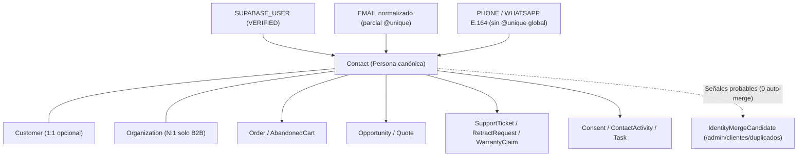
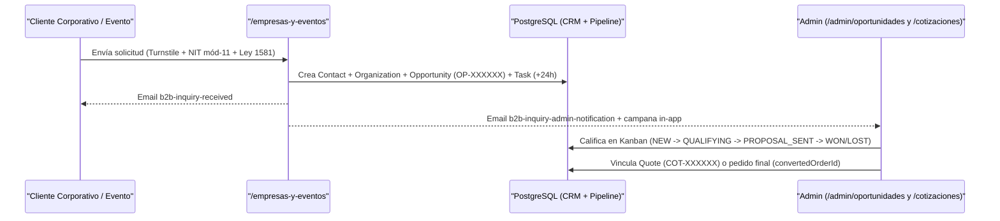

# CRM 360°, Embudo B2B y Fidelización — Lucams Shop

> **Documento vivo.** Documenta el Grafo de Identidad CRM 360°, los guardarraíles antifraude internos, la operación diaria en `/admin/hoy` y `/admin/clientes`, la analítica conductual RFM/LTV, el embudo consultivo B2B y de eventos, el cotizador con hoja de taller y los programas «Puntos Lucams» e «Invita y gana».

---

## 1. Grafo de Identidad CRM 360° (`ADR-193`)

Lucams desacopla la persona comercial y posventa (`Contact`) de la cuenta autenticada (`Customer`), permitiendo consolidar en una sola vista la historia completa de compradores invitados, clientes registrados, solicitantes B2B, cotizaciones y tickets sin forzar registro previo (`apps/web/features/identity/`).

### Resolución determinista y niveles de confianza (`features/identity/resolution-service.ts`)

- **Serialización sin condiciones de carrera**: antes de resolver o crear identidades en paralelo, `acquireIdentityLocksTx` ordena lexicográficamente las llaves candidatas y toma bloqueos transaccionales `pg_advisory_xact_lock`.
- **Reglas de unicidad adaptadas a Colombia**:
  - `SUPABASE_USER` y `EMAIL` normalizado (`trim().toLowerCase()`) están protegidos por el índice único parcial SQL `"ContactIdentity_unique_owner_key"` (`WHERE "verificationStatus" <> 'REVOKED'`).
  - `PHONE` y `WHATSAPP` se normalizan a **E.164** (`+573XXXXXXXXX` para móviles colombianos de 10 dígitos) pero **deliberadamente carecen de `@unique` global**, ya que en Colombia es habitual compartir líneas familiares/corporativas y los operadores reciclan números.
  - **Monotonía de verificación**: una identidad `VERIFIED` jamás se degrada a `UNVERIFIED_OBSERVED`. Durante el registro previo a validar el código OTP, el correo permanece en `UNVERIFIED_OBSERVED` y no puede sobrescribir el nombre de un `Contact` previo; solo al verificar el correo (`OTP`, login con contraseña o callback PKCE confirmado) pasa a `VERIFIED` y adopta retroactivamente pedidos, tickets, cotizaciones, carritos y garantías huérfanas con ese correo.
- **Aislamiento de sesión `[ID-01]` y protección de regalos**:
  - Cuando existe un `Customer` autenticado en sesión, `Order.contactId` se vincula siempre al `Contact` del titular autenticado. Si en checkout digita un correo alterno distinto (sin ser regalo), la orden conserva su contacto y se encola un `IdentityMergeCandidate` (`AUTH_BUYER_ALT_ORDER_EMAIL`).
  - Los datos del destinatario de envío o regalo (`recipientName`, `recipientPhone`, `shippingAddress`) están excluidos por diseño de la firma de `resolveOrderContactTx`: enviar un regalo a otra persona jamás contamina la ficha del comprador.

### Guardarraíles internos: `isStaff`, `selfDealing` y fusión asistida

1. **Gobierno de cuentas del equipo (`Contact.isStaff`)**:
   - El alta de personal en `/admin/usuarios` mediante `provisionStaffAdmin` (`features/admin-users/service.ts`) crea `auth.users` + `AdminUser` sin registrar un falso `Customer`, y marca `Contact.isStaff = true`. Además, `markStaffContactIfAdminTx` mantiene esa marca sincronizada de forma monotónica si el correo coincide con cualquier `AdminUser`.
   - Los contactos con `isStaff = true` quedan excluidos por defecto de `/admin/clientes` (con opción de visualización explícita e insignia «Equipo interno») y **excluidos por compuerta SQL dura** de las cohortes RFM/LTV en `/admin/metricas` y de los segmentos comerciales en `/admin/marketing/segmentos`.
2. **Detección forense de auto-gestión (`selfDealing`)**:
   - Cuando un administrador ejecuta acciones sensibles (`retract.*`, `warranty.*`, `cod.*`, `contact.merge*`), `recordAdminAction` (`apps/web/lib/admin-audit.ts`) cruza el correo del `AdminUser` actor contra el correo del contacto o pedido objetivo. Si coinciden, estampa `metadata.selfDealing = true` en `AdminActionLog` (filtrable en `/admin/auditoria`) y emite alerta estructurada en logs.
3. **Fusión asistida de duplicados con cero auto-merge (`/admin/clientes/duplicados`)**:
   - Señales probables como compartir teléfono de comprador (`SAME_BUYER_PHONE_E164`), repetir documento tributario (`SAME_BILLING_DOCUMENT`) o usar correo alterno (`AUTH_BUYER_ALT_ORDER_EMAIL`) nunca fusionan contactos en silencio: crean un `IdentityMergeCandidate` en estado `PENDING`.
   - Aprobar una fusión en `/admin/clientes/duplicados` (`features/identity/merge-service.ts`) exige capacidad `contacts:merge` (`SUPERADMIN`, `OPERATIONS_MANAGER`, `MANAGER`) y **reautenticación MFA reciente (`requireRecentMfa()`, <= 10 min)**.
   - Si ambos contactos poseen cuentas `Customer` activas, la fusión se bloquea (`BOTH_HAVE_CUSTOMER_ACCOUNTS`). Al aprobar un par válido bajo lock transaccional, se transfieren las 10 relaciones operativas al contacto sobreviviente, se revocan las identidades absorbidas, se guarda un **snapshot completo reversible** en `mergeSnapshotJson` y se registra `contact.merge` en `AdminActionLog`. Descartar un par lo marca `REJECTED` para no volver a sugerirlo.

---

## 2. Operación Diaria CRM, Inteligencia RFM/LTV y Marketing

### Bandeja operativa `/admin/hoy` (`features/crm/today-inbox-service.ts`)

Consolida la carga diaria del equipo en **5 carriles priorizados**, filtrando cada fuente según las capacidades RBAC del rol conectado y enmascarando PII si el rol carece de `orders:read_pii` / `contacts:read_pii`:

1. **`CARE_SLA` (Posventa SLA)**: retractos abiertos (reembolso máx. 15 días calendario), tickets de soporte sin primera respuesta o próximos a vencer (`<= 48 h` en días hábiles colombianos) y garantías activas.
2. **`WORKSHOP` (Taller y despacho)**: `RenderJob` fallidos en pedidos pagados, diseños pendientes de moderación y pedidos marcados con `needsReconciliation`.
3. **`FINANCE` (Finanzas y conciliación)**: pedidos contraentrega (`COD`) entregados hace más de 7 días pendientes de remesa o con discrepancia.
4. **`TASK` (Tareas CRM)**: tareas accionables (`Task`: `OPEN`, `IN_PROGRESS`, prioridades `LOW` a `URGENT`) vinculadas a contactos, pedidos, tickets, retractos, garantías u oportunidades, completables en un clic.
5. **`RECOVERY` (Recuperación comercial)**: órdenes `PENDING_PAYMENT` con rechazos en Wompi, carritos abandonados elegibles (4 h a 7 días) y recordatorios anuales de ocasión para contactos con opt-in vigente.

### Directorio y Ficha Contacto 360° (`/admin/clientes` y `/admin/clientes/[id]`)

> [!NOTE]
> En el panel administrativo las rutas canónicas del grafo son `/admin/clientes`, `/admin/clientes/[id]` y `/admin/clientes/duplicados` (no existe `/admin/contactos`). `resolveContactRouteParam` redirige transparentemente tanto desde un `Customer.id` como desde un `Contact.id` absorbido en una fusión previa hacia el contacto sobreviviente.

La ficha `/admin/clientes/[id]` (`features/identity/contact-360-service.ts`, auditada con `contact.view_360`) presenta:

- Indicadores de valor neto pagado, semáforo de riesgo COD (`CLEAN`, `WATCH`, `BLOCKED`) y estado vigente de autorizaciones Ley 1581 (`HABEAS_DATA`, `NEWSLETTER`).
- Alertas de fricción reciente (pago declinado, carrito abandonado, boceto en Estudio).
- Panel de trabajo CRM (`<CrmWorkspacePanel>`) para crear tareas `Task` y registrar bitácora omnicanal `ContactActivity` (`NOTE`, `CALL`, `WHATSAPP`, `EMAIL`, `SYSTEM`).
- Pestañas consolidadas con línea de tiempo, pedidos, carritos, cotizaciones, oportunidades B2B, casos posventa, identidades observadas/verificadas, reseñas, referidos y cupones personales.

### Inteligencia conductual RFM, LTV de Margen Neto y Embudo (`/admin/metricas`)

El panel `/admin/metricas` (`SUPERADMIN` y `FINANCE_ANALYST`, `features/crm/intelligence-service.ts`) calcula directamente en SQL sobre contactos reales (excluyendo cuentas eliminadas, anonimizadas y `isStaff`):

- **Matriz RFM de 5 segmentos** sobre pedidos pagados:
  - **Campeones (`champions`)**: `>= 3` compras y última compra `<= 90 días`.
  - **Leales (`loyal`)**: `2` compras y última compra `<= 90 días`.
  - **Nuevos prometedores (`promising_new`)**: `1` compra en los últimos `90 días`.
  - **En riesgo (`at_risk`)**: entre `91` y `180 días` desde su última compra.
  - **Inactivos (`hibernating`)**: `> 180 días` desde su última compra.
- **LTV de Margen Neto**: deduce flete, descuentos de cupón/puntos y costo unitario de catálogo (`margin_cents = Order.total - Order.shipping - SUM(OrderItem.qty * COALESCE(Product.cost, 0))`), reportando además el porcentaje de catálogo con costo configurado y la rentabilidad por canal UTM (`lucams_utm`, persistida únicamente bajo consentimiento `COOKIES_ANALYTICS`).
- **Embudo anónimo propio (`FunnelEventDaily`)**: visualiza la conversión a través de las 11 etapas de compra y personalización sin depender de cookies ni terceros (retención de 365 días).

### Segmentación comercial y exportación CSV segura (`/admin/marketing/*`)

- **`/admin/marketing/segmentos` (`features/crm/segments-service.ts`)**: ofrece 5 audiencias accionables (`vip`, `gift_buyers`, `winback_90d`, `annual_occasion`, `high_intent_no_order`). Un CTE SQL verifica el último registro de `Consent` con `scope = 'NEWSLETTER'` por correo e impone **`WHERE newsletter_opted_in = true AND "isStaff" = false`**: los contactos sin consentimiento comercial jamás exponen PII y solo se contabilizan como total agregado excluido.
- **Exportación CSV blindada (`GET /admin/marketing/segmentos/export` y `GET /admin/marketing/suscriptores/export`)**: exige capacidad `marketing:export_csv`, **MFA reciente (`requireRecentMfa()`)**, neutraliza inyección de fórmulas en hojas de cálculo anteponiendo `'` a celdas que inicien con `=`, `+`, `-`, `@`, `\t` o `\r`, y deja rastro en `AdminActionLog` (`marketing.export_segment_csv`, `newsletter.export_csv`).

---

## 3. Embudo Comercial B2B, Eventos y Cotizaciones

Lucams atiende pedidos corporativos, bodas, grados y colegios en un flujo consultivo separado del checkout de autoservicio:

### Captura consultiva en `/empresas-y-eventos` (`features/opportunities/`)

- Valida en cliente y servidor cantidad estimada (`10..100 000` unidades), fecha del evento, teléfono con indicativo hacia E.164, municipio DANE, y NIT empresarial mediante el algoritmo oficial DIAN **módulo 11** (`normalizeAndValidateNit` en `lib/colombia-validators.ts`).
- Protegido con Cloudflare Turnstile, doble rate-limit de 24 h (`5/día` por IP y `3/día` por correo) y aislamiento de sesión (`getStorefrontCustomerForForm`, que ignora sesiones administrativas o de terceros).
- En una sola transacción crea o enlaza `Contact` (`source: "B2B_INQUIRY"`), `Organization` (deduplicada por NIT), `Opportunity` con consecutivo `OP-XXXXXX` y snapshot inmutable del solicitante, autorizaciones Ley 1581, atribución UTM y una **`Task` automática con SLA comercial de 24 horas** (prioridad `URGENT` si supera 100 unidades, `HIGH` en el resto). En segundo plano despacha los correos `b2b-inquiry-received` y `b2b-inquiry-admin-notification` (ver [`../integrations/resend-and-emails.md`](../integrations/resend-and-emails.md)) y alerta en la campana del panel.

### Pipeline en `/admin/oportunidades`

- Gestiona las etapas `NEW` («Nueva»), `QUALIFYING` («En calificación»), `PROPOSAL_SENT` («Propuesta enviada»), `WON` («Ganada») y `LOST` («Perdida», con motivo obligatorio `lostReason`), clasificadas por tipo de evento (`CORPORATE_GIFT`, `WEDDING_SOCIAL`, `SCHOOL_GRADUATION`, `BRAND_MERCH`, `OTHER`).
- Permite convertir cualquier cotización en oportunidad B2B con un clic desde `/admin/cotizaciones/[id]` (`convertQuoteToOpportunityAction`, enlazando `convertedQuoteId`) y asociar el pedido cerrado por su consecutivo `LCM-YYYY-NNNN` en `convertedOrderId`.

### Cotizador (`Quote` `COT-XXXXXX`), portal `/cotizacion/[token]` y Hoja de taller

- **Generación (`features/quotes/`)**: activo cuando la tienda opera en modo catálogo (`NEXT_PUBLIC_STORE_MODE=catalog`). Reclama atómicamente el carrito, cierra `AbandonedCart` (`QUOTE_CREATED`), sella snapshots en `QuoteItem` y genera `Quote` (`COT-XXXXXX`; estados `PENDING`, `CONTACTED`, `CLOSED`, `DISCARDED`) con token público de 128 bits almacenado solo como hash SHA-256 (`publicAccessTokenHash`).
- **Portal público `/cotizacion/[token]`**: vista de confirmación de **solo lectura** (`noindex`) sin exponer notas internas ni teléfonos/correos en claro. El cliente revisa sus ítems y vistas previas personalizadas (autorizadas con `?qt=<token>`), copia el enlace o inicia conversación en WhatsApp con mensaje pre-armado.
- **Gestión y Taller en `/admin/cotizaciones`**:
  - `/admin/cotizaciones` y `/admin/cotizaciones/[id]`: bandeja filtrable, contacto directo por WhatsApp, notas internas acumulativas, cambio de estado y promoción a `Opportunity`.
  - **`/admin/cotizaciones/[id]/taller` (Hoja de taller)**: vista operativa de fabricación que calcula unidades físicas reales, pasos de armado, estado de moderación de cada diseño y enlaces firmados de descarga de los PNG 300 DPI en `production-assets`.
- **Retención automática de archivos de cotización (`retention-service.ts`)**: las filas comerciales `Quote` se conservan (salvo anonimización por Habeas Data), pero los diseños y fotografías en Storage asociados a `QuoteItem` se purgan automáticamente a los **`90 días`** tras pasar a `CLOSED` o `DISCARDED` (`PURGE_AFTER_QUOTE_CLOSED_DAYS`), y a los **`365 días`** si una cotización permanece abierta sin actividad (`PURGE_STALE_QUOTE_AFTER_DAYS`).

---

## 4. Programa de Lealtad («Puntos Lucams») y Referidos («Invita y gana»)

Ambos programas se configuran en `/admin/fidelizacion` (exclusivo `SUPERADMIN`, auditado en `AdminActionLog` e integrado con el snapshot CMS `global/comercio`).

### Puntos Lucams (`LoyaltyTxn`, `features/loyalty/`)

- **Reglas base configurables**:
  - Acumulación por defecto: **1 punto por cada `$1.000 COP`** efectivamente cobrados (`LOYALTY_EARN_COP_PER_POINT = 1000`, calculado con `Math.floor` sobre `Order.total`).
  - Redención por defecto: **100 puntos = `$1.000 COP`** (`LOYALTY_REDEEM_POINTS_PER_1000 = 100`, equivalente a `$10 COP` por punto), desde un mínimo de `100` puntos y hasta un tope del **`50 %` del subtotal de mercancía después de cupón** (`LOYALTY_REDEEM_MAX_PERCENT = 50`).
- **Prelación estricta y ciclo transaccional**:
  1. **Cupón -> Puntos (flete excluido)**: primero se descuenta el cupón sobre la mercancía; luego se calcula la redención de puntos sobre el remanente de productos. El costo de envío nunca es pagable con puntos. Por regla `[ID-01]`, solo el titular autenticado de la sesión puede redimir su propio saldo.
  2. **Reserva atómica en `PENDING_PAYMENT`**: al crear la orden, `reserveRedeemedPoints` ejecuta un decremento condicional (`WHERE "loyaltyPoints" >= points`) evitando doble gasto concurrente y escribe `LoyaltyTxn` con `reason = "REDEEM"`.
  3. **Acreditación `EARN` al pagar**: en `processPaidOrder`, `awardLoyaltyPointsForPaidOrder` acredita los puntos ganados protegiendo la idempotencia con el índice único parcial SQL `"LoyaltyTxn_orderId_reason_key"` (`ON ("orderId", "reason") WHERE "orderId" IS NOT NULL`).
- **Incentivo a compradores invitados y retrocrédito de 30 días (`ADR-175`)**:
  - En checkout (`getGuestLoyaltyIncentive`) y en `/checkout/gracias` (`<GuestPointsBanner>`), el comprador sin cuenta visualiza cuántos puntos equivale su compra y recibe invitación para registrarse.
  - **Acreditación retroactiva segura (`awardRetroactivePointsForNewCustomer`)**: únicamente **después de verificar criptográficamente el correo** (tras validar código OTP o iniciar sesión con contraseña, nunca en el formulario inicial sin verificar), el sistema busca órdenes pagadas de los últimos **`30 días`** (`RETROACTIVE_EARN_WINDOW_DAYS = 30`) con ese mismo correo exacto y acredita sus puntos de forma idempotente.
- **Reversión total y proporcional en retractos (`[FIN-01]`)**:
  - Si una orden completa pasa a `CANCELLED` o `REFUNDED` (incluida la expiración de órdenes impagas), `restoreRedeemedPoints` devuelve los puntos reservados pendientes mediante `reason = "REFUND"`.
  - En un retracto parcial por ítem (`RECEIVED -> REFUNDED`), `computeRetractRefundBreakdown` (`features/retract/service.ts`) emplea aritmética entera `BigInt` para prorratear descuentos, limitar el reembolso en efectivo a lo realmente pagado y devolver exactamente la fracción proporcional de puntos vía `restoreRedeemedPointsForRetract` (`reason = "RETRACT_REFUND:<retractId>"`), acotada contra `Order.loyaltyPointsRedeemed` para impedir sobrecréditos por redondeo.

### Programa de Referidos «Invita y gana» (`Customer.referralCode`, `Referral`, `/r/[codigo]`)

- **Enlace corto sin cookies de rastreo (`apps/web/app/r/[codigo]/route.ts`)**: cada cliente registrado recibe un código único `LCS-XXXXXXXX`. Al abrir `GET /r/[codigo]`, el servidor valida el formato y responde `307 Temporary Redirect` hacia `/registro?ref=<CODIGO>`, prellenando el código en el formulario de alta.
- **Beneficio bilateral en cupones personales (`features/referrals/service.ts`)**:
  - **Bienvenida inmediata al referido**: al completar el registro válido (`attachReferral`), se crea la fila `Referral` (`PENDING`) y un cupón personal CSPRNG `REF-XXXXXXXX` (`10 % OFF` por defecto, vigencia `90 días`, `maxUses = 1`, `isPublic = false`, `customerId = referido`), visible en `/mi-cuenta/cupones`.
  - **Premio al referente tras el primer pago**: cuando `processPaidOrder` confirma el pago del pedido del referido y verifica que es su **primera compra pagada histórica** (`paidCount === 1`), emite un cupón personal idéntico a nombre del referente (`customerId = referente`), marca `Referral.status = "REWARDED"` y envía el correo `referral-reward`.
- **Controles antifraude**:
  1. Bloqueo de auto-referido cuando el correo del nuevo registro coincide con el del referente.
  2. Unicidad por `referredEmail` (reintentos con el mismo correo no emiten múltiples cupones de bienvenida).
  3. Verificación de cliente nuevo real: si el correo referido ya tenía pedidos pagados anteriores (por ejemplo, compras previas como invitado), la referencia pasa a `EXPIRED` sin emitir premio al referente.
  4. Candado en base de datos mediante el trigger `coupon_usage_per_customer_limit` (`pg_advisory_xact_lock` sobre `CouponUsage`).

---

## Documentos Relacionados

- Carrito, cupones, checkout y saga de pago: [`./checkout-payments-shipping.md`](./checkout-payments-shipping.md)
- Retractos parciales, garantías y atención en `/admin/soporte`: [`./post-sale-and-support.md`](./post-sale-and-support.md)
- Producción 300 DPI y moderación de diseños: [`./studio-and-production.md`](./studio-and-production.md)
- Parámetros CMS v2 y plantillas de correo: [`./catalog-and-cms.md`](./catalog-and-cms.md) y [`../integrations/resend-and-emails.md`](../integrations/resend-and-emails.md)
- RBAC por capacidades, MFA TOTP `aal2` y enmascaramiento de PII: [`../SECURITY.md`](../SECURITY.md)
- Habeas Data, consentimiento Ley 1581 y supresión de cuentas: [`../COMPLIANCE.md`](../COMPLIANCE.md)
