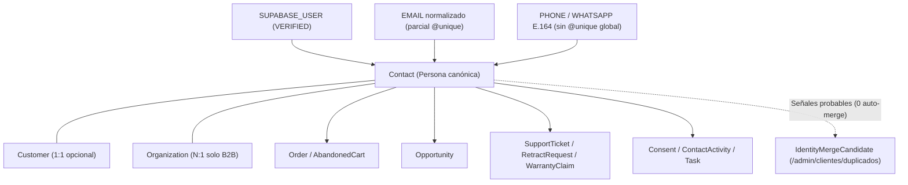
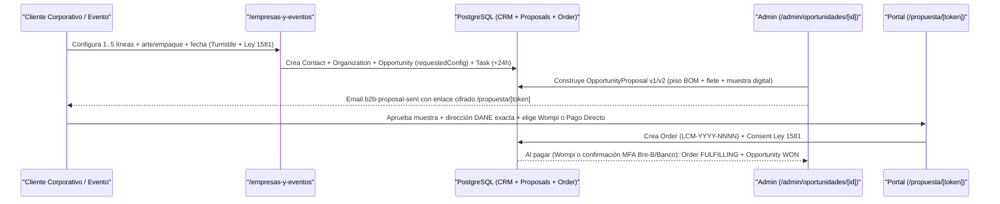

# CRM 360°, Embudo B2B y Fidelización — Lucams Shop

> **Documento vivo.** Documenta el Grafo de Identidad CRM 360°, los guardarraíles antifraude internos, la operación diaria en `/admin/hoy` y `/admin/clientes`, la analítica conductual RFM/LTV, el embudo consultivo B2B y de eventos, el cotizador con hoja de taller y los programas «Puntos Lucams» e «Invita y gana».

---

## 1. Grafo de Identidad CRM 360° (`ADR-193`)

Lucams desacopla la persona comercial y posventa (`Contact`) de la cuenta autenticada (`Customer`), permitiendo consolidar en una sola vista la historia completa de compradores invitados, clientes registrados, solicitantes B2B y tickets sin forzar registro previo (`apps/web/features/identity/`).

### Resolución determinista y niveles de confianza (`features/identity/resolution-service.ts`)

- **Serialización sin condiciones de carrera**: antes de resolver o crear identidades en paralelo, `acquireIdentityLocksTx` ordena lexicográficamente las llaves candidatas y toma bloqueos transaccionales `pg_advisory_xact_lock`.
- **Reglas de unicidad adaptadas a Colombia**:
  - `SUPABASE_USER` y `EMAIL` normalizado (`trim().toLowerCase()`) están protegidos por el índice único parcial SQL `"ContactIdentity_unique_owner_key"` (`WHERE "verificationStatus" <> 'REVOKED'`).
  - `PHONE` y `WHATSAPP` se normalizan a **E.164** (`+573XXXXXXXXX` para móviles colombianos de 10 dígitos) pero **deliberadamente carecen de `@unique` global**, ya que en Colombia es habitual compartir líneas familiares/corporativas y los operadores reciclan números.
  - **Monotonía de verificación**: una identidad `VERIFIED` jamás se degrada a `UNVERIFIED_OBSERVED`. Durante el registro previo a validar el código OTP, el correo permanece en `UNVERIFIED_OBSERVED` y no puede sobrescribir el nombre de un `Contact` previo; solo al verificar el correo (`OTP`, login con contraseña o callback PKCE confirmado) pasa a `VERIFIED` y adopta retroactivamente pedidos, tickets, oportunidades, carritos y garantías huérfanas con ese correo.
- **Aislamiento de sesión `[ID-01]` y protección de regalos**:
  - Cuando existe un `Customer` autenticado en sesión, `Order.contactId` se vincula siempre al `Contact` del titular autenticado. Si en checkout digita un correo alterno distinto (sin ser regalo), la orden conserva su contacto y se encola un `IdentityMergeCandidate` (`AUTH_BUYER_ALT_ORDER_EMAIL`).
  - Los datos del destinatario de envío o regalo (`recipientName`, `recipientPhone`, `shippingAddress`) están excluidos por diseño de la firma de `resolveOrderContactTx`: enviar un regalo a otra persona jamás contamina la ficha del comprador.

### Guardarraíles internos: `isStaff`, `selfDealing` y fusión asistida

1. **Gobierno de cuentas del equipo (`Contact.isStaff`)**:
   - El alta de personal en `/admin/usuarios` mediante `provisionStaffAdmin` (`features/admin-users/service.ts`) crea `auth.users` + `AdminUser` sin registrar un falso `Customer`, y marca `Contact.isStaff = true`. Además, `markStaffContactIfAdminTx` mantiene esa marca sincronizada de forma monotónica si el correo coincide con cualquier `AdminUser`.
   - Los contactos con `isStaff = true` quedan excluidos por defecto de `/admin/clientes` (con opción de visualización explícita e insignia «Equipo interno») y **excluidos por compuerta SQL dura** de las cohortes RFM/LTV en `/admin/metricas` y de los segmentos comerciales en `/admin/marketing/segmentos`.
2. **Detección forense de auto-gestión (`selfDealing`)**:
   - Cuando un administrador ejecuta acciones sensibles (`order.*`, `retract.*`, `warranty.*`, `support.*`, `review.*`, `cod.*`, `cart_recovery.*`, `lifecycle.*`, `contact.merge*`), `recordAdminAction` (`apps/web/lib/admin-audit.ts`) cruza el correo del `AdminUser` actor contra el correo del contacto, pedido o identidad objetivo (incluyendo `targetEmails` resueltos antes de borrar `BlockedIdentity` y ambos extremos `primaryContact` y `secondaryContact` en `IdentityMergeCandidate`). Si coinciden, estampa `metadata.selfDealing = true` en `AdminActionLog` (filtrable en `/admin/auditoria`) y emite alerta estructurada en logs.
3. **Fusión asistida de duplicados con cero auto-merge (`/admin/clientes/duplicados`)**:
   - Señales probables como compartir teléfono de comprador (`SAME_BUYER_PHONE_E164`), repetir documento tributario (`SAME_BILLING_DOCUMENT`) o usar correo alterno (`AUTH_BUYER_ALT_ORDER_EMAIL`) nunca fusionan contactos en silencio: crean un `IdentityMergeCandidate` en estado `PENDING`.
   - Aprobar una fusión en `/admin/clientes/duplicados` (`features/identity/merge-service.ts`) exige capacidad `contacts:merge` (`SUPERADMIN`, `OPERATIONS_MANAGER`, `MANAGER`) y **reautenticación MFA reciente (`requireRecentMfa()`, <= 10 min)**.
   - Si ambos contactos poseen cuentas `Customer` activas, la fusión se bloquea (`BOTH_HAVE_CUSTOMER_ACCOUNTS`). Al aprobar un par válido bajo lock transaccional, se transfieren las 10 relaciones operativas al contacto sobreviviente, se revocan las identidades absorbidas, se guarda un **snapshot completo reversible** en `mergeSnapshotJson` y se registra `contact.merge` en `AdminActionLog`. Descartar un par lo marca `REJECTED` para no volver a sugerirlo automáticamente; si el descarte fue accidental y ambos contactos siguen activos y sin anonimizar, un rol con `contacts:merge` puede devolverlo a `PENDING` mediante `reopenMergeCandidate` (auditado como `contact.merge_reopen`, manteniendo el requisito de step-up MFA al ejecutar la fusión).

---

## 2. Operación Diaria CRM, Inteligencia RFM/LTV y Marketing

### Bandeja operativa `/admin/hoy` (`features/crm/today-inbox-service.ts`)

Consolida la carga diaria del equipo en **5 carriles priorizados**, filtrando cada fuente según las capacidades RBAC del rol conectado y enmascarando PII si el rol carece de `orders:read_pii` / `contacts:read_pii`:

1. **`CARE_SLA` (Posventa SLA)**: retractos abiertos (reembolso máx. 15 días calendario), tickets de soporte sin primera respuesta o próximos a vencer (`<= 48 h` en días hábiles colombianos) y garantías activas.
2. **`WORKSHOP` (Taller y despacho)**: `RenderJob` fallidos en pedidos pagados, diseños pendientes de moderación y pedidos marcados con `needsReconciliation`.
3. **`FINANCE` (Finanzas y conciliación)**: pedidos contraentrega (`COD`) entregados hace más de 7 días pendientes de remesa o con discrepancia.
4. **`TASK` (Tareas CRM)**: tareas accionables (`Task`: `OPEN`, `IN_PROGRESS`, prioridades `LOW` a `URGENT`) vinculadas a contactos, pedidos, tickets, retractos, garantías u oportunidades, completables en un clic.
5. **`RECOVERY` (Recuperación comercial)**: órdenes `PENDING_PAYMENT` con rechazos en Wompi, carritos abandonados elegibles (4 h a 7 días) y recordatorios anuales de ocasión para contactos con opt-in vigente.

### Directorio y Ficha Contacto 360° (`/admin/clientes` y `/admin/clientes/[id]`)

> [!NOTE]
> En el panel administrativo las rutas canónicas del grafo son `/admin/clientes`, `/admin/clientes/[id]` y `/admin/clientes/duplicados` (no existe `/admin/contactos`). `resolveContactRouteParam` redirige transparentemente tanto desde un `Customer.id` como desde un `Contact.id` absorbido en una fusión previa hacia el contacto sobreviviente.

La ficha `/admin/clientes/[id]` (`features/identity/contact-360-service.ts`, auditada con `contact.view_360`) presenta:

- Indicadores de valor neto pagado, semáforo de riesgo COD (`CLEAN`, `WATCH`, `BLOCKED`) y estado vigente de autorizaciones Ley 1581 (`HABEAS_DATA`, `NEWSLETTER`).
- Alertas de fricción reciente (pago declinado, carrito abandonado, boceto en Estudio).
- Panel de trabajo CRM (`<CrmWorkspacePanel>`) para crear tareas `Task` y registrar bitácora omnicanal `ContactActivity` (`NOTE`, `CALL`, `WHATSAPP`, `EMAIL`, `SYSTEM`).
- Pestañas consolidadas con línea de tiempo, pedidos, carritos, oportunidades B2B, casos posventa, identidades observadas/verificadas, reseñas, referidos y cupones personales.

### Inteligencia conductual RFM, LTV de Margen Neto y Embudo (`/admin/metricas`)

El panel `/admin/metricas` (`SUPERADMIN` y `FINANCE_ANALYST`, `features/crm/intelligence-service.ts`) calcula directamente en SQL sobre contactos reales (excluyendo cuentas eliminadas, anonimizadas y `isStaff`):

- **Matriz RFM de 5 segmentos** sobre pedidos pagados:
  - **Campeones (`champions`)**: `>= 3` compras y última compra `<= 90 días`.
  - **Leales (`loyal`)**: `2` compras y última compra `<= 90 días`.
  - **Nuevos prometedores (`promising_new`)**: `1` compra en los últimos `90 días`.
  - **En riesgo (`at_risk`)**: entre `91` y `180 días` desde su última compra.
  - **Inactivos (`hibernating`)**: `> 180 días` desde su última compra.
- **LTV de Margen Neto (`ADR-209`)**: deduce flete, descuentos de cupón/puntos y costo unitario real por unidad comercial diseñada (`margin_cents = Order.total - Order.shipping - SUM(OrderItem.qty * OrderItem.designUnits * COALESCE(Product.cost, 0))`), reportando además el porcentaje de catálogo con costo configurado y la rentabilidad por canal UTM (`lucams_utm`, persistida únicamente bajo consentimiento `COOKIES_ANALYTICS`). Top Ventas en `/admin/metricas` consolida igualmente `SUM(OrderItem.qty * OrderItem.designUnits)`.
- **Embudo anónimo propio (`FunnelEventDaily`)**: visualiza la conversión a través de las 11 etapas de compra y personalización sin depender de cookies ni terceros (retención de 365 días).

### Segmentación comercial, boletín Ley 1581 y exportación CSV segura (`/admin/marketing/*`)

- **`/admin/marketing/segmentos` (`features/crm/segments-service.ts`)**: ofrece 5 audiencias accionables (`vip`, `gift_buyers`, `winback_90d`, `annual_occasion`, `high_intent_no_order`). Un CTE SQL verifica el último registro de `Consent` con `scope = 'NEWSLETTER'` por correo, excluye direcciones con rebote o queja en `EmailEvent` (`email.bounced`, `email.complained`) e impone **`WHERE newsletter_opted_in = true AND "isStaff" = false`**: los contactos sin consentimiento comercial vigente o suprimidos jamás exponen PII y solo se contabilizan como total agregado excluido.
- **`/admin/marketing/suscriptores` (`features/newsletter/admin-service.ts`)**: cruza la bitácora append-only `Consent` (`NEWSLETTER`) con `Contact`, `AdminUser` y `EmailEvent` para separar la **audiencia comercial activa** (opt-in vigente, no staff, sin rebotes ni quejas) de las bajas revocadas (`DE BAJA`), rebotes/quejas y cuentas internas.
- **Exportación CSV blindada (`GET /admin/marketing/segmentos/export` y `GET /admin/marketing/suscriptores/export`)**: exige capacidad `marketing:export_csv`, **MFA reciente (`requireRecentMfa()`)**, neutraliza inyección de fórmulas en hojas de cálculo anteponiendo `'` a celdas que inicien con `=`, `+`, `-`, `@`, `\t` o `\r`, y deja rastro en `AdminActionLog` (`marketing.export_segment_csv`, `newsletter.export_csv`). Por mandato Ley 1581 / Habeas Data, `GET /admin/marketing/suscriptores/export` exporta **por defecto únicamente suscriptores comerciales activos** (excluyendo `DE BAJA`, rebotes/quejas y staff); el libro probatorio completo (`?scope=audit_ledger`, con estado de autorización, rebotes y marca `es_staff` para requerimientos SIC) está restringido exclusivamente a `SUPERADMIN` (`403` para cualquier otro rol).

---

## 3. Embudo Comercial B2B y Eventos (`ADR-210`)

Lucams atiende pedidos corporativos, bodas, grados y colegios en un flujo consultivo integrado de punta a punta con el ecosistema transaccional. La cotización individual por WhatsApp fue retirada (`ADR-204`): las compras individuales usan checkout, envío, pago y pedido; los proyectos corporativos y eventos usan el configurador `/empresas-y-eventos` → propuesta formal `/propuesta/[token]` → `Order` real.

### Configurador público multicategoría en `/empresas-y-eventos` (`features/opportunities/`)

- Permite configurar **`1..5` líneas reales del catálogo** (filtrando soporte con/sin imán y convirtiendo packs a piezas físicas reales mediante `piecesPerCommercialUnit`, exigiendo un mínimo consolidado de **`>= 25` piezas físicas**) o activar **modo asesoría abierta** (`ADVISORY_OPEN`). Calcula en tiempo real un **rango orientativo no vinculante** a partir de `WholesaleTier` sin exponer jamás `Product.cost` al navegador, un **semáforo colombiano de días hábiles** (`colombian-sla.ts`) contra `eventDate`, y captura estructurada de modalidad de arte (`SAME_DESIGN`, `ASSORTED_BATCH`, `INDIVIDUAL_NOMINAL`, `CREATIVE_ASSISTANCE`) y empaque (`BULK_STANDARD`, `INDIVIDUAL_FAVOR`, `SPECIAL_KIT`), persistidos en `Opportunity.requestedConfig`. Prellena `?unidades=` y `?producto=` desde la vista previa del Estudio o `/carrito`, y valida NIT empresarial por **módulo 11** (`normalizeAndValidateNit`).
- Protegido con Cloudflare Turnstile, doble rate-limit de 24 h (`5/día` por IP y `3/día` por correo) y aislamiento de sesión (`getStorefrontCustomerForForm`, que ignora sesiones administrativas o de terceros).
- En una sola transacción crea o enlaza `Contact` (`source: "B2B_INQUIRY"`), `Organization` (deduplicada por NIT), `Opportunity` con consecutivo `OP-XXXXXX` y snapshot inmutable del solicitante, autorizaciones Ley 1581, atribución UTM y una **`Task` automática con SLA comercial de 24 horas** (prioridad `URGENT` si supera 100 unidades, `HIGH` en el resto). En segundo plano despacha los correos `b2b-inquiry-received` y `b2b-inquiry-admin-notification` (ver [`../integrations/resend-and-emails.md`](../integrations/resend-and-emails.md)) y alerta en la campana del panel con tipo `ORDER` y enlace a la oportunidad.

### Pipeline y Constructor de Propuestas en `/admin/oportunidades` (`proposals-service.ts`, `proposal-conversion-service.ts`)

- Gestiona de forma paginada las etapas `NEW` («Nueva solicitud»), `QUALIFYING` («En calificación»), `PROPOSAL_SENT` («Propuesta enviada»), `WON` («Ganada») y `LOST` («Perdida», con motivo obligatorio `lostReason`), clasificadas por tipo de evento (`CORPORATE_GIFT`, `WEDDING_SOCIAL`, `SCHOOL_GRADUATION`, `BRAND_MERCH`, `OTHER`), con alertas de urgencia e integración en `/admin/hoy` (carril `RECOVERY` para propuestas próximas a vencer en `<= 48 h` y carril `FINANCE` para pagos directos reportados).
- **Constructor de Propuestas B2B (`opportunities:propose` — `SUPERADMIN`, `OPERATIONS_MANAGER`, `MANAGER`):** permite armar versiones `PROP-OPXXXXXX-V1`, `V2`… prellenadas desde `requestedConfig`, verificando en vivo margen y **piso de costo BOM (`unitPriceCents >= Product.cost`, salvo override explícito de `SUPERADMIN`)**, cotizando envío en vivo (`QUOTED` Aveonline/`lucams` o `PACTED_MANUAL` con número de cajas `packageCount`), adjuntando muestra digital privada en `design-previews/b2b-proofs/` (`BEFORE_PAYMENT` o `AFTER_PAYMENT`, servida por `/api/b2b-proof/[proposalId]`) y emitiendo un enlace con token CSPRNG de 256 bits (`tokenHash` SHA-256) que marca versiones previas como `SUPERSEDED`. `CUSTOMER_SUPPORT` mantiene `opportunities:manage` para calificar sin ver costos BOM ni emitir precios.
- **Portal privado `/propuesta/[token]` y cierre en `Order`:** vista ejecutiva imprimible (`noindex`, `Cache-Control: private, no-store`) donde el cliente aprueba la muestra digital, completa la dirección DANE exacta (fijada al departamento/municipio cotizado) y elige entre **Wompi en línea** o **Pago Directo (`DIRECT_TRANSFER`: llave Bre-B / transferencia bancaria)** si la propuesta habilitó `allowDirectTransfer`. Al convertirse nace un `Order` real (`LCM-YYYY-NNNN`) con `paymentExpiresAt = proposal.validUntil`, sin `COD`, sin cupones y sin otorgar Puntos Lucams ni comisiones de referidos; al confirmarse el pago (automático en Wompi o mediante `confirmDirectTransferByAdmin` exclusivo de `SUPERADMIN` + MFA reciente), `processPaidOrder` pasa automáticamente la `Opportunity` a `WON`, cierra sus tareas abiertas y finaliza inscripciones activas de `B2B_FOLLOW_UP`.

---

## 4. Programa de Lealtad («Puntos Lucams») y Referidos («Invita y gana»)

Ambos programas se gobiernan en `/admin/fidelizacion`: la mutación de parámetros es exclusiva de `SUPERADMIN` con **step-up MFA reciente (`requireRecentMfa()`, `≤ 10 min`)**, auditada en `AdminActionLog` e integrada con el snapshot CMS `global/comercio`; `FINANCE_ANALYST` audita el pasivo equivalente vigente, el pulso de emisión/canje de 14 días y el embudo de referidos en modo solo lectura con PII enmascarada en servidor.

### Puntos Lucams (`LoyaltyTxn`, `features/loyalty/`)

- **Reglas base configurables**:
  - Acumulación por defecto: **1 punto por cada `$1.000 COP`** efectivamente cobrados (`LOYALTY_EARN_COP_PER_POINT = 1000`, calculado con `Math.floor` sobre `Order.total`).
  - Redención por defecto: **100 puntos = `$1.000 COP`** (`LOYALTY_REDEEM_POINTS_PER_1000 = 100`, equivalente a `$10 COP` por punto), desde un mínimo de `100` puntos y hasta un tope del **`50 %` del subtotal de mercancía después de cupón** (`LOYALTY_REDEEM_MAX_PERCENT = 50`).
  - **Candado anti-abuso del `25 %` (`saveLoyaltySettingsAction`)**: el servidor rechaza cualquier combinación de tasas donde el retorno efectivo supere el `25 %` (`earnCopPerPoint * redeemPointsPer1000 < 4_000`), acompañado de un simulador económico en vivo en `/admin/fidelizacion`.
- **Prelación estricta y ciclo transaccional**:
  1. **Cupón -> Puntos (flete excluido)**: primero se descuenta el cupón sobre la mercancía; luego se calcula la redención de puntos sobre el remanente de productos. El costo de envío nunca es pagable con puntos. Por regla `[ID-01]`, solo el titular autenticado de la sesión puede redimir su propio saldo.
  2. **Reserva atómica en `PENDING_PAYMENT`**: al crear la orden, `reserveRedeemedPoints` ejecuta un decremento condicional (`WHERE "loyaltyPoints" >= points`) evitando doble gasto concurrente y escribe `LoyaltyTxn` con `reason = "REDEEM"`.
  3. **Acreditación `EARN` al pagar**: en `processPaidOrder`, `awardLoyaltyPointsForPaidOrder` acredita los puntos ganados protegiendo la idempotencia con el índice único parcial SQL `"LoyaltyTxn_orderId_reason_key"` (`ON ("orderId", "reason") WHERE "orderId" IS NOT NULL`).
- **Incentivo a compradores invitados y retrocrédito de 30 días (`ADR-175`)**:
  - En checkout (`getGuestLoyaltyIncentive`) y en `/checkout/gracias` (`<GuestPointsBanner>`), el comprador sin cuenta visualiza cuántos puntos equivale su compra y recibe invitación para registrarse.
  - **Acreditación retroactiva segura (`awardRetroactivePointsForNewCustomer`)**: únicamente **después de verificar criptográficamente el correo** (tras validar código OTP o iniciar sesión con contraseña, nunca en el formulario inicial sin verificar), el sistema busca órdenes pagadas de los últimos **`30 días`** (`RETROACTIVE_EARN_WINDOW_DAYS = 30`) con ese mismo correo exacto y acredita sus puntos de forma idempotente.
- **Reversión total y proporcional en retractos (`[FIN-01]`)**:
  - Si una orden completa pasa a `CANCELLED` o `REFUNDED` (incluida la expiración de órdenes impagas), `restoreRedeemedPoints` devuelve los puntos reservados pendientes mediante `reason = "REFUND"`.
  - En un retracto parcial por ítem (`RECEIVED -> REFUNDED`), `computeRetractRefundBreakdown` (`features/retract/service.ts`) emplea aritmética entera `BigInt` para prorratear descuentos, limitar el reembolso en efectivo a lo realmente pagado y devolver exactamente la fracción proporcional de puntos vía `restoreRedeemedPointsForRetract` (`reason = "RETRACT_REFUND:<retractId>"`), acotada contra `Order.loyaltyPointsRedeemed` para impedir sobrecréditos por redondeo.

### Programa de Referidos «Invita y gana» (`Customer.referralCode`, `Referral`, `/r/[codigo]`)

- **Enlace corto sin cookies de rastreo (`apps/web/app/r/[codigo]/route.ts`)**: cada cliente registrado recibe un código único `LCS-XXXXXXXX`. Al abrir `GET /r/[codigo]`, el servidor valida el formato y responde `307 Temporary Redirect` hacia `/registro?ref=<CODIGO>`, prellenando el código en el formulario de alta.
- **Beneficio bilateral en cupones personales (`features/referrals/service.ts`)**:
  - **Bienvenida inmediata al referido**: al completar el registro válido (`attachReferral`), se crea la fila `Referral` (`PENDING`) y un cupón personal CSPRNG `REF-XXXXXXXX` (`10 % OFF` por defecto, vigencia `90 días`, `maxUses = 1`, `isPublic = false`, `customerId = referido`), visible en `/mi-cuenta/cupones`.
  - **Premio al referente tras el primer pago**: cuando `processPaidOrder` confirma el pago del pedido del referido y verifica que es su **primera compra pagada histórica** (`paidCount === 1`), emite un cupón personal idéntico a nombre del referente (`customerId = referente`), marca `Referral.status = "REWARDED"` y envía el correo `referral-reward`.
- **Controles antifraude**:
  1. Bloqueo de auto-referido cuando el correo del nuevo registro coincide con el del referente.
  2. Unicidad por `referredEmail` (reintentos con el mismo correo no emiten múltiples cupones de bienvenida).
  3. Verificación de cliente nuevo real: si el correo referido ya tenía pedidos pagados anteriores (por ejemplo, compras previas como invitado), la referencia pasa a `EXPIRED` sin emitir premio al referente.
  4. Candado en base de datos mediante el trigger `coupon_usage_per_customer_limit` (`pg_advisory_xact_lock` sobre `CouponUsage`).
  5. **Intransferibilidad estricta en checkout (`NOT_OWNER` en `features/coupons/redemption.ts`)**: todo cupón con `customerId != null` solo es canjeable por la sesión autenticada de su titular o en checkout invitado con el correo exacto del titular activo, y permanece bloqueado para exposición pública (`customerId: null` en `listPublicCoupons`).

---

## 5. Lifecycle Journeys (`ADR-198`)

`/admin/lifecycle` automatiza el acompañamiento por comportamiento sobre el grafo `Contact`; no es una secuencia fija de correos ni sustituye la recuperación de carritos, las reseñas o la mensajería transaccional de pedidos. La creación (`/admin/lifecycle/nuevo`) y toda mutación son exclusivas de `lifecycle:manage` (`SUPERADMIN`, `OPERATIONS_MANAGER` y `MANAGER`) con MFA `aal2` —activar, probar (`sendLifecycleTestAction`, limitada a `12/hora` por actor) y reintentar exige verificación TOTP reciente y deja `AdminActionLog`—; `FINANCE_ANALYST` accede en **modo analítico de solo lectura cero-PII** (`ADMIN_ROLE_SETS.LIFECYCLE_READ` en `/admin/lifecycle`, `/admin/lifecycle/[id]` y el preview sintético `/admin/lifecycle/[id]/preview`) con correos y nombres enmascarados en servidor.

### Modelo, disparadores y reglas

- `LifecycleJourney` define disparador, versión, estado (`DRAFT`, `ACTIVE`, `PAUSED`, `ARCHIVED`), necesidad de opt-in, ventana máxima de entrada, inactividad mínima, cooldown, límite diario y silencio en hora Colombia. Solo `ACTIVE` inscribe y ejecuta. El panel también tiene un **interruptor general** y un límite diario **global por contacto**, además del tope individual de cada recorrido; ambos se reservan transaccionalmente para que workers concurrentes no los superen.
- `LifecycleJourneyStep` ordena hasta 12 pasos consecutivos con espera acumulativa, condición, asunto, titular, preheader, cuerpo escapado, CTA interno y clasificación comercial/transaccional. Los pasos con historial o en uso por una inscripción activa no se pueden eliminar. El detalle permite previsualizar cada paso en sandbox CSP y elegir cuál probar.
- `LifecycleEnrollment` conserva ciclo, paso actual, próxima ejecución, pedido u oportunidad que originó la entrada, contexto del producto y motivo de salida. La clave `(journeyId, contactId, cycle)` y los bloqueos de inscripción impiden duplicados. Finalizar manualmente impide la recreación; solo una pausa `ADMIN_PAUSED` admite reanudación, nunca una baja o supresión. Cuando hay producto contextual, los CTA `/productos` y `/recomendador` de activación, recompra, reactivación y alta intención llevan a su PDP, cuyo strip existente presenta relacionados por ocasión y categoría.
- `LifecycleMessage` conserva la instantánea de contenido, overrides, nombre del destinatario, clasificación comercial y ruta contextual, deduplicación por `(enrollmentId, stepId, cycle)`, estado, token público solo como hash, `resendId`, clic y conversión. El token HMAC es opaco y estable durante los reintentos; `/j/[token]` solo permite una ruta interna segura. `EmailEvent` aporta entregas, rebotes, quejas y diferidos reales a las métricas por recorrido.

| Disparador        | Entrada y salida principales                                                                                                                                                                    |
| ----------------- | ----------------------------------------------------------------------------------------------------------------------------------------------------------------------------------------------- |
| `FIRST_PURCHASE`  | Registro, contacto, aceptación de consentimiento o diseño reciente sin compra pagada histórica (incluidos reembolsos); sale al comprar o delega un carrito vigente a la recuperación existente. |
| `SECOND_PURCHASE` | Exige exactamente una compra pagada histórica y una entrega dentro de la ventana. Una segunda orden distinta de la que originó el ciclo lo cierra.                                              |
| `REACTIVATION`    | Última compra dentro de la ventana de entrada pero anterior al corte de `inactivityDays`, sin compras posteriores; una nueva compra cierra el ciclo.                                            |
| `HIGH_INTENT`     | Diseño, carrito reciente, favorito, alerta con stock u oportunidad B2B abierta sin primera compra; personaliza el producto y delega carrito/reposición a sus flujos.                            |
| `B2B_FOLLOW_UP`   | Oportunidad abierta dentro de la ventana de entrada e inactiva al menos un día, incluso sin correo; crea una tarea CRM idempotente con bitácora y sale al ganarla, perderla o cerrarla.         |

Cada paso puede exigir `NO_PAID_ORDER`, `HAS_ABANDONED_CART`, `HAS_LOYALTY_POINTS`, `HAS_DESIGN_ACTIVITY`, `HAS_OPT_IN`, `ORDER_DELIVERED` o `NO_ORDER_SINCE_ENROLLMENT`. Si no se cumple, se omite sin enviar y se avanza. La audiencia se filtra en PostgreSQL por comportamiento, inscripciones vigentes, cooldown y aceptación `NEWSLETTER` de la versión vigente sin revocación posterior. Un carrito se considera reciente durante siete días calculados de nuevo en cada ciclo, nunca congelados al arrancar el proceso. Contactos eliminados, anonimizados o internos quedan fuera y sus inscripciones activas se cierran. Al fusionar contactos se conserva una sola inscripción activa y todo el historial se transfiere al sobreviviente, reasignando ciclos si hay colisiones.

El cron `/api/cron/lifecycle` (`lucams-lifecycle`, cada 15 minutos) usa `x-cron-secret`, captura errores y registra latido `cron:lifecycle`. Un ciclo con errores responde fallo; un circuito abierto de Resend detiene el lote sin consumir intentos. El envío reclama el mensaje y el cupo diario antes de llamar a Resend, conserva contenido, destinatario, clasificación, ruta y token en reintentos, espera 30 minutos ante fallos y pausa tras cinco intentos. Baja, rebote y queja cancelan pendientes y cierran inscripciones de inmediato; la comprobación previa a cada envío falla cerrada si la base de datos no puede confirmar supresión. `VERCEL_ENV=preview` o `LIFECYCLE_DRY_RUN=1` registra `DRY_RUN` sin llamar a Resend ni crear tareas operativas.

La atribución usa **último clic anterior a la orden en una ventana de 30 días** y la primera orden creada después de ese clic que ya esté pagada. Un clic posterior a una orden no la roba a otro mensaje anterior. `LifecycleMessage.convertedOrderId` tiene índice único: una orden solo genera una conversión y su importe una sola vez. Las semillas crean cinco recorridos siempre en `DRAFT`; solo reconcilian pasos de carrito heredados y la espera B2B en versión 1 sin historial, sin activar ni sobrescribir personalizaciones.

---

## Documentos Relacionados

- Carrito, cupones, checkout y saga de pago: [`./checkout-payments-shipping.md`](./checkout-payments-shipping.md)
- Retractos parciales, garantías y atención en `/admin/soporte`: [`./post-sale-and-support.md`](./post-sale-and-support.md)
- Producción 300 DPI y moderación de diseños: [`./studio-and-production.md`](./studio-and-production.md)
- Parámetros CMS v2 y plantillas de correo: [`./catalog-and-cms.md`](./catalog-and-cms.md) y [`../integrations/resend-and-emails.md`](../integrations/resend-and-emails.md)
- RBAC por capacidades, MFA TOTP `aal2` y enmascaramiento de PII: [`../SECURITY.md`](../SECURITY.md)
- Habeas Data, consentimiento Ley 1581 y supresión de cuentas: [`../COMPLIANCE.md`](../COMPLIANCE.md)
