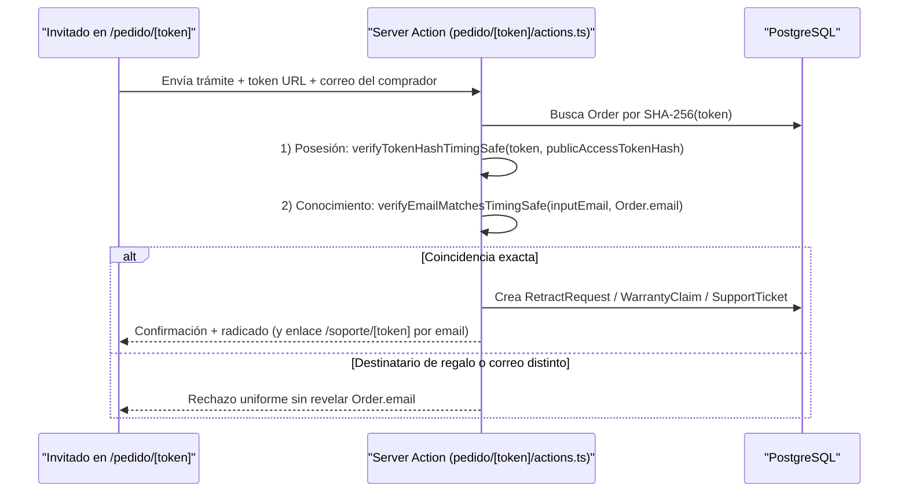
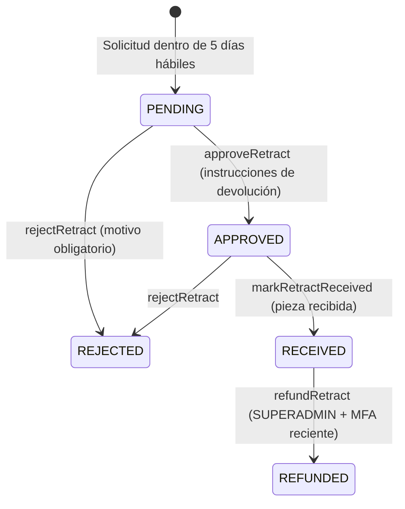

# Posventa, Retractos, Garantías, Soporte y Reseñas — Lucams Shop

> **Documento vivo.** Describe el portal de seguimiento por token opaco, la autenticación de doble factor para compras de invitados, el cumplimiento operativo del derecho de retracto y las garantías modulares bajo el Estatuto del Consumidor colombiano, la mesa de ayuda PQR con SLAs hábiles y Copiloto IA cero-PII, y el ciclo de reseñas verificadas post-entrega.

---

## 1. Seguimiento Posventa sin Fricción (`/pedido/[token]` y `/rastrear`)

Los compradores invitados y registrados cuentan con acceso directo al estado de su compra sin obligación de crear contraseña:

- **Token opaco de alta entropía (`features/orders/public-token.ts`)**: al crear el pedido se genera un secreto aleatorio de 128 bits (`32` caracteres hexadecimales con `crypto.randomBytes(16)`). En PostgreSQL se almacena **únicamente su hash SHA-256** (`Order.publicAccessTokenHash`), nunca el valor en claro.
- **Recuperación segura desde `/rastrear`**: si el comprador extravía su correo, `/rastrear` valida número de orden (`LCM-YYYY-NNNN`) + correo electrónico bajo límite de tasa (`10 intentos/h/IP`) con mensajes uniformes anti-enumeración; al coincidir, rota el secreto (`rotateOrderPublicAccessToken`, invalidando enlaces previos) y redirige al nuevo `/pedido/[token]`.
- **Experiencia en vivo en `/pedido/[token]` (`app/pedido/[token]/page.tsx`)**:
  - Exporta `robots: noindex, nofollow`, enmascara el correo (`maskEmail`) y pliega la dirección exacta para proteger la privacidad si el enlace se reenvía.
  - **Progreso de la orden y bitácora de transportadora**: presenta los 4 hitos principales derivados de `Order.status` (`PAID`, `FULFILLING`, `SHIPPED`, `DELIVERED`) seguidos por la línea de tiempo detallada **«Movimientos de la guía»** alimentada por `ShipmentEvent` (`features/shipping/shipment-events.ts`). _(Las transiciones administrativas internas con autor se auditan en `OrderStatusEvent`, visible en `/admin/pedidos/[number]`)._
  - **Ingesta dual resiliente de `ShipmentEvent`**: combina el webhook de Aveonline (`source: "WEBHOOK"`) con el cron de respaldo `GET /api/cron/tracking-sync` cada 15 minutos (`source: "POLL"`, lotes de hasta 25 órdenes activas), deduplicados mediante `ShipmentEvent.dedupKey`, anclando el hito inicial «Guía generada» a `Order.shipmentClaimedAt` y traduciendo los códigos operativos del operador a lenguaje claro (`friendlyCarrierEventLabel`). Consulta el detalle logístico en [`../integrations/aveonline.md`](../integrations/aveonline.md).
  - **Banners ámbar proactivos ante novedad o devolución**: cuando la transportadora reporta novedad o devolución, la orden no cambia de estado a ciegas; marca `Order.needsReconciliation = true` y `/pedido/[token]` despliega un aviso ámbar destacado con acceso inmediato a WhatsApp contextualizado.
  - **Enlaces verificados y vistas previas**: ofrece botones directos al portal oficial verificado de la transportadora (`carrierTrackingPageUrl`, omitiendo operadores sin portal confiable) y al PDF externo de la guía (`Order.trackingUrl`), además del visor paginado `<DesignPreviewDialog>` autorizado con `?ot=<token>` y control de recompra.

---

## 2. Autenticación Posventa de Doble Factor para Invitados (`GuestOrderSupportCard`)

Permitir radicar reembolsos o reclamos únicamente con poseer el enlace `/pedido/[token]` sería inseguro, especialmente en **pedidos de regalo (`Order.isGift = true`)** donde el comprador comparte el enlace de seguimiento con el homenajeado. Por ello, `<GuestOrderSupportCard>` (`apps/web/components/orders/guest-order-support.tsx` y `app/pedido/[token]/actions.ts`) aplica verificación en dos factores antes de cualquier mutación posventa:

- **Posesión + Conocimiento en tiempo constante (`lib/token-hash.ts`)**: comprueba primero el token de la URL con `verifyTokenHashTimingSafe` y luego exige ingresar el **correo electrónico original del comprador (`Order.email`)**, comparado sobre resúmenes SHA-256 de longitud fija con `crypto.timingSafeEqual` (`verifyEmailMatchesTimingSafe`).
- **Blindaje de regalos y del grafo CRM**: como `Order.email` se muestra enmascarado en la página y pertenece exclusivamente a quien pagó, el destinatario de un regalo puede consultar el rastreo pero no puede solicitar retractos ni desviar reembolsos. Asimismo, al abrir un ticket desde un pedido marcado como regalo o con destinatario distinto, se impide que el nombre de envío sobrescriba el nombre del comprador en `Contact`.
- **Trámites autoservicio habilitados sin cuenta**: solicitud de retracto por ítem (`DELIVERED`), reclamo de garantía legal por ítem (`DELIVERED`), radicación de ticket PQR formal (`MI_PEDIDO`, `ENVIO_RASTREO`, `GARANTIA_DEVOLUCION`, `PAGO_FACTURACION`) y contacto directo por WhatsApp en cualquier estado no cancelado.

---

## 3. Derecho de Retracto — Ley 1480 art. 47 y Ley 2439 de 2024 (`RetractRequest`)

El módulo `apps/web/features/retract/` materializa las reglas del Estatuto del Consumidor colombiano (ver [`../COMPLIANCE.md`](../COMPLIANCE.md)):

- **Ventana de solicitud (`{{retracto_dias}} = 5` días hábiles)**: contados desde la entrega efectiva (`Order.deliveredAt`) en zona horaria `America/Bogota` (`RETRACT_WINDOW_BUSINESS_DAYS = 5` en `lib/consumer-law.ts`).
- **Exclusión automática de personalizados y soporte de pedidos mixtos**:
  - La relación `RetractRequest` es **1:1 por `OrderItem`** (`orderItemId @unique`), no global a toda la orden.
  - `isItemPersonalized(item)` excluye automáticamente los ítems confeccionados conforme a las especificaciones del consumidor en el Estudio (`designId != null` o `customDesign != null`, conforme al art. 47 num. 3 de la Ley 1480), pero **habilita el retracto individual sobre los ítems estándar o `PREMADE` que compartan el mismo pedido**.
- **Máquina de estados y plazo legal de reembolso (`{{retracto_reembolso_dias}} = 15` días calendario)**:

- Al crearse la solicitud se estampa `slaDueAt` a **`15 días calendario`** (`RETRACT_REFUND_MAX_CALENDAR_DAYS = 15`, Ley 2439 de 2024), monitoreado en el carril `CARE_SLA` de `/admin/hoy`.
- **Liquidación exacta en centavos y reversión proporcional de puntos (`[FIN-01]`)**:
  - `computeRetractRefundBreakdown` usa aritmética entera `BigInt` para prorratear los descuentos de mercancía (cupones de importe/porcentaje y `loyaltyDiscount`), garantizando que la suma de reembolsos parciales jamás supere el efectivo neto cobrado.
  - Al confirmar `RECEIVED -> REFUNDED`, `restoreRedeemedPointsForRetract` acredita al cliente la porción exacta de Puntos Lucams redimidos en esa línea (`LoyaltyTxn` con `reason = "RETRACT_REFUND:<retractId>"`).
- **Gobierno RBAC y MFA en `/admin/retractos`**: los roles de `SUPPORT_CARE` (`SUPERADMIN`, `OPERATIONS_MANAGER`, `MANAGER`, `CUSTOMER_SUPPORT`) aprueban, rechazan y marcan recepción física; la transición final a `REFUNDED` (`WOMPI_VOID` o `BANK_TRANSFER`) está restringida exclusivamente a **`SUPERADMIN` con reautenticación MFA TOTP reciente (`requireRecentMfa()`)** y control `selfDealing`.

---

## 4. Garantías Legales Modulares — Ley 1480 arts. 7–16 (`WarrantyClaim`)

A diferencia del retracto, la garantía legal protege al comprador frente a defectos de calidad, idoneidad, magnetismo o impresión (`apps/web/features/warranty/`):

- **Snapshot inmutable `OrderItem.warrantyMonths` (`1..120` meses, `ADR-106`)**: cada producto define su término de garantía (base `{{garantia_base}}` = `1 mes`, ajustable en `/admin/productos` entre `1` y `120` meses con restricción SQL `CHECK`). Al comprar, el valor queda sellado en `OrderItem.warrantyMonths` para que ajustes posteriores en el catálogo jamás reduzcan derechos adquiridos.
- **Plena cobertura en productos personalizados e historial múltiple**:
  - **Aplica también a ítems personalizados del Estudio**: un fotoimán, calendario o separador con falla de fabricación o laminado tiene garantía legal completa. Si el cliente aprobó expresamente en el Estudio una advertencia de baja resolución fotográfica, `Design.qualityAcknowledgedAt` obra como constancia de información previa (Ley 1480 art. 16).
  - Un mismo `OrderItem` puede registrar más de un reclamo a lo largo de su vigencia; el servicio solo bloquea radicar uno nuevo mientras exista otro activo (`PENDING`, `IN_REVIEW` o `APPROVED`).
- **Ciclo de resolución, art. 9 y art. 11**:
  - Estados de `WarrantyStatus`: `PENDING` -> `IN_REVIEW` -> `APPROVED` -> `RESOLVED` (o `REJECTED`). Al radicarse se calcula `slaDueAt` a **`15 días hábiles colombianos`** (`{{garantia_respuesta_dias}}`, Ley 1480 art. 58).
  - La conversión administrativa desde `/admin/soporte/[id]` (`createWarrantyClaimAsAdmin`) permite abrir casos sin el bloqueo rígido de calendario automático para atender escenarios de suspensión durante reparación o reinicio por reposición (Ley 1480 art. 9).
  - Soporta los tres remedios legales del art. 11 en `WarrantyClaim.resolutionType`: `REPAIR`, `REPLACE` y `REFUND`.
  - **Evidencia fotográfica (`evidenceUrls`)**: el modelo `WarrantyClaim` y la vista `/admin/garantias` almacenan y enlazan hasta 5 URLs de evidencia; en el flujo público actual el formulario captura la descripción detallada del fallo (`10..2000` caracteres) y las fotografías de soporte se reciben por correo o respuesta al hilo / WhatsApp conforme a la política de garantías publicada.
- **Doble candado financiero en `/admin/garantias`**: cuando el remedio seleccionado es `REFUND`, tanto la aprobación como el cierre exigen la capacidad `warranty:refund` (bloqueando a `CUSTOMER_SUPPORT`) **más MFA reciente (`requireRecentMfa()`)**, registrando auditoría con detección `selfDealing`.

---

## 5. Sistema de Soporte, PQR y Copiloto IA (`SupportTicket`, `SupportTicketMessage`)

### Canales omnicanal y acceso bidireccional

1. **Enrutador `/soporte`**: redirige automáticamente a clientes autenticados hacia `/mi-cuenta/soporte` y a visitantes o personal interno hacia `/contacto`.
2. **Formulario público `/contacto` (`submitContactAction`)**: protegido con Cloudflare Turnstile, límite `5 req/h/IP` y registro de consentimiento Ley 1581; vincula el `Contact` 360°, emite token CSPRNG de 256 bits (`64` hex chars guardado como SHA-256 en `SupportTicket.publicAccessTokenHash`) y entrega el enlace privado `/soporte/[token]`.
3. **Portal de hilo para invitados `/soporte/[token]`**: con `noindex` y `referrer: no-referrer`, verifica el token en tiempo constante, oculta notas internas y permite al invitado responder en cualquier momento (reabriendo automáticamente el ticket a `OPEN` si estaba `CLOSED`).
4. **Centro autenticado `/mi-cuenta/soporte` y tarjeta en `/pedido/[token]`**: consolidan los hilos del comprador autenticado o validado con doble factor.

### Radicado Ley 2439, SLAs en días hábiles colombianos y operación en `/admin/soporte`

- **Radicado trazable**: cada solicitud entrega al instante su código único `#<primeros 8 chars en mayúscula>` acompañado de la fecha y hora exacta en huso `America/Bogota`, tanto en interfaz como en el correo `support-ticket-received`.
- **Conversión a caso legal especializado (`convertTicketToCase`)**: en `/admin/soporte/[id]`, un ticket con asunto `GARANTIA_DEVOLUCION` y pedido asociado puede transformarse con un clic en un `WarrantyClaim` o `RetractRequest` formal (`linkedCaseType` + `linkedCaseId`), dejando nota interna automática de trazabilidad.
- **Motor de calendario hábil colombiano (`apps/web/lib/colombian-sla.ts`)**: `computeSupportTicketSlaDueAt` calcula la fecha máxima legal descontando sábados, domingos y **todos los festivos oficiales de Colombia** (fijos, trasladados por Ley Emiliani y móviles de Semana Santa):
  - Consultas de Habeas Data (`DATOS_PERSONALES` / `HABEAS_DATA_CONSULTA`): **`10 días hábiles`** (`{{habeas_consulta_dias}}`, Ley 1581 art. 14).
  - Reclamos de Habeas Data y PQR de consumo: **`15 días hábiles`** (`{{habeas_reclamo_dias}}` / `{{garantia_respuesta_dias}}`, Ley 1581 art. 15 y Ley 1480 art. 58).
  - La primera respuesta pública de un agente sella `firstRespondedAt`.
- **Control de concurrencia entre agentes y notas internas**:
  - Los formularios de cambio de estado y de gobierno/asignación en `/admin/soporte/[id]` envían `expectedUpdatedAt` y ejecutan `updateMany` condicional sobre `SupportTicket.updatedAt`; si otro agente respondió o reasignó el caso segundos antes, se lanza `SupportConcurrencyError` exigiendo recargar antes de sobrescribir. Las respuestas se agregan de forma transaccional en `SupportTicketMessage` actualizando `updatedAt` (y auto-asignando responsable solo si estaba vacante).
  - Marcar «Nota interna» (`isInternal = true`) guarda comentarios privados del equipo que nunca salen por correo, nunca se exponen en `/soporte/[token]` ni `/mi-cuenta/soporte`, y no alteran `firstRespondedAt`.
- **Copiloto ARM humano-en-el-bucle cero-PII (`apps/web/features/ai/support-copilot.ts`)**:
  - En `/admin/soporte/[id]`, el agente puede solicitar un borrador asistido (`25 req/h` por admin). Antes de salir hacia Google Gemini, `sanitizeSupportTextForAi` **redacta toda PII** (correos, teléfonos, direcciones físicas colombianas, URLs, documentos/guías numéricas, consecutivos de orden y nombres propios del cliente) y excluye notas internas, enviando únicamente contexto operativo anónimo y plazos legales aplicables.
  - Al recibir la sugerencia (o la plantilla inteligente de respaldo si el proveedor externo no responde en `10 s`), el servidor reinyecta localmente el número de pedido y el saludo, precargando el borrador en el área de texto **sin enviarlo jamás de forma autónoma**. Si el humano revisa y envía la respuesta, se audita `aiAssisted: true` en `AdminActionLog` (ver [`../integrations/google-and-ai.md`](../integrations/google-and-ai.md)).

---

## 6. Reseñas Verificadas Post-Entrega (`/resena/[token]`, `Review`)

Para asegurar que las calificaciones provengan exclusivamente de entregas reales comprobadas (`ADR-111`, `apps/web/features/reviews/`):

- **Elegibilidad estricta en `DELIVERED`**: la constante única `REVIEWABLE_ORDER_STATUSES = ["DELIVERED"]` (`features/reviews/constants.ts`) gobierna tanto el formulario autenticado en PDP como el flujo por token. Ninguna orden en estados previos (`PAID`, `FULFILLING`, `SHIPPED`) habilita publicar reseña.
- **Invitación automática diferida (`GET /api/cron/review-request`)**: el job diario `lucams-review-request` selecciona órdenes en estado `DELIVERED` cuya entrega ocurrió **entre hace 7 y 30 días** con `reviewRequestedAt = null`, despacha el correo con un enlace firmado por producto y sella `Order.reviewRequestedAt`.
- **Token HMAC y uso único por `(pedido, producto)`**:
  - `review-token.ts` firma un token stateless HMAC-SHA256 con clave derivada por separación de dominio (`"review-token:" + CSRF_SECRET`) y vigencia de `30 días`, verificado con `crypto.timingSafeEqual`.
  - Al enviar en `/resena/[token]` (protegido con Turnstile y `5 envíos/h/IP`), el servidor revalida que la orden siga `DELIVERED` e impide duplicados tanto para clientes registrados (índice único parcial `Review_productId_customerId_active_unique`) como para invitados puros (marcador `createdBy = "review-token:<orderNumber>"`). _(El esquema contempla `Review.images`, aunque la captura pública actual opera solo con calificación `1..5` y comentario textual)._
- **Moderación íntegra y agregación SEO (`/admin/resenas`)**:
  - Toda reseña nace con `isApproved = false` y `featured = false`. Los roles `MANAGER_UP` pueden aprobarla para la PDP, destacarla para la portada (`featured = true`) o archivarla, **sin opción de editar el texto escrito por el consumidor** (transparencia Ley 1480).
  - `getProductRatingAggregate` calcula el promedio y conteo real sobre reseñas aprobadas y alimenta simultáneamente el bloque visual `<ProductReviews>` en la PDP y el marcado estructurado `AggregateRating` del JSON-LD (`product-jsonld.ts`), garantizando paridad exacta ante motores de búsqueda.

---

## Documentos Relacionados

- Ciclo de vida de la orden, pagos Wompi y envíos Aveonline: [`./checkout-payments-shipping.md`](./checkout-payments-shipping.md)
- Ficha Contacto 360°, carril `CARE_SLA` en `/admin/hoy` y Puntos Lucams: [`./crm-b2b-and-loyalty.md`](./crm-b2b-and-loyalty.md)
- Estudio de Personalización y exclusión de retracto en personalizados: [`./studio-and-production.md`](./studio-and-production.md)
- Constantes legales y tokens CMS (`resolveCmsTokens`): [`./catalog-and-cms.md`](./catalog-and-cms.md)
- Marco normativo Ley 1480, Ley 2439 y Ley 1581: [`../COMPLIANCE.md`](../COMPLIANCE.md)
- Integraciones externas: [`../integrations/aveonline.md`](../integrations/aveonline.md), [`../integrations/resend-and-emails.md`](../integrations/resend-and-emails.md) y [`../integrations/google-and-ai.md`](../integrations/google-and-ai.md)
