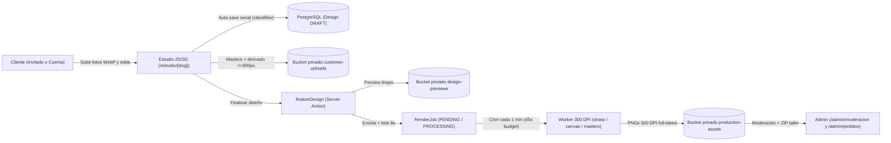
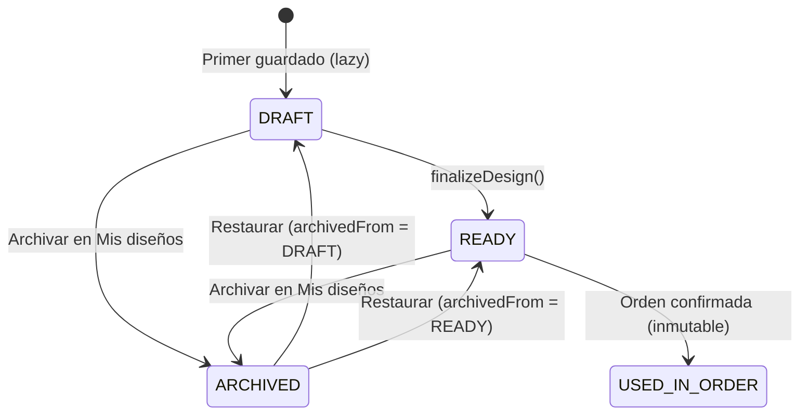
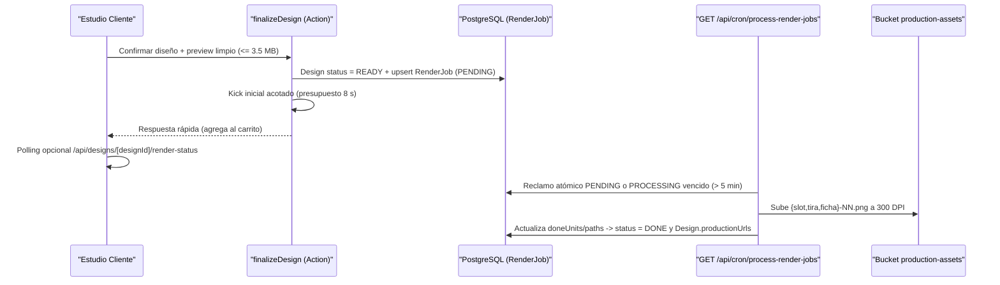

# Estudio de Personalización y Producción 300 DPI — Lucams Shop

> **Documento vivo.** Describe la arquitectura integral vigente del Estudio de Personalización en cliente, el previsualizador 3D interactivo, la privacidad de vistas previas, el pipeline asíncrono de renderizado 300 DPI, la operación de taller y la retención automática de activos personales. Para la guía rápida de archivos e invariantes locales del editor, consulta [`apps/web/app/estudio/[slug]/README.md`](../../apps/web/app/estudio/%5Bslug%5D/README.md).

---

## 1. Visión General y Flujo de Punta a Punta

El Estudio de Personalización (`ADR-013`, `ADR-035`) permite diseñar en vivo imanes fotográficos, tiras tipo cabina, calendarios mensuales, separadores de libros de una o dos caras y sets de letras magnéticas con fidelidad WYSIWYG respecto a la pieza física impresa a 300 DPI.

---

## 2. Modelo de Datos y Estados (`packages/db/prisma/schema.prisma`)

### Entidades principales

| Modelo                    | Propósito en el dominio                                                                                                                                                                    |
| ------------------------- | ------------------------------------------------------------------------------------------------------------------------------------------------------------------------------------------ |
| `Design`                  | Diseño del comprador (`customerId` o cookie `sessionId`), serialización `canvasData` (JSON v2), contador monotónico `clientRev` (`BigInt`), estado, moderación y rutas de salida.          |
| `PersonalizationTemplate` | Plantillas de diseño por `PersonalizationKind` (`mode`: `EDITABLE` en Estudio o `PREMADE`), globales (`productId = null`) o exclusivas de producto, con geometría base `canvasData`.       |
| `DesignAsset`             | Foto subida o asignada al diseño: master privado `storageUrl` en `customer-uploads`, derivado liviano `canvasPath` (`<= 800 px` WebP), dimensiones reales, limpieza EXIF y consentimiento. |
| `RenderJob`               | Trabajo asíncrono 1:1 con `Design` para generar los PNG de imprenta a 300 DPI fuera del tiempo de respuesta del carrito, con progreso incremental (`doneUnits / totalUnits`) y `attempts`. |
| `LetterTileSet` / `Tile`  | Colecciones administrables de ilustraciones por letra e idioma (`es` con 27 letras incl. `Ñ`, `en` con 26 letras) para abecedarios, vocales y nombres personalizados (`ADR-057`).          |
| `DesignGalleryImage`      | Arte prediseñado propio de Lucams agrupado por `tag`, con soporte de doble cara (`imageUrl`, `imageUrlB`) y filtro opcional por atributos de variante (`variantFilter`).                   |

### Máquinas de estado de `Design`, `ModerationStatus` y `RenderJob`

- **`DesignStatus`**:
  - `DRAFT`: boceto editable con auto-guardado activo.
  - `READY`: diseño finalizado con vista previa limpia generada y `RenderJob` encolado; apto para carrito, cotización o enlace compartido `/d/[token]`. Editar desde el carrito clona `READY -> DRAFT` (`cloneDesignForEdit`) para no alterar la línea activa si el comprador abandona la edición.
  - `USED_IN_ORDER`: snapshot inmutable vinculado a un `OrderItem` confirmado; bloqueado frente a ediciones y podas de borradores.
  - `ARCHIVED`: ocultado por el cliente en `/mi-cuenta/disenos`, preservando su estado previo en `archivedFrom`.
- **`ModerationStatus`** (`ADR-062`):
  - `PENDING` (estado inicial de todo diseño personalizado) -> `APPROVED` o `REJECTED` desde `/admin/moderacion`.
  - **Compuerta dura de despacho**: `orderHasUnmoderatedDesigns(orderId)` bloquea la transición del pedido a `SHIPPED` mientras exista cualquier línea personalizada cuyo diseño no esté en `APPROVED`. Si se rechaza (`REJECTED`), se registra `moderationReason`, se notifica al comprador y se invalida `shareTokenHash`.
- **`RenderJobStatus`** (`ADR-131`, `ADR-136`):
  - `PENDING` -> `PROCESSING` -> `DONE` (escribe `Design.productionUrls`) o `FAILED` (tras 3 fallos o error no recuperable, alertando en `ErrorReport`).

---

## 3. Superficies de Edición en Cliente (`apps/web/app/estudio/[slug]/`)

La ruta `/estudio/[slug]` (`page.tsx`) resuelve en servidor el producto, sus variantes activas, plantillas compatibles, activos previos y sesión, hidratando una de tres superficies cliente sin SSR (`studio-editor-loader.tsx`):

### 3.1 Lienzo interactivo 2D (`StudioEditor` + `react-konva`)

- **Paradigma slot-por-pieza y multi-unidad**: cada imán, segmento de tira, cara de separador o mes de calendario es un `StudioSlot` independiente respaldado por el store Zustand `createStudioStore` (`lib/store.ts`, historial undo/redo de 30 pasos). En productos multi-unidad (`unitSlots > 1`: calendarios de 12 meses, tiras de 3 o 4 fotos, separadores de 2 caras), `slotCount = unitCount * unitSlots` permite diseñar múltiples unidades distintas en una sola línea de carrito (`features/personalization/design-units.ts`).
- **Plantillas adaptativas y elección explícita (`ADR-103`, `ADR-167`)**:
  - `features/personalization/template-visibility.ts` filtra plantillas activas por relación de aspecto (`filterTemplatesByAspectRatio` con tolerancia `0.05`), cantidad de fotos por tira (`filterTemplatesByPhotoSlots`) y prioridad de plantillas específicas de producto (`preferProductSpecific`).
  - `features/personalization/template-adapt.ts` (`adaptTemplateToSize`) recalcula dimensiones de stage y capas al cambiar tamaño (`sizeCm`) o silueta (`Corazón`, `Círculo`).
  - Cuando un producto ofrece más de una plantilla y no viene `?template=` en la URL, el arranque usa la primera solo para geometría (`resolveBootTemplate`), mantiene `Design.templateId = null` y bloquea con guía visual el lienzo y la finalización hasta que el comprador elija su plantilla explícitamente.
- **Subida resiliente, validación 300 DPI y derivado de lienzo (`ADR-142`, `ADR-169`, `ADR-179`)**:
  - En cliente, `lib/upload-photo-pipeline.ts` aplica super-resolución preventiva en Web Worker (`client-photo-upscale.worker.ts`) si la foto no alcanza la densidad objetivo, comprime a WebP (`client-image-compress.ts`, máx. 2400 px) y sube con concurrencia máxima de 3 archivos preservando el orden de selección.
  - En servidor, `apps/web/lib/photo-validation.ts` inspecciona magic bytes reales (`JPEG`, `PNG`, `WebP`, `HEIC`), rechaza SVG y animados, limita a `15 MB` / `50 MP` / `12 000 px`, re-codifica aplicando orientación y eliminando metadatos EXIF/GPS, y evalúa nitidez y resolución efectiva frente al tamaño físico (`soft < 240 DPI`, `strong < 200 DPI`). Si el cliente decide continuar con fotos advertidas, debe aceptar explícitamente en vista previa, sellando `Design.qualityAcknowledgedAt`.
  - Al guardar el master en `customer-uploads`, se genera un derivado ligero `DesignAsset.canvasPath` (`<= 800 px` WebP q82). El lienzo Konva y las texturas 3D cargan siempre `canvasUrl` para fluidez en gama media móvil, reservando el master completo para imprenta.
- **Encuadre inteligente, marcos full-bleed y filtros**:
  - `lib/smart-crop.ts` ejecuta `smartcrop` sobre una miniatura `<= 256 px` sin bloquear el hilo principal y cede prioridad ante cualquier ajuste manual (`shouldApplySmartCropResult`). La matemática de encuadre `cover` y sensibilidad de pellizco vive unificada entre cliente y servidor en `features/personalization/photo-fit.ts`.
  - `features/personalization/frame-palette.ts` gobierna los marcos `frameOptions` (full-bleed sobre todo el stage con margen interior proporcional `FRAME_BLEED_MARGIN_RATIO = 0.04` en tarjetas y `0.03` en tiras) y el factor de grosor configurable por producto `borderWidthFactor` (`[0.25, 3]`, `ADR-173`), con contraste automático de texto (`defaultTextFillOnCard`).
  - En separadores planos sin doblez (`noFold`, `ADR-186`), `constrainPhotoTransformToCover` impide dejar bordes sin cubrir tanto en el editor como en la validación autoritativa de `finalizeDesign` (`PHOTO_NOT_FULL_BLEED`).
  - Cinco presets de filtros en `lib/photo-filters.ts` (`vivid`, `vintage`, `polaroid`, `pastel`, `bw`) con re-caché diferido al terminar el gesto (`lib/filter-recache.ts`).

### 3.2 Editores de fichas magnéticas (`LetterSetEditor` y `NameEditor`)

Para productos de abecedario, vocales y nombres personalizados (`ADR-057`, `ADR-157`), `page.tsx` monta `letter-set-editor.tsx` o `name-editor.tsx` sin descargar el bundle de Konva:

- Soportan múltiples sets independientes en un mismo diseño (`metadata.units[u]`), cada uno con su estilo ilustrado (`LetterTileSet` o modo «Solo letra»), interruptor de borde y paleta de colores por ficha (`use-letter-colors.ts`).
- `lib/letter-set-resolve.ts` resuelve la variante exacta según idioma, tamaño e imán, calculando el precio en servidor como `precio_variante * unitCount`.

### 3.3 Tipografías Web vs Imprenta y Microcopy (Capa 3)

- **Estrategia tipográfica dual (`ADR-132`)**:
  - El layout global de la tienda carga únicamente `Fredoka.subset.woff2` e `Inter.subset.woff2` para proteger el LCP.
  - El layout exclusivo `apps/web/app/estudio/layout.tsx` (`apps/web/app/estudio/fonts.ts`) declara con `preload: false` 6 fuentes adicionales `.ttf` (`Caveat`, `Baloo 2`, `Nunito`, `Patrick Hand`, `Playfair Display`, `Dancing Script`), cargadas bajo demanda con `document.fonts.load`.
  - El servidor de producción registra los **8 archivos `.ttf` completos** (`apps/web/assets/fonts/*.ttf`) en `GlobalFonts` de `@napi-rs/canvas`, garantizando paridad métrica exacta entre el navegador y el PNG 300 DPI.
- **Microcopy 100 % en Capa 3 (`ADR-187`)**: toda la interfaz del Estudio (`DEFAULT_STUDIO_TEXTS` en `studio-texts.ts`, servido por `useStudioTexts()`) vive tipada en TypeScript sin claves `estudio.*` en base de datos, evitando consultas innecesarias y claves CMS huérfanas (ver [`./catalog-and-cms.md`](./catalog-and-cms.md)).

### 3.4 Asistente IA de Ocasión

El panel `studio-ai-panel.tsx` invoca `suggestDesignAction` (`apps/web/features/ai/actions.ts`):

- Se desactiva automáticamente cuando la tienda corre en modo catálogo (`isCatalogMode()`).
- Antes de contactar al proveedor externo, `sanitizeOccasion` (`features/ai/schemas.ts`) purga correos, celulares colombianos y secuencias numéricas de 6 a 12 dígitos reemplazándolos por `"ocasión especial"`.
- Aplica doble límite de tasa por hora (`20 req/h` en producción por IP y por identidad `customer.id` o `cart_session`) y consulta el adaptador `AiProvider` respaldado por Google Gemini para sugerir paleta de marca, frase corta, distribución y consejo fotográfico. Para detalles del proveedor y cuotas, consulta [`../integrations/google-and-ai.md`](../integrations/google-and-ai.md).

---

## 4. Previsualizador 3D Interactivo (React Three Fiber / Three.js)

Todas las escenas contextuales de «Míralo en tu espacio» (`scene-gallery.tsx`) son entornos WebGL 3D reales en React Three Fiber a escala física (`cm * uPerCm`), iluminados por `studio-3d-environment.tsx`, con texturas procedurales cero-red (`lib/procedural-textures.ts`) y aislamiento de fallos WebGL por tarjeta (`scene-3d-error-boundary.tsx`, `ADR-172`).

### Las 7 escenas 3D de `SceneGallery` + visor focal de calendario

| ID en código | Componente R3F (`app/estudio/[slug]/`)      | Etiqueta UI         | Comportamiento y reglas físicas                                                                                         |
| ------------ | ------------------------------------------- | ------------------- | ----------------------------------------------------------------------------------------------------------------------- |
| `"fridge"`   | `FridgeView3D` (`fridge-3d-view.tsx`)       | En una nevera       | Nevecón French Door (178x91x75 cm); reparte piezas entre ambas puertas sin pisar la junta central ni el dispensador.    |
| `"polaroid"` | `PolaroidView3D` (`polaroid-3d-view.tsx`)   | Mesa Polaroid       | Exclusiva para plantillas Polaroid; dispone las tarjetas sobre superficie de madera.                                    |
| `"board"`    | `RoomBoardView3D` (`style="cork"`)          | Mural de corcho     | Tablero mural de 120x80 cm con clúster multicolumna balanceado (`lib/cluster-layout.ts`).                               |
| `"memo"`     | `RoomBoardView3D` (`style="memo"`)          | Tablero metálico    | Superficie para sets de letras (`LetterSetEditor` / `NameEditor`) con paginador por set «Set k de N» (`ADR-168`).       |
| `"book"`     | `BookView3D` (`book-view-3d.tsx`)           | En un libro         | Separadores doblados sobre el canto o planos (`noFold`) acostados sobre la página, con giro 180° «Ver respaldo/frente». |
| `"shelf"`    | `ShelfView3D` (`shelf-3d-view.tsx`)         | En una repisa       | Piezas recostadas con pose física sobre estante (`lib/leaning-scene-layout.ts`); apta para variantes con o sin imán.    |
| `"gift"`     | `GiftView3D` (`gift-3d-view.tsx`)           | Como regalo         | Caja de presentación con piezas apoyadas a escala real (`lib/leaning-scene-layout.ts`); apta con o sin imán.            |
| _(Focal)_    | `CalendarCardFocus` (`calendar-card-focus`) | Detalle por tarjeta | Visor 3D inicial 1 a 1 para calendarios con paginador de dos niveles («Set k de N» y los 12 meses del set, `ADR-170`).  |

### Fidelidad material: variantes sin imán y reverso de marca «Lucams»

- **Filtrado honesto por imán (`ADR-180`)**: cuando la variante elegida es gemela sin imán (`magnet === false`), `galleryScenes()` oculta automáticamente las escenas verticales magnéticas (`fridge`, `board`, `memo`) y pinta el dorso 3D en tono papel (`#FAF8F5`). Cuando `magnet === true`, todas las mallas 3D (`magnet-3d.tsx`) renderizan el reverso en negro ferrita (`MAGNET_BACK_COLOR = "#1A1A1A"`).
- **Patrón de reverso «Lucams» en separadores (`ADR-190`)**: cuando un separador con reverso opcional deja su cara B sin foto ni prediseñado, las tres superficies —visor 3D (`lib/brand-back-texture.ts`), vista previa 2D y archivo de imprenta (`features/personalization/default-back-face.ts`)— ejecutan el mismo trazado puro `drawBrandBackFace` (`features/personalization/brand-back-pattern.ts`): el wordmark **`"Lucams"`** en fuente `Dancing Script` bold (`#E9E6F0`, inclinado `-24°` sobre fondo `#FFFFFF`, **sin apóstrofo ni subrayado**) repetido en retícula desplazada tipo ladrillo.

---

## 5. Auto-Guardado Serial (`clientRev`) y Recuperación de Borradores (`[STU-02]`)

El Estudio protege el progreso contra cierres accidentales, recargas y carreras entre pestañas tanto para **compradores invitados** como para **clientes autenticados** (`ADR-133`, `ADR-152`, `ADR-156`, `[STU-02]`):

1. **Creación perezosa y cola serial FIFO**:
   - Abrir `/estudio/[slug]` no inserta filas vacías en base de datos. `ensureDesign` crea el `Design` en estado `DRAFT` en el primer cambio real (o al aplicar el primer prediseñado) deduplicando llamadas concurrentes, y emite/renueva la cookie `HttpOnly` `cart_session` si el visitante es invitado.
   - Los guardados posteriores corren en una cola FIFO estricta (`createSerialTaskQueue` en `lib/serial-task-queue.ts`) con debounce de `2 000 ms` y `flushSaves()` obligatorio antes de abrir la vista previa o agregar al carrito.
2. **Concurrencia optimista monotónica (`Design.clientRev`)**:
   - Cada actualización envía un entero incremental `clientRev`. `saveCanvas` (`features/personalization/service.ts`) ejecuta un `updateMany` condicional `WHERE id = $1 AND status = 'DRAFT' AND "clientRev" <= $incoming`.
   - Si otra pestaña guardó una revisión superior, el servidor responde `STALE_REVISION` (`HTTP 409` en `POST /api/designs/save-canvas`) y el editor detiene escrituras obsoletas para no sobrescribir trabajo más reciente.
   - Al ocultar la pestaña o cerrar la página (`visibilitychange` / `pagehide`), el cliente dispara `navigator.sendBeacon("/api/designs/save-canvas", blob)` (límite de `2 MB`) respaldado por un snapshot local de emergencia (`lucams_studio_canvas_<designId>`, TTL 7 días).
3. **Recuperación de borradores para invitados y autenticados (`[STU-02]`)**:
   - `page.tsx` habilita `draftResumeEnabled` siempre que exista sesión autenticada **o** cookie `cart_session` vigente (`studioCustomer !== null || cartSessionId !== null`).
   - Tras el primer guardado real, `writeStudioDraftId` (`lib/draft-marker.ts`) persiste el marcador `{ designId, savedAt }` en `localStorage` (`lucams_studio_draft_<slug>:<variantId>`, vigencia de 30 días) para mostrar el banner «Continuar donde quedaste». En `NameEditor` y `LetterSetEditor`, el progreso intermedio se conserva localmente por 7 días (`SIMPLE_STUDIO_DRAFT_MAX_AGE_MS`).
   - **Aislamiento anti-IDOR en `getOwnedDesign`**: un diseño con `customerId != null` exige coincidencia exacta con el cliente autenticado y jamás responde por `sessionId`; un diseño de invitado exige `customerId IS NULL` y coincidencia exacta con `cart_session`. Al iniciar sesión o registrarse, `adoptAnonDraftDesigns` transfiere todos los `DRAFT` y `DesignAsset` de la sesión anónima a la cuenta del cliente.
   - **Poda automática**: `trimExcessDraftDesigns` (`features/personalization/draft-lifecycle.ts`) conserva como máximo `MAX_DRAFTS_PER_PRODUCT = 3` borradores recientes por producto y dueño (con ventana de gracia de 1 hora para borradores recién creados).

---

## 6. Privacidad de Vistas Previas (`LUC-SEC-001` y `ADR-191`)

Las vistas previas contienen fotografías personales (incluidos menores y eventos familiares), por lo que nunca se exponen en un bucket público (ver [`../SECURITY.md`](../SECURITY.md)):

- **Bucket privado y gateway autorizado**: el bucket `design-previews` de Supabase Storage es privado. Toda lectura transita por `GET /api/design-preview/[...path]` (`apps/web/app/api/design-preview/[...path]/route.ts`), que valida la ruta contra una expresión regular estricta (`draft`, `clean` o artefactos legados) y responde con `Cache-Control: private, max-age=300` y `X-Content-Type-Options: nosniff`.
- **Matriz de control de acceso (`canAccessDesignPreview` en `features/personalization/preview-access.ts`)**:
  1. **Admin operativo**: requiere sesión activa verificada con `verifyAdminRouteAccess`, MFA TOTP en nivel `aal2` y rol operativo (excluye `CMS_EDITOR`).
  2. **Propietario del diseño**: cliente autenticado (`customer.id === design.customerId`) o invitado cuya cookie `cart_session` coincide con `design.sessionId` (si `design.customerId === null`).
  3. **Tokens de capacidad acotados**: `?ot=` (token de pedido `/pedido/[token]`), `?qt=` (token de cotización `/cotizacion/[token]`) o `?st=` (enlace compartido `/d/[token]`, validado en tiempo constante contra `Design.shareTokenHash`). Estos tokens autorizan **únicamente** vistas finalizadas (`clean`), **nunca** bocetos `draft-preview`.
  4. Cualquier acceso no autorizado o inexistente recibe un `404 Not Found` idéntico para evitar enumeración de IDs.
- **Vistas previas limpias sin marca de agua (`ADR-191`)**: las previsualizaciones de diseños del cliente se sirven completamente limpias en el Estudio, carrito, checkout, portal de pedido y enlaces compartidos (`designPreviewDisplay` retorna `watermarked: false`). La marca de agua se aplica exclusivamente a las miniaturas públicas del catálogo de arte prediseñado propio de la tienda (`features/personalization/design-gallery.ts` en el bucket público `product-images`), protegiendo las ilustraciones de Lucams sin interferir con las fotos del comprador.

---

## 7. Pipeline Asíncrono de Renderizado 300 DPI (`RenderJob`)

Para evitar timeouts HTTP en pedidos multi-unidad (por ejemplo, varios sets de calendarios de 12 meses o abecedarios completos), la generación de archivos de imprenta está desacoplada del request de compra (`ADR-081`, `ADR-131`, `ADR-136`, `ADR-188`).

### Mecánica del worker y reclamo atómico

- Al confirmar en el Estudio, `finalizeDesign` guarda la vista previa, crea o reinicia el `RenderJob` (`createOrResetRenderJob` en `features/personalization/render-job-service.ts`) e intenta adelantar unidades durante un **kick síncrono máximo de `8 000 ms`** (`RENDER_JOB_KICK_BUDGET_MS`).
- El job `pg_cron` `lucams-process-render-jobs` invoca cada minuto (con omisión automática en SQL si la cola está vacía) `GET /api/cron/process-render-jobs` (`maxDuration = 60`, presupuesto interno `RENDER_JOB_CRON_BUDGET_MS = 45_000 ms`, hasta `3` jobs por ejecución).
- `claimNextRenderJob` toma de forma atómica el trabajo más antiguo en estado `PENDING` o en `PROCESSING` cuyo lease haya expirado (`startedAt` mayor a **`5 minutos`**, `RENDER_JOB_STALE_LEASE_MS = 300_000`) siempre que `attempts < 3`. El progreso (`doneUnits` y `paths`) se guarda unidad por unidad para reanudar sin repetir trabajo si una ejecución agota su ventana. El cliente puede consultar el avance en `GET /api/designs/[designId]/render-status`.

### Los 3 niveles (tiers) de renderizado y geometría de corte

1. **Tier 1 — `sharp` seguro (`features/personalization/production-render.ts` + `sharp-safe.ts`)**:
   - Envuelve `sharp` bloqueando cargadores nativos innecesarios (`VipsForeignLoadNsgif`, `VipsForeignLoadTiff`, `VipsForeignLoadVips` en `features/personalization/sharp-safe.ts`).
   - Procesa a máxima velocidad slots rectangulares de pura fotografía sin marco, texto, rotación ni filtros, escalando el stage lógico por `PRODUCTION_SCALE = 3`.
2. **Tier 2 — `@napi-rs/canvas` servidor (`features/personalization/production-render-canvas.ts` y `letter-tile-render.ts`)**:
   - Con las 8 tipografías `.ttf` registradas, renderiza textos, marcos `frameOptions` con `borderWidthFactor`, recortes en silueta `Corazón` / `Círculo`, tiras photobooth con canaletas exactas, hojas mensuales de calendario con festivos colombianos (`RenderJob.calendarYear`) y tiras desplegadas de separadores de 2 caras (`composeFaceStrips` + cara B vacía con el patrón «Lucams»).
   - **Render individual por ficha (`ADR-188`)**: para `LetterSetEditor` y `NameEditor`, `letter-tile-render.ts` genera **un archivo PNG 300 DPI independiente por cada letra de cada set** (`ficha-NN.png`, `PX_PER_CM = 300 / 2.54` al `sizeCm` real de la variante con metadato `density: 300`).
   - **Regla full-bleed de troquel (`ADR-189`)**: las piezas rectangulares exportan sus esquinas rectas a sangre del stage para que el redondeo lo ejecute limpiamente la troqueladora física sin halos blancos, preservando máscaras solo en siluetas curvas (`Corazón`, `Círculo`).
3. **Tier 3 — Fallback de stages cliente con masters originales (`ADR-081`, `[STU-01]`)**:
   - Cuando el diseño emplea filtros Konva, rotaciones, cromo SVG (Polaroid Instagram) o texto multilínea complejo, el navegador conmuta temporalmente los slots del derivado `<= 800 px` a los masters de alta resolución en `customer-uploads` mediante `runWithPrintMasters` (`app/estudio/[slug]/lib/print-master-mode.ts`), refrescando automáticamente URLs firmadas próximas a vencer (`>= 40 min`) y abortando en modo fail-closed (`MasterPhotoLoadError`) si algún master falla para jamás imprimir un marcador vacío.
   - Los PNG se suben con tickets firmados a `production-assets/<designId>/_client/`, donde el worker verifica dimensiones y límites (`normalizeRasterImage`, máx. `20 MB` entrada / `30 MB` salida), los promueve a rutas definitivas `<designId>/{slot,tira,ficha}-NN.png` en el bucket privado `production-assets` y limpia `_client/`.

---

## 8. Operación de Taller y Separación RBAC

No existe una ruta aislada `/admin/produccion`; las herramientas de taller están integradas en el flujo operativo de pedidos y moderación para evitar cambios de contexto:

- **Moderación previa al despacho (`/admin/moderacion`)**: lista diseños `PENDING` asociados a pedidos pagados, en preparación, cotizaciones activas o enlaces compartidos. Permite inspeccionar los PNG 300 DPI mediante URLs firmadas temporales (1 hora) y aprobar o rechazar con motivo auditado.
- **Inspección agrupada y recuperación en el pedido (`/admin/pedidos/[number]`)**:
  - `ProductionPiecesGallery` (`production-pieces-gallery.tsx`) agrupa visualmente las piezas por unidad física o set (`productionPieceGroups` en `features/personalization/production-spec.ts`: letra de cada ficha, mes de cada calendario, segmento de cada tira) sobre cuadrícula de transparencia con visor ampliado y descarga individual firmada.
  - Si un `RenderJob` cae en `FAILED`, `RetryRenderJobButton` (`retryRenderJobAction`) reinicia el trabajo con un clic y ejecuta un nuevo kick de 8 s. Para pedidos históricos de sets de letras guardados como lámina única, `RegenLettersetButton` (`regenerateLettersetProductionAction`) regenera los PNG individuales por ficha.
- **Descarga masiva en ZIP (`GET /admin/pedidos/[number]/produccion`)**:
  - Route Handler con `maxDuration = 60` protegido por `ADMIN_ROLE_SETS.PRODUCTION_DOWNLOAD` y MFA `aal2`.
  - Si cualquier diseño del pedido tiene un `RenderJob` en `PENDING` o `PROCESSING`, responde **`409 Conflict`** para impedir que el taller descargue un paquete incompleto.
  - Empaqueta con `jszip` (`STORE`, sin recomprimir PNGs) subcarpetas ordenadas por ítem y unidad, incluyendo la guía visual `armado.png` (`composeAssemblySheet`) y las instrucciones operativas `LEEME.txt` (`resolveProductionSpec`), dejando rastro en `AdminActionLog` (`order.design_zip_download`).
- **Separación estricta `PRINT_WORKSHOP` vs `FULFILLMENT` (`apps/web/lib/admin-rbac.ts`)**:

| Capacidad / Superficie                                | `PRINT_WORKSHOP` (Impresión) | `FULFILLMENT` (Empaque y despacho) | `SUPERADMIN` / `OPERATIONS_MANAGER` |
| ----------------------------------------------------- | ---------------------------- | ---------------------------------- | ----------------------------------- |
| Ver datos operativos del pedido y transicionar estado | Sí                           | Sí                                 | Sí                                  |
| Descargar PNGs 300 DPI y ZIP de producción            | Sí                           | Sí                                 | Sí                                  |
| Moderar contenido en `/admin/moderacion`              | **Sí**                       | **No**                             | Sí                                  |
| Imprimir guía de envío / etiqueta PDF Aveonline       | **No**                       | **Sí** (auditado en cada descarga) | Sí                                  |
| Leer PII en claro del comprador (`orders:read_pii`)   | **No** (enmascarada en SSR)  | **No** (enmascarada en SSR)        | Sí                                  |

---

## 9. Políticas de Retención Automática de Archivos (Ley 1581)

En cumplimiento del principio de temporalidad de la Ley 1581 de 2012 (ver [`../COMPLIANCE.md`](../COMPLIANCE.md)), las fotografías y renders de clientes se depuran automáticamente mediante dos crons nocturnos (`GET /api/cron/purge-anon-designs` y `GET /api/cron/purge-delivered-designs`):

| Categoría de activo                                           | Constante en código (`features/personalization/`) | Ventana PRD | Condición de purga y salvaguardas                                                                                            |
| ------------------------------------------------------------- | ------------------------------------------------- | ----------- | ---------------------------------------------------------------------------------------------------------------------------- |
| Borradores `DRAFT` y subidas sueltas de invitados             | `PURGE_ANON_DESIGN_AFTER_DAYS`                    | **7 días**  | Sin actividad, sin carrito vivo, sin pedido y sin cotización activa.                                                         |
| Objetos huérfanos en `customer-uploads/.../pending/`          | `ORPHAN_PENDING_AFTER_DAYS`                       | **7 días**  | Subidas interrumpidas que nunca se vincularon a un diseño.                                                                   |
| Borradores `DRAFT` inactivos de clientes con cuenta           | `PURGE_IDLE_DESIGN_AFTER_DAYS`                    | **30 días** | Sin actividad, carrito, pedido ni cotización activa (respeta los diseños `ARCHIVED` por el usuario).                         |
| Diseños `READY` abandonados nunca comprados                   | `PURGE_IDLE_READY_AFTER_DAYS`                     | **90 días** | Tanto de invitados como con cuenta, sin carrito vivo, pedido ni cotización vigente (`ADR-130`).                              |
| Diseños asociados a cotizaciones cerradas / descartadas       | `PURGE_AFTER_QUOTE_CLOSED_DAYS`                   | **90 días** | Contados desde el cierre de la cotización (o `365 días` si la cotización quedó abierta estancada).                           |
| Masters y renders 300 DPI de pedidos entregados (`DELIVERED`) | `PURGE_DELIVERED_DESIGN_AFTER_DAYS`               | **90 días** | Post-`Order.deliveredAt`. **Se bloquea** si el diseño tiene otro pedido en vuelo o un retracto/garantía abierto (`ADR-070`). |

> [!IMPORTANT]
> **Preservación de bytes compartidos y trazabilidad del pedido:** al clonar un diseño para edición o recompra, múltiples filas `DesignAsset` pueden referenciar el mismo objeto en Storage. `purgeDesignBatch` verifica referencias cruzadas antes de borrar en Supabase Storage para nunca romper diseños vivos. En la purga post-entrega (`retention-delivered.ts`) se eliminan los masters pesados (`customer-uploads`) y los PNG de imprenta (`production-assets`), marcando `Design.purgedAt`, pero se conserva la fila `Design`, su `canvasData` y `previewUrl` para el historial del cliente. Además, `sweepOrphanStorageObjects` barre hasta 500 objetos huérfanos por corrida en los tres buckets validando su inexistencia en PostgreSQL. En ambientes no productivos (`VERCEL_ENV !== "production"`), todas las ventanas se acotan a un máximo de `14 días` (`RETENTION_NONPROD_MAX_DAYS`).

---

## Documentos Relacionados

- Guía local de componentes e invariantes del editor: `apps/web/app/estudio/[slug]/README.md`
- Catálogo, variantes `-NOMAG` y arquitectura CMS v2: [`./catalog-and-cms.md`](./catalog-and-cms.md)
- Carrito, checkout y saga del pedido: [`./checkout-payments-shipping.md`](./checkout-payments-shipping.md)
- Cotizaciones B2B y taller de cotización: [`./crm-b2b-and-loyalty.md`](./crm-b2b-and-loyalty.md)
- Retractos (exclusión de personalizados) y garantías legales: [`./post-sale-and-support.md`](./post-sale-and-support.md)
- Seguridad de buckets, RLS y MFA administrativo: [`../SECURITY.md`](../SECURITY.md)
- Cumplimiento legal y Ley 1581 de datos personales: [`../COMPLIANCE.md`](../COMPLIANCE.md)
- Integración con Google Gemini (`AiProvider`): [`../integrations/google-and-ai.md`](../integrations/google-and-ai.md) y Supabase Storage: [`../integrations/supabase.md`](../integrations/supabase.md)
