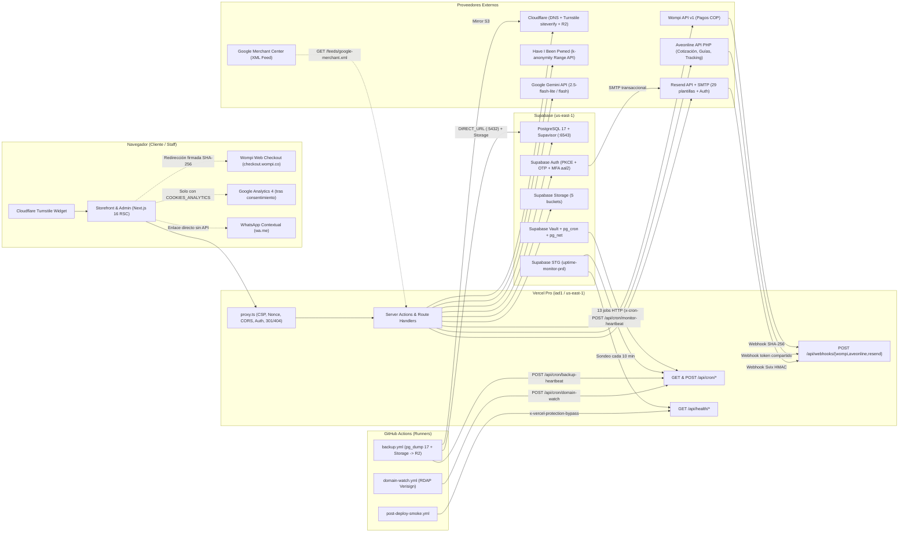

# Integraciones de Lucams Shop — Mapa Maestro y Resiliencia

> **Documento vivo.** Punto de entrada canónico para todas las integraciones de infraestructura, pasarela de pagos, logística, mensajería, seguridad perimetral, analítica e inteligencia artificial de **Lucams Shop** (`lucamsshop.com`). Para decisiones históricas consulta [`../DECISIONS.md`](../DECISIONS.md); para topología general del monorepo revisa [`../ARCHITECTURE.md`](../ARCHITECTURE.md).

---

## 1. Arquitectura global de integraciones

Lucams Shop opera sobre una arquitectura serverless co-localizada en `us-east-1` (Virginia del Norte: funciones de Vercel en `iad1` y base de datos Supabase en `us-east-1`), minimizando la latencia de red entre el servidor de aplicación Next.js 16 y el pooler transaccional Supavisor. Toda integración externa se encapsula tras adaptadores tipados en `apps/web/lib/` o `apps/web/features/` con timeouts explícitos, aislamiento de fallos y cero exposición de llaves secretas al navegador.

### Modos de operación (`NEXT_PUBLIC_STORE_MODE`)

El comportamiento transversal de las integraciones comerciales obedece a una única bandera de compilación y ejecución (`apps/web/lib/store-mode.ts` + guarda transaccional `assertTransactionalAllowed` en `apps/web/lib/stage-guard.ts`):

- **`full` (activo en Producción)**: habilita cobros en línea con Wompi, contraentrega (si `COD_ENABLED=true` en CMS), cotización/generación de guías con Aveonline, mensajería propia `LUCAMS`, feed de Google Merchant Center y copiloto/generadores con IA. Al arrancar el servidor, `validateEnv()` en `apps/web/lib/env.ts` exige las credenciales de `FULL_MODE_REQUIRED` (`WOMPI_*`, `AVEONLINE_*`).
- **`catalog` (Etapa 1 / contingencia comercial)**: desactiva pagos en línea, generación de guías, vista `/admin/integraciones` y feed XML de Merchant Center; convierte el checkout en solicitud de cotización de 1 paso (`/checkout/datos`) y las sondas de proveedores no requeridos responden `status: "skipped"` sin alertar en falso.

---

## 2. Índice canónico de documentos (`docs/integrations/`)

Lee únicamente el documento del proveedor involucrado en tu tarea:

| #   | Documento                                          | Qué cubre al detalle                                                                                                                                                                                                                                                                                                                                                                                                              | Cuándo leerlo                                                                                                                                       |
| --- | -------------------------------------------------- | --------------------------------------------------------------------------------------------------------------------------------------------------------------------------------------------------------------------------------------------------------------------------------------------------------------------------------------------------------------------------------------------------------------------------------- | --------------------------------------------------------------------------------------------------------------------------------------------------- |
| 1   | [`./vercel.md`](./vercel.md)                       | Configuración en Vercel Pro (`apps/web`, Node 22, `iad1`), las 9 rutas con `maxDuration` extendido, binarios nativos (`sharp@0.35.5`, `@napi-rs/canvas`), fuentes `.woff2`/`.ttf`, PWA manifest, pipeline completo de `proxy.ts`, CSP con nonce, tags de caché Next.js 16 y validación `validateEnv()`.                                                                                                                           | Cambios en `next.config.ts`, `proxy.ts`, headers de seguridad, timeouts serverless, renderizado server-side, caché o despliegue Preview/Production. |
| 2   | [`./supabase.md`](./supabase.md)                   | Topología PRD/STG/Podman local, Prisma + Supavisor (`:6543` vs `:5432`), retry de DB, clientes `browser`/`server`/`service`, Auth (PKCE, códigos OTP, plantillas HTML, MFA `aal2`, `provisionStaffAdmin`), los 5 buckets de Storage, postura RLS/grants + event trigger DDL, rate limit en SQL, Vault y los **19 procesos programados**.                                                                                          | Migraciones SQL, políticas RLS, subida/lectura de archivos en Storage, flujos de login/registro/MFA, o creación/ajuste de crons.                    |
| 3   | [`./wompi.md`](./wompi.md)                         | Arquitectura Hosted Web Checkout (`checkout.wompi.co/p/`), firma de integridad SHA-256 en centavos COP (`Int`), ledger `WompiPaymentAttempt` / `WompiPaymentTransaction`, rotación de referencias con UUID, webhook `POST /api/webhooks/wompi` (anti-replay 25 h, `LUC-SEC-009`), verificación activa en `/checkout/gracias` y flujo manual auditado de reembolsos.                                                               | Cambios en checkout de pago, conciliación de cobros, estados `PENDING_PAYMENT` → `PAID`, webhooks de pago o reembolsos.                             |
| 4   | [`./aveonline.md`](./aveonline.md)                 | Autenticación y guarda anti-demo (`idempresa 15289`), cotización `cotizarDoble` con empaque apilado `computePackedPackage`, catálogo DANE/MinTIC, reglas dinámicas por transportadora, generación de guía `generarGuia2` (doble compuerta de facturación, COD, `relacionEnvios`), archivado PDF en Storage, tabla canónica de errores (`shipment-error.ts`), rastreo híbrido (`ShipmentEvent`) y envío propio `LUCAMS` en Bogotá. | Tarifas de envío, empaque/peso/dimensiones, etiquetas PDF, errores al generar guías, estados de despacho/entrega o zonas de mensajería propia.      |
| 5   | [`./resend-and-emails.md`](./resend-and-emails.md) | Cliente HTTP Resend con circuit breaker por ventana deslizante, SMTP para Supabase Auth, webhook firmado Svix (`/api/webhooks/resend`), supresión comercial por rebotes/quejas (`EmailEvent`), `EMAIL_SEND_DISABLED` y catálogo/overrides CMS de las 29 plantillas React Email.                                                                                                                                                   | Correos transaccionales o de marketing, entregabilidad SPF/DKIM/DMARC, previsualización en `/admin/email-templates` o webhooks de correo.           |
| 6   | [`./cloudflare.md`](./cloudflare.md)               | Zona DNS en Cloudflare, protección anti-abuso con Cloudflare Turnstile (`fail-closed` en formularios públicos/auth/B2B), buckets S3 en Cloudflare R2 para backups cifrados de DB y Storage, y validación de contraseñas filtradas contra HIBP (`k-anonymity`).                                                                                                                                                                    | Registros DNS/dominios, formularios públicos protegidos por captcha, respaldos off-site en R2 o políticas de contraseñas.                           |
| 7   | [`./google-and-ai.md`](./google-and-ai.md)         | Proveedor Google Gemini (`gemini-2.5-flash-lite` con fallback a `gemini-2.5-flash`), sanitización cero-PII en soporte (`sanitizeSupportTextForAi`), GA4 con doble compuerta de consentimiento + anonimización de tokens en URLs, feed `/feeds/google-merchant.xml` y Google Search Console.                                                                                                                                       | Asistentes de redacción/soporte con IA, medición de eventos ecommerce/embudo, SEO técnico o catálogo en Google Shopping.                            |
| 8   | [`./github-and-ops.md`](./github-and-ops.md)       | Workflows de GitHub Actions (`ci.yml`, `post-deploy-smoke.yml`, `backup.yml`, `domain-watch.yml`), ruleset de ramas críticas, secretos de repositorio, latidos hacia `/api/cron/*` y canal de atención por WhatsApp (`lib/wa.ts` sobre `wa.me`, sin API de terceros).                                                                                                                                                             | Pipelines CI/CD, smokes automatizados, monitoreo RDAP de dominio, restauración DR o enlaces contextuales de WhatsApp.                               |

---

## 3. Matriz maestra de resiliencia

Todas las llamadas de red salientes obedecen dos primitivas centrales (más mecanismos específicos por proveedor):

1. **Circuit Breaker (`apps/web/lib/circuit-breaker.ts`)**: instancia en memoria por contenedor serverless (`new CircuitBreaker({ name, threshold, resetMs })`). Estados `closed` → `open` (al acumular `threshold` fallas consecutivas; rechaza inmediatamente con `CircuitOpenError`) → `half-open` tras `resetMs` (permite **una sola sonda** concurrente mediante flag `probing`; si acierta vuelve a `closed`, si falla reabre el circuito por otro ciclo `resetMs`).
2. **Retry con Backoff Exponencial y Jitter (`apps/web/lib/retry.ts`)**: `withRetry(fn, { attempts = 3, baseMs = 200, maxMs = 5000 })`. Calcula espera `min(maxMs, baseMs * 2^i + random(0..100))`. Solo reintenta errores transitorios evaluados por `isRetryable`: `TimeoutError` / `AbortError`, `TypeError` de `fetch`, códigos de socket (`ECONNRESET`, `ETIMEDOUT`, `ECONNREFUSED`, `EAI_AGAIN`, `UND_ERR_CONNECT_TIMEOUT`, `UND_ERR_SOCKET`), HTTP `408`, `429` o `5xx`, o errores marcados con `retryable: true`. **Importante**: `withRetry` envuelve por fuera a `cb.exec(...)` para que cada intento fallido incremente el contador del breaker y, una vez abierto, `CircuitOpenError` (no reintentable) corte el bucle al instante.

| Integración / Operación                                                      | Cliente / Archivo canónico                                            | Timeout HTTP                                                            | Circuit Breaker (`name` / umbral / reset)                                                   | Política de Retry                                                                                                                                  | Idempotencia y Deduplicación                                                                                                                                                                                                                   | Degradación Controlada / Fallback                                                                                                                                                                                                       |
| ---------------------------------------------------------------------------- | --------------------------------------------------------------------- | ----------------------------------------------------------------------- | ------------------------------------------------------------------------------------------- | -------------------------------------------------------------------------------------------------------------------------------------------------- | ---------------------------------------------------------------------------------------------------------------------------------------------------------------------------------------------------------------------------------------------- | --------------------------------------------------------------------------------------------------------------------------------------------------------------------------------------------------------------------------------------- |
| **Wompi — Consultas REST** (`getTransaction`, `listTransactionsByReference`) | `apps/web/lib/wompi.ts`                                               | `5 000 ms` (`6 000 ms` en sonda `/merchants/{pub}`)                     | `wompi` (`threshold: 5`, `resetMs: 30_000`)                                                 | `withRetry` estándar: `3` intentos (`200 ms` base, máx. `5 000 ms`)                                                                                | Ledger `WompiPaymentAttempt` (`reference @unique` con sufijo UUID en reintentos) + `WompiPaymentTransaction` (`externalId @unique`).                                                                                                           | En `/checkout/gracias`, un timeout o fallo de API renderiza `LookupRetryPage` («estamos verificando» con `<AutoRefresh />`), **jamás** falso rechazo; el webhook o `expire-pending-orders` convergen la orden.                          |
| **Wompi — Webhook entrante**                                                 | `apps/web/app/api/webhooks/wompi/route.ts`                            | `maxDuration = 60 s` (techo body `64 KB`)                               | N/A (receptor)                                                                              | Wompi reintenta `3` veces (`30 min`, `3 h`, `24 h`); ventana anti-replay de `25 h`                                                                 | `WebhookEvent` `(source: "WOMPI", externalId: "<txId>-<status>-<ts>")` + captura `P2002` en carrera; transacción atómica de stock + `Order.status`.                                                                                            | Si la saga falla inesperadamente o falta stock, marca `Order.needsReconciliation = true`, deja `processedAt = null` (alerta `webhooks_stuck`) y responde `HTTP 200` para evitar tormenta de reintentos.                                 |
| **Aveonline — Auth, Agentes, Transportadoras y Tracking**                    | `apps/web/features/shipping/aveonline.ts`                             | `5 000 ms` (`8 000 ms` en AveCRM webhooks)                              | `aveonline` (`threshold: 5`, `resetMs: 30_000`)                                             | `withRetry`: `2` intentos en `autenticarusuario.php`; `3` intentos en listados y `obtenerEstadoAuth`                                               | Caché en memoria de token (`55 min` efectivos sobre `60 min` de vigencia) y de agentes/carriers (`24 h`, nunca cachea listas vacías ni errores). `ShipmentEvent.dedupKey` por minuto cross-source.                                             | Si el webhook AveCRM falla o nunca llega, el cron `tracking-sync` (cada `15 min`) converge estados y backfill de hitos vía `obtenerEstadoAuth`.                                                                                         |
| **Aveonline — Cotización (`cotizarDoble`)**                                  | `apps/web/features/shipping/aveonline.ts` (`quoteLive`)               | `15 000 ms` (`maxDuration = 45 s` en `/checkout/envio`)                 | `aveonline-quote` **aislado** (`threshold: 5`, `resetMs: 30_000`)                           | `withRetry` acotado a `2` intentos (presupuesto máx. ~`30 s` + auth)                                                                               | Clave determinista `origen→destino\|cod\|productos` sellada con HMAC en `offersToken` (`checkout/service.ts`).                                                                                                                                 | 1) Si falla en vivo, sirve `lastGoodQuoteCache` (TTL `10 min`, máx. `200` claves, marca `estimated: true`). 2) Si no hay caché pero aplica envío propio `LUCAMS`, ofrece `LUCAMS`. 3) Si todo falla, banner amarillo recuperable en UI. |
| **Aveonline — Generación de guía (`generarGuia2`) y `relacionEnvios`**       | `apps/web/features/shipping/aveonline.ts` + `features/orders/saga.ts` | `20 000 ms` guía / `10 000 ms` relación / `12 000 ms` descarga PDF      | `aveonline` (`threshold: 5`, `resetMs: 30_000`)                                             | **PROHIBIDO (`retry: false`)** — llamada no idempotente que factura flete                                                                          | Guard inicial `if (order.trackingNumber)` + claim atómico `Order.shipmentClaimedAt` (`stale-reclaim` a los `10 min` solo si `needsReconciliation = false`) + persistencia inmediata del `trackingNumber` antes de transicionar a `FULFILLING`. | Orden queda confirmada en `PAID` (no se pierde la venta), persiste diagnóstico sin PII en `Order.shipmentLastError`. Si hubo timeout (`>20 s`), retiene el claim y prende `needsReconciliation` para evitar doble guía.                 |
| **Resend — Envío de correos REST**                                           | `apps/web/lib/resend.ts`                                              | `15 000 ms` (`5 000 ms` en sonda `/domains`)                            | Ventana deslizante propia (`10` envíos; abre `30 000 ms` si `≥6` muestras y `>50 %` fallos) | `4` intentos con esperas `[0, 1000, 2000, 4000] ms` en red/`429`/`5xx` (`4xx` no reintenta)                                                        | Header `Idempotency-Key` de Resend; si devuelve HTTP `409` por cambio de payload, reintenta una vez con sufijo determinista `:r2`. Claim en DB para alertas/confirmaciones (`confirmationSentAt`).                                             | Nunca lanza excepción al flujo de negocio: devuelve `{ sent: false, reason }`. Suprime envíos comerciales a destinatarios con `BOUNCED` o `COMPLAINED` en `EmailEvent`. Kill-switch `EMAIL_SEND_DISABLED=1` en tests.                   |
| **Supabase / PostgreSQL (Prisma)**                                           | `packages/db/src/index.ts`                                            | `pool_timeout=20 s` (`PRISMA_POOL_TIMEOUT`)                             | Pool acotado por instancia (`connection_limit=5`)                                           | Extensión `$allOperations` (`runWithDbRetry`): `3` intentos con espera lineal `300 ms * attempt` (`300 ms`, `600 ms`) en `P1001`, `P1017`, `P2024` | Índices `@unique` en ledger de pagos, cupones (`CouponUsage.orderId`), puntos (`LoyaltyTxn`), `WebhookEvent` y `ShipmentEvent`.                                                                                                                | En `proxy.ts`, lecturas de catálogo/redirecciones degradan `fail-open` o con snapshot directo si el contexto de caché no está disponible; rate limit en SQL hace `fail-open` con log `rate_limit.empty_row` ante anomalía de RPC.       |
| **Cloudflare Turnstile**                                                     | `apps/web/lib/turnstile.ts`                                           | `5 000 ms`                                                              | Sin CB (stateless edge API)                                                                 | Sin retry (token de un solo uso)                                                                                                                   | Cada token de cliente se consume una sola vez en `challenges.cloudflare.com/turnstile/v0/siteverify`.                                                                                                                                          | **`fail-closed` en producción**: si falta `TURNSTILE_SECRET_KEY` o la red falla, bloquea la operación con mensaje seguro. En desarrollo sin llave hace bypass controlado con `logger.warn`.                                             |
| **Have I Been Pwned (HIBP)**                                                 | `apps/web/lib/pwned-passwords.ts`                                     | `3 000 ms`                                                              | Sin CB                                                                                      | Sin retry                                                                                                                                          | Consulta GET inmutable por prefijo SHA-1 de 5 caracteres (`k-anonymity`) con header `Add-Padding: true`.                                                                                                                                       | **`fail-open` intencional**: si HIBP responde no-200 o expira los `3 s`, registra `security.pwned.timeout_or_network` y permite el registro/cambio de clave sin bloquear clientes legítimos.                                            |
| **Google Gemini API**                                                        | `apps/web/features/ai/gemini-provider.ts` + `support-copilot.ts`      | `12 000 ms` catálogo / `10 000 ms` soporte / `6 000 ms` sonda `/models` | Cadena de modelos por llamada                                                               | Fallback inmediato de modelo primario `gemini-2.5-flash-lite` a `gemini-2.5-flash`                                                                 | Acciones de redacción manuales invocadas por staff autenticado (`ADMIN`+), con rate limit por usuario.                                                                                                                                         | En copiloto de soporte (`support-copilot.ts`), si fallan ambos modelos o falta `GEMINI_API_KEY`, degrada transparente a `mode: "smart_template"` determinista.                                                                          |

---

## 4. Mapa de observabilidad y health checks

El sistema expone sondas granulares en `apps/web/app/api/health/**` (todas con `dynamic = "force-dynamic"`, `Cache-Control: no-store` y rate limit de `30` peticiones/min por IP en Postgres vía `lib/rate-limit.ts`), una página pública de estado y dos paneles administrativos.

> **Nota sobre nombres de rutas en código**: el endpoint agregador que consolida la salud de todas las integraciones se llama **`GET /api/health/all`** (`apps/web/app/api/health/all/route.ts`). No existe `/api/health/integrations`; cualquier referencia operativa al agregador apunta a `/api/health/all`.

### Endpoints HTTP (`/api/health/*`)

| Ruta                        | Qué verifica exactamente                                                                                                                                                                                  | Respuesta pública vs autenticada (`x-cron-secret`)                                                                                                                                                  | Códigos HTTP                                                                                                                                    |
| --------------------------- | --------------------------------------------------------------------------------------------------------------------------------------------------------------------------------------------------------- | --------------------------------------------------------------------------------------------------------------------------------------------------------------------------------------------------- | ----------------------------------------------------------------------------------------------------------------------------------------------- |
| `GET /api/health`           | Liveness puro del runtime Node.js en Vercel (`{ status: "ok", timestamp }`). No toca DB ni filtra commit SHA o entorno.                                                                                   | Idéntica (mínima).                                                                                                                                                                                  | `200` (`429` si excede rate limit).                                                                                                             |
| `GET /api/health/db`        | Ejecuta `SELECT 1` vía Prisma contra Supavisor (`:6543`).                                                                                                                                                 | Pública sin detalles internos de conexión.                                                                                                                                                          | `200` OK · `503` RFC 7807 (`Service Unavailable`) si falla DB.                                                                                  |
| `GET /api/health/storage`   | Lista 1 objeto en el bucket `product-images` usando `supabaseService` (`storage.from("product-images").list("", { limit: 1 })`).                                                                          | Devuelve `{ status, latencyMs, timestamp }`.                                                                                                                                                        | `200` OK · `503` si Storage falla o faltan llaves.                                                                                              |
| `GET /api/health/wompi`     | Invoca `probeWompiHealth()` → `GET {apiUrl}/merchants/{WOMPI_PUBLIC_KEY}` (timeout `6 s`), validando coherencia entre `WOMPI_ENV` y llaves sin crear transacciones ni exponer llaves.                     | Devuelve `{ status: "ok" \| "skipped" \| "fail", env, latencyMs }`. En modo catálogo sin llaves responde `skipped`.                                                                                 | `200` en `ok` o `skipped` · `503` en `fail`.                                                                                                    |
| `GET /api/health/aveonline` | Invoca `probeAveonlineHealth()` → autentica contra `autenticarusuario.php` y verifica que `AVEONLINE_ENV=production` **no** esté usando la cuenta demo pública (`idempresa === 15289`).                   | Devuelve `{ status: "ok" \| "warn" \| "fail", mode, authenticated, isDemoAccount }` (sin exponer `idempresa` ni credenciales).                                                                      | `200` en `ok` o `warn` (demo en prod / sin vars en test) · `503` si falla auth en `production`.                                                 |
| `GET /api/health/resend`    | Consulta `GET https://api.resend.com/domains` (`5 s`) y cruza contra `buildSenderReport()` que el dominio de `EMAIL_FROM` esté `verified` y exista `EMAIL_REPLY_TO`.                                      | Devuelve `{ status: "ok" \| "warn" \| "skipped" \| "fail", latencyMs, sender }`.                                                                                                                    | `200` en `ok`, `warn` o `skipped` · `503` en `fail` (API caída o llave inválida).                                                               |
| `GET /api/health/crons`     | Evalúa `getCronHealth()` (`features/observability/cron-heartbeat.ts`) sobre los **14 jobs vigilados** en la tabla `AlertState`. Un job activo está `stale` si supera `2 × intervalMs` sin latido.         | **Sin header**: solo `{ status: "ok" \| "degraded", timestamp }` (no filtra topología interna). **Con `x-cron-secret` válido**: adjunta el arreglo completo `jobs[]` con `lastSuccessAt` y `ageMs`. | `200` si todos los jobs activos están al día · `503` (`status: "degraded"`) si alguno está vencido o nunca corrió.                              |
| `GET /api/health/all`       | **Agregador maestro**: lanza en paralelo (timeout `6 s`, `redirect: "manual"`, usando `getTrustedSelfBaseUrl()` + `vercelBypassHeaders()`) las 5 sondas `db`, `storage`, `resend`, `aveonline` y `wompi`. | Devuelve `checks` por componente y `totalMs`. Solo incluye `version` (`VERCEL_GIT_COMMIT_SHA` corto) y `environment` cuando recibe `x-cron-secret` válido.                                          | `200` (`"ok"` o `"degraded"` si cae un proveedor externo no crítico) · `503` (`"fail"`) **únicamente** si fallan los críticos `db` o `storage`. |

### Superficies visuales de estado y diagnóstico

1. **`/status` (`apps/web/app/status/page.tsx`)**: página pública (`robots: noindex, follow`) que muestra en tiempo real la salud de los subsistemas al comprador. Filtra automáticamente pagos/envíos cuando `isCatalogMode()` está activo para no exponer integraciones apagadas (`lib/public-status.ts`).
2. **`/admin/integraciones` (`apps/web/app/admin/(panel)/integraciones/page.tsx`)**: consola técnica para el equipo administrador (oculta en modo catálogo, donde redirige a `/admin/dashboard`). Ejecuta sondas en vivo y verifica variables/ajustes de 7 integraciones: **Wompi**, **Aveonline** (incluyendo transportadoras habilitadas y webhooks AveCRM), **Resend** (dominios SPF/DKIM y remitente), **Supabase Storage**, **WhatsApp**, **Google Analytics 4** e **IA (Google Gemini)**.
3. **`/admin/observability` (`apps/web/app/admin/(panel)/observability/page.tsx` + `apps/web/features/observability/`)**: tablero exclusivo `SUPERADMIN` con cumplimiento de SLOs, `ErrorLog` / `ErrorReport`, webhooks estancados (`webhooks_stuck`), estado de los 15 crons con dead-man switch, último backup en R2 (`backup:last-success`), monitor externo desde Supabase STG (`uptime-monitor:last-run`), cuota de Supabase Storage y métricas Web Vitals (RUM). Detalle completo en [`../OBSERVABILITY.md`](../OBSERVABILITY.md).

---

## 5. Resumen ejecutivo de los 19 procesos programados

Por mandato arquitectónico (`CLAUDE.md` #11), **Lucams Shop no utiliza Vercel Cron**. Toda la automatización periódica del sistema suma **19 procesos programados** repartidos en tres mecanismos complementarios:

1. **13 jobs HTTP `pg_cron` + `pg_net` en Supabase Producción** (`GET /api/cron/*` autenticados con header `x-cron-secret` leído desde `vault.decrypted_secrets`):
   - `process-render-jobs` (cada `1 min`, con _idle-skip_ SQL previo), `alerts` (cada `5 min`), `cms-publish-scheduled` (cada `5 min`, con _idle-skip_ SQL previo), `tracking-sync` (`4,19,34,49 * * * *`), `back-in-stock` (cada `30 min`), `cart-recovery` (cada hora `:00`), `expire-pending-orders` (cada hora `:23`), `purge-event-logs` (`03:00 UTC`), `purge-anon-designs` (`08:00 UTC`), `purge-delivered-designs` (`09:00 UTC`), `daily-summary` (`13:00 UTC` / `08:00` Colombia) y `review-request` (`17:00 UTC` / `12:00` Colombia).
2. **3 rutas `POST /api/cron/*` invocadas por productores externos**:
   - `POST /api/cron/backup-heartbeat` ← GitHub Actions `backup.yml` (`13 7 * * *` UTC) tras volcar PostgreSQL 17 y Storage hacia Cloudflare R2.
   - `POST /api/cron/domain-watch` ← GitHub Actions `domain-watch.yml` (`23 11 5 * *` UTC, mensual) tras consultar RDAP en Verisign (`rdap.verisign.com`).
   - `POST /api/cron/monitor-heartbeat` ← job `uptime-monitor-prd` (`*/10 * * * *`) ejecutado desde el proyecto **Supabase Staging** (`scripts/monitor-uptime-stg.sql`), que sondea 5 endpoints de salud de PRD en 2 fases asíncronas y dispara alerta directa por Resend al segundo fallo consecutivo.
3. **3 jobs SQL puros en `pg_cron`** (sin salto HTTP a Vercel):
   - `lucams-purge-rate-limits` (`29 5 * * *` UTC, purga `rate_limit_buckets` > 7 días y escribe su propio latido en `AlertState`), `lucams-internal-cron-history-purge` (`17 4 * * *` UTC, retención 14 días en `cron.job_run_details`) y `lucams-internal-net-response-purge` (`43 4 * * *` UTC, retención 24 horas en `net._http_response`).

De estos 19 procesos, **15 reportan latido individual** al dead-man switch `CRON_JOBS` en `apps/web/features/observability/cron-heartbeat.ts` (los 13 HTTP + `purge-rate-limits` SQL + `domain-watch` GHA), mientras que `backup-heartbeat` y `monitor-heartbeat` cuentan con monitores dedicados (`getBackupHealth()` con umbral `36 h` y `getMonitorHealth()` con umbral `30 min`), y los 2 jobs de higiene interna de `pg_cron`/`pg_net` operan silenciosamente dentro de PostgreSQL.

- **Tabla canónica completa (expresiones cron UTC, hora Colombia, secretos en Vault, migraciones SQL e idle-skip)**: consulta [`./supabase.md`](./supabase.md).
- **Detalle de los workflows externos en GitHub Actions (`backup.yml`, `domain-watch.yml`, `post-deploy-smoke.yml`)**: consulta [`./github-and-ops.md`](./github-and-ops.md).

---

## 6. Referencias oficiales base

- **Vercel Limits & Functions**: https://vercel.com/docs/functions/limitations (verificado 2026-10-20).
- **Supabase Platform (Supavisor, Auth, Storage, Cron & Vault)**: https://supabase.com/docs (verificado 2026-10-20).
- **Wompi Colombia — Documentación para comercios**: https://docs.wompi.co/docs/colombia/ambientes-y-llaves/ y https://docs.wompi.co/docs/colombia/eventos/ (verificado 2026-07-28).
- **Aveonline — API de Integraciones**: https://integraciones.aveonline.co/docs/nacional/autenticacion/ (verificado 2026-10-20).
- **Resend API Reference**: https://resend.com/docs/api-reference/emails/send-email (verificado 2026-09-19).
- **Cloudflare Turnstile Server-Side Validation**: https://developers.cloudflare.com/turnstile/get-started/server-side-validation/ (verificado 2026-09-19).
- **HIBP Pwned Passwords Range API**: https://haveibeenpwned.com/API/v3#SearchingPwnedPasswordsByRange (verificado 2026-09-19).
