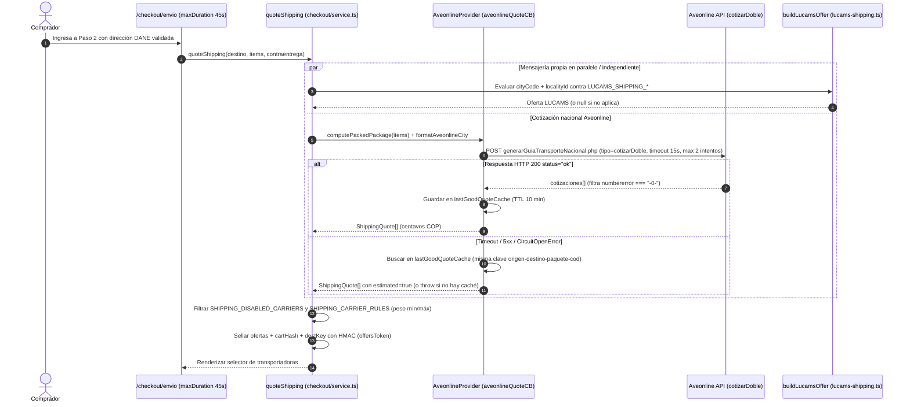
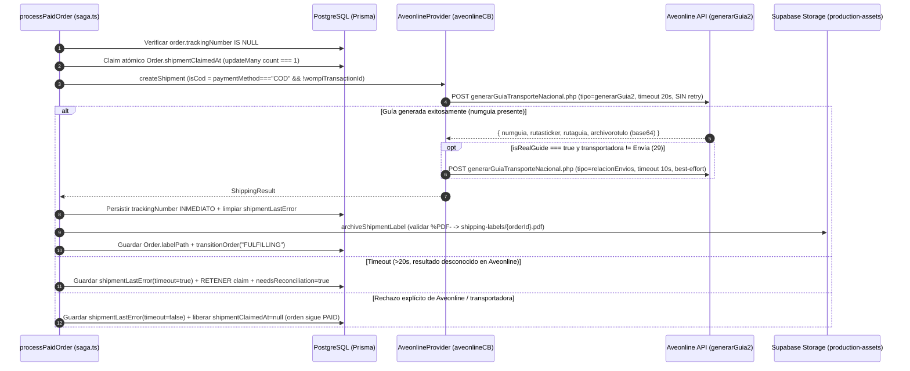
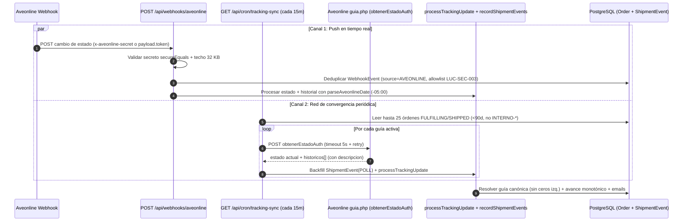

# Aveonline y Envío Propio LUCAMS — Cotización, Guías, Etiquetas PDF y Rastreo Híbrido

> **Documento vivo.** Especificación técnica canónica del subsistema logístico de **Lucams Shop**: operador multi-transportadora **Aveonline** para envíos nacionales y mensajería interna **`LUCAMS`** por localidades en Bogotá D.C. Para la máquina de estados del pedido y checkout consulta [`../domains/checkout-payments-shipping.md`](../domains/checkout-payments-shipping.md); para posventa, novedades y retracto revisa [`../domains/post-sale-and-support.md`](../domains/post-sale-and-support.md).

---

## 1. Arquitectura general y contratos (`ShippingProvider`)

Toda la logística nacional se encapsula detrás de la interfaz `ShippingProvider` (`apps/web/features/shipping/provider.ts`) con implementación única `AveonlineProvider` (`apps/web/features/shipping/aveonline.ts`). En paralelo, `apps/web/features/shipping/lucams-shipping.ts` inyecta la oferta de mensajería propia `LUCAMS` como una opción más dentro del paso `/checkout/envio`, compartiendo el mismo sello antifraude HMAC (`offersToken`) y el mismo flujo de saga post-pago.

| Módulo en código                                                        | Responsabilidad exacta                                                                                                                                                                                                                                                 |
| ----------------------------------------------------------------------- | ---------------------------------------------------------------------------------------------------------------------------------------------------------------------------------------------------------------------------------------------------------------------- |
| `apps/web/features/shipping/aveonline.ts`                               | Cliente HTTP de Aveonline (`autenticarusuario.php`, `agentes.php`, `transportadora.php`, `cotizarDoble`, `generarGuia2`, `relacionEnvios`, `obtenerEstadoAuth`, AveCRM webhooks), empaque `computePackedPackage`, normalización de ciudades y mapeo de estados/fechas. |
| `apps/web/features/shipping/settings.ts`                                | Ajustes operativos en CMS v2 (`/admin/envios`, invalidados al instante con `updateTag("cms")`): transportadoras excluidas, reglas de peso mínimo/máximo y parámetros del envío propio `LUCAMS`.                                                                        |
| `apps/web/features/shipping/label-archive.ts`                           | Extracción (base64 o descarga HTTP), validación de magic bytes `%PDF-` y archivado propio en el bucket privado `production-assets` (`shipping-labels/<orderId>.pdf` → `Order.labelPath`).                                                                              |
| `apps/web/features/orders/shipment-error.ts`                            | Persistencia sanitizada sin PII en `Order.shipmentLastError` y diagnóstico operativo `suggestShipmentFailureCause` para el panel `/admin/pedidos/[number]`.                                                                                                            |
| `apps/web/features/shipping/shipment-events.ts`                         | Historial granular idempotente cross-source en la tabla `ShipmentEvent` (`source: "WEBHOOK" \| "POLL"`) y etiquetas amigables para `/pedido/[token]`.                                                                                                                  |
| `apps/web/features/shipping/tracking-sync.ts`                           | Servicio de polling periódico (`GET /api/cron/tracking-sync`) para converger estados y descripciones cuando el webhook AveCRM se retrasa o pierde eventos.                                                                                                             |
| `apps/web/features/shipping/tracking-urls.ts`                           | Mapa verificado de portales públicos de rastreo por transportadora (`CARRIER_TRACKING_PAGES`).                                                                                                                                                                         |
| `apps/web/features/shipping/lucams-shipping.ts` + `lib/lucams-zones.ts` | Tarificación, estimación con hora de corte y validación de zonas DANE para mensajería interna `LUCAMS`.                                                                                                                                                                |
| `apps/web/lib/dane-divipola.ts`                                         | Catálogo curado DANE Divipola 2024 (32 departamentos + Bogotá D.C., ~180 municipios) con códigos postales oficiales de 6 dígitos del MinTIC (`datos.gov.co`, dataset `ixig-z8b5`).                                                                                     |

---

## 2. Autenticación, cachés en memoria y guarda `AVEONLINE_ENV`

Aveonline **no posee un servidor sandbox independiente**: tanto las pruebas como la operación real golpean `https://app.aveonline.co/api` (doc oficial: https://integraciones.aveonline.co/docs/nacional/autenticacion/, verificada 2026-10-20).

### Par único de credenciales y caché de token

1. **Variables únicas por entorno**: el código lee siempre `AVEONLINE_USUARIO` y `AVEONLINE_CLAVE`. En local y Vercel Preview contienen las credenciales de la cuenta pública de pruebas de Aveonline; en Vercel Production contienen las credenciales comerciales de **Lucams**.
2. **Endpoint de autenticación**: `POST https://app.aveonline.co/api/comunes/v1.0/autenticarusuario.php` con body `{ "tipo": "auth", "usuario": "...", "clave": "..." }`, `timeoutMs: 5_000` y `retryAttempts: 2` (presupuesto acotado para caber junto con `cotizarDoble` dentro de los `45 s` de `/checkout/envio`).
3. **Detección explícita de clave inválida**: la API PHP responde `HTTP 200` con `status: "ok"` y `cuentas: []` cuando la contraseña no coincide; `getAuthToken()` detecta ese caso y lanza un error explícito de credenciales en vez de un fallo genérico.
4. **Cachés en memoria por instancia serverless**:
   - **`tokenCache`**: vigencia documentada de `60 minutos`; se renueva preventivamente `5 minutos` antes de vencer (`55 min` efectivos), guardando `{ token, idempresa }`.
   - **`agentsCache`** (`POST /comunes/v1.0/agentes.php`, `tipo: "listarAgentesPorEmpresaAuth"`, TTL `24 h`): `resolveDefaultAgentId()` prioriza el punto de despacho con `principal` en `["S", "SI", "1"]` y si no toma el primero. Sin `idagente` válido, `generarGuia2` rechaza toda guía. Nunca cachea respuestas de error.
   - **`carriersCache`** (`POST /box/v1.0/transportadora.php`, `tipo: "listarTransportadorasPorEmpresa"`, TTL `24 h`): resuelve slugs de transportadora a `idtransportador` numérico en la saga post-pago (`resolveCarrierId`). Nunca cachea arreglos vacíos ni `status !== "ok"`.

### Guarda anti-cuenta demo en Producción (`AVEONLINE_ENV` + `idempresa 15289`)

Dado que las variables en Vercel están cifradas, `AVEONLINE_ENV` (`"test"` | `"production"`) declara la intención del entorno para la sonda `probeAveonlineHealth()` (`GET /api/health/aveonline`):

- La cuenta demo pública de Aveonline devuelve siempre `idempresa === 15289` (`DEMO_ACCOUNT_IDEMPRESA`).
- Si `AVEONLINE_ENV === "production"` pero las credenciales autenticadas devuelven `idempresa === 15289`, `probeAveonlineHealth()` marca `isDemoAccount: true` y `ok: false` (`status: "warn"` en `/api/health/aveonline` y alerta visual en `/admin/integraciones`), advirtiendo de inmediato que la tienda está autenticando contra la cuenta demo en lugar de la cuenta real de Lucams.

---

## 3. Cotización multi-carrier (`cotizarDoble`), Empaque Apilado y Reglas



### Modelo de empaque «caja apilada» (`computePackedPackage`)

Verificado contra la API real de Aveonline (doc oficial: https://integraciones.aveonline.co/docs/nacional/cotizacion/, verificada 2026-10-20):

1. Aveonline **ignora `unidades` al calcular el flete en `cotizarDoble`**, pero en `generarGuia2` imprime `unidades` como **número de cajas físicas separadas** (`1 / N` en el rótulo).
2. Todos los productos magnéticos de Lucams se despachan consolidados en **1 solo paquete físico (`unidades: 1`)**.
3. `computePackedPackage(items)` orienta cada producto por su dimensión menor como espesor de apilado (`[menor, media, mayor]` ordenadas ascendente):
   - **`altoCm`** = `max(mayor)` entre todos los ítems.
   - **`anchoCm`** = `max(media)` entre todos los ítems.
   - **`largoCm`** = `round(Σ(menor × qty) × 10) / 10` (espesor real apilado).
   - **`pesoKg`** = `max(0.1, round((Σ(weightGrams × qty) / 1000) × 10) / 10)`.
   - **`valorDeclaradoPesos`** = `max(10_000, Math.round(Σ(declaredValueCop × qty) / 100))`. Convierte nuestros centavos COP internos a **pesos enteros**, respeta el mínimo obligatorio de `$10.000 COP` de Aveonline (evita `numbererror: "-5"`) y usa `declaredValueCopPerInventoryUnit` para que los sets multi-pieza aseguren el precio real de venta de la línea sin multiplicarlo por el conteo de piezas internas.
4. **Paridad cotizado == facturado**: tanto `cotizarDoble` como `generarGuia2` llaman a `computePackedPackage`, eliminando re-liquidaciones por diferencia de volumen o peso.

### Normalización DANE (`CIUDAD(DEPTO)`) y códigos postales MinTIC

- El selector de direcciones del checkout se alimenta exclusivamente del catálogo cerrado `apps/web/lib/dane-divipola.ts` (32 departamentos + Bogotá D.C. y ~180 municipios con códigos DANE de 5 dígitos y código postal urbano de 6 dígitos del MinTIC `ixig-z8b5`).
- `formatAveonlineCity(city, department)` elimina tildes, remueve sufijos `D.C.`, pasa a mayúsculas y aplica el mapeo histórico exigido por el `listadociudades.json` de Aveonline: **Bogotá se envía siempre como `BOGOTA(CUNDINAMARCA)`** (nunca `BOGOTA(BOGOTA D.C.)`, que Aveonline rechaza con `-1`/`-2`).

### Reglas dinámicas (`/admin/envios`), aislamiento de Circuit Breakers y caché

1. **Reglas operativas en CMS (`features/shipping/settings.ts`)**: antes de firmar el `offersToken` HMAC, `quoteShipping` descarta cualquier transportadora presente en `SHIPPING_DISABLED_CARRIERS` o cuyo rango en `SHIPPING_CARRIER_RULES` (`minWeightKg` / `maxWeightKg`) sea violado por `pkg.pesoKg` (p. ej., transportadoras de carga pesada que cotizan pero luego anulan guías menores a `11 kg`). Para ofrecer contraentrega se exige simultáneamente `COD_ENABLED === "true"`, cobertura COD en la cotización y aprobación del motor de riesgo `assessCodRisk` (`BlockedIdentity`).
2. **Circuit Breaker aislado (`aveonlineQuoteCB`)**: `cotizarDoble` consulta todas las transportadoras habilitadas en servidor y tarda normalmente **7–11 segundos**; por ello corre con `timeoutMs: 15_000`, `retryAttempts: 2` y un breaker exclusivo `aveonline-quote` (`threshold: 5`, `resetMs: 30_000`). Si `cotizarDoble` se degrada, **no abre `aveonlineCB`**, preservando intacta la generación de guías de órdenes ya pagadas.
3. **Distinción cobertura vs fallo + `lastGoodQuoteCache`**:
   - Si Aveonline responde `status: "ok"` pero todas las filas traen `numbererror !== "-0-"`, es una respuesta definitiva de **sin cobertura** (`return []`), nunca se cachea ni dispara reintentos.
   - Si ocurre un fallo transitorio de red/timeout/breaker, `quote()` sirve `lastGoodQuoteCache` (en memoria, TTL **`10 minutos`**, tope `200` claves `origen→destino|cod|productos`) marcando `estimated: true` para que la UI avise «tarifa estimada». Si no hay caché disponible pero el destino tiene cobertura propia `LUCAMS`, el checkout continúa operando con `LUCAMS`.

---

## 4. Generación de guía (`generarGuia2`), Doble Compuerta, COD y `relacionEnvios`



### Reglas críticas de `generarGuia2`

1. **`timeoutMs: 20_000` y PROHIBICIÓN absoluta de retry automático**: `generarGuia2` crea un despacho facturable y no ofrece llave de idempotencia en la API de Aveonline. Si supera `20 s`, el servidor pudo haber emitido la guía igual: `saga.ts` **retiene `shipmentClaimedAt`**, registra `shipmentLastError` con `timeout: true` y prende `Order.needsReconciliation = true` para que el equipo verifique en el panel de Aveonline por `dsreferencia` (`order.id`) antes de reintentar.
2. **Doble compuerta de facturación (`isRealGuide`)**:
   ```ts
   const isRealGuide =
     process.env.AVEONLINE_GENERATE_REAL === "true" &&
     (process.env.NODE_ENV === "production" || process.env.AVEONLINE_FORCE_BILLING === "true");
   ```
   Define `bloquegenerarguia: isRealGuide ? "0" : "1"` (doc oficial: https://integraciones.aveonline.co/docs/nacional/generacionGuia/, verificada 2026-10-20):
   - `"1"` (default seguro en local, CI y Preview): modo simulación oficial; genera `numguia` y etiqueta PDF real para pruebas pero **no factura ni despacha**.
   - `"0"` (solo en Producción con `AVEONLINE_GENERATE_REAL="true"`): emite guía real facturable ante la transportadora.
3. **Regla financiera de recaudo Contraentrega (`COD`)**:
   - Según la matriz oficial de formas de pago de Aveonline (verificada 2026-07-28 en https://integraciones.aveonline.co/docs/nacional/cotizacion/), `contraentrega: 1` hace que el mensajero cobre el flete _adicional_ al destinatario y `idasumecosto: 1` le traslada también la comisión de recaudo.
   - Como `Order.total` en Lucams **ya incluye el flete** aceptado en checkout, `generarGuia2` envía **siempre `contraentrega: 0` e `idasumecosto: 0`**:
     - **Pedido prepagado (Wompi)**: `valorrecaudo: 0` → el destinatario recibe sin pagar nada.
     - **Pedido contraentrega (`COD`)**: `valorrecaudo: centsToPesos(order.total)` → el mensajero recauda exactamente `Order.total` en pesos sin cobrar el flete dos veces.
   - **Backstop anti-doble-cobro (`isCod`)**: `order.paymentMethod === "COD" && !order.wompiTransactionId`. Jamás se emite recaudo si la orden ya registra un `wompiTransactionId`.
4. **Datos de origen, destinatario y modo regalo**:
   - **Origen (remitente)**: leído dinámicamente desde `SiteSettings` en `/admin/contenido` (`PICKUP_CITY`, `PICKUP_DEPARTMENT`, `PICKUP_ADDRESS`, `PICKUP_PHONE`, `PICKUP_CONTACT_NAME`, `BUSINESS_NIT`).
   - **Destinatario**: incluye `dsbarrio` (`neighborhood`), `dscom` (`notes`, hasta 200 caracteres), `dscorreop` (obligatorio en Aveonline; validado antes de llamar a la API) y `dsnit` numérico `> 10000` (si el cliente ingresó un pasaporte sin dígitos suficientes o no ingresó documento, usa el placeholder `"100001"`). Si el pedido es regalo (`resolveShipmentRecipient`), el rótulo sale a nombre y teléfono de quien recibe, manteniendo `dscorreop` con el correo del comprador.
5. **Relación de envíos / manifiesto automático (`relacionEnvios`)**:
   - La documentación oficial de generación de guía exige `relacion_envios: "1"` para **todas las transportadoras excepto Envía (`idtransportador = "29"`)**.
   - Cuando `isRealGuide === true` y la transportadora no es Envía (`!isEnviaCarrier`), `createShipment` envía `relacion_envios: "1"` y acto seguido invoca `createShippingRelation` (`tipo: "relacionEnvios"`, `timeoutMs: 10_000`, sin retry, _best-effort_). Si falla, deja traza `shipping.aveonline.relation_fail` en logs para generarla manualmente desde el panel sin invalidar la guía ya creada.

---

## 5. Archivado propio de etiquetas PDF (`features/shipping/label-archive.ts`)

Las URLs externas devueltas por Aveonline (`rutasticker`, `rutaguia`, `rotulo`) caducan, exigen sesión o en ocasiones devuelven páginas HTML de error PHP con `HTTP 200`. Para garantizar impresión confiable en el taller de despacho, `archiveShipmentLabel` archiva una copia propia inmediatamente después de crear la guía:

1. **Prioridad de fuentes**:
   - **Fuente 1 (preferida, sin red)**: `archivorotulo` o `archivosticker` (PDF en base64 incluido dentro del JSON de respuesta de `generarGuia2`).
   - **Fuente 2**: descarga HTTP (`timeoutMs: 12_000`, máx. `15 MB`) de `labelUrl` (`rutasticker` térmico 110×120 → `rutaguia` → `rotulo`).
   - **Fuente 3**: descarga HTTP de `trackingUrl` si es distinta de `labelUrl`.
2. **Validación estricta `%PDF-` (`isPdfBuffer`)**: verifica la presencia de la firma mágica `%PDF-` dentro de los primeros `1 024 bytes` del buffer, ignorando el header `Content-Type` declarativo y rechazando cualquier HTML de error.
3. **Almacenamiento seguro**: sube con `upsert: true` al bucket privado **`production-assets`** en `shipping-labels/<orderId>.pdf` y persiste la ruta en `Order.labelPath`. En `/admin/pedidos/[number]`, solo los roles con permiso de despacho (`FULFILLMENT`, `OPERATIONS_MANAGER`, `ADMIN`, `SUPERADMIN`) pueden abrir la etiqueta mediante signed URL efímera auditada (`order.print_shipping_guide`).

---

## 6. Errores comunes en generación de guía

> **Tabla referenciada desde código (`apps/web/features/orders/shipment-error.ts`)**: cuando falla `createShipment`, la saga persiste `Order.shipmentLastError` (aplicando `scrubPii` sobre el mensaje crudo y guardando solo ciudad/departamento sin PII del cliente) y `suggestShipmentFailureCause()` traduce el fallo en el detalle administrativo `/admin/pedidos/[number]`.

| Código / Patrón en mensaje de Aveonline                               | Condición en `suggestShipmentFailureCause`                                            | Causa técnica real                                                                                                                                                                                | Acción operativa recomendada                                                                                                                                                                    |
| --------------------------------------------------------------------- | ------------------------------------------------------------------------------------- | ------------------------------------------------------------------------------------------------------------------------------------------------------------------------------------------------- | ----------------------------------------------------------------------------------------------------------------------------------------------------------------------------------------------- |
| **Timeout HTTP (`> 20 s`)**                                           | `error.timeout === true`                                                              | El socket abortó a los 20 s, pero Aveonline **pudo haber creado la guía** en su servidor.                                                                                                         | **NO reintentar a ciegas**. Buscar primero en el panel de Aveonline por referencia (`order.id`); si existe, asociar el `trackingNumber` manualmente; solo si no existe, usar «Reintentar guía». |
| **`"...no opera envios de menos de X kilos"`**                        | `/no opera\s+env[ií]os?\s+de\s+menos\s+de/`                                           | La transportadora exige un peso mínimo (p. ej. Transprensa `< 11 kg`) y el paquete es más liviano.                                                                                                | Configurar el `minWeightKg` de esa transportadora en `/admin/envios` (`SHIPPING_CARRIER_RULES`) para excluirla en futuros checkouts livianos y generar esta guía con otra transportadora.       |
| **`"Guía Anulada..."` / `"anulada"`**                                 | `msg.includes("anulada")`                                                             | La transportadora anuló la guía al emitirla por falta de cobertura real en ese municipio o cuenta en modo demo.                                                                                   | Reintentar con otra transportadora habilitada; si todas anulan, confirmar cobertura del municipio con el asesor de Aveonline.                                                                   |
| **`numbererror: "-1"` / `"origen no existe"`**                        | `msg.includes("origen no existe")`                                                    | La ciudad/departamento de recogida no coincide con `listadociudades.json` de Aveonline.                                                                                                           | Revisar `PICKUP_CITY` y `PICKUP_DEPARTMENT` en `/admin/contenido/paginas/global` (sección _Negocio_).                                                                                           |
| **`numbererror: "-2"` / `"destino no existe"`**                       | `msg.includes("destino no existe")`                                                   | El municipio de entrega no coincide con el catálogo interno de Aveonline.                                                                                                                         | Corregir ciudad/departamento en la dirección del pedido antes de reintentar.                                                                                                                    |
| **`"credenciales incorrectas"` / `"token"`**                          | `msg.includes("credenciales") \|\| msg.includes("token")`                             | `AVEONLINE_USUARIO`/`AVEONLINE_CLAVE` rechazados o token invalidado en Aveonline.                                                                                                                 | Verificar estado y credenciales en `/admin/integraciones` → tarjeta **Aveonline**.                                                                                                              |
| **`"no se encontraron productos"`**                                   | `msg.includes("no se encontraron productos")`                                         | Alguna variante carece de especificaciones físicas (`weightGrams`, `widthCm`, `heightCm`, `depthCm`).                                                                                             | Completar peso y dimensiones del producto/variante en `/admin/productos` y reintentar la guía.                                                                                                  |
| **`"No se puede generar la guia"` / `"error al momento de iniciar"`** | `msg.includes("no se pudo generar") \|\| msg.includes("error al momento de iniciar")` | Caída temporal del webservice de la transportadora final detrás de Aveonline, o cuenta sin agente (`idagente`) activo.                                                                            | Verificar que exista al menos un punto de despacho activo en Aveonline y reintentar tras unos minutos.                                                                                          |
| **`numbererror: "-5"` / `"-6"` / `"-7"` / `"-13"` / `"999"`**         | Fallback general (prevenidos por código antes de llamar)                              | `-5`: valor declarado `< $10.000 COP`; `-6`/`-7`: unidades o peso fuera de rango; `-13`: falta `dscorreop`; `999`: transportadora sin cobertura/contrato para la ruta o exceso de tope asegurado. | Prevenidos automáticamente por `computePackedPackage` (piso `$10.000`, conversión centavos→pesos) y la guarda de email previo; si aparece `999` en guía directa, cambiar de transportadora.     |

---

## 7. Rastreo híbrido de envíos (Webhook + Polling + Portales)

Para impedir que un pedido quede estancado eternamente en `FULFILLING` o `SHIPPED` (lo que bloquearía el correo de entrega, el cómputo legal de retracto desde `deliveredAt` y la conciliación de recaudos COD), Lucams combina notificaciones push y sondeo periódico sobre el mismo motor idempotente.



### 1. Webhook `POST /api/webhooks/aveonline` (`apps/web/app/api/webhooks/aveonline/route.ts`)

- **Techo de lectura**: `32 KB` (`AVEONLINE_MAX_BODY_BYTES`).
- **Autenticación en tiempo constante (`secureEquals`)**: Aveonline no firma webhooks con HMAC (doc oficial: https://integraciones.aveonline.co/docs/avecrm/crearWebhook/, verificada 2026-10-20). Se exige coincidencia con `AVEONLINE_WEBHOOK_SECRET` por:
  1. Header `x-aveonline-secret`, o
  2. Propiedad `payload.token` del JSON (el campo _Token_ configurado en _Mis integraciones_ del panel Aveonline).
  3. Query string `?secret=` **deshabilitado por defecto**; solo se acepta si `AVEONLINE_ALLOW_QUERY_SECRET === "true"` durante migraciones puntuales (evita filtrar el secreto en logs de proxy/CDN).
  - Cualquier intento inválido persiste un `SecurityEvent` (`WEBHOOK_INVALID_SIGNATURE`) y devuelve `HTTP 401` (`HTTP 503` en producción si `AVEONLINE_WEBHOOK_SECRET` no estuviera configurada).
- **Doble formato soportado y fechas en hora Colombia (`-05:00`)**: `handleWebhook` convierte `guia` numérica a `String` y soporta tanto el formato legacy (`estado: [{ estado_id, nombre_estado, fecha }]`) como AveCRM (`estado: [{ nombre, timestamp }]` u objeto único). `parseAveonlineDate` interpreta cadenas sin zona horaria (`YYYY-MM-DD HH:mm:ss` del webhook y `MM/DD/YYYY HH:mm:ss` de `fechamostrar` en polling) fijándoles explícitamente el offset **`-05:00` (`America/Bogota`)** para evitar desfases de 5 horas en servidores UTC.
- **Deduplicación y privacidad (`LUC-SEC-003`)**: crea `WebhookEvent` con `source: "AVEONLINE"` y `externalId: "${trackingNumber}-${status}-${hasCarrierTimestamp ? timestampMs : 'no-ts'}"` (capturando `P2002` en carreras). El `payload` guardado aplica allowlist estricta sin almacenar jamás `payload.token` ni texto crudo.
- **Resolución canónica de guías (`canonicalTrackingNumber`)**: `generarGuia2` suele devolver números con cero inicial (ej. `"014164727329"`) mientras que el webhook los reporta sin ceros a la izquierda (`"14164727329"`). `findOrderByTrackingNumber` busca primero coincidencia exacta y luego compara formas canónicas sin ceros iniciales. Si ninguna orden coincide, emite una alerta administrativa in-app (`tracking-no-match`) para asociación manual.
- **Transiciones monotónicas (`processTrackingUpdate`)**:
  - Auto-sana `PAID → FULFILLING` si la orden tenía guía pero quedó en `PAID`.
  - `DISPATCHED` / `IN_TRANSIT` (incluyendo estados reales de bodega como `"MERCANCIA RECOGIDA"`, `"EN BODEGA ORIGEN"`, `"EN BODEGA DESTINO"`, `"EN REPARTO"`) desde `FULFILLING` → avanza a **`SHIPPED`** y envía `sendOrderShipped`.
  - `DELIVERED` desde `SHIPPED` o `FULFILLING` → avanza a **`DELIVERED`**, sella `deliveredAt` y envía `sendOrderDelivered`.
  - `RETURNED` / `EXCEPTION` (devoluciones, novedades, guías anuladas) → **no auto-cancela ni reembolsa sola**; prende `Order.needsReconciliation = true`, alerta al equipo y notifica al comprador con `notifyOrderReturned`.
- **Historial granular (`ShipmentEvent`)**: `recordShipmentEvents` inserta todos los hitos en `ShipmentEvent` con `dedupKey` cross-source por minuto (`guía|estado|minuto|rawNormalizado`, y clave única sin tiempo `${guía}|GENERADA` anclada a `Order.shipmentClaimedAt`), alimentando la línea de tiempo pública con textos claros (`friendlyCarrierEventLabel`).

### 2. Cron de respaldo `GET /api/cron/tracking-sync`

- **Frecuencia**: `4,19,34,49 * * * *` (**cada 15 minutos**, migración `044`, `maxDuration = 60`).
- **Alcance por corrida**: selecciona hasta **25 órdenes** (`TRACKING_SYNC_BATCH = 25`) en estado `FULFILLING` o `SHIPPED`, creadas en los últimos **90 días**, con `trackingNumber` no nulo y **excluyendo prefijo `INTERNO-`**, priorizando las de `updatedAt` más antiguo.
- **Efecto**: consulta `obtenerEstadoAuth` (`POST /nal/v1.0/guia.php`, `timeoutMs: 5_000`, `retry: true`), enriquece `ShipmentEvent` (`source: "POLL"`) con las descripciones operativas detalladas (`historicos[].descripcion`) que el webhook no incluye, e invoca `processTrackingUpdate` para converger cualquier despacho o entrega cuyo webhook no haya llegado.

### 3. URLs públicas verificadas de rastreo por transportadora (`tracking-urls.ts`)

Como `Order.trackingUrl` en Aveonline apunta al PDF de la etiqueta (`rutaguia`) y los portales colombianos requieren digitar el número de guía en formulario, la vista primaria del comprador es siempre `/pedido/[token]` acompañada del botón secundario hacia el portal oficial verificado:

| Slug(s) en `Order.shippingCarrier`       | Transportadora               | URL pública verificada (`CARRIER_TRACKING_PAGES`)                                         |
| ---------------------------------------- | ---------------------------- | ----------------------------------------------------------------------------------------- |
| `envia`                                  | Envía                        | `https://envia.co/tracking` _(el dominio antiguo `.com.co` está inactivo)_                |
| `servientrega`                           | Servientrega                 | `https://www.servientrega.com/wps/portal/rastreo-envio`                                   |
| `coordinadora`, `coordinadora-mercantil` | Coordinadora Mercantil       | `https://coordinadora.com/rastreo/rastreo-de-guia/`                                       |
| `tcc`, `tcc-sa`                          | TCC                          | `https://tcc.com.co/rastreo/`                                                             |
| `interrapidisimo`                        | Interrapidísimo              | `https://www.interrapidisimo.com/`                                                        |
| `99minutos`                              | 99minutos                    | `https://tracking.99minutos.com/`                                                         |
| `domina`                                 | Domina                       | `https://tracking.infokairos.com.co/`                                                     |
| `saferbo`, `go-envios`, `lucams`         | Saferbo / Go Envíos / LUCAMS | `null` _(sin portal externo verificable; el seguimiento vive 100 % en `/pedido/[token]`)_ |

---

## 8. Coexistencia con transportadora propia en Bogotá (`LUCAMS`)

Lucams opera su propia mensajería local bajo el identificador `LUCAMS_CARRIER = "lucams"` y nombre visible **`LUCAMS`** (`apps/web/features/shipping/lucams-shipping.ts` + `apps/web/lib/lucams-zones.ts`):

- **Cobertura geográfica**: catálogo modular por código DANE municipal (`LUCAMS_ZONE_CITIES`), activo hoy para **Bogotá D.C. (`11001`)** con sus **20 localidades oficiales** (`usaquen`, `chapinero`, `santa-fe`, `san-cristobal`, `usme`, `tunjuelito`, `bosa`, `kennedy`, `fontibon`, `engativa`, `suba`, `barrios-unidos`, `teusaquillo`, `los-martires`, `antonio-narino`, `puente-aranda`, `la-candelaria`, `rafael-uribe-uribe`, `ciudad-bolivar`, `sumapaz`).
- **Ajustes dinámicos en `/admin/envios` (`features/shipping/settings.ts`)**:
  - `LUCAMS_SHIPPING_ENABLED`: `"true"` / `"false"` (no permite activar si hay `0` zonas marcadas).
  - `LUCAMS_SHIPPING_PRICE_COP`: tarifa plana en **centavos COP** (default `1_000_000` = `$10.000 COP`).
  - `LUCAMS_SHIPPING_CUTOFF_HOUR`: hora de corte en `America/Bogota` (`0–23`, default `12`).
  - `LUCAMS_SHIPPING_ZONES`: JSON `{ "11001": ["usaquen", "chapinero", ...] }` (_fail-closed_ si es `{}`).
- **Cálculo de promesa y seguridad en checkout**:
  - `deliveryDays = maxProductionDays + (bogotaHour >= cutoffHour ? 1 : 0)` (incluye fabricación a mano más ruta local).
  - **Sin contraentrega (`contraentrega: false`)**: requiere pago previo por Wompi.
  - Sella `quoteId: "lucams-11001-<zoneId>"` dentro del `offersToken` HMAC y, adicionalmente, `finalizeCheckout` revalida en vivo que el servicio y la localidad sigan activos en el momento exacto de pagar.
- **Comportamiento post-pago**: **cero llamadas a la API de Aveonline**. `processPaidOrder` reclama atómicamente `trackingNumber = "INTERNO-<order.number>"` (ej. `INTERNO-LCM-2026-0045`) y transiciona el pedido a `FULFILLING`. El despacho y la entrega se marcan desde `/admin/pedidos/[number]`, disparando los mismos correos transaccionales al cliente.

---

## 9. Checklist paso a paso en el Panel de Aveonline (`app.aveonline.co`)

Ejecuta esta verificación al configurar la cuenta comercial de Lucams o auditar el paso de demo a producción:

### Paso 1 — Agentes (Puntos de despacho / recogida)

- [ ] Ingresar a **https://app.aveonline.co/** con el usuario comercial de Lucams.
- [ ] En **Configuración / Agentes (Puntos de despacho)**, verificar que exista al menos **un agente activo** con dirección real de taller y marcado como **Principal (`SI`)** (`resolveDefaultAgentId` lo exige para `generarGuia2`).
- [ ] En `/admin/contenido/paginas/global` (sección _Negocio_), verificar que `PICKUP_CITY`, `PICKUP_DEPARTMENT`, `PICKUP_ADDRESS`, `PICKUP_PHONE`, `PICKUP_CONTACT_NAME` y `BUSINESS_NIT` coincidan con los datos registrados en Aveonline.

### Paso 2 — Transportadoras y Reglas Operativas

- [ ] En el panel de Aveonline, confirmar qué transportadoras tienen contrato y logística de recaudo/prepagado habilitada para la empresa.
- [ ] En `/admin/envios` de Lucams Shop:
  - Desactivar en la lista cualquier transportadora habilitada en Aveonline que el negocio decida no ofrecer (`SHIPPING_DISABLED_CARRIERS`).
  - Configurar pesos mínimos/máximos en `SHIPPING_CARRIER_RULES` para transportadoras de carga semipesada (ej. `minWeightKg: 11` en Transprensa).

### Paso 3 — Registro del Webhook de Estados

- [ ] Generar un secreto aleatorio criptográfico (`≥ 32` caracteres) y guardarlo en Vercel como `AVEONLINE_WEBHOOK_SECRET` (manteniendo `AVEONLINE_ALLOW_QUERY_SECRET` ausente o `"false"`).
- [ ] En el panel de Aveonline (**Mis integraciones → Webhooks de estados de guías** — o mediante la herramienta administrativa que invoca `createAveonlineWebhook`), registrar:
  - **URL**: `https://lucamsshop.com/api/webhooks/aveonline`
  - **Token**: pegar exactamente el valor de `AVEONLINE_WEBHOOK_SECRET` (Aveonline lo reenviará en `payload.token` en cada notificación).

### Paso 4 — Variables de Producción y Doble Compuerta

- [ ] En Vercel (**Production**), configurar:
  - `AVEONLINE_USUARIO` y `AVEONLINE_CLAVE` de la cuenta real de Lucams (nunca la cuenta demo `15289`).
  - `AVEONLINE_ENV=production`
  - `AVEONLINE_GENERATE_REAL=true` (solo en Production; en Preview y local mantener `AVEONLINE_GENERATE_REAL=false` para operar con `bloquegenerarguia="1"` sin facturar).
- [ ] Consultar `GET https://lucamsshop.com/api/health/aveonline` y confirmar `{ "status": "ok", "mode": "production", "authenticated": true, "isDemoAccount": false }`.
