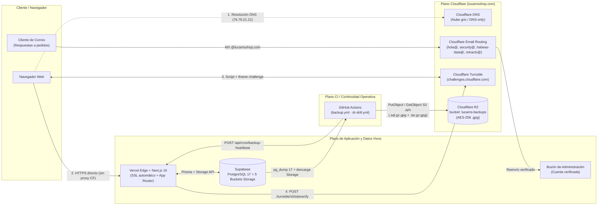
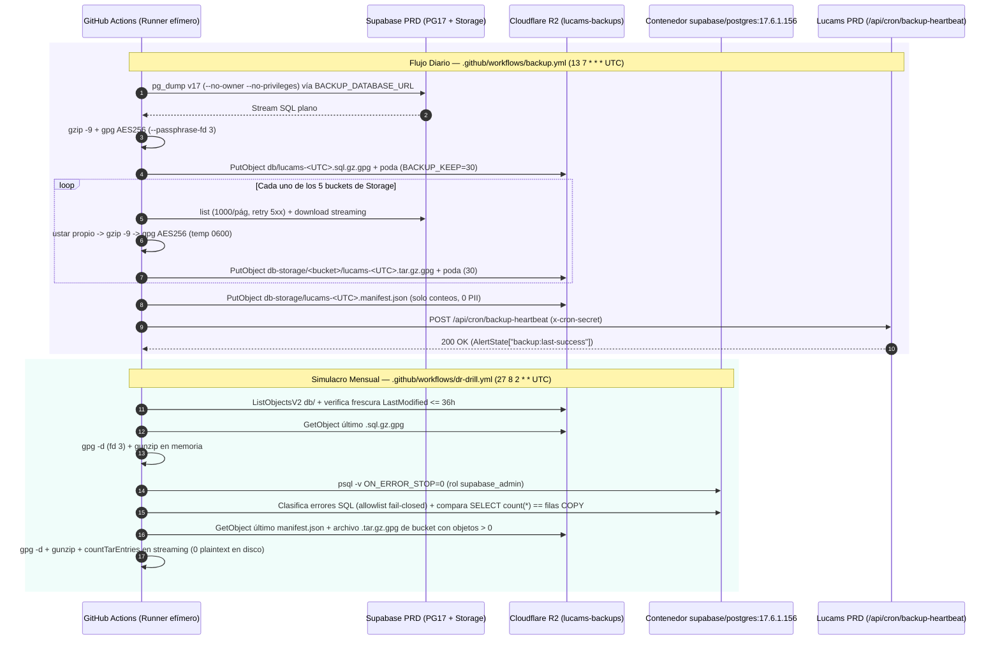

# Cloudflare (DNS, Email Routing, Turnstile y R2) — Lucams Shop

> **Documento vivo.** Fuente canónica de las cuatro capacidades que **Lucams Shop** opera sobre **Cloudflare**: resolución DNS autoritativa de `lucamsshop.com` (en modo _DNS-only_ hacia Vercel), recepción y reenvío de buzones corporativos con **Cloudflare Email Routing**, protección anti-bot **Cloudflare Turnstile** en formularios transaccionales y públicos, y almacenamiento cifrado off-site de respaldos diarios y simulacros DR en **Cloudflare R2**.

---

## 1. Rol de Cloudflare en la arquitectura y frontera con Vercel

A diferencia de una topología tradicional donde Cloudflare actúa como proxy inverso (CDN/WAF de «nube naranja») delante del servidor de origen, en **Lucams Shop** el plano de cómputo, TLS público, caché de rutas ISR y red de borde lo provee directamente **Vercel** (ver [`./vercel.md`](./vercel.md)). Cloudflare opera como plano de infraestructura perimetral y resiliencia mediante cuatro servicios independientes:

1. **DNS autoritativo (`lucamsshop.com`)**: delegado desde el registrador colombiano `mi.com.co` (ver [`./github-and-ops.md`](./github-and-ops.md)). Los registros web (`@` y `www`) operan estrictamente en modo **DNS-only (nube gris)** para que Vercel gestione sin intermediarios los certificados SSL automáticos (Let's Encrypt), el enrutamiento HTTP/2–HTTP/3 y la cabecera no falsificable `x-vercel-forwarded-for`.
2. **Cloudflare Email Routing**: recibe en el dominio raíz `@lucamsshop.com` las respuestas de clientes (`EMAIL_REPLY_TO="hola@lucamsshop.com"`) y los correos dirigidos a los buzones legales y de seguridad, redirigiéndolos al buzón verificado de administración sin pagar licencias de suite de correo corporativo.
3. **Cloudflare Turnstile**: desafío anti-bot adaptativo sin CAPTCHAs visuales intrusivos, montado en cliente con `<TurnstileWidget />` y verificado de extremo a extremo desde el servidor en `apps/web/lib/turnstile.ts` sobre **10 puntos de invocación en 9 archivos**.
4. **Cloudflare R2 (`lucams-backups`)**: repositorio compatible con S3 dedicado **exclusivamente** a copias de seguridad diarias cifradas con GPG AES-256 (PostgreSQL + los 5 buckets de Supabase Storage) y simulacros mensuales automatizados de restauración desde GitHub Actions. **El runtime web de Next.js tiene cero lectura y cero escritura contra R2**: todos los archivos vivos de clientes, catálogo y producción residen en Supabase Storage (ver [`./supabase.md`](./supabase.md)).



### Resumen de qué pasa y qué NO pasa por Cloudflare

| Tráfico / Operación                                                                   | ¿Pasa por proxy Cloudflare?             | Destino real                                                               | Motivo arquitectónico                                                                                                                          |
| ------------------------------------------------------------------------------------- | --------------------------------------- | -------------------------------------------------------------------------- | ---------------------------------------------------------------------------------------------------------------------------------------------- |
| Navegación HTTPS (`lucamsshop.com`, `www`), Server Actions y API Routes               | **No** (_DNS-only_, nube gris)          | Vercel Edge Network                                                        | Evita doble CDN sobre ISR/RSC, bucles de redirección TLS, bloqueos ACME HTTP-01 de Vercel y pérdida de la IP real en `x-vercel-forwarded-for`. |
| Webhooks entrantes (`/api/webhooks/{wompi,aveonline,resend}`) y crons (`/api/cron/*`) | **No** (_DNS-only_, nube gris)          | Vercel Edge Network                                                        | Evita falsos positivos de WAF/Bot Fight Mode sobre firmas criptográficas legítimas de Wompi, Aveonline, Svix y `pg_net`.                       |
| Correo saliente transaccional y comercial (`@mail.lucamsshop.com`)                    | **No** (solo registros DNS SPF/DKIM/MX) | Amazon SES vía Resend ([`./resend-and-emails.md`](./resend-and-emails.md)) | El envío sale directo desde Resend con reputación aislada en el subdominio `mail.lucamsshop.com`.                                              |
| Correo entrante a `@lucamsshop.com` (`hola@`, `security@`, legales)                   | **Sí** (MX de Email Routing)            | Cloudflare Email Routing → buzón admin                                     | Provee recepción real para `EMAIL_REPLY_TO` y canales regulatorios sin operar servidores IMAP/SMTP propios.                                    |
| Reto anti-bot de formularios públicos                                                 | **Sí** (iframe + API `siteverify`)      | `challenges.cloudflare.com`                                                | Evalúa señales de telemetría del navegador y valida tokens de un solo uso server-side.                                                         |
| Imágenes de productos, CMS, fotos del Estudio y PNGs 300 DPI                          | **No**                                  | Supabase Storage ([`./supabase.md`](./supabase.md))                        | El runtime web sirve e ingesta activos únicamente contra los 5 buckets de Supabase Storage.                                                    |
| Backups diarios cifrados de BD + Storage y simulacros DR                              | **Sí** (API S3 sobre TLS)               | Cloudflare R2 (`lucams-backups`)                                           | Copia independiente fuera de Supabase/AWS con \$0 de costo por egreso en restauraciones.                                                       |

---

## 2. Configuración DNS de `lucamsshop.com`

La zona autoritativa `lucamsshop.com` en Cloudflare concentra los registros de resolución web, autenticación de correo saliente, enrutamiento de correo entrante y verificación de propiedad ante Google.

> **Regla crítica de operación:** todos los registros de la tabla siguiente llevan el estado de proxy en **DNS only (nube gris)**. Activar el proxy naranja (`Proxied`) sobre `@` o `www` rompe la renovación automática de certificados de Vercel y altera las cabeceras de red que `apps/web/lib/client-ip.ts` inspecciona para rate-limiting (ver [`../SECURITY.md`](../SECURITY.md)).

### Inventario completo de registros DNS

| Categoría          | Tipo    | Nombre (Host)                           | Valor / Destino                                                                    | Proxy    | Propósito técnico                                                                                                                                                      |
| ------------------ | ------- | --------------------------------------- | ---------------------------------------------------------------------------------- | -------- | ---------------------------------------------------------------------------------------------------------------------------------------------------------------------- |
| **Web (Vercel)**   | `A`     | `@` (`lucamsshop.com`)                  | `76.76.21.21`                                                                      | DNS only | Apunta el dominio raíz (apex) al anycast IPv4 oficial de Vercel para aprovisionar SSL automático y servir producción.                                                  |
| **Web (Vercel)**   | `CNAME` | `www`                                   | `cname.vercel-dns.com`                                                             | DNS only | Delega `www.lucamsshop.com` a Vercel, donde redirige con `308`/`301` hacia el host canónico `https://lucamsshop.com`.                                                  |
| **Envío Resend**   | `MX`    | `mail` (o `send.mail` según región SES) | `feedback-smtp.us-east-1.amazonses.com` (prioridad `10`)                           | DNS only | Canal `Return-Path` donde Amazon SES / Resend recibe rebotes asíncronos de `@mail.lucamsshop.com`.                                                                     |
| **Envío Resend**   | `TXT`   | `mail` (o `send.mail`)                  | `v=spf1 include:amazonses.com ~all`                                                | DNS only | Autoriza mediante SPF a los servidores de Amazon SES operados por Resend a emitir desde `@mail.lucamsshop.com`.                                                        |
| **Envío Resend**   | `TXT`   | `resend._domainkey.mail`                | `p=MIGfMA0GCSqGSIb3DQEBAQUAA4GNADCBiQKBgQ...`                                      | DNS only | Clave pública RSA para la firma criptográfica DKIM de todos los correos salientes de Resend y SMTP Auth.                                                               |
| **Envío Resend**   | `TXT`   | `_dmarc.mail`                           | `v=DMARC1; p=quarantine; rua=mailto:dmarc@mail.lucamsshop.com; pct=100`            | DNS only | Política DMARC dedicada al subdominio `mail.lucamsshop.com` (alineación estricta SPF/DKIM; escalable a `p=reject`).                                                    |
| **Recepción CF**   | `MX`    | `@`                                     | `route1.mx.cloudflare.net`, `route2.mx.cloudflare.net`, `route3.mx.cloudflare.net` | DNS only | Registros gestionados automáticamente por Cloudflare Email Routing para recibir correo dirigido a `*@lucamsshop.com`.                                                  |
| **Recepción CF**   | `TXT`   | `@`                                     | `v=spf1 include:_spf.mx.cloudflare.net ~all`                                       | DNS only | Autoriza a la infraestructura de Cloudflare Email Routing a reenviar mensajes entrantes preservando validación SPF/ARC.                                                |
| **Seguridad Apex** | `TXT`   | `_dmarc`                                | `v=DMARC1; p=quarantine; pct=100`                                                  | DNS only | Protege el dominio raíz `@lucamsshop.com` frente a suplantación de identidad (_spoofing_) directa sobre buzones humanos.                                               |
| **SEO / Google**   | `TXT`   | `@`                                     | `google-site-verification=<token>`                                                 | DNS only | Verifica la propiedad tipo _Domain_ en Google Search Console y habilita el reclamo del dominio en Google Merchant Center ([`./google-and-ai.md`](./google-and-ai.md)). |

> **Coexistencia de múltiples registros `TXT` en `@`:** `google-site-verification=...` y `v=spf1 include:_spf.mx.cloudflare.net ~all` coexisten como registros `TXT` separados en la raíz `@`. Nunca debe crearse un segundo registro `v=spf1` en `@` (RFC 7208 § 3.2 invalida SPF con `permerror` si existen dos políticas `v=spf1` en el mismo nivel DNS; el SPF de Resend vive aislado en `mail`, no en `@`).

---

## 3. Cloudflare Email Routing (buzones operativos y `EMAIL_REPLY_TO`)

El subdominio de envío `mail.lucamsshop.com` está delegado a Amazon SES / Resend exclusivamente para salida y rebote técnico, por lo que **carece de bandeja de entrada humana**. Si un comprador responde a un correo de confirmación de pedido o de soporte sin una dirección de respuesta explícita, el mensaje se perdería.

Para cerrar ese ciclo sin costo fijo mensual, **Cloudflare Email Routing** captura los correos entrantes en el dominio raíz `@lucamsshop.com` y los reenvía mediante ARC (_Authenticated Received Chain_) al buzón personal verificado de administración de Lucams Shop.

### Buzones enrutados y su rol en el código

| Buzón público (`@lucamsshop.com`) | Variable / Setting CMS / Token                                                           | Superficies donde interviene                                                                                     | Rol operativo y normativo                                                                                                                                                                                                                                                                                                                                                  |
| --------------------------------- | ---------------------------------------------------------------------------------------- | ---------------------------------------------------------------------------------------------------------------- | -------------------------------------------------------------------------------------------------------------------------------------------------------------------------------------------------------------------------------------------------------------------------------------------------------------------------------------------------------------------------- |
| `hola@lucamsshop.com`             | `EMAIL_REPLY_TO` (`PROD_REQUIRED`), `CONTACT_EMAIL`, `ALERT_EMAIL`, `{{email_contacto}}` | `apps/web/lib/resend.ts`, `apps/web/lib/env.ts`, footer, `/contacto`, `/ayuda`, `/unsubscribe`, alertas críticas | **Crítico en arranque (`lib/env.ts`)**: `validateEnv()` bloquea el arranque en producción si falta `EMAIL_REPLY_TO`. Todo correo emitido por `lib/resend.ts` inyecta `reply_to: EMAIL_REPLY_TO` por defecto, además de actuar como fallback del destinatario interno de alertas, pedidos pagados, cotizaciones y B2B ([`./resend-and-emails.md`](./resend-and-emails.md)). |
| `security@lucamsshop.com`         | `SECURITY_EMAIL`, `{{email_security}}`                                                   | `apps/web/public/.well-known/security.txt` (RFC 9116), `/legal/security`                                         | Canal oficial de divulgación responsable de vulnerabilidades exigido por la política de seguridad ([`../SECURITY.md`](../SECURITY.md)).                                                                                                                                                                                                                                    |
| `habeas-data@lucamsshop.com`      | `HABEAS_DATA_EMAIL`, `{{email_habeas_data}}`                                             | `/legal/privacidad`, `/legal/habeas-data`, `/legal/cookies`, `/contacto`, `/mi-cuenta`                           | Canal dedicado para consultas, rectificaciones, revocatorias y supresión de datos personales bajo la Ley 1581 de 2012 ([`../COMPLIANCE.md`](../COMPLIANCE.md)).                                                                                                                                                                                                            |
| `retracto@lucamsshop.com`         | `RETRACTO_EMAIL`, `{{email_retracto}}`                                                   | `/legal/terminos`, `/legal/devoluciones`                                                                         | Canal documental alterno para radicar derecho de retracto (Ley 1480 art. 47), complementario al autoservicio en `/mi-cuenta` y `/pedido/[token]` ([`../domains/post-sale-and-support.md`](../domains/post-sale-and-support.md)).                                                                                                                                           |

> **Sustitución dinámica en documentos legales:** dentro de `packages/db/legal-content/*.md` los buzones se referencian mediante los tokens `{{email_contacto}}`, `{{email_security}}`, `{{email_habeas_data}}` y `{{email_retracto}}`, resueltos en tiempo de renderizado por `resolveCmsTokens()` (`apps/web/lib/cms-tokens.ts`) a partir de los settings publicados en `/admin/contenido/paginas/global`.
>
> **Política Catch-All recomendada:** mantener la regla _Catch-All_ de Cloudflare Email Routing en **Drop** (desactivada), habilitando únicamente reglas explícitas (_Custom addresses_) para los cuatro buzones anteriores y cualquier alias administrativo puntual. Esto evita reenviar spam aleatorio dirigido a direcciones inexistentes del dominio.

---

## 4. Cloudflare Turnstile (protección anti-bot)

Lucams Shop protege sus formularios públicos y transaccionales con **Cloudflare Turnstile** sin instalar paquetes npm de terceros, combinando un wrapper ligero de cliente (`apps/web/components/turnstile-widget.tsx`) con validación estricta server-side (`apps/web/lib/turnstile.ts`).

> **Cuota oficial verificada (Mandato #9):** el plan gratuito de Cloudflare Turnstile cuesta **\$0 USD/mes**, incluye hasta **1.000.000 de llamadas mensuales a `siteverify` por sitio** y permite hasta **20 widgets por cuenta** (fuentes oficiales: [cloudflare.com/products/turnstile](https://www.cloudflare.com/products/turnstile/) y [developers.cloudflare.com/turnstile/get-started/server-side-validation](https://developers.cloudflare.com/turnstile/get-started/server-side-validation/), verificado el 2026-05-09).

### 4.1. Arquitectura del widget cliente (`apps/web/components/turnstile-widget.tsx`)

1. **Carga diferida sin SDK:** utiliza `<Script src="https://challenges.cloudflare.com/turnstile/v0/api.js" strategy="afterInteractive" async defer />` de Next.js.
2. **Renderizado programático explícito:** monta el desafío invocando `window.turnstile.render(containerRef.current, { sitekey, theme, size, callback, "expired-callback", "error-callback" })` sobre `<div className="lucams-turnstile-host" />` (reintentando cada `200 ms` si el script externo aún no terminó de evaluar, y limpiando con `window.turnstile.remove(widgetId)` al desmontar).
3. **Prohibición deliberada de `className="cf-turnstile"`:** el contenedor usa `lucams-turnstile-host` porque el script de Cloudflare auto-detecta cualquier nodo `.cf-turnstile` e intenta auto-renderizarlo antes del `useEffect` de React; sin `data-sitekey` en el DOM, el auto-render lanzaba `Invalid or missing type for parameter sitekey`.
4. **Inyección automática en `FormData`:** al resolverse el reto, Turnstile inyecta dentro del contenedor un `<input type="hidden" name="cf-turnstile-response" value="<token>" />` que viaja nativamente en el `FormData` hacia la Server Action.
5. **Props soportadas:**
   - `size`: `"normal" | "compact" | "flexible" | "invisible"` (default `"flexible"`).
   - `theme`: `"auto" | "light" | "dark"` (default `"light"`).
   - `onTokenChange?: (token: string | null) => void`: almacenado en un `useRef` interno para no re-montar el reto cuando el padre pasa una función inline.
   - `refreshKey?: number`: al incrementarse, fuerza el desmontaje y creación de un nuevo desafío cuando un token de un solo uso ya fue consumido o expiró.
6. **Montaje perezoso en el footer (`apps/web/components/newsletter-form.tsx`):** dado que el formulario del boletín vive en el pie de todas las páginas públicas, `<NewsletterForm />` mantiene inicialmente un `<input type="hidden" name="cf-turnstile-response" value="" />` inerte y solo activa `<TurnstileWidget size="compact" />` (`challengeActive = true`) cuando el formulario entra en el viewport o recibe foco/interacción del usuario, evitando descargar el script e iframe de Cloudflare en cada visita de lectura.
7. **Directivas CSP (`apps/web/lib/security-headers.ts`):** `buildCsp()` autoriza `https://challenges.cloudflare.com` únicamente en `script-src` y `frame-src`. No se incluye en `connect-src` del navegador porque la verificación del token ocurre exclusivamente servidor a servidor.

### 4.2. Verificación server-side, timeout y postura fail-closed (`apps/web/lib/turnstile.ts`)

La función `verifyTurnstileToken(token, remoteIp)` (`server-only`) envía una petición `POST https://challenges.cloudflare.com/turnstile/v0/siteverify` con cuerpo `application/x-www-form-urlencoded` (`secret`, `response` y opcionalmente `remoteip`, obtenida con `getClientIp(await headers())` priorizando `x-vercel-forwarded-for`) y **`AbortSignal.timeout(5000)` (5 segundos)**.

| Escenario                              | Condición evaluada                                   | Resultado devuelto (`TurnstileResult`)                                    | Evento de log                                 | Efecto en el flujo                                                                                                                                                                                    |
| -------------------------------------- | ---------------------------------------------------- | ------------------------------------------------------------------------- | --------------------------------------------- | ----------------------------------------------------------------------------------------------------------------------------------------------------------------------------------------------------- |
| **Producción sin clave secreta**       | `!TURNSTILE_SECRET_KEY && NODE_ENV === "production"` | `{ success: false, errorCodes: ["missing-secret"], reason: "no-config" }` | `logger.error("turnstile.no_secret_in_prod")` | **Fail-closed total**: bloquea el formulario (además `validateEnv()` en `lib/env.ts` impide el arranque si falta en `VERCEL_ENV === "production"`).                                                   |
| **Desarrollo local sin llaves**        | `!TURNSTILE_SECRET_KEY && NODE_ENV !== "production"` | `{ success: true }`                                                       | —                                             | **Bypass controlado de desarrollo**: permite trabajar localmente sin credenciales externas.                                                                                                           |
| **Token vacío o ausente**              | `!token`                                             | `{ success: false, errorCodes: ["missing-token"], reason: "no-token" }`   | —                                             | **Bloquea** la acción antes de tocar base de datos o proveedores externos.                                                                                                                            |
| **Error HTTP de Cloudflare**           | `!r.ok` (ej. `5xx` / `429`)                          | `{ success: false, errorCodes: ["http-<status>"], reason: "http-error" }` | `logger.warn("turnstile.verify.http_fail")`   | **Fail-closed**: rechaza el envío.                                                                                                                                                                    |
| **Token inválido, expirado o reusado** | `data.success === false`                             | `{ success: false, errorCodes, reason: "rejected" }`                      | `logger.warn("turnstile.verify.failed")`      | **Fail-closed**: cada token Turnstile es de un solo uso y caduca a los 300 s ([doc oficial](https://developers.cloudflare.com/turnstile/get-started/server-side-validation/), verificado 2026-05-09). |
| **Timeout (> 5 s) o caída de red**     | `catch (err)`                                        | `{ success: false, errorCodes: ["exception"], reason: "network" }`        | `logger.error("turnstile.verify.exception")`  | **Fail-closed**: protege los endpoints frente a abuso durante degradaciones de red.                                                                                                                   |

### 4.3. Llaves dummy oficiales para Preview (STG) y CI E2E

Las llaves reales de producción en Cloudflare Turnstile restringen criptográficamente el _hostname_ autorizado a `lucamsshop.com` y `www.lucamsshop.com`. Si se usaran en los despliegues Preview de Vercel (`*.vercel.app`) o en runners efímeros de Playwright (`localhost`), Cloudflare rechazaría todo intento con `hostname-mismatch`.

Por ello, el scope **Preview** de Vercel y los jobs E2E de `.github/workflows/nightly-full.yml` configuran las llaves públicas de prueba _Always Pass_ documentadas oficialmente por Cloudflare ([Testing Turnstile](https://developers.cloudflare.com/turnstile/troubleshooting/testing/), verificado 2026-05-09):

- `NEXT_PUBLIC_TURNSTILE_SITE_KEY=1x00000000000000000000AA` (renderiza un widget real que emite un token dummy válido).
- `TURNSTILE_SECRET_KEY=1x0000000000000000000000000000000AA` (acepta únicamente tokens dummy emitidos por la sitekey de prueba y rechaza tokens reales).

### 4.4. Inventario completo de puntos de invocación (10 llamadas en 9 archivos)

Cada uno de los siguientes flujos lee `formData.get("cf-turnstile-response")` en el servidor y exige `turnstile.success === true` **antes** de ejecutar mutaciones, cobros, generación de guías o envíos de correo:

| #   | Flujo / Ruta pública                                         | Componente cliente (`<TurnstileWidget />`)                                     | Archivo y Server Action                                                         | Rate limit complementario                                                     | Comportamiento ante rechazo                                                                                                                                                                 |
| --- | ------------------------------------------------------------ | ------------------------------------------------------------------------------ | ------------------------------------------------------------------------------- | ----------------------------------------------------------------------------- | ------------------------------------------------------------------------------------------------------------------------------------------------------------------------------------------- |
| 1   | Registro de cliente (`/registro`)                            | `apps/web/app/(auth)/registro/registro-form.tsx`                               | `apps/web/app/(auth)/registro/actions.ts` → `signupAction`                      | Doble bucket por IP y por email                                               | Corta antes de consultar HIBP y Supabase Auth; devuelve mensaje de recarga en el formulario.                                                                                                |
| 2   | Recuperación de contraseña (`/recuperar-password`)           | `apps/web/app/(auth)/recuperar-password/recuperar-form.tsx`                    | `apps/web/app/(auth)/recuperar-password/actions.ts` → `recuperarPasswordAction` | `10/h` prod (`30/h` dev) por IP y por email (`reset-password`)                | Corta vectores de _email-bombing_ OTP antes de invocar GoTrue.                                                                                                                              |
| 3   | Checkout con pasarela Wompi (`/checkout/pago`)               | `apps/web/app/checkout/pago/pay-button.tsx` (`size="flexible"`)                | `apps/web/app/checkout/pago/actions.ts` → `payWompiAction`                      | `20/10 min` prod (`100` dev) por IP (`checkout_pay`)                          | Registra `checkout.pago.turnstile_fail` y redirige a `/checkout/pago?error=...` sin crear `Order` ([`../domains/checkout-payments-shipping.md`](../domains/checkout-payments-shipping.md)). |
| 4   | Checkout contraentrega COD (`/checkout/pago`)                | `apps/web/app/checkout/pago/pay-button.tsx` (`size="flexible"`)                | `apps/web/app/checkout/pago/actions.ts` → `payCodAction`                        | `6/10 min` prod (`50` dev) por IP (`checkout_cod`) + `assessCodRisk`          | Registra `checkout.pago.cod_turnstile_fail` y redirige antes de confirmar pedido o emitir guía Aveonline con costo.                                                                         |
| 5   | Cotización WhatsApp en modo catálogo (`/checkout/datos`)     | `apps/web/app/checkout/datos/quote-form.tsx` (`size="flexible"`)               | `apps/web/features/quotes/actions.ts` → `createQuoteAction`                     | `5/24 h` por IP + `3/24 h` por teléfono WhatsApp (`quote`)                    | Registra `quote.create.turnstile_failed` e impide persistir `Quote` o notificar al admin.                                                                                                   |
| 6   | Captación consultiva B2B y eventos (`/empresas-y-eventos`)   | `apps/web/app/empresas-y-eventos/b2b-inquiry-form.tsx`                         | `apps/web/features/opportunities/actions.ts` → `submitB2bInquiryAction`         | `5/24 h` por IP + `3/24 h` por email (`b2b-inquiry`)                          | Registra `b2b.inquiry.turnstile_failed` antes de crear `Contact`, `Organization` u `Opportunity` ([`../domains/crm-b2b-and-loyalty.md`](../domains/crm-b2b-and-loyalty.md)).                |
| 7   | Formulario público de contacto y soporte (`/contacto`)       | `apps/web/app/contacto/contact-form.tsx` (`size="flexible"`)                   | `apps/web/features/support/actions.ts` → `submitContactAction`                  | `5/24 h` por IP + `3/24 h` por email (`contact`)                              | Registra `support.ticket.turnstile_failed` antes de abrir `SupportTicket` o disparar correos ([`../domains/post-sale-and-support.md`](../domains/post-sale-and-support.md)).                |
| 8   | Suscripción al boletín en footer global                      | `apps/web/components/newsletter-form.tsx` (`size="compact"`, montaje perezoso) | `apps/web/features/newsletter/actions.ts` → `subscribeNewsletterAction`         | `5/h` prod (`20` dev) por IP + `2/h` prod (`10` dev) por email (`newsletter`) | Registra `newsletter.turnstile_failed` antes de escribir en `Consent` o sincronizar con Resend Contacts.                                                                                    |
| 9   | Reseña autenticada en ficha de producto (`/producto/[slug]`) | `apps/web/app/producto/[slug]/review-form.tsx`                                 | `apps/web/features/reviews/actions.ts` → `submitReviewAction`                   | `5/h` por IP (`review`) + validación de compra real                           | Registra `review.turnstile_failed` tras validar sesión y esquema Zod, antes de consultar pedidos en BD.                                                                                     |
| 10  | Reseña de invitado con link firmado (`/resena/[token]`)      | `apps/web/app/resena/[token]/review-token-form.tsx`                            | `apps/web/features/reviews/token-actions.ts` → `submitTokenReviewAction`        | `5/h` por IP (`review`) + token HMAC de un solo uso                           | Valida primero la firma HMAC en memoria (`verifyReviewToken`) y luego exige Turnstile (`via: "token"`) antes de tocar BD.                                                                   |

> **Flujos que deliberadamente NO montan Turnstile hoy:**
>
> - **Login (`/login`)**: prioriza conversión sin fricción; se protege con rate-limiting estricto por IP + cuenta y bloqueo ante fuerza bruta.
> - **Posventa de invitado (`/pedido/[token]`)**: las solicitudes de retracto, garantía y soporte desde la vista del pedido autentican al comprador con doble factor de posesión + conocimiento (`verifyTokenHashTimingSafe` sobre `publicAccessTokenHash` de alta entropía + `verifyEmailMatchesTimingSafe` sobre `Order.email`), más rate-limiting dedicado.
> - **Estado en `/admin/integraciones`**: Turnstile aparece como `unverified` (`UNKNOWN_NOT_PROBED` en `apps/web/lib/integration-health.ts`) porque Cloudflare no ofrece un endpoint de lectura de salud y llamar a `siteverify` con tokens arbitrarios no certifica la llave de sitio.

---

## 5. Cloudflare R2 (respaldos cifrados off-site y simulacros DR)

Siguiendo las decisiones `ADR-059` y `ADR-086` ([`../DECISIONS.md`](../DECISIONS.md)), **Cloudflare R2** actúa como bóveda de recuperación ante desastres (DR) independiente de Supabase y de AWS.

- **Cero acoplamiento con el runtime web:** `@aws-sdk/client-s3` está declarada únicamente como `devDependency` en `apps/web/package.json`. Ningún Route Handler, Server Component ni Server Action de Next.js importa el SDK de S3 ni se conecta a R2. Todo activo vivo reside en los **5 buckets de Supabase Storage** (`customer-uploads`, `production-assets`, `design-previews`, `cms-media` y `product-images`).
- **Ejecución fuera de Vercel Cron (Mandato #11):** tanto el respaldo diario como el simulacro mensual corren en runners efímeros de **GitHub Actions** ([`./github-and-ops.md`](./github-and-ops.md)).
- **Cuota gratuita oficial (Mandato #9):** Cloudflare R2 incluye sin costo **10 GB-mes** de almacenamiento estándar, **1.000.000 de operaciones Clase A/mes** (`PutObject`, `ListObjectsV2`), **10.000.000 de operaciones Clase B/mes** (`GetObject`) y **\$0 USD por tráfico de salida (egress)** (fuente oficial: [developers.cloudflare.com/r2/pricing](https://developers.cloudflare.com/r2/pricing/), verificado el 2026-05-09). El egreso gratuito permite ejecutar simulacros mensuales reales de descarga completa sin penalización económica.



### 5.1. Respaldo diario cifrado (`.github/workflows/backup.yml`)

- **Horario:** cron `13 7 * * *` UTC (**07:13 UTC / 02:13 America/Bogotá**, todos los días) + disparo manual `workflow_dispatch`. Grupo de concurrencia `backup-db` con `cancel-in-progress: false` para no truncar volcados en curso.
- **Compuertas de activación (`gate`):** evalúa dos salidas independientes:
  - `configured`: requiere `BACKUP_DATABASE_URL` y las cuatro variables `R2_ACCOUNT_ID`, `R2_ACCESS_KEY_ID`, `R2_SECRET_ACCESS_KEY` y `R2_BUCKET`.
  - `storage_configured`: requiere las cuatro `R2_*` más `BACKUP_SUPABASE_URL` y `BACKUP_SUPABASE_SECRET_KEY`. Si algún secreto de Storage faltara, `backup-storage` se salta con advertencia sin apagar el respaldo de PostgreSQL.

#### A. Job `backup` — Base de datos PostgreSQL 17 (`apps/web/scripts/backup-db-to-r2.mjs` + `backup-lib.mjs`)

1. **Cliente PostgreSQL 17 oficial:** el runner Ubuntu instala `postgresql-client-17` desde el repositorio oficial PGDG (`apt.postgresql.org.asc` armado) porque el servidor de Supabase corre PostgreSQL 17 y versiones inferiores de `pg_dump` abortan por incompatibilidad de versión.
2. **Volcado y compresión en memoria:** ejecuta `pg_dump <BACKUP_DATABASE_URL> --no-owner --no-privileges` (formato SQL plano portable entre proyectos Supabase, sobre conexión directa sin pooler; localmente acepta fallback a `DIRECT_URL`) y canaliza `stdout` hacia `zlib.createGzip({ level: 9 })`.
3. **Cifrado simétrico fail-closed (`BACKUP_GPG_PASSPHRASE`):** el dump contiene PII protegida por la Ley 1581 de 2012. Antes de tocar la red, se cifra con `gpg --symmetric --cipher-algo AES256 --batch --yes --passphrase-fd 3 -o -`. La frase de paso viaja por el descriptor de archivo `fd 3` (`stdio[3]`), nunca por argumentos CLI ni variables de entorno del proceso hijo donde sería visible en `/proc`. Si `BACKUP_GPG_PASSPHRASE` está vacía o ausente, el script **aborta de inmediato (fail-closed)**.
4. **Subida S3 a R2 y diagnósticos endurecidos:** sube el objeto a `https://<accountId>.r2.cloudflarestorage.com` (`region: "auto"`, `ContentType: "application/pgp-encrypted"`) bajo la llave lexicográficamente ordenable `db/lucams-YYYY-MM-DDThhmmssZ.sql.gz.gpg` (`buildBackupKey`). El helper `normalizeR2AccountId` limpia errores humanos al copiar la URL completa del endpoint y `explainR2ConnectError` traduce fallos OpenSSL `SSL alert number 40 (handshake failure)` en causas accionables sin imprimir el ID secreto.
5. **Retención rotativa de 30 copias (`BACKUP_KEEP="30"`):** `selectStaleKeys` filtra únicamente llaves que coinciden con `BACKUP_KEY_RE` (`/(^|\/)lucams-\d{4}-\d{2}-\d{2}T\d{6}Z\.sql\.gz(\.gpg)?$/`), conserva las **30 más recientes** (~1 mes de respaldos diarios; default `8` en ejecuciones locales sueltas) y elimina el excedente mediante `DeleteObjectsCommand` sin tocar ningún otro prefijo del bucket.

#### B. Job `backup-storage` — Espejo completo de los 5 buckets (`apps/web/scripts/backup-storage-to-r2.mjs` + `backup-storage-lib.mjs`)

1. **Snapshot completo diario por bucket (no incremental):** empaqueta cada día un archivo autocontenido por cada uno de los **5 buckets** definidos en `DEFAULT_STORAGE_BUCKETS` (sobreescribibles vía `BACKUP_STORAGE_BUCKETS`):
   - `customer-uploads` (fotos crudas subidas por clientes en el Estudio — PII).
   - `production-assets` (artes finales 300 DPI listos para imprenta).
   - `design-previews` (vistas previas con marca de agua).
   - `cms-media` (activos editoriales de la mediateca).
   - `product-images` (galería pública y prediseñados del catálogo).
2. **Listado recursivo con reintentos ante fallos del gateway:** recorre carpetas (`entry.id === null`) paginando de a `1.000` entradas con `BACKUP_SUPABASE_SECRET_KEY` (service role que salta RLS para leer buckets privados), ignora `.emptyFolderPlaceholder` y envuelve tanto listados como descargas en `withRetry` (5 reintentos con _backoff_ `[2s, 5s, 15s, 45s, 90s]` + _jitter_ ante errores `STORAGE_TRANSIENT_RE`: `502`/`503`/`504`, `fetch failed`, `ECONNRESET` o saturación `Too many connections issued to the database`).
3. **Empaquetado `ustar` en streaming + cifrado a disco `0600`:** un generador asíncrono (`tarEntries`) emite cabeceras POSIX `ustar` de 512 bytes codificadas en `backup-storage-lib.mjs` (con soporte de división `prefix` de 155 bytes + `name` de 100 bytes y verificación estricta de que los bytes descargados coincidan con `metadata.size`) y descarga un objeto a la vez hacia `gzip -9` → `gpg AES256` (`--passphrase-fd 3`) → archivo temporal con permisos `0600`. **Solo el texto cifrado toca el disco del runner** y el consumo de RAM permanece plano sin importar el peso total del bucket.
4. **Llaves en R2, manifiesto cero-PII y retención:**
   - Archivo por bucket: `db-storage/<bucket>/lucams-YYYY-MM-DDThhmmssZ.tar.gz.gpg`.
   - Manifiesto por corrida (sin cifrar, `application/json`): `db-storage/lucams-YYYY-MM-DDThhmmssZ.manifest.json`. Contiene **únicamente totales agregados** (`bucket`, `objects`, `bytes`, `key`, `encryptedBytes`) — jamás rutas de objetos ni datos personales.
   - Aplica `BACKUP_KEEP="30"` de forma independiente sobre los archivos `.tar.gz.gpg` de cada bucket (`STORAGE_BACKUP_KEY_RE`) y sobre los manifiestos (`STORAGE_MANIFEST_KEY_RE`).

#### C. Job `heartbeat` — Latido hacia la aplicación (`POST /api/cron/backup-heartbeat`)

Se ejecuta exclusivamente cuando `backup` finaliza en `success` y, si `storage_configured == 'true'`, también `backup-storage` finaliza en `success` (un respaldo parcial jamás reporta salud verde):

- Envía `POST https://lucamsshop.com/api/cron/backup-heartbeat` con cabecera `x-cron-secret: $CRON_SECRET` (validada con `cronSecretOk` en `apps/web/app/api/cron/backup-heartbeat/route.ts`, tope de cuerpo `8 KB`; incluye `x-vercel-protection-bypass` solo si se define `VERCEL_BYPASS_TOKEN`).
- Registra `AlertState["backup:last-success"]` mediante `recordBackupHeartbeat()`.
- Si transcurren **más de 36 horas** sin latido exitoso, la regla `backup_stale` dispara alerta en `/admin/notificaciones` y degrada el indicador «Backup diario a R2» en `/admin/observability` (ver [`../OBSERVABILITY.md`](../OBSERVABILITY.md)). Si el propio `POST` devuelve distinto de `200`, el workflow falla en rojo el mismo día.

### 5.2. Simulacro mensual automatizado de recuperación (`.github/workflows/dr-drill.yml`)

Un respaldo cuya restauración no se verifica periódicamente no certifica continuidad de negocio. El workflow `.github/workflows/dr-drill.yml` se ejecuta el **día 2 de cada mes a las 08:27 UTC (`27 8 2 * *`)** y bajo demanda (`workflow_dispatch`), tras la corrida diaria de `backup.yml`:

1. **Job `drill` — Restauración completa en PostgreSQL 17 real (`apps/web/scripts/dr-drill.mjs` + `dr-drill-lib.mjs`):**
   - Levanta como contenedor de servicio `public.ecr.aws/supabase/postgres:17.6.1.156` (el mismo motor con esquemas y extensiones pre-creadas de Supabase Cloud) e instala `psql` 17.
   - Lista `db/` en R2 filtrando archivos `.sql.gz.gpg` y exige **frescura estricta (`backupFreshnessError`)**: el `LastModified` autoritativo en R2 del respaldo más reciente debe tener **≤ 36 horas** (`DRILL_MAX_BACKUP_AGE_HOURS`, default `36`). Si el backup diario lleva días roto, el simulacro falla aunque exista un volcado antiguo válido.
   - Descarga, descifra con `gpg -d --passphrase-fd 3` y descomprime en memoria; escribe el SQL temporal con modo `0600` y ejecuta `psql <DRILL_DATABASE_URL> -v ON_ERROR_STOP=0 -q -f dump.sql` con el rol `supabase_admin` sobre la base `postgres` (única donde `pg_cron` puede residir).
   - **Clasificación fail-closed de errores SQL (`summarizeRestoreErrors`):** `ON_ERROR_STOP=0` es deliberado porque tanto el contenedor como un proyecto Supabase gestionado traen pre-creados los esquemas internos (`auth`, `storage`, `vault`, `extensions`, `pgbouncer`, `realtime`, `graphql`). El parser extrae toda línea `ERROR:` (con o sin prefijo `psql:<archivo>:<línea>:`) y la contrasta contra las 13 reglas explícitas de `dr-drill-lib.mjs`; **cualquier error fuera de la allowlist tumba el simulacro**.
   - **Cuadre exacto autocalibrado contra bloques `COPY` (`dumpCopyRowCounts`):** cuenta las filas presentes en los bloques `COPY` del propio SQL y verifica que `SELECT count(*) FROM "<Tabla>"` tras restaurar sea **idéntico** en las 6 tablas testigo (`Product`, `Category`, `OcasionTag`, `CmsField`, `Order`, `Customer`), además de validar `Product >= DRILL_MIN_PRODUCTS` (default `5`) como detector de volcados vacíos. Jamás imprime contenido de filas en los logs públicos de Actions.
2. **Job `drill-storage` — Verificación criptográfica y estructural de Storage (`apps/web/scripts/dr-drill-storage.mjs`):**
   - Descarga el manifiesto más reciente (`db-storage/lucams-<UTC>.manifest.json`) y selecciona el primer bucket con `objects > 0` (o el indicado en `DRILL_STORAGE_BUCKET`).
   - Descarga su `.tar.gz.gpg`, lo canaliza por `gpg -d --passphrase-fd 3` → `gunzip` → `countTarEntries()` en streaming (**cero bytes en claro escritos en disco**), validando el checksum octal de cada cabecera `ustar` de 512 bytes y la presencia del bloque final de archivo.
   - Falla si el archivo tiene 0 entradas o si el conteo de entradas o la suma de bytes difiere en 1 solo byte respecto al manifiesto.

### 5.3. Comandos locales y restauración manual de emergencia

- **Ejecución manual local de respaldos** (requiere `pg_dump` 17, `gpg` y variables cargadas):
  - Base de datos: `pnpm --filter web db:backup`
  - Buckets de Storage: `pnpm --filter web storage:backup`
- **Descifrado manual ante contingencia real** (procedimiento completo de mantenimiento y RTO/RPO en [`../OPERATIONS.md`](../OPERATIONS.md)):

```bash
# 1. Descifrar y descomprimir un respaldo de PostgreSQL descargado de R2:
gpg -d --batch --passphrase-fd 3 -o dump.sql.gz lucams-YYYY-MM-DDThhmmssZ.sql.gz.gpg \
  3<<<"$BACKUP_GPG_PASSPHRASE" && gunzip dump.sql.gz

# 2. Descifrar y desempaquetar un archivo de bucket de Supabase Storage:
gpg -d --batch --passphrase-fd 3 -o bucket.tar.gz lucams-YYYY-MM-DDThhmmssZ.tar.gz.gpg \
  3<<<"$BACKUP_GPG_PASSPHRASE" && tar -xzf bucket.tar.gz
```

> **Alcance explícito de lo que NO restaura R2 por sí solo:** las políticas RLS/Storage, extensiones y crons viven versionados en `supabase/migrations/*.sql`; los secretos de Vault (`cron_base_url`, `cron_secret`), la configuración SMTP/plantillas de GoTrue (`scripts/supabase-auth-email-config.mjs`) y el re-enlace operativo de sesiones `auth.users` se reaplican desde el repositorio y el panel de Supabase ([`./supabase.md`](./supabase.md)).

---

## 6. Variables de entorno y secretos asociados

| Variable / Secreto               | Dónde reside                                                                                        | Obligatoriedad                    | Descripción                                                                                                                                                                           |
| -------------------------------- | --------------------------------------------------------------------------------------------------- | --------------------------------- | ------------------------------------------------------------------------------------------------------------------------------------------------------------------------------------- |
| `NEXT_PUBLIC_TURNSTILE_SITE_KEY` | Vercel (`Production` = real; `Preview` = `1x00000000000000000000AA`), `nightly-full.yml`            | `PROD_REQUIRED` (`lib/env.ts`)    | Clave pública del widget Turnstile; si está vacía en desarrollo local, `<TurnstileWidget />` renderiza un `<input hidden>` vacío.                                                     |
| `TURNSTILE_SECRET_KEY`           | Vercel (`Production` = real; `Preview` = `1x0000000000000000000000000000000AA`), `nightly-full.yml` | `PROD_REQUIRED` (`lib/env.ts`)    | Secreto server-only para `siteverify`; sin él, producción falla cerrada.                                                                                                              |
| `EMAIL_REPLY_TO`                 | Vercel (`Production` / `Preview`), `.env*`                                                          | `PROD_REQUIRED` (`lib/env.ts`)    | Dirección receptora en Cloudflare Email Routing (`hola@lucamsshop.com`).                                                                                                              |
| `R2_ACCOUNT_ID`                  | GitHub Actions Secrets (`backup.yml`, `dr-drill.yml`)                                               | Obligatorio en GHA                | ID hexadecimal de 32 caracteres de la cuenta Cloudflare (etiqueta del host `<id>.r2.cloudflarestorage.com`).                                                                          |
| `R2_BUCKET`                      | GitHub Actions Secrets                                                                              | Obligatorio en GHA                | Nombre del bucket R2 (`lucams-backups`).                                                                                                                                              |
| `R2_ACCESS_KEY_ID`               | GitHub Actions Secrets                                                                              | Obligatorio en GHA                | Access Key ID del token S3 de R2 acotado a `lucams-backups`.                                                                                                                          |
| `R2_SECRET_ACCESS_KEY`           | GitHub Actions Secrets                                                                              | Obligatorio en GHA                | Secret Access Key del token S3 de R2.                                                                                                                                                 |
| `BACKUP_GPG_PASSPHRASE`          | GitHub Actions Secrets + gestor de contraseñas del negocio                                          | **Fail-closed** en backup y drill | Frase de paso simétrica AES-256 compartida por `backup-db-to-r2.mjs`, `backup-storage-to-r2.mjs`, `dr-drill.mjs` y `dr-drill-storage.mjs`. Sin ella los respaldos son indescifrables. |
| `BACKUP_DATABASE_URL`            | GitHub Actions Secrets (`backup.yml`, `post-deploy-smoke.yml`)                                      | Obligatorio en GHA                | Cadena de conexión PostgreSQL directa (puerto `5432`, sin pooler) de producción.                                                                                                      |
| `BACKUP_SUPABASE_URL`            | GitHub Actions Secrets (`backup.yml`, `dr-drill.yml`)                                               | Gate `storage_configured`         | URL del proyecto Supabase de producción para el espejo de Storage.                                                                                                                    |
| `BACKUP_SUPABASE_SECRET_KEY`     | GitHub Actions Secrets (`backup.yml`, `dr-drill.yml`)                                               | Gate `storage_configured`         | `sb_secret_*` dedicada al backup server-side de los 5 buckets de Storage.                                                                                                             |

---

## 7. Checklist paso a paso en Cloudflare Dashboard

### 7.1. Zona DNS (`lucamsshop.com`)

- [ ] Crear la zona `lucamsshop.com` en Cloudflare (plan Free) y delegar los dos _nameservers_ asignados (`*.ns.cloudflare.com`) en el panel del registrador `mi.com.co`.
- [ ] Configurar `A @ -> 76.76.21.21` y `CNAME www -> cname.vercel-dns.com` verificando que ambos queden en **DNS only (nube gris)**.
- [ ] Agregar los registros de envío de Resend para `mail.lucamsshop.com` (`MX`, `TXT` SPF, `TXT` DKIM `resend._domainkey.mail` y `TXT` `_dmarc.mail`) en modo **DNS only** ([`./resend-and-emails.md`](./resend-and-emails.md)).
- [ ] Agregar el registro `TXT _dmarc` en el apex (`v=DMARC1; p=quarantine; pct=100`) y el `TXT @` de `google-site-verification=<token>`.
- [ ] Confirmar en **DNS → Settings → DNSSEC** el estado deseado en coordinación con `mi.com.co` antes de activar registros DS.

### 7.2. Cloudflare Email Routing

- [ ] Ir a **Email → Email Routing → Get started** y permitir que Cloudflare inserte los registros `MX` (`route1..3.mx.cloudflare.net`) y `TXT` (`v=spf1 include:_spf.mx.cloudflare.net ~all`) en `@`.
- [ ] En **Destination addresses**, registrar el correo administrativo de destino y confirmar el enlace de verificación recibido.
- [ ] En **Routing rules → Custom addresses**, crear las reglas `hola@lucamsshop.com`, `security@lucamsshop.com`, `habeas-data@lucamsshop.com` y `retracto@lucamsshop.com` con acción _Send to an email_ hacia la dirección verificada.
- [ ] Dejar la regla **Catch-all address** desactivada (_Drop_) para descartar correo basura dirigido a buzones inexistentes.
- [ ] Configurar `EMAIL_REPLY_TO=hola@lucamsshop.com` en Vercel (`Production` y `Preview`) y verificar enviando un correo externo de prueba a los cuatro buzones.

### 7.3. Cloudflare Turnstile

- [ ] En el menú lateral de cuenta (fuera de la zona individual), abrir **Turnstile → Add widget**.
- [ ] Nombrar el widget `Lucams Shop Production`, restringir **Hostnames** exclusivamente a `lucamsshop.com` y `www.lucamsshop.com`, y elegir modo **Managed** (sin pre-clearance de cookies porque el dominio web no pasa por proxy naranja).
- [ ] Copiar **Site Key** y **Secret Key** al scope **Production** de Vercel (`NEXT_PUBLIC_TURNSTILE_SITE_KEY` y `TURNSTILE_SECRET_KEY`, marcando la secreta como _Sensitive/Encrypted_).
- [ ] En el scope **Preview** de Vercel, definir las llaves de prueba oficiales de Cloudflare (`1x00000000000000000000AA` / `1x0000000000000000000000000000000AA`) para no bloquear despliegues `*.vercel.app`.

### 7.4. Cloudflare R2 y credenciales S3 de mínimo privilegio

- [ ] Ir a **R2 Object Storage → Overview**, activar la suscripción gratuita de R2 en la cuenta y copiar el **Account ID** de 32 caracteres (`R2_ACCOUNT_ID`).
- [ ] Hacer clic en **Create bucket**, nombrarlo exactamente `lucams-backups`, ubicación automática y acceso público **deshabilitado** (nunca habilitar `r2.dev` ni dominios públicos sobre este bucket).
- [ ] Ir a **R2 → Manage R2 API Tokens → Create API token**:
  - Permisos: **Object Read & Write** (mínimo privilegio; no otorgar _Admin Read & Write_).
  - Alcance (_Specify bucket(s)_): restringir **únicamente** al bucket `lucams-backups`.
- [ ] Copiar `Access Key ID` y `Secret Access Key` y cargarlos en **GitHub → Settings → Secrets and variables → Actions** (`R2_ACCOUNT_ID`, `R2_BUCKET=lucams-backups`, `R2_ACCESS_KEY_ID`, `R2_SECRET_ACCESS_KEY`), junto con `BACKUP_GPG_PASSPHRASE` (resguardada además en el gestor de contraseñas del negocio), `BACKUP_DATABASE_URL`, `BACKUP_SUPABASE_URL`, `BACKUP_SUPABASE_SECRET_KEY` y `CRON_SECRET`.
- [ ] Disparar manualmente `Backup DB → R2` y luego `DR drill — restore desde R2` desde la pestaña **Actions** de GitHub, comprobando que ambos terminen en verde y que `/admin/observability` muestre el latido reciente del backup.

---

## Documentos relacionados

- Índice de integraciones: [`./README.md`](./README.md)
- Hosting, dominios y despliegue en Vercel: [`./vercel.md`](./vercel.md)
- Base de datos PostgreSQL 17 y los 5 buckets vivos de Supabase Storage: [`./supabase.md`](./supabase.md)
- Transporte de correo saliente y plantillas en Resend: [`./resend-and-emails.md`](./resend-and-emails.md)
- Verificación de dominio en Google Search Console y Merchant Center: [`./google-and-ai.md`](./google-and-ai.md)
- Workflows `backup.yml`, `dr-drill.yml`, `domain-watch.yml` y registrador `mi.com.co`: [`./github-and-ops.md`](./github-and-ops.md)
- Cabeceras CSP, rate-limiting y divulgación responsable: [`../SECURITY.md`](../SECURITY.md)
- Runbook de Disaster Recovery (RPO/RTO) y modo mantenimiento: [`../OPERATIONS.md`](../OPERATIONS.md)
- Regla `backup_stale` y panel de salud operativa: [`../OBSERVABILITY.md`](../OBSERVABILITY.md)
- Protección de PII y canales regulatorios (Ley 1581 y Ley 1480): [`../COMPLIANCE.md`](../COMPLIANCE.md)
