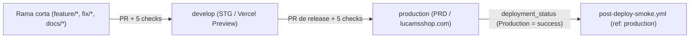
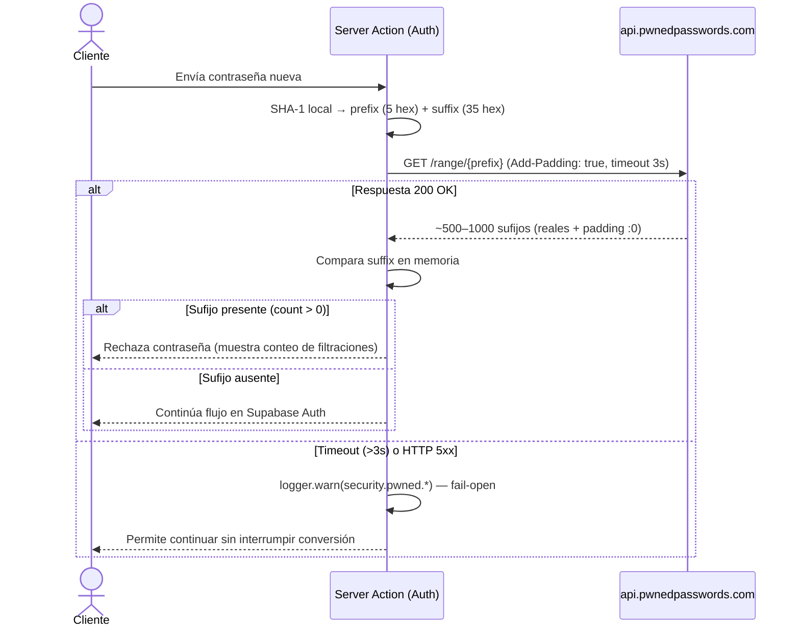

# GitHub, CI/CD y Servicios Operativos Auxiliares — Lucams Shop

> **Documento canónico vivo.** Especifica al detalle mínimo la gobernanza del repositorio en **GitHub**, el modelo de ramas protegidas (`feature/* → develop → production`), los **6 workflows automatizados de GitHub Actions** y su matriz de secretos, junto con las tres integraciones operativas auxiliares sin costo de plataforma: **Have I Been Pwned (HIBP Pwned Passwords)** bajo k-anonymity, **WhatsApp Click-to-Chat (`wa.me`)** gobernado desde el CMS y la gestión/vigilancia RDAP del dominio **`lucamsshop.com`** en **`mi.com.co`**.

---

## 1. Gobernanza del repositorio GitHub y modelo de ramas

### 1.1 Flujo `feature/* → develop → production`

El repositorio opera exclusivamente con **dos ramas permanentes protegidas**:

- **`develop` (rama base por defecto — STG / Preview):** integra todas las ramas cortas de trabajo (`feature/*`, `fix/*`, `docs/*`, `chore/*`, `refactor/*`, `test/*`). Cada fusión en `develop` despliega automáticamente el ambiente estable de Staging en [Vercel](./vercel.md).
- **`production` (rama de lanzamiento — PRD):** recibe promociones mediante Pull Request desde `develop` y gobierna el despliegue productivo en `https://lucamsshop.com`.

> **Importante:** la rama **`main` no existe** en el repositorio Git de Lucams Shop. Si observas `main` dentro del panel de [Supabase](./supabase.md), corresponde únicamente al identificador interno de su motor de base de datos, nunca a una rama de GitHub.

---

### 1.2 Ruleset `protect-ramas-criticas` (`id: 26248226`, `ADR-105`)

Ambas ramas (`develop` y `production`) están blindadas en GitHub Settings → Repository → Rulesets bajo las siguientes reglas inmutables:

- **Cero excepciones (`bypass_actors: []`):** ni siquiera los administradores de la organización pueden hacer push directo, _force-push_ o eliminar `develop` o `production`.
- **Pull Request obligatorio y rama al día (`strict: true`):** toda fusión exige que la rama origen esté actualizada contra la cabeza de la rama destino antes de permitir el _merge_.
- **5 status checks obligatorios consolidados:**
  1. `Gitleaks secret scan` (job `secrets-scan`)
  2. `Typecheck + Lint + Build` (job `quality`)
  3. `Vitest tests (unit + integración con Postgres)` (job `unit-tests`)
  4. `RLS behavior (rls-matrix contra Supabase local)` (job `rls-behavior`)
  5. `E2E + a11y + Lighthouse — Playwright` (job `e2e`)

---

### 1.3 Endurecimiento supply-chain y fast-path `docs_only`

Todos los workflows en `.github/workflows/*.yml` comparten cuatro controles de seguridad y eficiencia:

1. **Actions ancladas por SHA completo (40 hex):** ninguna acción de terceros se referencia por tag mutable (`@v4`); todas usan el commit inmutable (`actions/checkout@3d3c42e...`, `pnpm/action-setup@ea17c68...`, `actions/setup-node@949feb2...`, `gitleaks/gitleaks-action@e0c47f4...`, `supabase/setup-cli@d239d10...`, `actions/upload-artifact@cf430e0...`).
2. **Permisos de mínimo privilegio:** cada workflow declara `permissions: contents: read` en la raíz. Solo el job `secrets-scan` de `ci.yml` eleva localmente `pull-requests: read` para listar los commits del PR en la API de GitHub.
3. **Toolchain determinista:** Node.js `22`, `pnpm 11.0.9` e instalación estricta con `pnpm install --frozen-lockfile`.
4. **Fast-path documental fail-closed (`changes` → `docs_only` en `ci.yml`):**
   - Ante cualquier duda (`workflow_dispatch`, diff vacío o un solo archivo fuera de la lista blanca), `docs_only` vale `"false"` y corre la suite completa.
   - En eventos `pull_request`, si **todos** los archivos modificados coinciden con `^(docs/|README\.md$|CLAUDE\.md$|AGENTS\.md$|apps/web/(README|AGENTS|CLAUDE)\.md$|apps/web/.*/README\.md$)`, activa `docs_only=true`.
   - _Nota crítica:_ `packages/db/legal-content/*.md` **no** entra en el fast-path porque es contenido legal renderizado al público en `/legal/*`.
   - Con `docs_only=true`, el PR certifica `secrets-scan`, `pnpm format:check` (que valida Markdown) y `pnpm audit --prod --audit-level=high` en ~30 segundos; los jobs `unit-tests`, `rls-behavior` y `e2e` se omiten por condición `if:` de job y GitHub los evalúa como aprobados frente al ruleset.

### 1.4 Escaneo de secretos en 3 capas (`.gitleaks.toml` + pre-commit)

- **Capa 1 — Hook local (`scripts/git-hooks/pre-commit`):** se activa una vez por clon con `git config core.hooksPath scripts/git-hooks` y ejecuta `gitleaks git --staged --config .gitleaks.toml .` antes de crear cada commit.
- **Capa 2 — GitHub Push Protection:** bloqueo nativo de GitHub al recibir pushes en cualquier rama.
- **Capa 3 — Job `secrets-scan` en CI (`.gitleaks.toml`):** extiende la base oficial (`useDefault = true`) con **7 reglas propias** (`supabase-secret-key-pattern`, `supabase-sb-secret`, `supabase-sb-publishable-hardcode`, `wompi-private-key`, `resend-api-key`, llaves de API de LLMs externos y `postgres-uri-with-password` fuera de `localhost`/`127.0.0.1`). Los archivos `docs/**/*.md` **no están exentos** por ruta: un secreto real pegado en documentación rompe el CI de inmediato.

---

## 2. Inventario detallado de los 6 workflows de GitHub Actions

| Workflow (`.github/workflows/`) | Disparadores                                                         | Concurrencia                                      | Propósito principal                                                                                              |
| ------------------------------- | -------------------------------------------------------------------- | ------------------------------------------------- | ---------------------------------------------------------------------------------------------------------------- |
| `ci.yml`                        | `pull_request` (`develop`, `production`) + `workflow_dispatch`       | `cancel-in-progress: true` por ref                | Gate obligatorio de calidad, seguridad, DB/RLS, E2E y Lighthouse en cada PR                                      |
| `nightly-full.yml`              | `schedule` (`0 6 * * *` UTC) + `workflow_dispatch`                   | Estándar                                          | Suite extendida contra Supabase Docker real (GoTrue + Storage + Mailpit), cross-browser y checkout Wompi sandbox |
| `post-deploy-smoke.yml`         | `deployment_status` (`Production` = `success`) + `workflow_dispatch` | `cancel-in-progress: false` (`post-deploy-smoke`) | Verificación en vivo de `lucamsshop.com` + detector de migraciones Prisma pendientes en PRD                      |
| `backup.yml`                    | `schedule` (`13 7 * * *` UTC) + `workflow_dispatch`                  | `cancel-in-progress: false` (`backup-db`)         | Respaldo diario cifrado GPG de PostgreSQL 17 y de los 5 buckets de Storage hacia Cloudflare R2 + latido          |
| `dr-drill.yml`                  | `schedule` (`27 8 2 * *` UTC) + `workflow_dispatch`                  | `cancel-in-progress: false` (`dr-drill`)          | Simulacro mensual de restauración de DB en `supabase/postgres:17` y verificación criptográfica de Storage        |
| `domain-watch.yml`              | `schedule` (`23 11 5 * *` UTC) + `workflow_dispatch`                 | `cancel-in-progress: false` (`domain-watch`)      | Consulta mensual RDAP de `lucamsshop.com` en Verisign y reporte a `/api/cron/domain-watch`                       |

---

### 2.1 `ci.yml` — Integración Continua de PRs

No incluye trigger `push` porque `protect-ramas-criticas` impide pushes directos a `develop` y `production`, evitando corridas duplicadas al fusionar. Consta de 6 jobs:

1. **`changes` (`timeout: 3 min`):** calcula `docs_only` comparando `pull_request.base.sha` contra `github.sha`.
2. **`secrets-scan` (`timeout: 5 min`):** clon completo (`fetch-depth: 0`) y escaneo `gitleaks-action` sobre los commits del PR.
3. **`quality` (`timeout: 12 min`):** corre siempre `pnpm format:check` y `pnpm audit --prod --audit-level=high`. Si `docs_only != 'true'`, ejecuta además:
   - `pnpm -r typecheck` y `pnpm -r lint`.
   - **Paridad AST CMS v2 (`ADR-082`/`ADR-187`):** `vitest run lib/cms-sitemap-parity.test.ts` (garantiza correspondencia 1:1 entre claves CMS leídas en `apps/web` y `cms-site-map.mjs`).
   - **Guardia de scripts DB:** `check-script-guards.mjs` + `pnpm --filter @lucams/db test` (verifica que todo script que muta datos importe el guard fail-closed).
   - **Guardia lingüística `es-CO`:** rechaza cualquier rastro de voseo en `.ts`, `.tsx` y `.mjs`.
   - `pnpm --filter web build`.
4. **`unit-tests` (`timeout: 15 min`, service `postgres:15`):** aplica `.github/ci/supabase-compat.sql` (roles, extensiones y stubs `auth`/`storage`), corre `prisma migrate deploy`, toma snapshot con `audit-schema-drift.mjs`, aplica todas las migraciones SQL de `supabase/migrations/*.sql`, certifica cero deriva Prisma ↔ Supabase, siembra CMS v2 para settings globales y ejecuta `pnpm --filter web test:coverage`.
5. **`rls-behavior` (`timeout: 15 min`, Supabase CLI `2.111.0`):** levanta el stack real desde `.github/ci/localstack` (`supabase start`), aplica `prereq-extensions.sql`, migraciones Prisma y SQL de Supabase (usando `SUPABASE_ADMIN_URL`), y ejecuta `rls-coverage.integration.test.ts` + `rls-matrix.integration.test.ts`.
6. **`e2e` (`timeout: 30 min`, service `postgres:15`):** aplica compatibilidad + migraciones + `seed-catalog-v2.mjs --apply`, compila `pnpm --filter web build` en puerto `4000` y sobre ese **mismo build y base de datos** corre:
   - Playwright (`smoke.spec`, `a11y.spec`, `axe.spec`, `compra.spec`, `estudio.spec`, `mobile-storefront-audit.spec` en `desktop-chrome`).
   - Lighthouse CI escritorio (`pnpm lhci`) y móvil (`pnpm lhci:mobile`, `ADR-066`).
   - Si falla, sube `apps/web/playwright-report/` y `.lighthouseci/` por `7` días.

---

### 2.2 `nightly-full.yml` — Certificación nocturna con Supabase real y sandbox de pagos

Corre a las `06:00 UTC` (`01:00 COT`) o bajo demanda (`workflow_dispatch`):

- **`gate-activity`:** en ejecuciones programadas (`schedule`), inspecciona `git log -1 --since="24 hours ago"`. Si no hubo commits nuevos en 24 h, omite limpiamente los 3 runners pesados; en `workflow_dispatch` fuerza `should_run=true` siempre.
- **`vitest-supabase-real` (`timeout: 20 min`):** levanta `supabase start` (GoTrue + PostgREST + Storage reales) y corre las 6 suites de integración exclusivas (`auth-actions`, `finalize-server-render`, `personalization/service`, `letter-tiles`, `retention-service` y `lib/wompi.live.test.ts`).
- **`e2e-supabase-real` (`timeout: 40 min`):** siembra catálogo canónico, ocasiones, catálogo v2, CMS v2 y Lifecycle en borrador (`seed-lifecycle.mjs --apply`), instala Chromium + Firefox + WebKit y ejecuta los 9 specs exclusivos de GoTrue/Mailpit/Admin (`admin-login`, `admin-mfa`, `admin-help`, `admin-lifecycle`, `cms-editing-flow`, `responsive-admin-audit`, `audit-cliente`, `homolog-auth`, `retracto-garantia-cliente`) más el smoke de solo lectura en `desktop-firefox` y `desktop-webkit`. `LIFECYCLE_DRY_RUN=1` impide cualquier correo Lifecycle real durante la certificación.
- **`gate-wompi-sandbox` + `e2e-wompi-sandbox` (`timeout: 40 min`):** si están presentes los secretos sandbox de [Wompi](./wompi.md) y [Aveonline](./aveonline.md), ejecuta `wompi-sandbox.spec` (pago con tarjeta de prueba `4242` → orden `PAID` + generación de guía) y archiva la evidencia visual por `30` días (`wompi-sandbox-evidence`).

---

### 2.3 `post-deploy-smoke.yml` — Verificación automática post-despliegue en PRD

Se activa mediante el evento nativo `deployment_status` emitido por Vercel en el instante exacto en que un despliegue del entorno `Production` pasa a `state == 'success'` (o manualmente por `workflow_dispatch`):

1. **Checkout anclado a `ref: production`:** evita falsos positivos comparando siempre las migraciones de la rama productiva real y nunca las que estén en validación sobre `develop`.
2. **Sondas HTTP sin dependencias (`node apps/web/scripts/post-deploy-smoke.mjs`):** ejecuta en paralelo **5 sondas `GET` de solo lectura** contra `https://lucamsshop.com` con hasta `3` intentos (`timeout: 15 s`, backoff `10 s` / `20 s`):
   - `/api/health` (liveness de la app)
   - `/api/health/db` (conectividad PostgreSQL vía Prisma)
   - `/api/health/crons` (dead-man switch de jobs programados; devuelve `503` si alguno está vencido)
   - `/` y `/productos` — además de `HTTP 200`, exigen en el HTML los **3 marcadores estructurales del layout raíz**: `lang="es-CO"`, `href="#contenido"` (skip-link WCAG 2.4.1) e `id="contenido"` (`<main>`), detectando páginas en blanco o caídas de hidratación SSR.
3. **Detector de deriva de migraciones y agendado Lifecycle en PRD:** si existe el secreto `BACKUP_DATABASE_URL`, cruza las carpetas `packages/db/prisma/migrations` de `production` contra `SELECT migration_name FROM _prisma_migrations WHERE finished_at IS NOT NULL` en PRD y falla en rojo si quedó alguna migración sin aplicar. La misma etapa exige exactamente un `lucams-lifecycle` activo con `*/15 * * * *` en `cron.job`; si falta o tiene otra frecuencia, indica aplicar la migración `058` después del deploy `Ready`.

---

### 2.4 `backup.yml` y `dr-drill.yml` — Respaldo diario cifrado y simulacro mensual

Documentados a nivel de almacenamiento y scripts en [Cloudflare (`./cloudflare.md`)](./cloudflare.md) y [Operaciones (`../OPERATIONS.md`)](../OPERATIONS.md):

- **`backup.yml` (`13 7 * * *` UTC / `02:13 COT`):**
  - `gate`: evalúa por separado `configured` (DB + R2) y `storage_configured` (R2 + `BACKUP_SUPABASE_*`) para que un faltante parcial emita `::warning::` sin apagar el otro respaldo.
  - `backup` (`20 min`): instala `postgresql-client-17` desde el repositorio oficial PGDG (`apt.postgresql.org.asc`), ejecuta `apps/web/scripts/backup-db-to-r2.mjs` (`pg_dump` directo → gzip → GPG AES-256 con `BACKUP_GPG_PASSPHRASE` → subida S3 a R2) y poda copias dejando `BACKUP_KEEP="30"`.
  - `backup-storage` (`30 min`): ejecuta `apps/web/scripts/backup-storage-to-r2.mjs`, empaquetando los 5 buckets de Supabase Storage en archivos `.tar.gz.gpg` + manifiesto JSON con retención de `30` copias por bucket.
  - `heartbeat` (`5 min`): solo si `backup` (y `backup-storage` cuando está activo) terminaron en `success`, envía `POST https://lucamsshop.com/api/cron/backup-heartbeat` con header `x-cron-secret`. La app actualiza `AlertState["backup:last-success"]`, vigilado con umbral `BACKUP_STALE_MS = 36 h`.
- **`dr-drill.yml` (`27 8 2 * *` UTC — día 2 de cada mes, `08:27 UTC`):**
  - `drill` (`30 min`): levanta un service container `public.ecr.aws/supabase/postgres:17.6.1.156` (mismo motor y extensiones que producción), instala `psql 17` y corre `apps/web/scripts/dr-drill.mjs` para descargar el último `.sql.gz.gpg`, descifrarlo, restaurarlo en limpio y verificar paridad exacta de filas y umbral mínimo de productos (`DRILL_MIN_PRODUCTS`).
  - `drill-storage` (`20 min`): ejecuta `apps/web/scripts/dr-drill-storage.mjs`, descifrando en memoria (streaming sin escribir texto plano en disco) un archivo `.tar.gz.gpg` y cuadrando entradas y bytes exactos contra el manifiesto.

---

### 2.5 `domain-watch.yml` — Vigilancia mensual RDAP del dominio

Corre el día 5 de cada mes a las `11:23 UTC` (`06:23 COT`, `cron: "23 11 5 * *"`) y por `workflow_dispatch`.

- **Por qué corre en GitHub Actions y no en `pg_cron`:** los servidores RDAP de Verisign y `rdap.org` rechazan activamente las conexiones TLS salientes originadas desde la extensión `pg_net` de Supabase, mientras que responden `200` de forma estable a los runners Azure de GitHub Actions.
- **Separación entre vigilancia registral (RDAP) y salud DNS/TLS:** `domain-watch.yml` audita el estado registral en el TLD `.com` (`https://rdap.verisign.com/com/v1/domain/lucamsshop.com`, 2 intentos × `20 s`), mientras que la resolución DNS en vivo y la validez del certificado TLS de `https://lucamsshop.com` son monitoreadas cada **10 minutos** por `uptime-monitor-prd` (ver [Observabilidad](../OBSERVABILITY.md)).
- **Procesamiento en la aplicación (`POST /api/cron/domain-watch` → `apps/web/features/observability/domain-watch.ts`):**
  - Protegido por `x-cron-secret` (timing-safe) y límite de cuerpo de `8 KB` (`ObservationSchema` en Zod).
  - En la primera corrida siembra en silencio el baseline en `AlertState` (`domain-watch:{expires-at,nameservers,status,last-alert-bucket}`).
  - **Cambio de `nameservers` o de `status` EPP** (normalizados en minúsculas y ordenados para ignorar reordenamientos inocuos): dispara alerta **crítica** inmediata (`domain_nameservers_changed` o `domain_status_changed`, notificación in-app + correo vía Resend) ante posible secuestro de dominio o suspensión ICANN (`clientHold` / `serverHold`).
  - **Expiración (`domain_expiry`):** evalúa `EXPIRY_THRESHOLDS_DAYS = [60, 30, 14, 7, 3, 1]` (con cadencia mensual se activan en la práctica los escalones de **60 y 30 días** antes del vencimiento, más recordatorio cada `> 20 h` si se ejecuta a diario con `<= 3` días restantes). Si el envío de correo crítico falla, no sella `lastAlertBucket` para reintentar en la siguiente corrida.
  - **Ceguera RDAP (`domain_rdap_failing`):** si ambos intentos a Verisign fallan, el workflow envía `{"rdapOk": false}`; a la **2.ª corrida fallida consecutiva** dispara alerta de severidad alta en `/admin/notificaciones`.
  - **Dead-man switch:** cada ejecución exitosa registra `recordCronHeartbeat("domain-watch")`. En `apps/web/features/observability/cron-heartbeat.ts`, `CRON_JOBS["domain-watch"]` define un intervalo base de **31 días** (`31 * 24 * 60 * 60 * 1000 ms`), por lo que `/api/health/crons` y la alerta `cron_stale_domain-watch` lo marcan `overdue` a **`2× = 62 días`** sin latido.

---

## 3. Matriz exacta de GitHub Secrets por workflow

Los 6 workflows no requieren `Repository Variables` (`vars.*`) externas; todas las constantes no sensibles viven declaradas en los bloques `env:` versionados de cada YAML. Los secretos se administran en **GitHub → Settings → Secrets and variables → Actions → Repository secrets**:

| Secreto en GitHub Actions     | `ci.yml` |    `nightly-full.yml`     | `post-deploy-smoke.yml` |        `backup.yml`         |       `dr-drill.yml`        | `domain-watch.yml` | Propósito exacto                                                                                             |
| ----------------------------- | :------: | :-----------------------: | :---------------------: | :-------------------------: | :-------------------------: | :----------------: | ------------------------------------------------------------------------------------------------------------ |
| `GITHUB_TOKEN` _(automático)_ |    Sí    |             —             |            —            |              —              |              —              |         —          | Lectura de commits del PR en `secrets-scan` (`gitleaks-action`)                                              |
| `BACKUP_DATABASE_URL`         |    —     |             —             | Opcional (drift check)  |        **Requerido**        |              —              |         —          | URI PostgreSQL directa (`:5432`, sin pooler) de PRD para `pg_dump 17` y verificación de `_prisma_migrations` |
| `R2_ACCOUNT_ID`               |    —     |             —             |            —            |        **Requerido**        |        **Requerido**        |         —          | ID de cuenta de Cloudflare propietaria del bucket R2                                                         |
| `R2_BUCKET`                   |    —     |             —             |            —            |        **Requerido**        |        **Requerido**        |         —          | Nombre del bucket R2 (`lucams-backups`)                                                                      |
| `R2_ACCESS_KEY_ID`            |    —     |             —             |            —            |        **Requerido**        |        **Requerido**        |         —          | Access Key S3 de mínimo privilegio sobre `lucams-backups`                                                    |
| `R2_SECRET_ACCESS_KEY`        |    —     |             —             |            —            |        **Requerido**        |        **Requerido**        |         —          | Secret Key S3 correspondiente                                                                                |
| `BACKUP_GPG_PASSPHRASE`       |    —     |             —             |            —            | **Requerido** (fail-closed) | **Requerido** (fail-closed) |         —          | Frase de paso simétrica GPG AES-256 para cifrar/descifrar dumps SQL y tars de Storage                        |
| `BACKUP_SUPABASE_URL`         |    —     |             —             |            —            |   **Requerido** (Storage)   |        Gate Storage         |         —          | URL `https://<ref>.supabase.co` de PRD para listar/descargar objetos de los 5 buckets                        |
| `BACKUP_SUPABASE_SECRET_KEY`  |    —     |             —             |            —            |   **Requerido** (Storage)   |        Gate Storage         |         —          | Secret key server-side de Supabase PRD (bypassea RLS para respaldar buckets privados)                        |
| `CRON_SECRET`                 |    —     |             —             |            —            | **Requerido** (`heartbeat`) |              —              |   **Requerido**    | Secreto compartido con PRD para autenticar `x-cron-secret` en `/api/cron/{backup-heartbeat,domain-watch}`    |
| `VERCEL_BYPASS_TOKEN`         |    —     |             —             |            —            |          Opcional           |              —              |      Opcional      | Cabecera `x-vercel-protection-bypass` solo si se apunta el endpoint a un Preview protegido                   |
| `WOMPI_PUBLIC_KEY`            |    —     | **Gate dinero** (sandbox) |            —            |              —              |              —              |         —          | Llave pública `pub_test_*` para `e2e-wompi-sandbox` y fallback en `e2e-supabase-real`                        |
| `WOMPI_PRIVATE_KEY`           |    —     | **Gate dinero** (sandbox) |            —            |              —              |              —              |         —          | Llave privada `prv_test_*` para `e2e-wompi-sandbox`                                                          |
| `WOMPI_INTEGRITY_SECRET`      |    —     | **Gate dinero** (sandbox) |            —            |              —              |              —              |         —          | Secreto de firma de integridad sandbox de Wompi                                                              |
| `WOMPI_EVENTS_SECRET`         |    —     | **Gate dinero** (sandbox) |            —            |              —              |              —              |         —          | Secreto de verificación de eventos webhook sandbox de Wompi                                                  |
| `AVEONLINE_USUARIO`           |    —     | **Gate dinero** (sandbox) |            —            |              —              |              —              |         —          | Usuario demo de Aveonline para emitir guía de prueba tras el pago sandbox                                    |
| `AVEONLINE_CLAVE`             |    —     | **Gate dinero** (sandbox) |            —            |              —              |              —              |         —          | Contraseña demo de Aveonline                                                                                 |

---

## 4. Have I Been Pwned — HIBP Pwned Passwords (`apps/web/lib/pwned-passwords.ts`)

Para impedir ataques de _credential stuffing_ con contraseñas filtradas en brechas públicas (~800+ millones de hashes), Lucams valida toda contraseña nueva o modificada de clientes contra la API v3 de **Pwned Passwords** mediante el protocolo criptográfico de **k-anonymity** (`ADR-085`, ver [Seguridad](../SECURITY.md)).

### 4.1 Protocolo k-anonymity, `Add-Padding` y degradación fail-open

1. **Hash local y partición (`checkPwnedPassword`):**
   - Calcula en servidor `SHA-1(password)` en hexadecimal mayúsculas (`40` caracteres) usando `node:crypto`.
   - Separa únicamente los **primeros 5 caracteres** (`prefix = sha1.slice(0, 5)`) y retiene en memoria los `35` restantes (`suffix = sha1.slice(5)`). **Ni la contraseña en texto plano ni el hash completo salen jamás del servidor.**
2. **Consulta con relleno criptográfico (`Add-Padding: true`):**
   - Ejecuta `GET https://api.pwnedpasswords.com/range/${prefix}` con `User-Agent: lucams-shop`, cabecera **`Add-Padding: true`** y timeout estricto de **`3000 ms`** (`AbortController` liberado siempre en `finally`).
   - La cabecera `Add-Padding: true` instruye a Cloudflare/HIBP a rellenar la respuesta hasta un tamaño uniforme con entradas ficticias de conteo `0`, impidiendo que un observador de red deduzca por el tamaño del paquete TLS si el prefijo consultado tenía muchas coincidencias.
   - El servidor busca localmente si alguna línea `SUFFIX:COUNT` empieza por `suffix`. Como `parseInt` lee el contador real (> 0 en brechas reales), las líneas de relleno (`:0`) nunca generan falsos positivos.
3. **Degradación fail-open controlada y auditada:**
   - Si HIBP devuelve un código distinto de `2xx` o expira el timeout de `3 s`, `checkPwnedPassword` **no bloquea al usuario**: devuelve `{ pwned: false, failed: true, reason }` y registra `logger.warn` con el evento estructurado `security.pwned.api_fail` o `security.pwned.fetch_error`.

### 4.2 Los 3 flujos exactos protegidos en el código

| Flujo de cuenta                         | Archivo y Server Action                                                        | Evento de auditoría al bloquear               | Mensaje devuelto al usuario                                                                 |
| --------------------------------------- | ------------------------------------------------------------------------------ | --------------------------------------------- | ------------------------------------------------------------------------------------------- |
| **1. Registro de cliente**              | `signupAction` en `apps/web/app/(auth)/registro/actions.ts`                    | `security.pwned.signup_block` (`ip`, `count`) | `Esta contraseña apareció en filtraciones de datos públicas (N veces). Elige una distinta.` |
| **2. Restablecimiento por OTP**         | `resetPasswordAction` en `apps/web/app/(auth)/restablecer-password/actions.ts` | `security.pwned.reset_block` (`ip`, `count`)  | `Esta contraseña apareció en filtraciones de datos públicas (N veces). Elige una distinta.` |
| **3. Cambio autenticado de contraseña** | `changePasswordAction` en `apps/web/app/mi-cuenta/seguridad/actions.ts`        | Validado tras reautenticar `currentPassword`  | `Esa contraseña apareció en filtraciones conocidas. Elige otra.`                            |

---

## 5. WhatsApp Click-to-Chat (`apps/web/lib/wa.ts`)

Lucams opera toda su mensajería conversacional sobre enlaces profundos universales **`https://wa.me/<numero>?text=<mensaje>`**, **sin contratar la API paga de Meta WhatsApp Business Cloud ni Twilio**. El módulo `apps/web/lib/wa.ts` (`import "server-only"`) centraliza el 100 % de la construcción de URLs para que una eventual migración futura a API conversacional tenga un único punto de cambio.

### 5.1 Resolución jerárquica del número del negocio (`getWhatsAppNumber`)

1. Consulta primero el campo editable **`WA_NUMBER`** del CMS (`/admin/contenido` → Ajustes globales → sección WhatsApp).
2. Si no existe en DB, usa `process.env.NEXT_PUBLIC_WA_NUMBER`.
3. En última instancia cae a `FALLBACK_NUMBER` (`573208873826`).
4. Aplica siempre `.replace(/\D/g, "")` porque `wa.me` exige dígitos puros con indicativo de país sin `+`, espacios ni guiones.

### 5.2 Plantillas contextualizadas hacia el negocio (`buildWhatsAppUrl`)

`WhatsAppContext` soporta **6 contextos** cuyas plantillas se administran en vivo desde el CMS con interpolación segura `{variable}`:

| `ctx.kind`                    | Clave CMS (`getSettingValue`)      | Variables interpoladas                                                       | Superficies donde se invoca                                                                                                                                                |
| ----------------------------- | ---------------------------------- | ---------------------------------------------------------------------------- | -------------------------------------------------------------------------------------------------------------------------------------------------------------------------- |
| `"product"`                   | `WA_MSG_PRODUCT`                   | `{productName}`, `{sku}`                                                     | Ficha de producto (`/producto/[slug]`) y Estudio (`/estudio/[slug]`) para dudas previas a la compra                                                                        |
| `"support"` _(sin asunto)_    | `WA_MSG_SUPPORT`                   | —                                                                            | Home (`/`), `/contacto`, `/empresas-y-eventos`, layout de autenticación y pie de página (`site-footer.tsx`)                                                                |
| `"support"` _(con `subject`)_ | `WA_MSG_SUPPORT_SUBJECT`           | `{subject}`                                                                  | `/rastrear` («Quiero saber el estado de mi pedido») y consultas guiadas                                                                                                    |
| `"order"`                     | `WA_MSG_ORDER`                     | `{orderNumber}` (`LCM-YYYY-NNNN`)                                            | Seguimiento posventa del pedido en `/pedido/[token]` (oculto si el pedido está cancelado)                                                                                  |
| `"quote"`                     | `WA_MSG_QUOTE`                     | `{quoteNumber}`, `{customerName}`, `{itemsSummary}`, `{total}`, `{quoteUrl}` | Confirmación y vista pública de cotizaciones (`buildQuoteWhatsAppUrl` en `apps/web/features/quotes/service.ts`, esencial tanto en modo catálogo como en cierres asistidos) |
| `"wholesale"` / `"custom"`    | `WA_MSG_WHOLESALE` / texto directo | —                                                                            | Consultas corporativas al por mayor y enlaces puntuales                                                                                                                    |

### 5.3 Blindaje de longitud y formato en cotizaciones (`apps/web/features/quotes/service.ts`)

Cuando un carrito con muchos productos genera una cotización por WhatsApp, los navegadores Chromium rechazan silenciosamente lanzadores de protocolo (`whatsapp://`) cuya URL supere **2046 caracteres**. Para que el botón jamás falle ni corte el total al final del mensaje, `buildQuoteWhatsAppUrl` aplica tres defensas:

- **Presupuesto codificado (`WA_MAX_DETAILED_ITEMS = 8`, `WA_ITEMS_ENCODED_BUDGET = 900` bytes URL-encoded, `WA_MAX_ITEM_NAME_CHARS = 60`):** detalla hasta 8 líneas dentro del presupuesto de 900 caracteres codificados y resume el resto con `…y N productos más — mira el detalle aquí: <quoteUrl>`, manteniendo la URL completa alrededor de `<= 1600` caracteres.
- **Recorte seguro por grafemas (`truncateForWhatsApp`):** usa `Intl.Segmenter("es", { granularity: "grapheme" })` (con fallback a `Array.from` por code points) en lugar de `String.prototype.slice`, evitando partir un emoji compuesto o par subrogado UTF-16 por la mitad — lo que haría que `encodeURIComponent` lanzara `URIError: URI malformed` tumbando con `500` la página de la cotización.
- **Neutralización de marcado de WhatsApp (`neutralizeWhatsAppMarkup`):** sustituye `*`, `_`, `~` y `` ` `` dentro de nombres de productos y variantes por equivalentes visuales (`∗`, `‗`, `∼`, `ʼ`) para que un SKU o nombre con guiones bajos no desconfigure las negritas/cursivas del mensaje.

### 5.4 Contacto saliente desde el Admin hacia el cliente (`customerWaLink` y `customerTelLink`)

Para que el equipo operativo contacte en un clic al comprador desde `/admin/{pedidos,cotizaciones,carritos,clientes,oportunidades}` y desde los correos internos de notificación (`order-admin-notification`, `quote-admin-notification`, `b2b-inquiry-admin-notification`):

- `normalizeCustomerPhone(phone)` limpia no-dígitos: si recibe un móvil colombiano de 10 dígitos (`^3\d{9}$`), **antepone automáticamente `57`** (`573XXXXXXXXX`); si ya viene en formato internacional plausible (`11` a `15` dígitos E.164), lo conserva; ante teléfonos fijos cortos o cadenas inválidas devuelve `null` para que la UI oculte el botón en vez de pintar un enlace roto.

---

## 6. Dominio `lucamsshop.com` (registrador `mi.com.co`)

| Atributo                      | Configuración vigente                                                                                                                                       |
| ----------------------------- | ----------------------------------------------------------------------------------------------------------------------------------------------------------- |
| **Dominio canónico**          | `lucamsshop.com` (TLD `.com` operado por el registro Verisign)                                                                                              |
| **Registrador comercial**     | **`mi.com.co`** (registrador colombiano acreditado donde reside la titularidad comercial y facturación local)                                               |
| **Nameservers autoritativos** | Delegados íntegramente a **Cloudflare** (ver tabla completa de registros DNS `A`, `CNAME`, `MX`, SPF, DKIM y DMARC en [`./cloudflare.md`](./cloudflare.md)) |
| **Vigilancia automatizada**   | `.github/workflows/domain-watch.yml` (mensual, día 5 `11:23 UTC`) → `POST /api/cron/domain-watch` + `uptime-monitor-prd` (DNS/TLS cada 10 min)              |

### Controles obligatorios de seguridad en el registrador (`mi.com.co`)

1. **Autenticación multifactor (MFA)** activa en la cuenta titular de `mi.com.co`, registrada bajo un buzón independiente del propio dominio `lucamsshop.com` (para no perder acceso de recuperación si el dominio presentara una incidencia DNS).
2. **Bloqueo de transferencia (`clientTransferProhibited`):** activo permanentemente; cualquier retiro inesperado de este estado EPP dispara `domain_status_changed` en `domain-watch`.
3. **Renovación anticipada y auto-renovación:** método de pago vigente y renovación manual recomendada con **al menos 60 días de antelación** al vencimiento anual (`2027-07-19` en el ciclo actual). Tras renovar, la siguiente corrida de `domain-watch.yml` actualiza `domain-watch:expires-at` y rearma automáticamente todos los umbrales.

---

## 7. Checklist paso a paso de configuración en GitHub Settings y servicios auxiliares

### 7.1 GitHub Repository Settings

1. **Rama por defecto:** en **Settings → General → Default branch**, fija `develop`. Activa **Automatically delete head branches** para limpiar ramas `feature/*` tras cada merge.
2. **Permisos de Actions:** en **Settings → Actions → General → Workflow permissions**, selecciona **Read repository contents and packages permissions** y desmarca _Allow GitHub Actions to create and approve pull requests_.
3. **Seguridad de código:** en **Settings → Code security**, mantén activos **Secret scanning** y **Push protection**.
4. **Ruleset `protect-ramas-criticas`:** en **Settings → Rules → Rulesets**, verifica que apunte a `refs/heads/develop` y `refs/heads/production`, con _Bypass list_ vacía, _Restrict deletions_, _Block force pushes_, _Require a pull request before merging_ y _Require status checks to pass_ (`Require branches to be up to date before merging` marcado) con los 5 nombres exactos listados en la § 1.2.
5. **Secrets de Actions:** en **Settings → Secrets and variables → Actions**, carga los secretos de la matriz (§ 3) verificando que `BACKUP_DATABASE_URL` use el puerto directo `:5432` (nunca `:6543`) y que `CRON_SECRET` coincida exactamente con la variable `CRON_SECRET` de Vercel Production.
6. **Prueba en vivo de workflows operativos:** desde la pestaña **Actions**, dispara manualmente (`Run workflow`) una vez `backup.yml`, `dr-drill.yml`, `domain-watch.yml` y `post-deploy-smoke.yml`, comprobando que todos terminen en verde y que `/admin/observability` refleje los latidos `backup:last-success` y `cron:domain-watch`.

### 7.2 Servicios auxiliares (HIBP, WhatsApp y `mi.com.co`)

1. **HIBP Pwned Passwords:** no requiere cuenta ni API key. Para verificar conectividad, intenta registrarte en STG con una contraseña trivial (`12345678`) y confirma que el formulario la rechace citando su número de apariciones públicas.
2. **WhatsApp (`wa.me`):** verifica en `/admin/contenido` (Ajustes globales → WhatsApp) que `WA_NUMBER` contenga el indicativo `57` seguido de los 10 dígitos móviles (`573208873826`) y que las plantillas `WA_MSG_*` conserven los placeholders `{productName}`, `{sku}`, `{orderNumber}`, `{quoteNumber}`, `{customerName}`, `{itemsSummary}`, `{total}` y `{quoteUrl}`.
3. **Registrador `mi.com.co`:** verifica anualmente método de pago, contacto administrativo ICANN verificado (evita suspensiones `clientHold`), bloqueo de transferencia activo y nameservers apuntando únicamente al par asignado por Cloudflare.

---

## 8. Referencias oficiales verificadas y documentos relacionados

### Fuentes externas oficiales

- **GitHub Docs — Repository Rulesets & Required Status Checks:** `https://docs.github.com/en/repositories/configuring-branches-and-merges-in-your-repository/managing-rulesets/about-rulesets` y `https://docs.github.com/en/actions/security-for-github-actions/security-guides/security-hardening-for-github-actions` (verificado `2026-11-03`).
- **Have I Been Pwned — Pwned Passwords API v3 (k-anonymity & `Add-Padding`):** `https://haveibeenpwned.com/API/v3#PwnedPasswords` y `https://www.troyhunt.com/enhancing-pwned-passwords-privacy-with-padding/` (verificado `2026-08-24` / `2026-11-05`).
- **WhatsApp Help Center — Click to Chat (`wa.me`) y formato de texto:** `https://faq.whatsapp.com/5913398998672934` y `https://faq.whatsapp.com/539178204879377` (verificado `2026-07-25`).
- **Microsoft Learn (IEInternals) — Límite de 2046 caracteres en URLs de protocolos de aplicación en Chromium:** `https://learn.microsoft.com/en-us/archive/blogs/ieinternals/url-length-limits` (verificado `2026-07-25`).
- **ICANN / Verisign RDAP — Especificación RFC 9083 y endpoint `.com`:** `https://datatracker.ietf.org/doc/html/rfc9083` y `https://rdap.verisign.com/com/v1/domain/lucamsshop.com` (verificado `2026-09-20`).

### Documentación interna relacionada

- Mapa de integraciones: [`./README.md`](./README.md) · Despliegue y `deployment_status`: [`./vercel.md`](./vercel.md) · DNS, Turnstile y almacenamiento R2: [`./cloudflare.md`](./cloudflare.md) · Base de datos y migraciones: [`./supabase.md`](./supabase.md) · Alertas críticas por correo: [`./resend-and-emails.md`](./resend-and-emails.md)
- Dominios funcionales: [Catálogo y CMS](../domains/catalog-and-cms.md) · [CRM, B2B y fidelización](../domains/crm-b2b-and-loyalty.md) · [Posventa y soporte](../domains/post-sale-and-support.md)
- Gobierno transversal: [Manual de Operación y Runbooks](../OPERATIONS.md) · [Seguridad](../SECURITY.md) · [Observabilidad y Dead-Man Switch](../OBSERVABILITY.md) · [Decisiones de arquitectura (`ADR-059`, `ADR-085`, `ADR-105`)](../DECISIONS.md)
