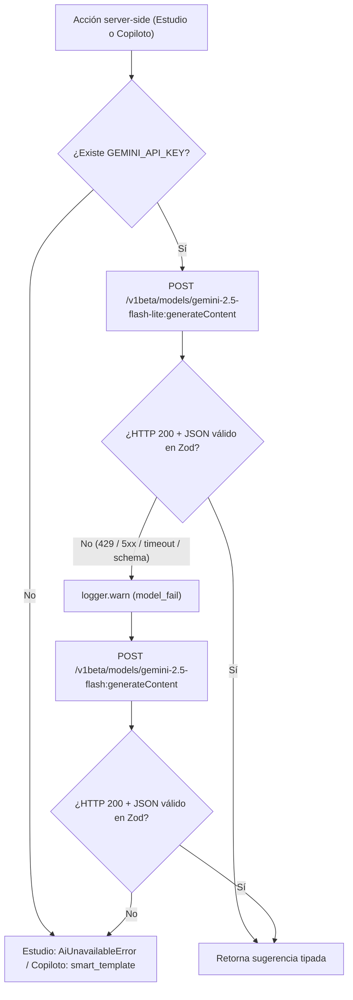
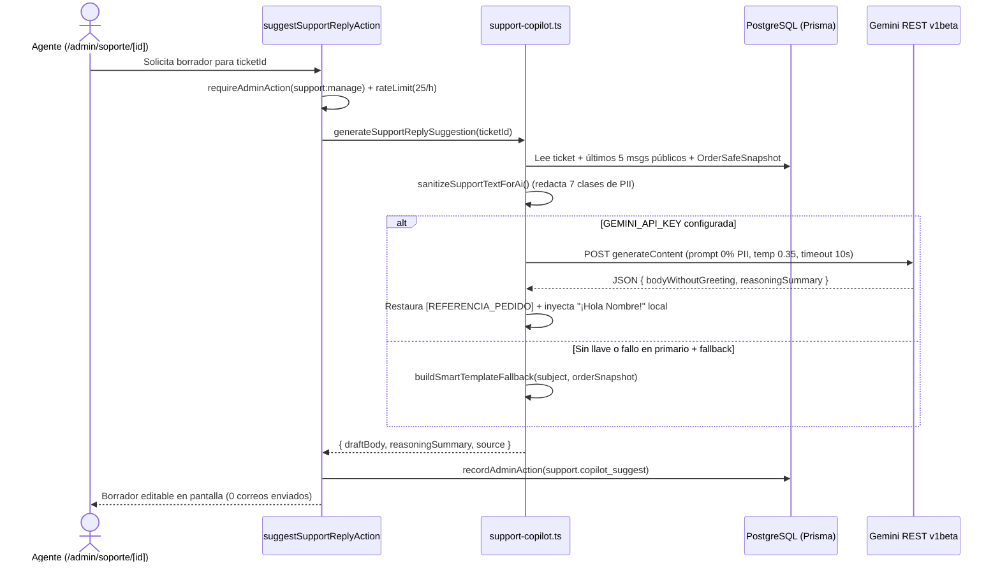

# Google Ecosystem & Inteligencia Artificial — Lucams Shop

> **Documento canónico vivo.** Especifica al detalle mínimo todas las integraciones de **Lucams Shop** con servicios de Google y capacidades de inteligencia artificial: **Google Gemini API (`v1beta` REST)** para el asistente creativo del Estudio y el copiloto interno ARM de soporte, **Google Analytics 4 (GA4)** y atribución first-party **UTM** bajo Ley 1581 (en contraste con el embudo propio sin cookies y el RUM de Web Vitals), **Google Merchant Center (`GET /feeds/google-merchant.xml`)**, **Google Search Console** y la infraestructura de **SEO técnico** (`sitemap.xml`, `robots.txt` y JSON-LD estructurado).

---

## 1. Visión arquitectónica y mapa de superficies

Lucams integra cuatro familias del ecosistema de Google sin acoplar SDKs pesados en el bundle ni comprometer el cumplimiento de la **Ley 1581 de 2012** (Habeas Data) ni de la **Ley 1480 de 2011** (Estatuto del Consumidor):

| Servicio                        | Superficie / protocolo                                                                                   | Archivos núcleo                                                                                                                                                                                            | Cuándo se activa                                                                                               | Impacto en CSP del navegador                                                                                                |
| ------------------------------- | -------------------------------------------------------------------------------------------------------- | ---------------------------------------------------------------------------------------------------------------------------------------------------------------------------------------------------------- | -------------------------------------------------------------------------------------------------------------- | --------------------------------------------------------------------------------------------------------------------------- |
| **Google Gemini API**           | REST `POST /v1beta/models/{model}:generateContent` + `GET /v1beta/models` (0 SDK npm, 100 % server-side) | `apps/web/features/ai/{provider,gemini-provider,service,actions,schemas,support-copilot}.ts`                                                                                                               | En modo `full` (`GEMINI_API_KEY` requerida por `FULL_MODE_REQUIRED` en `apps/web/lib/env.ts`)                  | **Ninguno** (tráfico exclusivo servidor → Google)                                                                           |
| **Google Analytics 4 (GA4)**    | `gtag.js` (`afterInteractive`) con doble compuerta opt-in y sanitización de rutas/query                  | `apps/web/components/analytics-ga4.tsx`, `apps/web/lib/analytics.ts`, `apps/web/lib/security-headers.ts`                                                                                                   | Solo si `NEXT_PUBLIC_GA_MEASUREMENT_ID` coincide con `/^G-[A-Z0-9]+$/i` **y** `hasAnalyticsConsent() === true` | Condicional: solo agrega `googletagmanager.com` y `*.google-analytics.com` si `NEXT_PUBLIC_GA_MEASUREMENT_ID` está definida |
| **Google Merchant Center**      | Feed XML RSS 2.0 (`xmlns:g="http://base.google.com/ns/1.0"`) en `GET /feeds/google-merchant.xml`         | `apps/web/app/feeds/google-merchant.xml/route.ts`, `apps/web/lib/feeds/google-merchant.ts`                                                                                                                 | Solo en modo `full` (`!isCatalogMode()`); devuelve `404` en modo catálogo                                      | **Ninguno** (consumido por el crawler de Google Shopping)                                                                   |
| **Google Search Console & SEO** | Meta tag `google-site-verification` + TXT DNS, `/sitemap.xml`, `/robots.txt` y `<JsonLd>` con nonce CSP  | `apps/web/app/layout.tsx`, `apps/web/app/sitemap.ts`, `apps/web/app/robots.ts`, `apps/web/lib/seo/structured-data.ts`, `apps/web/components/json-ld.tsx`, `apps/web/app/producto/[slug]/product-jsonld.ts` | Permanente sobre `getCanonicalSiteUrl()`; meta tag condicional a `GOOGLE_SITE_VERIFICATION`                    | `<JsonLd>` inyecta el `x-nonce` de la respuesta                                                                             |

> **Fuentes de letra (`next/font/google`):** `apps/web/app/layout.tsx` importa las familias tipográficas en tiempo de compilación con `next/font/google`, autoalojando los `.woff2` en el dominio propio; la CSP conserva `https://fonts.googleapis.com` en `style-src` como respaldo seguro, sin enviar IPs de visitantes a `fonts.gstatic.com` en cada vista.

---

## 2. Variables de entorno

Definidas y validadas en `apps/web/lib/env.ts` y documentadas en `apps/web/.env.example`:

| Variable                        | Alcance                    | Requerida en PRD                         | Valor por defecto / formato         | Propósito                                                                                                                                                                                                |
| ------------------------------- | -------------------------- | ---------------------------------------- | ----------------------------------- | -------------------------------------------------------------------------------------------------------------------------------------------------------------------------------------------------------- |
| `GEMINI_API_KEY`                | Server-only                | Sí en modo `full` (`FULL_MODE_REQUIRED`) | API key de Google AI Studio         | Autentica `x-goog-api-key` contra `generativelanguage.googleapis.com`. Jamás se expone al navegador                                                                                                      |
| `GEMINI_MODEL_PRIMARY`          | Server-only                | Opcional                                 | `gemini-2.5-flash-lite`             | Modelo primario de baja latencia y bajo costo para sugerencias y borradores                                                                                                                              |
| `GEMINI_MODEL_FALLBACK`         | Server-only                | Opcional                                 | `gemini-2.5-flash`                  | Modelo de respaldo si el primario devuelve error HTTP (`429`/`5xx`), timeout o JSON inválido                                                                                                             |
| `NEXT_PUBLIC_GA_MEASUREMENT_ID` | Público (`NEXT_PUBLIC_*`)  | Opcional                                 | `G-XXXXXXXXXX` (`/^G-[A-Z0-9]+$/i`) | Habilita GA4 y ensancha las directivas `script-src`, `connect-src` e `img-src` de la CSP. Si falta o no cumple el regex, toda la capa GA4 queda en no-op                                                 |
| `GOOGLE_SITE_VERIFICATION`      | Server-only (RSC metadata) | Opcional                                 | Token alfanumérico de GSC           | Emite `<meta name="google-site-verification" content="..." />` desde `metadata.verification.google` en `apps/web/app/layout.tsx` (complementario al registro DNS `TXT` en [Cloudflare](./cloudflare.md)) |

---

## 3. Google Gemini API (`v1beta` REST nativo)

### 3.1 Arquitectura del cliente, modelos, timeouts y sonda de salud

Lucams consume la API REST `v1beta` de Gemini directamente con `fetchWithTimeout` (`apps/web/lib/fetch-with-timeout.ts`), **sin instalar `@google/generative-ai` ni `@google/genai`** (`ADR-058`). Todos los archivos bajo `apps/web/features/ai/` declaran `import "server-only"` (salvo `schemas.ts` y `actions.ts`, que actúa como frontera `"use server"`).

- **Endpoint base:** `https://generativelanguage.googleapis.com/v1beta/models`
- **Autenticación:** cabecera `x-goog-api-key: <GEMINI_API_KEY>` + `Content-Type: application/json`.
- **Cadena secuencial de modelos (`models()` / `geminiModels()`):** construye `[...new Set([primary, fallback])]` con `GEMINI_MODEL_PRIMARY` (`gemini-2.5-flash-lite`) y `GEMINI_MODEL_FALLBACK` (`gemini-2.5-flash`). Si ambos env vars tienen el mismo valor, el `Set` evita duplicar la llamada.
- **Estrategia de resiliencia (sin `CircuitBreaker` en memoria):** a diferencia de [Wompi](./wompi.md), [Aveonline](./aveonline.md) o [Resend](./resend-and-emails.md), Gemini **no instancia `lib/circuit-breaker.ts`**. Las invocaciones son acciones interactivas puntuales iniciadas por humanos (nunca en la ruta crítica de checkout ni webhooks), por lo que la latencia y los fallos se acotan con cuatro defensas deterministas:
  1. **Timeout estricto por modelo (`AbortSignal.timeout`):** `12 000 ms` por intento en el Estudio y `10 000 ms` por intento en el Copiloto de soporte.
  2. **Cero reintentos sobre el mismo modelo caído:** ante `429`, `5xx`, timeout o fallo de validación Zod sobre el JSON devuelto, registra `logger.warn` (`ai.gemini.model_fail` o `ai.support_copilot.model_fail`) y salta de inmediato al modelo de respaldo.
  3. **Salida estructurada doble:** envía `responseMimeType: "application/json"` + `responseSchema` (subconjunto OpenAPI soportado por Gemini) y vuelve a validar la cadena devuelta con **Zod** (`RawSuggestionSchema` / `CopilotResponseSchema`).
  4. **Degradación garantizada:** si los dos modelos fallan o falta `GEMINI_API_KEY`, el Estudio captura `AiUnavailableError` y muestra un aviso amable sin interrumpir la edición, mientras que el Copiloto de soporte entrega una plantilla contextual determinista (`source: "smart_template"`).
- **Sonda de salud segura (`probeGeminiHealth()` en `apps/web/features/ai/gemini-provider.ts`):** consumida por el panel `/admin/integraciones` (`apps/web/lib/integration-health.ts`):
  - Si `GEMINI_API_KEY` no está configurada → devuelve `{ status: "skipped", detail: "GEMINI_API_KEY no configurada.", latencyMs: 0 }` (nunca dispara falsas alarmas en entornos locales sin llave).
  - Si existe → ejecuta `GET https://generativelanguage.googleapis.com/v1beta/models` con `timeoutMs: 6000` y header `x-goog-api-key`.
  - **Cero consumo de cuota de generación:** valida que la llave autentica y cuenta cuántos modelos reporta la cuenta (`Key válida · N modelos disponibles`), registrando `health.gemini.http_fail` (`400`/`401`/`403`/`5xx`) o `health.gemini.fail` (red/timeout) si falla.

---

### 3.2 Caso de uso 1 — Asistente creativo de diseño en el Estudio (`ADR-058`)

Permite al comprador escribir la ocasión de su regalo dentro de [el Estudio de personalización](../domains/studio-and-production.md) y recibir ideas concretas (frase corta opcional, color de la paleta de marca, idea de composición del pack y un consejo práctico).

#### Flujo completo de extremo a extremo

1. **UI cliente (`apps/web/app/estudio/[slug]/studio-ai-panel.tsx`):**
   - Solo se habilita cuando la tienda opera en modo `full` (`!isCatalogMode()`).
   - Modal accesible (`useDialogA11y`: foco inicial, focus trap, tecla `Escape`, retorno de foco) con campo `occasion` (`maxLength={200}`, botón deshabilitado si `occasion.trim().length < 3`) y aviso explícito de privacidad (`texts.ia.notaPrivacidad`) informando que el texto descriptivo se procesa con un proveedor externo de IA.
2. **Server Action (`suggestDesignAction` en `apps/web/features/ai/actions.ts`):**
   - **Compuerta server-side de modo tienda:** si `isCatalogMode()` es `true`, registra `ai.suggest.blocked_catalog_mode` y rechaza con mensaje amable (ocultar el botón en cliente nunca sustituye la autorización en el servidor).
   - **Validación de entrada (`DesignSuggestInputSchema` en `apps/web/features/ai/schemas.ts`):**
     - `occasion`: `z.string().trim().min(3).max(200)`
     - `productName`: `z.string().max(120)`
     - `slotCount`: `z.number().int().min(1).max(40)`
     - `allowText`: `z.boolean()`
   - **Filtro preventivo anti-PII (`sanitizeOccasion`):** antes de invocar al proveedor, inspecciona `occasion` contra `OCCASION_PII_PATTERNS`:
     - `/\b\d{6,12}\b/` (cédulas, NIT, cuentas o documentos)
     - `/[\w.+-]+@[\w-]+\.[\w.]+/` (correos electrónicos)
     - `/\b3\d{9}\b/` (celulares colombianos de 10 dígitos)
       Si cualquiera coincide, **reemplaza silenciosamente** `occasion` por `"ocasión especial"` (`NEUTRAL_OCCASION`). Nunca rechaza la petición del usuario y jamás permite que datos personales salgan hacia Google.
   - **Doble capa de rate-limit por ventana de 1 hora (`3600 s`):** tope de **`20` solicitudes/hora en producción** (`VERCEL_ENV === "production"`) y **`100`/hora en entornos no productivos**:
     - **Capa 1 (IP hasheada):** `rateLimit(ipKey("ai_suggest", ip), hourlyCap, 3600)`.
     - **Capa 2 (identidad contra rotación de IP):** si hay sesión autenticada usa `ownerKey("ai_suggest", customer.id)`; si es visitante anónimo con cookie `cart_session` usa `ownerKey("ai_suggest_sess", sessionId)`.
3. **Generación y mapeo seguro de marca (`gemini-provider.ts` + `service.ts`):**
   - Parámetros de inferencia: `timeoutMs: 12000`, `temperature: 0.9`, `maxOutputTokens: 400`, `GEMINI_RESPONSE_SCHEMA` con `propertyOrdering: ["phrase", "colorName", "layout", "tip"]`.
   - `SYSTEM_INSTRUCTION` fuerza español de Colombia en **tuteo estricto**, tono cálido/kawaii y salida exclusivamente JSON.
   - El LLM no inventa códigos hexadecimales arbitrarios: elige un `colorName` del enum cerrado `BRAND_COLORS` y `getDesignSuggestion()` lo resuelve en servidor a la paleta oficial de Lucams:
     - `morado` → `#7C6AAD` («Morado»)
     - `turquesa` → `#5DD9D1` («Turquesa»)
     - `rosado` → `#E85B9F` («Rosado»)
     - `coral` → `#F58A6F` («Coral»)
     - `amarillo` → `#FFD93D` («Amarillo»)
   - Si `input.allowText` es `false`, `service.ts` fuerza `phrase = null` aunque el modelo haya devuelto texto.

---

### 3.3 Caso de uso 2 — Copiloto interno ARM de soporte (`ADR-193`)

Asiste a los agentes del panel en `/admin/soporte/[id]` (`suggestSupportReplyAction` en `apps/web/app/admin/(panel)/soporte/actions.ts` → `generateSupportReplySuggestion` en `apps/web/features/ai/support-copilot.ts`), acelerando respuestas empáticas y jurídicamente exactas en [posventa y soporte](../domains/post-sale-and-support.md) bajo tres invariantes inquebrantables:

1. **Humano en el bucle y solo lectura:** exige `requireAdminAction({ capability: "support:manage" })`, aplica rate-limit de **`25` sugerencias/hora por administrador** (`admin-support-copilot:${adminId}`) y audita cada uso en `AdminActionLog` (`action: "support.copilot_suggest"`, `entityType: "SupportTicket"`, `metadata: { source }`). **Jamás envía correos, jamás cambia el estado de un pedido ni ejecuta reembolsos**: solo devuelve `{ draftBody, reasoningSummary, source }` al área de edición del agente.
2. **Cero PII enviada a Google (`sanitizeSupportTextForAi`):** antes de armar el prompt, excluye todas las notas internas (`!m.isInternal`), toma como máximo los últimos 5 mensajes públicos del hilo y aplica 7 reglas deterministas de redacción sobre el mensaje inicial y el historial (truncando el resultado a `1800` caracteres):

| Orden | Categoría detectada            | Patrón / lógica                                                                                 | Token de reemplazo      |
| ----- | ------------------------------ | ----------------------------------------------------------------------------------------------- | ----------------------- |
| 1     | Enlaces y capability URLs      | `/https?:\/\/\S+/gi`                                                                            | `[URL_REDACTADA]`       |
| 2     | Correos electrónicos           | `/[\w.+-]+@[\w-]+\.[\w.-]+/g`                                                                   | `[EMAIL_REDACTADO]`     |
| 3     | Referencias operativas Lucams  | `/\b(?:LCM-\d{4}-\d{1,6}\|COT-[A-Z0-9]{6}\|OP-[A-Z0-9]{6})\b/gi`                                | `[REFERENCIA_PEDIDO]`   |
| 4     | Teléfonos móviles/fijos CO     | `/(?:\+?57[\s.-]?)?\b3\d{2}[\s.-]?\d{3}[\s.-]?\d{4}\b/g`                                        | `[TELEFONO_REDACTADO]`  |
| 5     | Direcciones físicas urbanas CO | `Calle`, `Cll`, `Carrera`, `Cra`, `Kr`, `Avenida`, `Av`, `Diagonal`, `Transversal` + numeración | `[DIRECCION_REDACTADA]` |
| 6     | Cédulas, NIT, cuentas o guías  | Secuencias formateadas con puntos/guiones o corridas de `6` a `16` dígitos                      | `[DOCUMENTO_REDACTADO]` |
| 7     | Nombre del titular del ticket  | Nombre completo y cada token alfabético `>= 3` letras (ordenados de mayor a menor longitud)     | `[CLIENTE]`             |

Además, el pedido vinculado se resume en un `OrderSafeSnapshot` sin dirección, teléfono, correo ni número de guía real (solo booleano `hasTrackingNumber`, estado humano, método de pago, bandera `hasCustomDesignItem`, resumen de ítems `[personalizado]` / `[estándar]` y `minWarrantyMonths`). Cuando Gemini responde (`timeoutMs: 10000`, `temperature: 0.35`, `maxOutputTokens: 550`, `GEMINI_COPILOT_SCHEMA`), el servidor restaura localmente `[REFERENCIA_PEDIDO]` → `orderSnapshot.number` e inyecta el saludo personalizado (`¡Hola <PrimerNombre>!`) y la despedida (`Un abrazo,\nEquipo Lucams`) sin que el nombre ni el código del pedido hayan salido jamás a terceros.

3. **Guardarraíles legales colombianos (`apps/web/lib/consumer-law.ts`) y fallback `smart_template`:** tanto `COPILOT_SYSTEM_PROMPT` como la función determinista de respaldo `buildSmartTemplateFallback()` (usada cuando no existe `GEMINI_API_KEY` o fallan ambos modelos) aplican las reglas exactas de [cumplimiento legal](../COMPLIANCE.md):
   - **Derecho de retracto (Ley 1480 de 2011, art. 47):** `5` días hábiles desde la entrega **únicamente para productos estándar**. Si `order.hasCustomDesignItem` es `true`, explica con claridad la excepción legal de bienes confeccionados conforme a las especificaciones del consumidor (**art. 47 numeral 3**) y ofrece de inmediato la ruta de garantía de calidad.
   - **Garantía legal de calidad:** cobertura según `minWarrantyMonths` del pedido por defectos de impresión, corte, imán o daño en transporte, con respuesta de fondo en máximo `15` días hábiles (`WARRANTY_CLAIM_RESPONSE_BUSINESS_DAYS`).
   - **Plazo de reembolso (Ley 2439 de 2024):** máximo `15` días calendario una vez aprobado (`RETRACT_REFUND_MAX_CALENDAR_DAYS`).
   - **Habeas Data (Ley 1581 de 2012):** máximo `10` días hábiles para consultas (`HABEAS_DATA_CONSULTATION_BUSINESS_DAYS`) y `15` días hábiles para reclamos (`HABEAS_DATA_CLAIM_BUSINESS_DAYS`).

---

## 4. Telemetría, GA4 y atribución UTM bajo Ley 1581

Lucams separa su observabilidad de producto y rendimiento en **cuatro canales independientes** con reglas de privacidad distintas, evitando perder visibilidad operativa del negocio cuando el visitante rechaza las cookies opcionales:

| Canal                                   | Destino                                      | ¿Requiere consentimiento «Analíticas»? | ¿Usa cookies / IDs de sesión?                           | Retención automática (`purgeExpiredEventLogs`)     | Propósito                                                                                                      |
| --------------------------------------- | -------------------------------------------- | -------------------------------------- | ------------------------------------------------------- | -------------------------------------------------- | -------------------------------------------------------------------------------------------------------------- |
| **Google Analytics 4 (GA4)**            | Google (`gtag.js`)                           | **Sí (doble compuerta estricta)**      | Sí (`_ga*` de Google)                                   | Gobernada en propiedad GA4                         | Embudos de adquisición publicitaria y audiencias externas                                                      |
| **Atribución UTM (`lucams_utm`)**       | Cookie first-party → `Order` y `Opportunity` | **Sí (`hasAnalyticsConsent()`)**       | Cookie `lucams_utm` (TTL 30 días, 0 PII)                | Vive en la orden/oportunidad comercial             | LTV, ingresos y margen real por canal/campaña en `/admin/metricas` y CRM                                       |
| **Embudo propio (`POST /api/funnel`)**  | Tabla `FunnelEventDaily` (PostgreSQL)        | **No (100 % anónimo y sin cookies)**   | **No** (no lee cookies ni guarda IP/UA/sessionId)       | **365 días** (`FUNNEL_EVENT_DAILY_RETENTION_DAYS`) | Diagnóstico real de conversión tienda + Estudio y errores de subida/exportación en `/admin/metricas`           |
| **RUM Web Vitals (`POST /api/vitals`)** | Tabla `WebVital` (PostgreSQL)                | **Sí (`hasAnalyticsConsent()`)**       | Correlaciona `cart_session` (UUID `HttpOnly`) si existe | **35 días** (`WEB_VITAL_RETENTION_DAYS`)           | Percentiles p50/p75/p95 (`LCP`, `INP`, `CLS`, `TTFB`, `FCP`, `LONGTASK`, `PAGEWEIGHT`) en `/admin/performance` |

---

### 4.1 Google Analytics 4 (`apps/web/components/analytics-ga4.tsx` y `apps/web/lib/analytics.ts`)

1. **Validación fail-closed y CSP condicional:**
   - `GA_MEASUREMENT_ID` valida `NEXT_PUBLIC_GA_MEASUREMENT_ID` contra `/^G-[A-Z0-9]+$/i`. Un valor vacío o mal pegado (como un bloque ``:

| Superficie                                                                           | Schemas emitidos                                 | Archivos                                                      | Reglas clave                                                                                                                                                                                                                                                                                            |
| ------------------------------------------------------------------------------------ | ------------------------------------------------ | ------------------------------------------------------------- | ------------------------------------------------------------------------------------------------------------------------------------------------------------------------------------------------------------------------------------------------------------------------------------------------------- |
| **Home (`/`)**                                                                       | `Organization` + `WebSite`                       | `apps/web/app/page.tsx`                                       | Incluye logo absoluto `/brand/lucams-logo.png` y `sameAs` filtrado con las redes sociales activas del CMS (`SOCIAL_*_URL`)                                                                                                                                                                              |
| **Listados (`/productos`, `/productos/[cat]/[sub]`, `/ocasion`, `/ocasion/[slug]`)** | `CollectionPage` (`ItemList`) + `BreadcrumbList` | `apps/web/lib/seo/structured-data.ts` + `<JsonLd>`            | Usa `itemUrlPrefix: "/ocasion/"` en el índice `/ocasion` y `"/producto/"` en colecciones de productos                                                                                                                                                                                                   |
| **Ficha de producto (`/producto/[slug]`)**                                           | `Product` + `BreadcrumbList`                     | `apps/web/app/producto/[slug]/product-jsonld.ts` + `<JsonLd>` | Convierte centavos → pesos (`toFixed(0)`), emite `Offer` (precio único) o `AggregateOffer` (`lowPrice`/`highPrice` cuando hay múltiples variantes), incluye `AggregateRating` **solo** cuando existen reseñas reales aprobadas y **omite `offers` por completo en modo catálogo** (`catalogMode: true`) |

---

## 7. Checklist paso a paso de configuración en consolas de Google

### 7.1 Google AI Studio (Gemini API)

1. Ingresa a [Google AI Studio](https://aistudio.google.com/) con la cuenta corporativa de Lucams y crea un proyecto dedicado para producción y otro separado para staging/desarrollo.
2. En **Get API key → Create API key**, genera la llave y cópiala únicamente en Vercel (`GEMINI_API_KEY` en Production y Preview; ver [Vercel](./vercel.md)).
3. Verifica que la facturación Pay-as-you-go (Tier 1) esté vinculada en Google Cloud Console si el tráfico supera las cuotas gratuitas de `gemini-2.5-flash-lite` y `gemini-2.5-flash`.
4. Tras desplegar, abre `/admin/integraciones` y comprueba que la tarjeta **Gemini** muestre `ok` (`Key válida · N modelos disponibles`).

### 7.2 Google Analytics 4 (GA4)

1. En [Google Analytics](https://analytics.google.com/) → **Admin → Crear propiedad**, configura zona horaria **Colombia (`GMT-05:00`)** y moneda **Peso colombiano (`COP`)**.
2. Crea un **Flujo de datos Web** apuntando a `https://lucamsshop.com` y copia el **ID de medición** (`G-XXXXXXXXXX`).
3. En **Ajustes de flujo → Medición mejorada**, **desactiva «Vistas de página» automáticas por cambios en el historial del navegador**, ya que `<AnalyticsGa4 />` emite `page_view` manuales sanitizados (`send_page_view: false`) en cada navegación SPA.
4. En **Admin → Definiciones personalizadas → Dimensiones personalizadas**, registra `product_slug`, `editor_kind`, `device_category` y `error_code` (alcance _Evento_) para explotar los 7 eventos del Estudio.
5. En **Admin → Recogida y modificación de datos → Retención de datos**, selecciona `14 meses` y mantén desactivado Google Signals si no se ha actualizado el aviso de privacidad.
6. Configura `NEXT_PUBLIC_GA_MEASUREMENT_ID=G-XXXXXXXXXX` en Vercel Production y redespliega. Verifica en el navegador que **antes** de aceptar «Analíticas» en el banner no exista ninguna petición a `googletagmanager.com` en la pestaña Network.

### 7.3 Google Merchant Center Next

1. Ingresa a [Google Merchant Center](https://merchants.google.com/), registra el comercio **Lucams Shop** con país **Colombia**, zona horaria `America/Bogota` y reclama el sitio `https://lucamsshop.com` (automático si usas la misma cuenta verificada en Search Console).
2. En **Configuración → Envío y devoluciones**, configura a nivel cuenta la política de cobertura nacional (Aveonline) y Bogotá («Envío Lucams»), así como la política de devoluciones y garantías alineada con `/legal/devoluciones` y `/legal/garantias` (recuerda que el XML no envía `<g:shipping>`).
3. En **Productos → Fuentes de datos → Añadir fuente de productos**, elige **Añadir productos desde un archivo**, ingresa la URL `https://lucamsshop.com/feeds/google-merchant.xml` y programa la **obtención diaria** (ej. `05:00 COT`).
4. Ejecuta **Obtener ahora** y verifica que todos los SKUs activos se importen sin errores críticos de precio (`COP`) ni de identificadores (`identifier_exists = no`).

### 7.4 Google Search Console

1. En [Google Search Console](https://search.google.com/search-console), añade la propiedad de tipo **Dominio** `lucamsshop.com` y copia el registro `TXT` (`google-site-verification=...`) en la zona DNS de [Cloudflare](./cloudflare.md) (opcionalmente configura también `GOOGLE_SITE_VERIFICATION` en Vercel para prefijo HTTPS).
2. En **Indexación → Sitemaps**, envía `https://lucamsshop.com/sitemap.xml` y confirma estado **Correcto**.
3. Revisa periódicamente los informes **Productos (Fragmentos de comerciante)**, **Rutas de exploración (Breadcrumbs)** y **Métricas web principales** para contrastarlos con `/admin/performance`.

---

## 8. Referencias oficiales verificadas y documentos relacionados

### Fuentes externas oficiales

- **Google Gemini API — `generateContent` REST & Structured Outputs (`v1beta`):** `https://ai.google.dev/api/generate-content` y `https://ai.google.dev/gemini-api/docs/structured-output` (verificado `2026-07-13` / `2026-11-05`).
- **Google Gemini API — Modelos y precios (`gemini-2.5-flash-lite` / `gemini-2.5-flash`):** `https://ai.google.dev/pricing` (verificado `2026-11-05`).
- **Google Analytics 4 — Eventos recomendados de comercio electrónico (`gtag.js`):** `https://developers.google.com/analytics/devguides/collection/ga4/ecommerce` (verificado `2026-10-28`).
- **Google Merchant Center — Especificación de datos de productos RSS 2.0 (`xmlns:g`) y `identifier_exists`:** `https://support.google.com/merchants/answer/7052112` y `https://support.google.com/merchants/answer/6324478` (verificado `2026-10-28`).
- **Google Search Central — Sitemaps, JavaScript SEO (`/robots.txt` + `/_next/`) y datos estructurados `Product`:** `https://developers.google.com/search/docs/crawling-indexing/sitemaps/build-sitemap`, `https://developers.google.com/search/docs/crawling-indexing/javascript/javascript-seo-basics` y `https://developers.google.com/search/docs/appearance/structured-data/product` (verificado `2026-10-28`).
- **Next.js 16 — Metadata Files (`sitemap.ts` y `robots.ts`):** `https://nextjs.org/docs/app/api-reference/file-conventions/metadata/sitemap` y `https://nextjs.org/docs/app/api-reference/file-conventions/metadata/robots` (verificado `2026-10-28`).

### Documentación interna relacionada

- Mapa de integraciones: [`./README.md`](./README.md) · Despliegue y Edge CDN: [`./vercel.md`](./vercel.md) · DNS y verificación de dominio: [`./cloudflare.md`](./cloudflare.md)
- Dominios funcionales: [Estudio y producción](../domains/studio-and-production.md) · [Catálogo y CMS](../domains/catalog-and-cms.md) · [CRM, B2B y fidelización](../domains/crm-b2b-and-loyalty.md) · [Posventa y soporte](../domains/post-sale-and-support.md)
- Gobierno transversal: [Seguridad y CSP](../SECURITY.md) · [Cumplimiento Ley 1581 / Ley 1480](../COMPLIANCE.md) · [Observabilidad y RUM](../OBSERVABILITY.md) · [Operaciones](../OPERATIONS.md) · [Decisiones de arquitectura](../DECISIONS.md)
