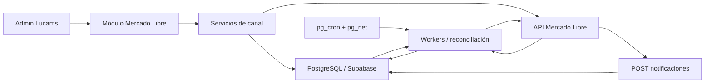

# Mercado Libre Colombia — Especificación funcional y técnica

> **Estado: diseño preimplementación. No existe integración operativa ni credenciales configuradas.** El objetivo no es una demo, sino una integración completa, progresiva y productiva para productos terminados con stock. Los enlaces fueron abiertos y contrastados el **15 de noviembre de 2026**. Las capacidades condicionadas por cuenta se identifican explícitamente y deben validarse sin asumir disponibilidad.

## 1. Resultado objetivo y alcance

Mercado Libre será un canal adicional administrado desde Lucams para **productos prediseñados ya fabricados**, individuales o packs con stock físico.

### Incluye

- Conexión segura de la cuenta vendedora.
- Publicaciones, variaciones, precios y stock.
- Pedidos, cobros y agrupación por carrito/pack.
- Etiquetas, envíos, SLA, entregas y devoluciones.
- Preguntas, mensajes, reclamos y acciones disponibles.
- Cargos, costos, reembolsos, margen y conciliación.
- Ventas, cancelaciones, tiempos de despacho, reputación, visitas y esfuerzo operativo.
- Un único módulo admin, con auditoría, alertas, reintentos y reconciliación.

### Excluye

- Estudio, fotos del comprador, diseños, moderación de arte y renders.
- Fabricación bajo pedido y `MANUFACTURING_TIME`.
- Kits virtuales con componentes compartidos en el alcance inicial.
- Integración con otros países o múltiples cuentas en la primera versión.
- Publicidad y administración de promociones, salvo una fase posterior separada.
- Certificación como partner para uso exclusivo del propio comercio.

La entrega será incremental, pero **ninguna fase se considerará una demo**. Cada incremento debe ser seguro, estar probado y permanecer desactivado si aún no cumple sus criterios de salida.

## 2. Aplicación, autorización y certificación

### 2.1 Función real de la aplicación

La aplicación del DevCenter es el registro que permite al backend de Lucams actuar sobre la cuenta vendedora. No es una app pública ni una interfaz para compradores.

Flujo:

1. El titular crea la aplicación desde la cuenta oficial del negocio.
2. Registra nombre, logo, descripción, redirect URI HTTPS, permisos y tópicos.
3. En Lucams, un administrador autorizado pulsa **Conectar Mercado Libre**.
4. ML solicita autorización y devuelve un código al callback.
5. El backend intercambia el código por tokens y valida el `seller_id`.
6. Lucams opera las APIs y recibe notificaciones dentro de los permisos otorgados.

Para Colombia: `site_id = MCO` y moneda `COP`. OAuth usa Authorization Code server-side, redirect exacto, `state` y PKCE recomendado. El access token dura 6 horas; el refresh token es de un solo uso y se reemplaza en cada renovación. `offline_access` permite trabajar sin que el titular esté conectado. Desde el 30 de agosto de 2026, ML y Mercado Pago exigen aplicaciones separadas por unidad de negocio.

Fuentes: [crear aplicación](https://developers.mercadolibre.com.co/es_ar/crea-una-aplicacion-en-mercado-libre-es), [OAuth y tokens](https://developers.mercadolibre.com.co/es_ar/autenticacion-y-autorizacion), [guía in-house](https://developers.mercadolibre.com.co/es_ar/primeros-pasos-in-house) y [site MCO](https://api.mercadolibre.com/sites/MCO).

### 2.2 Permisos

| Alcance                                        | Permiso funcional                           |
| ---------------------------------------------- | ------------------------------------------- |
| Cuenta y reputación                            | Usuarios, habilitado por defecto            |
| Publicaciones, imágenes, precios y variaciones | Publicación y sincronización                |
| Preguntas y mensajes                           | Comunicación pre y posventa                 |
| Pedidos, envíos, devoluciones y reclamos       | Ventas y envíos                             |
| Indicadores y visitas                          | Métricas del negocio                        |
| Cargos, ingresos y documentos                  | Facturación, limitado a los recursos usados |

La autorización debe usar el mínimo necesario. Fuente: [permisos funcionales](https://developers.mercadolibre.com.co/es_ar/permisos-funcionales).

### 2.3 Certificación

La guía in-house permite desarrollar y operar una integración para el propio comercio sin presentar la certificación como requisito previo. DPP y sus niveles Silver/Gold/Platinum pertenecen al programa de partners, soporte e integradores; no son lo mismo que validación del vendedor, permisos, moderación de publicaciones o habilitación de una función.

Para Lucams no se justifica certificar una app de uso interno. Sí pueden existir activaciones particulares, como User Products o kits. Fuentes: [guía in-house](https://developers.mercadolibre.com.co/es_ar/primeros-pasos-in-house) y [soporte DPP](https://developers.mercadolibre.com.co/es_ar/soporte-para-integradores).

## 3. Cobertura real de APIs y restricciones

La siguiente matriz es la base del alcance. «Documentado» significa que existe una guía oficial abierta; no elimina la necesidad de probar la cuenta MCO. «Condicionado» indica activación, logística, estado o permisos variables.

| Capacidad               | Recursos y comportamiento confirmado                                                                                                 | Condición importante                                                                     | Fuente oficial                                                                                                                                                                                                                                                |
| ----------------------- | ------------------------------------------------------------------------------------------------------------------------------------ | ---------------------------------------------------------------------------------------- | ------------------------------------------------------------------------------------------------------------------------------------------------------------------------------------------------------------------------------------------------------------- |
| Cuenta y reputación     | `GET /users/{id}` entrega cuenta, tags y `seller_reputation`                                                                         | Los datos y períodos dependen del seller                                                 | [Reputación](https://developers.mercadolibre.com.co/es_ar/reputacion-de-vendedores)                                                                                                                                                                           |
| Categorías              | `domain_discovery/search`, `/sites/MCO/categories`, `/categories/{id}`                                                               | La categoría define reglas y límites                                                     | [Categorización](https://developers.mercadolibre.com.mx/es_ar/categoriza-productos)                                                                                                                                                                           |
| Atributos               | `/categories/{id}/attributes` y `/sale_terms`                                                                                        | Obligatorios y valores cambian por categoría                                             | [Atributos](https://developers.mercadolibre.com.co/es_ar/atributos)                                                                                                                                                                                           |
| Publicaciones           | `POST /items`, `GET/PUT /items/{id}` y `POST /items/validate`                                                                        | Campos editables cambian con ventas y modelo del seller                                  | [Publicar](https://developers.mercadolibre.com.ar/publica-productos), [validador](https://developers.mercadolibre.com.co/es_ar/validador-de-publicaciones) y [sincronización](https://developers.mercadolibre.com.ar/es_ar/servicio-sincroniza-publicaciones) |
| User Products           | El seller con tag `user_product_seller` usa `family_name` y recibe `user_product_id`; puede tener condiciones distintas por variante | Activación gradual. Legacy y UP coexisten; no publicar con el payload equivocado         | [Precio por variación / UP](https://developers.mercadolibre.com.co/es_ar/precio-variacion)                                                                                                                                                                    |
| Stock simple            | `PUT /items/{id}` con `available_quantity` y variaciones                                                                             | Se escribe valor absoluto, no un delta                                                   | [Sincronización](https://developers.mercadolibre.com.ar/es_ar/servicio-sincroniza-publicaciones)                                                                                                                                                              |
| Stock multiorigen       | `GET /user-products/{id}/stock` y escritura por ubicación con `x-version`                                                            | Con `warehouse_management`, `/items.available_quantity` no gobierna el stock real        | [Stock distribuido](https://developers.mercadolibre.com.co/es_ar/stock-distribuido)                                                                                                                                                                           |
| Pedidos                 | `GET /orders/{id}`, búsqueda por seller, pagos, ítems, `pack_id` y `shipping.id`                                                     | El envío puede crearse después; el pago y sus estados mandan                             | [Pedidos](https://developers.mercadolibre.com.co/es_ar/pedidos-y-opiniones) y [ME2/carrito](https://developers.mercadolibre.com.ar/es_ar/es_ar/mercadoenvios-modo-2)                                                                                          |
| Preferencias logísticas | `/users/{id}/shipping_preferences` y `/categories/{id}/shipping_preferences`                                                         | Modos y logísticas dependen de seller/categoría                                          | [Mercado Envíos 2](https://developers.mercadolibre.com.ar/es_ar/es_ar/mercadoenvios-modo-2)                                                                                                                                                                   |
| Envíos                  | `GET /shipments/{id}` con `x-format-new: true`, `/sla`, `/history`, `/costs`, `/orders`                                              | Dirección post-pago, estados/subestados y SLA variables                                  | [Gestionar envíos](https://developers.mercadolibre.com.co/es_ar/envios)                                                                                                                                                                                       |
| Etiquetas               | `GET /shipment_labels?...&response_type=pdf` o `zpl2`                                                                                | ME2, estado `ready_to_ship`, subestado imprimible; Full no imprime la venta del seller   | [Etiquetas ME2](https://developers.mercadolibre.com.ar/es_ar/es_ar/mercadoenvios-modo-2)                                                                                                                                                                      |
| Preguntas               | `/my/received_questions/search`, `/questions/{id}` y `POST /answers`                                                                 | Moderación y estados de pregunta/respuesta                                               | [Preguntas](https://developers.mercadolibre.com.co/es_ar/preguntas-y-respuestas)                                                                                                                                                                              |
| Mensajes                | Notificaciones `messages`, `/messages/unread` y lectura por pack/seller                                                              | Lectura puede marcar como leído; existen bloqueos y expiración                           | [Mensajes pendientes](https://developers.mercadolibre.com.co/es_ar/mensajes-pendientes) y [bloqueos](https://developers.mercadolibre.com.co/es_ar/mensajes-bloqueados)                                                                                        |
| Inicio de mensajes      | `/messages/action_guide/packs/{pack_id}` y `/option`                                                                                 | En ME2 se exige motivo; hay plantillas, límites y moderación                             | [Motivos para comunicarse](https://developers.mercadolibre.com.co/es_ar/motivos-para-comunicarse)                                                                                                                                                             |
| Reclamos                | `/post-purchase/v1/claims`, búsqueda, detalle, historial, acciones y `affects-reputation`                                            | Las acciones se leen en `available_actions`; no se presupone reembolso/devolución        | [Reclamos](https://developers.mercadolibre.com.co/es_ar/que-es-un-reclamo) y [resoluciones](https://developers.mercadolibre.com.co/es_ar/gestionar-resolucion-de-reclamos)                                                                                    |
| Mensajes de reclamos    | Lectura, envío y adjuntos JPG/PNG/PDF de hasta 5 MB                                                                                  | El destinatario cambia en mediación; acciones dependen de la etapa                       | [Mensajes de reclamos](https://developers.mercadolibre.com.co/es_ar/gestionar-mensaje-de-un-reclamo)                                                                                                                                                          |
| Devoluciones            | `/post-purchase/v2/claims/{id}/returns`, reviews y revisión por `return_id`                                                          | Restock solo tras recepción/revisión elegible; dinero y logística tienen estados propios | [Devoluciones](https://developers.mercadolibre.com.co/es_ar/gestionar-devoluciones)                                                                                                                                                                           |
| Cargos y reportes       | `/billing/integration/group/ML/order/details` y reportes por período                                                                 | Paginación, moneda, documentos y campos varían; validar MCO                              | [Reportes de facturación](https://developers.mercadolibre.com.co/es_ar/provisiones)                                                                                                                                                                           |
| Costos estimados        | `/sites/MCO/listing_prices` por categoría, precio, publicación y logística                                                           | Estimación no sustituye cargos reales                                                    | [Costos por vender](https://developers.mercadolibre.com.co/es_ar/comision-por-vender)                                                                                                                                                                         |
| Visitas                 | `/items/{id}/visits/time_window` y consultas por usuario                                                                             | Ventanas limitadas; conservar histórico propio                                           | [Visitas](https://developers.mercadolibre.com.ar/es_mx/recurso-de-visitas)                                                                                                                                                                                    |
| Notificaciones          | `orders_v2`, `items`, `shipments`, `questions`, `messages`, `post_purchase`, UP y stock                                              | HTTP 200 en 500 ms, duplicados y consulta posterior obligatoria                          | [Notificaciones](https://developers.mercadolibre.com.mx/es_mx/productos-recibe-notificaciones)                                                                                                                                                                |
| Recuperación            | `/missed_feeds?app_id=...` con filtros                                                                                               | Solo hasta 2 días; items requiere `site_id`                                              | [Historial de notificaciones](https://developers.mercadolibre.com.mx/es_mx/productos-recibe-notificaciones)                                                                                                                                                   |
| Comunicados             | `/communications/notices`                                                                                                            | Seller usa su token; owner consulta avisos de la integración                             | [Comunicaciones](https://developers.mercadolibre.com.ar/conoce-las-novedades-que-reciben-los-vendedores)                                                                                                                                                      |

### Decisiones derivadas de esta investigación

1. El adaptador debe detectar **legacy frente a User Products** mediante la cuenta y conservar ambos mapeos; no es válido asumir que todas las variantes comparten precio ni que el payload legacy sigue siendo aceptado.
2. No se reintenta ciegamente una creación o acción financiera tras timeout. Primero se consulta el estado externo usando IDs/SKU.
3. Mensajes, reclamos y devoluciones no son simples bandejas: la UI debe ofrecer las acciones devueltas por ML, sus plazos, moderación y restricciones.
4. El margen combina estimaciones y cargos reales, siempre marcados de forma distinta.
5. La integración necesita polling de reconciliación además de webhooks.

## 4. Módulo administrativo único

Una entrada: **Canales → Mercado Libre**. La ruta base abre Resumen; los detalles permanecen en rutas hijas con la misma navegación.

| Vista              | Funciones                                                                                                      |
| ------------------ | -------------------------------------------------------------------------------------------------------------- |
| **Resumen**        | Conexión, ventas, margen, pedidos, cancelaciones, SLA, reputación, visitas, esfuerzo, alertas y fecha de corte |
| **Publicaciones**  | Vinculación, categoría, atributos, variantes, precio, stock, estado, moderación, validación y sincronización   |
| **Pedidos**        | Cobro, comprador, ítems, pack/carrito, estado, envío, reclamos y cancelaciones                                 |
| **Envíos**         | Etiquetas PDF/ZPL, tracking, SLA, demoras, entregas, devoluciones y acciones logísticas                        |
| **Atención**       | Preguntas, mensajes posventa, reclamos, adjuntos, responsable y plazos                                         |
| **Finanzas**       | Bruto, cargos, envío, reembolsos, costo, neto, liberación de dinero y conciliación                             |
| **Sincronización** | Cuenta/OAuth, mapeos, eventos, outbox, errores, reintentos, comunicados y reconciliación                       |

Reglas de UX:

- No hay enlaces muertos ni vistas simuladas mientras una capacidad esté en desarrollo.
- Cada dato externo muestra última sincronización y divergencias.
- Las acciones sensibles exigen confirmación, RBAC y, cuando corresponda, MFA reciente.
- Se ofrecen solo acciones válidas para el estado actual del recurso.
- Un enlace a ML es respaldo para excepciones, no sustituto deliberado de una función disponible.
- El listado general de pedidos puede filtrar por canal sin duplicar la operación.

## 5. Fuente de verdad y reglas de consistencia

| Dominio                                  | Autoridad            | Regla                                               |
| ---------------------------------------- | -------------------- | --------------------------------------------------- |
| Producto base, SKU e imágenes originales | Lucams               | Solo una selección elegible se publica              |
| Contenido y precio del canal             | Lucams, con override | ML puede moderar; no se asume paridad con la tienda |
| Categoría y reglas de publicación        | ML                   | Se consulta antes de escribir                       |
| Stock físico local                       | Lucams               | Se calcula el ofrecible y se envía un absoluto      |
| Stock Full                               | ML                   | Es inventario físico separado                       |
| Pedido, pago y cobro ML                  | ML                   | No se crea Wompi ni COD                             |
| Envío ML                                 | ML                   | No se genera una guía Aveonline duplicada           |
| Mensajes, reclamos y devoluciones        | ML                   | Se refleja estado y se ejecutan acciones permitidas |
| Cargos, liberación y documentos          | ML                   | Se importan y concilian                             |
| Historial operativo consolidado          | Lucams               | Guarda IDs, timestamps y origen de cada cambio      |

## 6. Arquitectura propuesta

### 6.1 Topología



No se agrega infraestructura nueva. Se reutilizan Next.js server-side, Postgres, `pg_cron`, `pg_net`, Storage privado, RBAC, MFA, auditoría, alertas y observabilidad.

### 6.2 Componentes

- `MercadoLibreProvider`: HTTP, OAuth, validación, timeouts, rate limiting y normalización de errores.
- Servicio de conexión: grant, seller, cifrado, rotación, revocación y refresh serializado.
- Registro de publicaciones: legacy/UP, categoría, atributos, IDs y estados.
- Inbox: recepción en menos de 500 ms, deduplicación y persistencia mínima.
- Outbox: operaciones salientes con clave idempotente, lease, intentos y confirmación.
- Importadores: pedidos, envíos, mensajes, reclamos, devoluciones y cargos.
- Reconciliadores: consulta periódica por ventana y corrección de divergencias.
- Módulo admin y servicios de métricas.

### 6.3 Modelo lógico de datos

Los nombres describen entidades necesarias, no una migración ya aprobada. El diseño detallado debe revisar campos, índices y relaciones antes de implementarse.

| Entidad                            | Responsabilidad y campos esenciales                                                                                         |
| ---------------------------------- | --------------------------------------------------------------------------------------------------------------------------- |
| `ChannelAccount`                   | Canal, ambiente, seller/app IDs, estado, scopes, tokens cifrados, expiración y última sincronización                        |
| `ChannelListing`                   | Cuenta, producto, `item_id`, `user_product_id`, modelo legacy/UP, categoría, override editorial, estado y hash remoto       |
| `ChannelListingVariant`            | Listing, `ProductVariant`, `variation_id`, SKU y atributos de equivalencia                                                  |
| `ChannelSyncEvent`                 | Dirección, tópico, recurso, ID externo/dedup, payload mínimo, estado, intentos, lease, próxima ejecución y error sanitizado |
| `ChannelPayment`                   | Pedido, payment IDs, estado, importe, liberación, moneda y datos financieros no sensibles                                   |
| `ChannelShipment`                  | Pedido, shipment ID, modo/logística, estado/subestado, SLA, tracking, etiqueta privada y costo                              |
| `ChannelThread` / `ChannelMessage` | Pregunta, posventa o reclamo, recurso asociado, mensaje externo, moderación, lectura y adjuntos                             |
| `ChannelClaim`                     | Claim ID, pedido/envío/pago, tipo, etapa, motivo, plazos, acciones, resolución y efecto en reputación                       |
| `ChannelReturn`                    | Return ID, reclamo, ítems/cantidades, dinero, envíos, revisión, condición y elegibilidad de restock                         |
| `ChannelCharge`                    | Detail/document IDs, pedido/pack/pago/envío, tipo, importe con signo en centavos, descuento, moneda y fecha                 |
| `ChannelDailyMetric`               | Visitas, ventas, cancelaciones, SLA y reputación con fecha/período y fuente                                                 |

### 6.4 Reutilización del dominio actual

- `Order` necesita canal, cuenta e ID externo; `PaymentMethod` debe distinguir ML/Mercado Pago de Wompi/COD.
- `OrderItem` conserva SKU/variante, cantidad, precio e importe congelados.
- Un pedido ML no usa `createOrderFromCart`, puntos, cupones, referidos ni consentimiento de marketing de la tienda.
- Un carrito ML puede reunir varias órdenes bajo `pack_id`; un envío puede relacionar varias órdenes. La importación debe agrupar sin duplicar.
- `InventoryLog` necesita razones externas e idempotencia por pedido/variante/acción.
- `ShipmentEvent` actual no cubre por sí solo múltiples shipments, devoluciones ni todos los campos ML; se requiere la entidad de canal.
- Los reclamos ML no se fuerzan a `RetractRequest` o `WarrantyClaim`: tienen otro ciclo legal y operativo.
- Los reportes financieros generales deben incorporar el canal solo después de definir bruto, neto, liberación y reembolsos.

### 6.5 Dinero e identificadores

- Importes internos en centavos COP `Int`; la conversión desde números JSON se valida y redondea una sola vez en el borde.
- IDs de usuarios, pedidos, pagos y variaciones se almacenan como `String`, nunca `Int32`; ML ha advertido IDs por encima de Int32 en sus [comunicaciones para desarrolladores](https://developers.mercadolibre.com.ar/devcenter/home).
- Toda entidad externa tiene unicidad por cuenta + ID externo.
- Toda escritura conserva `last_seen_at`, hash o versión remota cuando exista.

## 7. Reglas funcionales críticas

### 7.1 Publicaciones y variantes

1. Seleccionar producto/SKU terminado.
2. Consultar categoría, atributos, garantía, logística y costos.
3. Detectar `user_product_seller`, `warehouse_management` y capacidades de la cuenta.
4. Construir payload legacy o UP según corresponda.
5. Ejecutar `/items/validate` antes de crear cuando sea aplicable.
6. Guardar IDs devueltos y confirmar con una lectura posterior.
7. Sincronizar solo campos modificables y conservar IDs de variaciones.

No se clonan publicaciones ni se borran para resolver errores editoriales. La condición se carga como `ITEM_CONDITION` en implementaciones nuevas, según la guía de publicación.

### 7.2 Stock

```text
ofrecible ML = máximo(0, mínimo(stock disponible Lucams - reserva de seguridad, tope del canal))
```

- Se publican absolutos, nunca deltas.
- Venta ML confirmada descuenta una vez en Lucams; venta web pagada genera sincronización saliente.
- Si ML ya descontó, Lucams confirma el nuevo absoluto sin enviar otro débito.
- Si falta stock al importar una venta ya cobrada, se marca reconciliación crítica, alerta y pausa la oferta afectada cuando sea posible; no se oculta ni se cancela automáticamente la venta.
- Cancelación no implica restock automático. Devolución solo repone tras recepción y condición vendible.
- Con multiorigen se usa la ubicación y `x-version`; con Full no se confunde stock local con `meli_facility`.

### 7.3 Pedidos

1. Recibir `orders_v2`/`shipments` y persistir deduplicado.
2. Consultar el recurso actual con el token del seller correcto.
3. Importar solo estados elegibles y no producir antes del pago confirmado.
4. Resolver `pack_id`, orden, ítems, pagos y shipment; tolerar `shipping.id = null` temporal.
5. Crear/actualizar el pedido en una transacción idempotente.
6. Descontar stock con actualización condicional y ledger único.
7. Emitir alertas y hacer visible el pedido en el módulo.

Los eventos fuera de orden se resuelven consultando el estado actual; no se aplican transiciones obsoletas basadas solo en la fecha del webhook.

### 7.4 Envíos

- Consultar preferencias antes de publicar.
- No generar Aveonline para Mercado Envíos.
- Priorizar por `/sla` y volver a consultar antes de despachar.
- Solicitar etiqueta solo con modo/estado/subestado válidos; Full no imprime la etiqueta de venta del seller.
- Guardar PDF/ZPL en almacenamiento privado con acceso administrativo auditado.
- No modificar la plantilla oficial de etiquetas.

### 7.5 Preguntas y mensajes

- Preguntas: pendientes, antigüedad, publicación, respuesta y moderación.
- Posventa: conversación por pack/seller, lectura sin efectos accidentales (`mark_as_read=false` cuando corresponda), historial y bloqueos.
- Inicio por el seller: consultar `action_guide`, motivo, plantilla y `cap_available` antes de enviar.
- No enviar mensajes repetitivos automáticos como «recibimos tu compra» ni usar el canal para marketing.
- En reclamos/mediación, el destinatario y los adjuntos siguen las acciones permitidas por ML.

Fuente adicional: [buenas prácticas de plataforma](https://developers.mercadolibre.com.co/es_ar/buenas-practicas-para-uso-de-la-plataforma).

### 7.6 Reclamos y devoluciones

- Suscribirse a `claims` y `claims_actions` dentro de Post Purchase.
- Leer `available_actions`, responsable, `due_date`, `related_entities` y resolución.
- Mostrar impacto en reputación sin recalcularlo con reglas propias.
- Consultar devolución solo cuando exista entidad relacionada.
- Usar `return_id` para revisión y evidencias; no asumir que el adjunto pertenece al claim en la arquitectura nueva.
- Reembolso total/parcial, disputa y devolución solo si están disponibles y con confirmación.
- Sincronizar efectos financieros y físicos por separado.

### 7.7 Finanzas y margen

```text
venta bruta
- cargos del canal
- costo de envío asumido
- reembolsos/contracargos
- costo del producto y empaque
= resultado neto operativo
```

- `listing_prices` alimenta una simulación fechada antes de publicar.
- Los cargos reales se importan desde reportes por orden/período y se deduplican por `detail_id`.
- Se distinguen venta, cobro, dinero retenido, liberado, liquidado y reembolsado.
- La liberación reportada por ML no se reemplaza por una estimación de días.
- La conciliación bancaria real requiere validar en la prueba técnica qué recursos de ML/Mercado Pago están disponibles para la cuenta; no se promete un payout API no confirmado.
- El resultado operativo no se etiqueta como utilidad contable si faltan impuestos o costos.

### 7.8 Métricas y esfuerzo

- Ventas, neto, margen, ticket, unidades, cancelaciones, devoluciones y reclamos.
- SLA propio calculado desde hitos y reputación oficial leída desde `seller_reputation`; no se presentan como equivalentes.
- Visitas y conversión con ventana y fuente; conservar histórico porque la API limita consultas.
- Esfuerzo mediante intervenciones manuales, mensajes, reclamos, errores y reintentos. Los minutos solo se muestran si se miden o se declaran estimados.
- Todo indicador incluye período, fuente y última sincronización.

## 8. Seguridad, resiliencia y operación

### 8.1 Seguridad

- Secretos y tokens solo en servidor, cifrados con clave dedicada y fuera de logs.
- `state` de un solo uso, PKCE y redirect URI exacto.
- RBAC/MFA para conectar, desconectar, reembolsar o cambiar cuenta.
- Webhook con body acotado, validación de estructura, `application_id` y seller esperados.
- El webhook nunca crea por sí solo una venta: se consulta el recurso oficial.
- PII mínima, logs redactados y retención definida.
- Separación estricta de credenciales, cuentas y datos STG/PRD.
- Manejo explícito de 401/403 por token, scopes, usuario, IP o app bloqueada. Fuente: [Error 403](https://developers.mercadolibre.com.co/es_ar/error-403).

### 8.2 Resiliencia

- HTTP 200 en menos de 500 ms; procesamiento posterior mediante cola persistente.
- Deduplicación por ID de evento o hash estable de app/tópico/recurso/acciones cuando no exista ID.
- Backoff con jitter para errores transitorios y 429; no hay una cuota universal fija.
- Leases para impedir workers duplicados y recuperación de tareas atascadas.
- Creaciones y acciones no idempotentes no se repiten a ciegas tras timeout.
- `missed_feeds` hasta 2 días y reconciliación periódica por recurso.
- Consulta regular de `/communications/notices` para cambios y alertas.
- Kill switch por canal y por tipo de escritura; la lectura puede continuar durante una contingencia.

### 8.3 Observabilidad

- Salud OAuth, última renovación y validez de grant.
- Profundidad/antigüedad de inbox y outbox.
- Tasa de error, 429, latencia y notificaciones desactivadas.
- Divergencias de stock, precio, pedidos, envíos y cargos.
- Pedidos pagados sin importar, envíos cerca del SLA, reclamos vencidos y devoluciones sin revisar.
- Alertas críticas con deduplicación y enlace directo al recurso interno.

## 9. Ambientes y pruebas reales

ML no ofrece sandbox separado para este flujo: usa usuarios test en producción. Se permiten hasta 10 por cuenta y todas las operaciones deben ocurrir exclusivamente entre usuarios/publicaciones test. No se mezclan con cuentas reales. Fuente: [Realiza pruebas](https://developers.mercadolibre.com.co/es_ar/realiza-pruebas).

La configuración recomendada es aislar aplicaciones/credenciales por ambiente y mantener STG vinculado únicamente a sellers test. PRD usa el seller real. Los artículos test siguen el título y reglas oficiales y se eliminan periódicamente por ML.

Cobertura mínima:

- OAuth, refresh serializado, revocación y rotación de secret.
- Legacy y UP, publicación, validación, variantes, precio y stock.
- Webhook duplicado/fuera de orden, pérdida y recuperación.
- Pedido simple y carrito, pago aprobado/rechazado, falta de stock y cancelación.
- Shipment tardío, etiqueta, reimpresión, entrega y devolución.
- Pregunta, posventa, motivo/cap, moderación y reclamo con adjunto.
- Cargos, descuentos, liberación, reembolso y conciliación.
- Prueba acotada en producción con SKU reales solo después de homologar el flujo completo.

## 10. Entrega progresiva por sesiones

Cada fase puede ocupar una o varias sesiones. No se avanza si las dependencias o criterios de salida fallan. Una funcionalidad incompleta permanece desactivada y sin enlaces muertos.

| Fase                                | Entrega completa                                                                                        | Criterio de salida                                                                           |
| ----------------------------------- | ------------------------------------------------------------------------------------------------------- | -------------------------------------------------------------------------------------------- |
| **0. Validación externa**           | Cuenta, titular, app, usuarios test, permisos, categorías, logística, legacy/UP, multiorigen y finanzas | Evidencia de APIs reales, matriz de capacidades actualizada y alcance sin supuestos críticos |
| **1. Fundación**                    | Migraciones aditivas, provider, OAuth, tokens, cuenta, inbox/outbox, RBAC y salud                       | Conectar/desconectar seller test, renovar tokens y procesar eventos sin duplicados           |
| **2. Publicaciones y stock**        | Vincular/crear/editar/pausar, legacy/UP, precio, stock y reconciliación                                 | Ciclo completo con SKU test y cambios originados tanto en Lucams como en ML                  |
| **3. Pedidos y envíos**             | Pedido pagado, carrito, inventario, cobro, etiqueta, SLA, tracking y cancelación                        | Compra test importada una vez, stock correcto y despacho trazable                            |
| **4. Atención y posventa**          | Preguntas, mensajes, reclamos, devoluciones, adjuntos y acciones permitidas                             | Casos test gestionados desde Lucams respetando moderación, plazos y restock                  |
| **5. Finanzas y métricas**          | Cargos, liberación, neto, margen, conciliación, reputación, visitas y esfuerzo                          | Totales contrastados con reportes ML y divergencias explicadas                               |
| **6. Endurecimiento y lanzamiento** | Reconciliación global, alertas, runbook, seguridad, rendimiento y activación gradual                    | Homologación completa y piloto real limitado sin operación manual duplicada                  |

### Contrato para cada sesión

1. Leer `docs/STATE.md`, este documento y el ADR del canal antes de cambiar código.
2. Revisar la fase actual y las APIs vigentes enlazadas; registrar cualquier cambio de ML en el sitio correspondiente.
3. Entregar una porción vertical completa, no stubs ni botones sin funcionalidad.
4. Incluir migraciones duales Prisma/Supabase, RLS, RBAC, auditoría y pruebas cuando apliquen.
5. Ejecutar `make check && pnpm test`, más `pnpm build` si se tocan rutas/build.
6. Actualizar este documento y `docs/STATE.md` con lo realmente operativo y el siguiente bloqueo.
7. No guardar credenciales, payloads con PII ni usuarios test en documentación.

## 11. Validaciones externas todavía necesarias

La documentación permite diseñar, pero no reemplaza la cuenta real. Antes de la fase 1 hay que confirmar:

1. Titular y administrador permanente de cuenta y app.
2. SKU y packs terminados del catálogo inicial, precio y reserva de stock.
3. Tags `user_product_seller` y `warehouse_management` del seller.
4. Categorías, atributos, garantía y logísticas disponibles.
5. Recursos de reclamos, reportes y liberación disponibles en MCO.
6. Campos exactos de liquidación y cualquier necesidad de una app Mercado Pago separada.
7. Excepciones que seguirán requiriendo el panel ML.
8. Tratamiento fiscal y contable revisado por el responsable correspondiente.

Estas validaciones no convierten la entrega en una demo: son la evidencia necesaria para implementar el sistema completo sin construir sobre supuestos.

## 12. Definición global de terminado

La integración solo estará completa cuando:

- Las capacidades incluidas en el alcance puedan operarse desde el módulo o tengan una excepción externa documentada y visible.
- Publicaciones, stock, pedidos, envíos, atención, reclamos y finanzas mantengan IDs y estados reconciliables.
- No existan cobros duplicados, guías Aveonline para ML, descuentos dobles de stock ni restock sin recepción elegible.
- Los fallos se recuperen sin intervención oculta y toda acción sensible tenga auditoría.
- Las cifras financieras se contrasten con reportes reales.
- Las pruebas entre usuarios test y el piloto real limitado pasen sin errores críticos abiertos.
- La operación diaria no dependa de copiar datos manualmente entre Lucams y ML.
