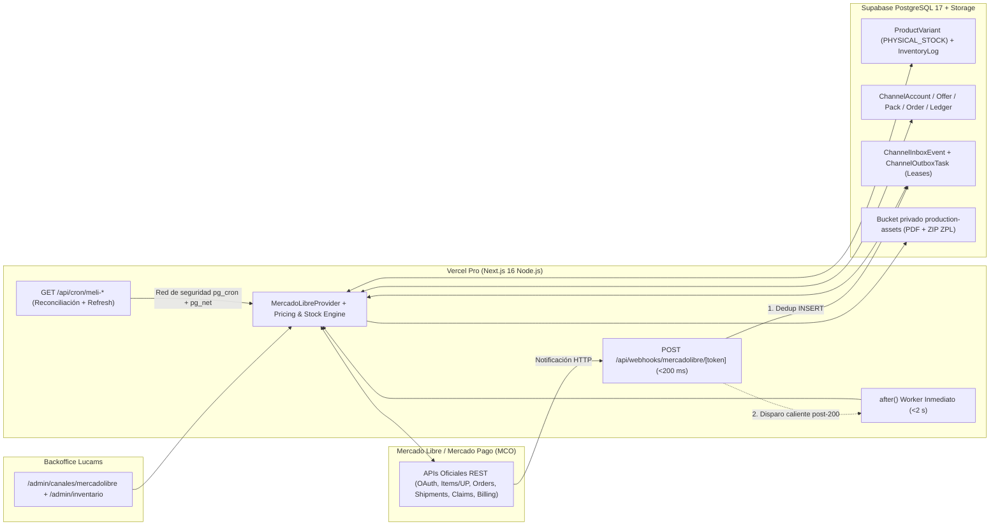

# Mercado Libre Colombia — Especificación funcional y técnica

> **Estado: diseño preimplementación (`ADR-205` + `ADR-208`). No existe integración operativa ni credenciales configuradas.** El objetivo no es una demo ni un piloto descartable, sino una integración productiva completa para **productos prediseñados terminados con stock físico multilateral**, centralizada en Lucams. Las fuentes oficiales y las reglas operativas de Colombia (`MCO`) fueron contrastadas el **15 y 16 de noviembre de 2026**. Toda capacidad condicionada por cuenta, categoría o perfil fiscal se identifica explícitamente y debe verificarse en la cuenta real durante la Fase 0 sin asumir disponibilidad.

## 1. Modelo de negocio, separación del catálogo (`ADR-208`) y alcance

Mercado Libre será un canal transaccional administrado desde Lucams exclusivamente para **productos prediseñados ya fabricados y pre-empacados en estantería**, individuales o en packs con SKU e inventario físico real compartido con `lucamsshop.com`, Meta Catalog y Google Merchant.

### 1.1 Separación estricta de las tres naturalezas en Lucams (`ADR-208`)

Para impedir sobreventas, tiempos de despacho incumplidos o contaminación del inventario, el dominio separa tres naturalezas que no comparten reglas de stock:

| Naturaleza en el dominio                     | Entidad / módulo en Lucams                                                        | ¿Tiene SKU?        | ¿Tiene stock físico?                                                                                | Comportamiento por canal                                                                                                                                                   |
| -------------------------------------------- | --------------------------------------------------------------------------------- | ------------------ | --------------------------------------------------------------------------------------------------- | -------------------------------------------------------------------------------------------------------------------------------------------------------------------------- |
| **1. Artes digitales de biblioteca**         | `DesignGalleryImage` (`/admin/disenos`, galería de artes del Estudio)             | No                 | No (activo digital infinito)                                                                        | Exclusivo dentro del Estudio en `lucamsshop.com`: el comprador combina libremente sus fotos personales con ilustraciones de Lucams. Nunca sale a canales externos.         |
| **2. Productos personalizables bajo pedido** | `Product` con `fulfillmentMode = MADE_TO_ORDER`                                   | Sí                 | No (retira el buffer ficticio `100.000`; gobernado por `isActive` e insumos en `/admin/materiales`) | Se vende en `lucamsshop.com` pasando por el Estudio (con adquisición desde Meta/Google). **Bloqueado por invariante de código y base de datos para Mercado Libre.**        |
| **3. Productos prediseñados terminados**     | `Product` con `fulfillmentMode = PHYSICAL_STOCK` (`/admin/inventario` 100 % real) | Sí (SKU universal) | **Sí: pozo físico único, real y multilateral**                                                      | Consumo simultáneo en **`lucamsshop.com` (compra en 1 clic sin Estudio y retracto de 5 días hábiles)**, **Mercado Libre (`MCO`)**, **Meta Catalog** y **Google Merchant**. |

### 1.2 Economía unitaria real en Mercado Libre Colombia (`MCO`)

La estructura de cargos de Mercado Libre Colombia condiciona qué presentaciones son viables antes de publicar:

1. **Comisión porcentual por exposición y categoría:** varía según publicación **Clásica** (`gold_special`, sin cuotas sin interés) o **Premium** (`gold_pro`, con financiación para el comprador). Se consulta de forma exacta por API en `/sites/MCO/listing_prices` antes de publicar ([costos por vender](https://developers.mercadolibre.com.co/es_ar/comision-por-vender), verificado 2026-11-16).
2. **Cargo fijo adicional por unidad en precios bajos (`< $60.000 COP`):** en Colombia, las unidades de bajo ticket pagan un cargo fijo por unidad vendida además de la comisión porcentual ([centro de ayuda MCO — costos por vender](https://www.mercadolibre.com.co/ayuda/costos-de-vender-un-producto_1948), verificado 2026-11-16; validar tramos exactos vigentes de la cuenta en Fase 0). Publicar separadores o imanes individuales de bajo valor erosiona casi todo el ingreso bruto.
3. **Umbral de Envío Gratis obligatorio (`>= $60.000 COP`) y «zona muerta»:** los productos nuevos desde `$60.000 COP` activan Envío Gratis para el comprador con cofinanciación logística a cargo del vendedor según peso, distancia y reputación ([envíos y costos MCO](https://www.mercadolibre.com.co/ayuda/costos-de-envio-por-mercado-envios_3628), verificado 2026-11-16). Esto genera una **zona muerta comercial** (aprox. `$60.000–$66.000 COP`) donde subir el precio por encima de `$59.900 COP` reduce el ingreso neto real del vendedor al activarse el descuento de envío.
4. **Retenciones tributarias en pagos con tarjeta:** bajo el régimen actual de **persona natural no responsable de IVA** (`COMPLIANCE.md` § 7.1), cuando el comprador en Mercado Libre paga con tarjeta débito o crédito, Mercado Pago practica automáticamente **Retención en la Fuente** (renta) y **ReteICA** municipal (según domicilio fiscal Bogotá cargado en el RUT), sin aplicar ReteIVA mientras el RUT acredite no responsabilidad de IVA; en pagos PSE o efectivo no aplica dicha retención ([retenciones de impuestos en MCO](https://www.mercadolibre.com.co/ayuda/retenciones-de-impuestos_3218), verificado 2026-11-16; contrastar tasas exactas con contador en Fase 0).

Por diseño comercial y operativo, el portafolio inicial en Mercado Libre operará sobre **sets, colecciones y cajas regalo físicamente pre-armadas en estantería** (alistamiento inmediato sin ensamblaje al vender), con simulador preventivo obligatorio de margen y motor modular de precios por canal (§ 7.2).

### 1.3 Alcance funcional

#### Incluye

- Separación previa del núcleo de inventario físico terminado frente a productos bajo pedido (`ADR-208`).
- Conexión segura OAuth de la cuenta vendedora `MCO` con rotación serializada y cifrado dedicado.
- Publicaciones, variaciones legacy y modelo **User Products**, motor modular de precios (`FORMULA` / `MANUAL`), simulador preventivo de margen y sincronización bidireccional de stock en segundos.
- Importación aislada de pedidos y carritos (`pack_id`) en contexto acotado propio (`ChannelPack` / `ChannelOrder`).
- Despacho con **Mercado Envíos (`ME2`)**, **Mercado Envíos Flex Bogotá (`self_service`)** y trazabilidad de inventario separado para **Full (`fulfillment`)**, etiquetas PDF/ZPL auditadas, SLA y devoluciones.
- Preguntas pre-venta, mensajería posventa gobernada por `action_guide`, reclamos (`claims` v1) y devoluciones (`returns` v2) con inspección humana antes de reingresar stock.
- Contabilidad exacta en centavos COP (comisiones, cargos fijos, fletes, reembolsos, **retenciones tributarias a favor** y liberación de dinero), integrada con `/admin/finanzas` y `FiscalWatch` (`3.500 UVT`).
- Un único módulo operativo (`/admin/canales/mercadolibre`), con RBAC por capacidad, RLS, alertas, reintentos y reconciliación.

#### Excluye

- Estudio de personalización, fotografías del comprador, moderación UGC, `RenderJob` 300 DPI y `MANUFACTURING_TIME`.
- Kits o combos virtuales dinámicos que descuenten múltiples SKUs hijos en tiempo real durante la primera versión (los packs iniciales se pre-arman como SKUs físicos propios en estantería).
- Múltiples países o múltiples cuentas vendedoras simultáneas en la primera etapa.
- Administración de Mercado Ads y promociones cofinanciadas automáticas, salvo fase posterior separada.
- Certificación comercial en el Developer Partner Program (DPP) para uso interno del propio comercio.

La entrega será incremental, pero **ninguna fase será una demo**: cada fase cierra un corte vertical seguro, probado y con criterios estrictos de salida, manteniendo apagada y sin enlaces muertos cualquier vista aún no productiva.

---

## 2. Aplicación, autorización, rotación serializada y certificación

### 2.1 Función real de la aplicación y flujo OAuth

La aplicación registrada en el DevCenter autoriza al backend de Lucams a operar sobre la cuenta oficial vendedora; no es una aplicación pública para terceros.

1. El titular crea la aplicación desde la cuenta oficial vendedora en Colombia (`site_id = MCO`, moneda `COP`).
2. Configura nombre, descripción, redirect URI HTTPS exacto, permisos mínimos y URL tokenizada de notificaciones.
3. En Lucams, `SUPERADMIN` con MFA `aal2` reciente inicia **Conectar Mercado Libre**.
4. Mercado Libre solicita autorización con `state` criptográfico de un solo uso + **PKCE (`S256`)** y redirige al callback.
5. El servidor intercambia el `code`, valida que el `user_id` coincida con el seller esperado, cifra los tokens con **`AES-256-GCM`** usando llave exclusiva (`MELI_TOKEN_ENCRYPTION_KEY` + `keyVersion`, nunca `CSRF_SECRET`) y detecta las capacidades reales de la cuenta (`GET /users/{id}`).

El `access_token` expira a las **6 horas** y el `refresh_token` (`offline_access`) es **de un solo uso** (se invalida en cada renovación). Desde el **30 de agosto de 2026**, Mercado Libre y Mercado Pago exigen aplicaciones separadas por unidad de negocio.

Fuentes: [crear aplicación](https://developers.mercadolibre.com.co/es_ar/crea-una-aplicacion-en-mercado-libre-es), [autenticación y autorización](https://developers.mercadolibre.com.co/es_ar/autenticacion-y-autorizacion), [primeros pasos in-house](https://developers.mercadolibre.com.co/es_ar/primeros-pasos-in-house) y [site MCO](https://api.mercadolibre.com/sites/MCO) (verificadas 2026-11-16).

### 2.2 Renovación serializada en Serverless (anti-colisión multi-instancia)

En Vercel Serverless múltiples funciones concurrentes (webhooks, crons y acciones admin) no comparten memoria. Si dos instancias intentan rotar el mismo `refresh_token` simultáneamente, la segunda recibe `invalid_grant` y puede invalidar el grant por detección de _replay_. El servicio de conexión aplica dos defensas obligatorias:

1. **Renovación proactiva programada:** el cron de mantenimiento renueva preventivamente cualquier cuenta activa cuyo `accessTokenExpiresAt` venza en **`< 45 minutos`**, garantizando que el tráfico ordinario lea de PostgreSQL un token vigente sin llamar a `/oauth/token`.
2. **Exclusión mutua en PostgreSQL (`pg_advisory_xact_lock`):** cuando una petición requiere refrescar en caliente, adquiere un lock transaccional por `channelAccountId`, relee `accessTokenExpiresAt` dentro del lock y, si otra instancia acaba de rotarlo, reutiliza el token nuevo sin emitir una segunda llamada a Mercado Libre.

### 2.3 Permisos mínimos y ausencia de requisito DPP

| Alcance operativo                                                       | Permiso funcional en DevCenter               |
| ----------------------------------------------------------------------- | -------------------------------------------- |
| Cuenta, tags del seller y reputación                                    | Usuarios (habilitado por defecto)            |
| Publicaciones, User Products, imágenes, precios, variaciones y stock    | Publicación y sincronización                 |
| Preguntas pre-venta y mensajería posventa                               | Comunicación pre y posventa                  |
| Pedidos, carritos (`packs`), envíos, etiquetas, devoluciones y reclamos | Ventas y envíos                              |
| Indicadores operativos y visitas                                        | Métricas del negocio                         |
| Cargos, reportes de facturación, retenciones y conciliación             | Facturación (limitado a los recursos usados) |

La guía oficial _in-house_ confirma que un comercio que desarrolla para su propia cuenta **no requiere certificación DPP** (Silver/Gold/Platinum corresponden a integradores multi-cliente). Sí pueden existir activaciones específicas de cuenta en Mercado Libre (como migración a _User Products_, _Stock Distribuido_ o _Envíos Flex_). Fuentes: [permisos funcionales](https://developers.mercadolibre.com.co/es_ar/permisos-funcionales) y [soporte DPP](https://developers.mercadolibre.com.co/es_ar/soporte-para-integradores) (verificadas 2026-11-16).

---

## 3. Cobertura real de APIs y restricciones técnicas en `MCO`

«Documentado» significa especificación pública vigente; toda condición dependiente de la cuenta se valida empíricamente en la Fase 0.

| Capacidad                                           | Recursos HTTP y comportamiento verificado                                                                                                                                                                                        | Condición crítica de ingeniería                                                                                                                                                                                                                   | Fuente oficial                                                                                                                                                                                                                                                                        |
| --------------------------------------------------- | -------------------------------------------------------------------------------------------------------------------------------------------------------------------------------------------------------------------------------- | ------------------------------------------------------------------------------------------------------------------------------------------------------------------------------------------------------------------------------------------------- | ------------------------------------------------------------------------------------------------------------------------------------------------------------------------------------------------------------------------------------------------------------------------------------- |
| Cuenta, tags y reputación                           | `GET /users/{id}` devuelve perfil, `tags[]` (`user_product_seller`, `warehouse_management`, `multiwarehouse`) y `seller_reputation`                                                                                              | Determina qué contrato de publicación y stock debe usar el adaptador                                                                                                                                                                              | [Reputación](https://developers.mercadolibre.com.co/es_ar/reputacion-de-vendedores)                                                                                                                                                                                                   |
| Categorías y atributos                              | `GET /sites/MCO/domain_discovery/search`, `/categories/{id}`, `/categories/{id}/attributes` y `/sale_terms`                                                                                                                      | Atributos obligatorios (`ITEM_CONDITION`, marca, modelo/formato) cambian por categoría                                                                                                                                                            | [Categorización](https://developers.mercadolibre.com.mx/es_ar/categoriza-productos) y [Atributos](https://developers.mercadolibre.com.co/es_ar/atributos)                                                                                                                             |
| Publicación legacy vs **User Products**             | `POST /items/validate`, `POST /items`, `GET/PUT /items/{id}`. En cuentas con `user_product_seller` se envía `family_name`, el título lo arma ML y **cada variante genera su propio `item_id` y `user_product_id`**               | Enviar `variations[]` junto con `family_name` falla con **Error `374`**; omitir `family_name` en cuentas migradas falla con **Error `369`**                                                                                                       | [Publicar](https://developers.mercadolibre.com.ar/publica-productos), [validador](https://developers.mercadolibre.com.co/es_ar/validador-de-publicaciones) y [Precio por variación / UP](https://developers.mercadolibre.com.co/es_ar/precio-variacion)                               |
| Stock simple vs **Stock distribuido (`x-version`)** | Sin `warehouse_management`: `PUT /items/{id}` (`available_quantity` absoluto). Con `warehouse_management`: `GET /user-products/{up_id}/stock` + `PUT /user-products/{up_id}/stock` (`selling_address` vs `meli_facility`)        | Con `warehouse_management`, enviar `available_quantity` en `/items` arroja **`400 Bad Request`**. El `PUT` exige cabecera **`x-version`** leída en el `GET` previo y responde **`409 Conflict`** ante escritura concurrente                       | [Sincronización](https://developers.mercadolibre.com.ar/es_ar/servicio-sincroniza-publicaciones) y [Stock distribuido](https://developers.mercadolibre.com.co/es_ar/stock-distribuido)                                                                                                |
| Pedidos y carritos (`pack_id`)                      | `GET /orders/{id}` y `GET /orders/pack/{pack_id}`; comprador con correo/teléfono enmascarados por privacidad de plataforma                                                                                                       | Un carrito crea múltiples `order_id` bajo un único `pack_id` y un único `shipment_id`; cada `order_id` puede cancelarse o reclamarse por separado                                                                                                 | [Pedidos](https://developers.mercadolibre.com.co/es_ar/pedidos-y-opiniones) y [ME2 / Carrito](https://developers.mercadolibre.com.ar/es_ar/es_ar/mercadoenvios-modo-2)                                                                                                                |
| Datos fiscales del comprador (`billing-info`)       | `GET /orders/billing-info/MCO/{billing_info_id}` usando `buyer.billing_info.id` de la orden                                                                                                                                      | El objeto fiscal embebido en `/orders/{id}` está deprecado; solo se consulta cuando `BILLING_DOCUMENT_ENABLED = true` (minimización Ley 1581)                                                                                                     | [Facturación / Billing Info](https://developers.mercadolibre.com.co/es_ar/datos-de-facturacion)                                                                                                                                                                                       |
| Envíos (`ME2`, **Flex Bogotá** y `Full`)            | `GET /shipments/{id}` con cabecera obligatoria **`x-format-new: true`**, `/sla`, `/history`, `/costs` y `/users/{id}/shipping_preferences`                                                                                       | `logistic.type` distingue `xd_drop_off`/`drop_off`/`cross_docking` (red ML), **`self_service` (Mercado Envíos Flex Bogotá)** y `fulfillment` (bodega Full). En Flex, el mensajero cierra la entrega escaneando QR en la app móvil oficial de Flex | [Gestionar envíos](https://developers.mercadolibre.com.co/es_ar/envios) y [Mercado Envíos Flex](https://www.mercadolibre.com.co/ayuda/mercado-envios-flex_5217)                                                                                                                       |
| Etiquetas oficiales                                 | `GET /shipment_labels?shipment_ids=...&response_type=pdf` o `zpl2` (entrega `.zip` con ZPL)                                                                                                                                      | Solo imprimible en `ready_to_ship` + subestado habilitado; `Full` nunca imprime etiqueta en el comercio. Guardar `.pdf` y `.zip` en `production-assets` (respeta `allowed_mime_types`)                                                            | [Etiquetas ME2](https://developers.mercadolibre.com.ar/es_ar/es_ar/mercadoenvios-modo-2)                                                                                                                                                                                              |
| Preguntas y mensajería posventa                     | `/my/received_questions/search`, `POST /answers`; posventa por `/messages/packs/{pack_id}/sellers/{seller_id}`, `/messages/unread` y `/messages/action_guide/packs/{pack_id}`                                                    | Usar `mark_as_read=false` al previsualizar; para iniciar conversación en `ME2` es obligatorio consultar motivos y `cap_available` en `action_guide`                                                                                               | [Preguntas](https://developers.mercadolibre.com.co/es_ar/preguntas-y-respuestas), [Mensajes](https://developers.mercadolibre.com.co/es_ar/mensajes-pendientes) y [Motivos](https://developers.mercadolibre.com.co/es_ar/motivos-para-comunicarse)                                     |
| Reclamos y devoluciones                             | `/post-purchase/v1/claims` (detalle, `available_actions`, mensajes, adjuntos JPG/PNG/PDF `<= 5 MB`, `affects-reputation`) y `/post-purchase/v2/claims/{id}/returns`                                                              | Prohibido presuponer botones fijos: la UI ofrece exclusivamente `available_actions`. El restock físico ocurre solo tras recepción y revisión humana aprobada sobre `return_id`                                                                    | [Reclamos](https://developers.mercadolibre.com.co/es_ar/que-es-un-reclamo), [Resoluciones](https://developers.mercadolibre.com.co/es_ar/gestionar-resolucion-de-reclamos) y [Devoluciones](https://developers.mercadolibre.com.co/es_ar/gestionar-devoluciones)                       |
| Cargos, retenciones y costos                        | `/sites/MCO/listing_prices` (simulación) y `/billing/integration/group/ML/order/details` + reportes por período                                                                                                                  | Validar en Fase 0 el desglose exacto en `MCO` para comisiones, cargos fijos, fletes, retenciones (`ReteFuente`/`ReteICA`) y liberación de fondos                                                                                                  | [Reportes de facturación](https://developers.mercadolibre.com.co/es_ar/provisiones) y [Costos por vender](https://developers.mercadolibre.com.co/es_ar/comision-por-vender)                                                                                                           |
| Visitas, webhooks y recuperación                    | `/items/{id}/visits/time_window`; webhooks `orders_v2`, `items`, `shipments`, `questions`, `messages`, `post_purchase`, `user-products-families`, `fbm_stock_operations`; `/missed_feeds?app_id=...` y `/communications/notices` | El receptor debe responder **`HTTP 200` en `< 500 ms`**; `/missed_feeds` retiene hasta 2 días. Las notificaciones no sustituyen leer el recurso con Bearer token                                                                                  | [Visitas](https://developers.mercadolibre.com.ar/es_mx/recurso-de-visitas), [Notificaciones](https://developers.mercadolibre.com.mx/es_mx/productos-recibe-notificaciones) y [Comunicaciones](https://developers.mercadolibre.com.ar/conoce-las-novedades-que-reciben-los-vendedores) |

---

## 4. Módulo administrativo único y control de acceso

Una entrada en la navegación lateral: **Canales → Mercado Libre** (`/admin/canales/mercadolibre`), enlazada técnicamente desde `/admin/integraciones` (`ADR-206`).

| Vista                       | Responsabilidad operativa                                                                                                                                                                                                                                                            |
| --------------------------- | ------------------------------------------------------------------------------------------------------------------------------------------------------------------------------------------------------------------------------------------------------------------------------------ |
| **Resumen**                 | Estado de conexión OAuth, `seller_reputation`, cola urgente del día (**Flex Bogotá** con corte horario vs **Agencia/Colecta ME2**), preguntas pendientes (> 30 min resaltadas), reclamos por vencer, ventas/margen del período y alertas de divergencia                              |
| **Publicaciones y precios** | Catálogo filtrable de SKUs `PHYSICAL_STOCK`, creación/vinculación Legacy o User Products, **motor modular de precios (`FORMULA` / `MANUAL`)**, **simulador preventivo de margen `MCO`**, validador `/items/validate`, moderación y comparador de stock `Lucams ↔ ML Local ↔ ML Full` |
| **Pedidos (`Packs`)**       | Vista agrupada por paquete físico (`ChannelPack`) y sub-órdenes (`ChannelOrder`), estado de pago, desglose de ítems a empacar en la misma caja, cancelaciones parciales y banderas de reconciliación                                                                                 |
| **Envíos**                  | Descarga auditada de etiquetas PDF y ZIP ZPL, separación operativa **Flex Bogotá (`self_service`)** / **Agencia ME2** / **Full**, relojes de `/sla`, tracking e incidencias de entrega                                                                                               |
| **Atención y posventa**     | Bandeja de preguntas pre-venta (con borrador opcional del copiloto IA 0-PII alimentado por `physicalSpecs`), mensajes por pack sujetos a `action_guide`, reclamos `v1` y devoluciones `v2` con decisión explícita de inspección física para restock                                  |
| **Finanzas**                | Ingreso bruto de mercancía, comisión ML, cargo fijo por unidad, envío asumido o ingreso Flex, costo BOM, margen operativo, **retenciones tributarias a favor (`ReteFuente`, `ReteICA`)** y estado de liberación de dinero                                                            |
| **Sincronización**          | Salud OAuth, renovación de grant, profundidad de Inbox/Outbox, errores sanitizados, reintentos manuales, reconciliación por cursores, avisos de `/communications/notices` y kill-switches por operación                                                                              |

### 4.1 RBAC granular y postura RLS

La restricción temporal actual de `/admin/canales/mercadolibre` a `SUPERADMIN` en `apps/web/lib/admin-rbac.ts` se reemplazará al activar cada vista por autorización fina alineada con la matriz de capacidades (`N-21`: ruta == página == Server Action / Route Handler):

| Función                                                      | Lectura                                                                                                                                                | Escritura / acción                                                                                               |
| ------------------------------------------------------------ | ------------------------------------------------------------------------------------------------------------------------------------------------------ | ---------------------------------------------------------------------------------------------------------------- |
| Conexión OAuth, scopes, kill-switches y desconexión          | `SUPERADMIN`                                                                                                                                           | `SUPERADMIN` + MFA reciente (`requireRecentMfa`)                                                                 |
| Publicaciones, motor de precios (`FORMULA`/`MANUAL`) y stock | `SUPERADMIN`, `OPERATIONS_MANAGER`, `MANAGER`                                                                                                          | `SUPERADMIN`, `OPERATIONS_MANAGER`, `MANAGER`                                                                    |
| Pedidos (`ChannelPack` / `ChannelOrder`)                     | Roles con `orders:read_operational` (importes según `canSeeOrderCommercialBreakdown`)                                                                  | Reconciliación según `orders:reconcile`                                                                          |
| Etiquetas PDF/ZPL y despacho (`ME2` / `Flex`)                | `SUPERADMIN`, `OPERATIONS_MANAGER`, `MANAGER`, `FULFILLMENT` (`PRINT_WORKSHOP` excluido: cero taller en prediseñados y cero acceso a PII de etiquetas) | Impresión auditada y control operativo según `ORDERS_SHIPMENT_DISPATCH`                                          |
| Preguntas, mensajes posventa, reclamos y devoluciones        | `SUPERADMIN`, `OPERATIONS_MANAGER`, `MANAGER`, `CUSTOMER_SUPPORT`                                                                                      | Respuestas y acciones válidas en `available_actions`; reembolsos/disputas con confirmación explícita y auditoría |
| Finanzas, retenciones, margen y métricas del canal           | `SUPERADMIN`, `FINANCE_ANALYST`                                                                                                                        | `SUPERADMIN` para cierres de conciliación                                                                        |
| Sincronización técnica, colas y reintentos                   | `SUPERADMIN`                                                                                                                                           | `SUPERADMIN`                                                                                                     |

`CMS_EDITOR` no recibe acceso al módulo. Toda tabla nueva aplica **RLS _deny-by-default_ (`rowsecurity = true` + `REVOKE ALL` a `anon` y `authenticated`)**, migraciones duales Prisma + SQL Supabase y cobertura obligatoria en la suite de pruebas RLS (`make verify-db`).

---

## 5. Autoridad de datos y contexto acotado (`ChannelPack` vs `Order`)

### 5.1 Fuente de verdad por dominio

| Dominio                                                | Autoridad                    | Regla de consistencia                                                                                                                                                |
| ------------------------------------------------------ | ---------------------------- | -------------------------------------------------------------------------------------------------------------------------------------------------------------------- |
| Producto maestro, SKU, costo BOM e imágenes base       | Lucams                       | Solo variantes con `fulfillmentMode = PHYSICAL_STOCK` son elegibles                                                                                                  |
| Precio del canal Mercado Libre                         | Lucams (`ChannelOffer`)      | Gobernado por `pricingMode` (`FORMULA` o `MANUAL`), independiente del precio web; en Meta y Google rige paridad estricta con la tienda                               |
| Categoría, atributos requeridos y moderación           | Mercado Libre                | Se consultan y validan antes de publicar o actualizar                                                                                                                |
| Stock físico local (`selling_address`)                 | Lucams                       | Pozo único compartido con Tienda y Meta; se calcula el ofrecible y se escribe valor absoluto (con `x-version` si aplica)                                             |
| Stock en bodega Full (`meli_facility`)                 | Mercado Libre                | Inventario físico separado ya despachado a bodega de ML; jamás descuenta ni suma sobre `ProductVariant.stock` local                                                  |
| Pedido, carrito (`pack_id`), pago y envío del canal    | Mercado Libre                | Persistidos en `ChannelPack` / `ChannelOrder` / `ChannelShipment`; nunca crean intentos Wompi ni guías Aveonline                                                     |
| Preguntas, mensajes, reclamos y devoluciones           | Mercado Libre                | Se reflejan estados oficiales y se ejecutan solo acciones habilitadas; el reingreso físico a `ProductVariant.stock` es autoridad exclusiva de Lucams tras inspección |
| Cargos, retenciones tributarias y liberación de fondos | Mercado Libre / Mercado Pago | Se importan en `ChannelLedgerEntry` y se concilian contra reportes oficiales y certificados tributarios                                                              |

### 5.2 Por qué las ventas de Mercado Libre NO reutilizan la tabla `Order` web

Insertar órdenes de Mercado Libre dentro de la tabla `Order` del checkout directo rompería seis invariantes productivos del monorepo:

1. **Protección de reputación de correo (`Resend`) y privacidad (`Ley 1581`):** `Order.email` y `Order.phone` son obligatorios, pero Mercado Libre entrega alias enmascarados o vacíos. Meterlos en `Order` provocaría envíos de correos transaccionales, solicitudes de reseña (`review-request`) o secuencias de `LifecycleJourney` hacia direcciones bloqueadas de ML, generando `BOUNCED` que degradan `mail.lucamsshop.com` e infringiendo las políticas de comunicación del marketplace.
2. **Aislamiento del grafo `Contact` (`ADR-193`):** un comprador de Mercado Libre no otorgó autorización de tratamiento comercial directo a Lucams ni posee correo verificable; no debe contaminar `Contact`, `ContactIdentity` ni `IdentityMergeCandidate`.
3. **Cardinalidad real `pack_id` (`N` órdenes → `1` envío) y cancelaciones parciales:** `Order` modela `1` orden ↔ `1` guía (`trackingNumber`) y un único `OrderStatus`. En un carrito de Mercado Libre conviven múltiples `order_id` bajo un solo `pack_id` y una sola etiqueta `shipment_id`, pudiendo cancelarse o reclamarse una sub-orden mientras el resto del paquete sigue vigente.
4. **Exactitud en `/admin/finanzas` (`[FIN-01]`):** el panel financiero actual agrega `Order.total` como recaudación directa (Wompi + COD entregado). En Mercado Libre median comisiones del 12 %–21 %, cargos fijos, fletes cofinanciados y retenciones fiscales que exigen un ledger propio antes de consolidarse.
5. **Exactitud tributaria en `FiscalWatch` (`ADR-196`, tope DIAN `3.500 UVT`):** la vigilancia fiscal necesita sumar únicamente el **ingreso bruto de mercancía vendida por Lucams** (sin fletes facturados por terceros a nombre de ML) para el tope de facturación electrónica, y sumar explícitamente los cobros con tarjeta procesados por Mercado Pago en la regla del **art. 437 par. 3 ET** (que en la tienda web solo lee `WompiPaymentTransaction`).
6. **Inmunidad de los crons actuales:** `tracking-sync` (Aveonline), `expire-pending-orders`, `purge-delivered-designs` y `daily-summary` siguen operando sobre `Order` sin condiciones defensivas frágiles.

La consolidación ejecutiva ocurre en la capa de lectura: `/admin/finanzas` ofrece vista segmentada **`Tienda online | Mercado Libre | Consolidado`**, `FiscalWatch` incorpora los agregados certificados de `ChannelOrder` / `ChannelLedgerEntry`, y `/admin/inventario` muestra el movimiento unificado de `InventoryLog` a través de todos los canales.

---

## 6. Arquitectura técnica y modelo lógico de datos

### 6.1 Topología serverless sin infraestructura extra



Se reutilizan estrictamente Next.js 16 server-side (`after()` de `next/server`), PostgreSQL 17 vía Supavisor, `pg_cron` + `pg_net` con secretos en Vault, Supabase Storage privado (`production-assets`), RBAC/MFA, `AdminActionLog` y el sistema propio de alertas.

### 6.2 Evolución del núcleo compartido (`ADR-208`) y no-regresión

- **`Product` y `ProductVariant`:**
  - `fulfillmentMode`: enum `FulfillmentMode { MADE_TO_ORDER, PHYSICAL_STOCK }` con `@default(PHYSICAL_STOCK)` en Prisma (alineado con `personalizationKind = NONE` para que los productos estándar sin Estudio y las fábricas E2E `createEphemeralProduct` descuenten stock real sin regresiones en `fullmode-pasarela`, `fullmode-cod` y `fullmode-stock`).
  - **Backfill SQL exacto de las 4 familias de Estudio:** la migración clasifica como `MADE_TO_ORDER` todo producto con `personalizationKind <> 'NONE'`, `isPersonalizable = true`, `personalizationSchema->>'letterSet' IN ('full', 'vowels')` (`abecedario-completo` y `pack-vocales`) o variantes `attributes->>'variant' = 'name'` (`nombre-personalizado`), y `createProduct`/`updateProduct` fuerzan `MADE_TO_ORDER` siempre que intervenga el Estudio. Solo `PHYSICAL_STOCK` participa en `/admin/inventario` y puede vincularse a `ChannelOffer`.
  - `publishedOnStorefront`: `Boolean @default(true)` en `Product`, sincronizado en los 5 puntos del gate de visibilidad (`STOREFRONT_PRODUCT_WHERE`, `getStorefrontVisibility`, `isPurchasableVariant` web y las 2 búsquedas `$queryRaw` de trigramas en `lib/catalog.ts` y `public-service.ts`).
  - `safetyStock`: `Int @default(0)` (`CHECK >= 0`) en `ProductVariant`, incluido junto con `stock` en la lista de campos operativos que `catalog-sync.mjs` jamás sobrescribe de STG hacia PRD.
- **`InventoryLog`:**
  - `channel`: enum `SalesChannel { STOREFRONT, MERCADOLIBRE, B2B, INTERNAL }` (`@default(STOREFRONT)`).
  - `channelOrderId`: `String?` e `idempotencyKey`: `String? @unique` para garantizar idempotencia física en ventas externas, entradas de lotes de taller (`PRODUCTION_BATCH_IN`), bajas por merma (`DAMAGED_SCRAP_OUT`) y reingresos inspeccionados de devolución.

### 6.3 Entidades del contexto Mercado Libre

Todos los identificadores remotos de Mercado Libre (`seller_id`, `item_id`, `user_product_id`, `variation_id`, `pack_id`, `order_id`, `payment_id`, `shipment_id`, `claim_id`, `return_id`, `detail_id`) se almacenan como **`String`** (nunca `Int32`), y todo importe monetario en **centavos COP (`Int`)**:

| Entidad                                   | Responsabilidad y campos esenciales                                                                                                                                                                                                                                                                                                                                                                                                                            |
| ----------------------------------------- | -------------------------------------------------------------------------------------------------------------------------------------------------------------------------------------------------------------------------------------------------------------------------------------------------------------------------------------------------------------------------------------------------------------------------------------------------------------- |
| `ChannelAccount`                          | `siteId` (`"MCO"`), `sellerId`, `appId`, `nickname`, tags detectados (`isUserProductSeller`, `hasWarehouseManagement`, `hasMultiwarehouse`, `flexEnabled`), reputación snapshot, tokens cifrados (`AES-256-GCM` + `keyVersion`), `accessTokenExpiresAt`, metadatos de webhook y kill-switches granulares                                                                                                                                                       |
| `ChannelProductFamily`                    | Agrupador opcional para cuentas con _User Products_ (`channelAccountId`, `familyName`, `categoryId`, atributos base de familia)                                                                                                                                                                                                                                                                                                                                |
| `ChannelOffer`                            | Vínculo atómico con `ProductVariant` (`PHYSICAL_STOCK`): `externalItemId`, `externalUserProductId` (nullable), `externalVariationId` (solo legacy), `listingTypeId` (`gold_special`/`gold_pro`), `logisticType`, **`pricingMode` (`FORMULA` \| `MANUAL`)**, parámetros de fórmula, `priceCents` publicado, `maxChannelStock`, `lastPushedStock`, `lastStockVersion` (`BigInt?` para `x-version`), estado remoto, moderación y snapshot de simulación de margen |
| `ChannelPack`                             | Contenedor operativo y logístico (`externalPackId` o `"single:<orderId>"`): agrupa `1..N` sub-órdenes del mismo carrito, enlaza `1:1` con el envío principal y con la conversación posventa                                                                                                                                                                                                                                                                    |
| `ChannelOrder`                            | Cada `order_id` de ML dentro de `ChannelPack`: estado (`paid`, `cancelled`), timestamps oficiales, subtotal bruto de mercancía en centavos, indicador booleano `isCardPayment` (para `FiscalWatch` sin retener PII de medios de pago), `buyerNickname` y flags de reconciliación                                                                                                                                                                               |
| `ChannelOrderItem`                        | Línea inmutable (`channelOrderId`, `productVariantId`, `channelOfferId`, SKU snapshot, `qty`, `unitPriceCents`, `estimatedSaleFeeCents`, estado de aplicación en inventario)                                                                                                                                                                                                                                                                                   |
| `ChannelShipment`                         | `externalShipmentId`, `channelPackId`, `direction` (`forward` / `return`), `logisticType` (`self_service`, `xd_drop_off`, `drop_off`, `cross_docking`, `fulfillment`), `status`, `substatus`, límites oficiales de `/sla` (`handlingLimitAt`, `deliveryLimitAt`), `labelPdfPath`, `labelZplZipPath` y costo logístico reportado                                                                                                                                |
| `ChannelQuestion`                         | `externalQuestionId`, `channelOfferId`, texto, estado (`UNANSWERED`, `ANSWERED`, `BANNED`, `DELETED`), `askedAt`, `answeredAt`, respuesta y actor admin                                                                                                                                                                                                                                                                                                        |
| `ChannelMessageThread` / `ChannelMessage` | Hilo posventa por `ChannelPack`, estado de `cap_available` y motivos permitidos en `action_guide`, dirección, moderación y adjuntos privados                                                                                                                                                                                                                                                                                                                   |
| `ChannelClaim`                            | `externalClaimId`, vínculo a `ChannelOrder`/`ChannelPack`, tipo, etapa (`claim`/`dispute`), `availableActions` JSON vivo, responsable actual, `dueAt`, `affectsReputation` y resolución                                                                                                                                                                                                                                                                        |
| `ChannelReturn`                           | `externalReturnId`, `channelClaimId`, estado logístico y financiero independientes, ítems/cantidades retornadas, dictamen de revisión (`PENDING_INSPECTION`, `RESTOCK_APPROVED`, `DAMAGED_SCRAP`), evidencia y auditoría de quién aprobó el reingreso                                                                                                                                                                                                          |
| `ChannelLedgerEntry`                      | Asiento financiero deduplicado por `(channelAccountId, externalDetailId)`: tipo tipado (`GROSS_MERCHANDISE`, `ML_SALE_FEE`, `ML_FIXED_FEE`, `SHIPPING_SELLER_COST`, `FLEX_SHIPPING_INCOME`, `TAX_WITHHOLDING_RETEFUENTE`, `TAX_WITHHOLDING_RETEICA`, `TAX_WITHHOLDING_RETEIVA`, `REFUND`, `CHARGEBACK`, `NET_RELEASE`), importe con signo en centavos COP, estado de disponibilidad (`RETENTION`, `AVAILABLE`, `RELEASED`), `occurredAt` y `releasedAt`        |
| `ChannelInboxEvent`                       | Evento entrante deduplicado (`dedupKey @unique`), tópico, `resource`, `externalUserId`, estado (`PENDING`, `PROCESSING`, `DONE`, `FAILED`), lease (`lockedUntil`), intentos y error sanitizado                                                                                                                                                                                                                                                                 |
| `ChannelOutboxTask`                       | Operación saliente transaccional (`SYNC_STOCK`, `SYNC_PRICE`, `UPDATE_OFFER_STATUS`), `coalesceKey` para fusionar ráfagas del mismo SKU, lease, intentos, `nextRunAt` y diagnóstico                                                                                                                                                                                                                                                                            |

---

## 7. Reglas funcionales críticas

### 7.1 Publicaciones, variaciones y User Products

1. Elegir únicamente variantes con `fulfillmentMode = PHYSICAL_STOCK`, peso/dimensiones logísticas válidas y costo cargado (`Product.cost` o receta `ProductMaterial`).
2. Consultar categoría `MCO`, atributos obligatorios (`ITEM_CONDITION = new`, ficha técnica), garantía (`Product.warrantyMonths`), preferencias logísticas y simulación real en `/sites/MCO/listing_prices`.
3. Inspeccionar en `ChannelAccount` los tags `user_product_seller` y `warehouse_management`:
   - **Cuenta User Products:** construir payload por variante con `family_name`, sin enviar `variations[]` ni `title` manual cuando ML lo gobierna; persistir `externalItemId` + `externalUserProductId` en cada `ChannelOffer`.
   - **Cuenta Legacy:** permitir variaciones bajo un mismo `externalItemId` conservando `externalVariationId` al actualizar.
4. Validar previamente con `POST /items/validate`, ejecutar creación sin reintentos ciegos ante timeout (consultar primero por SKU/familia antes de reenviar) y confirmar con lectura posterior.
5. Nunca borrar y recrear publicaciones para corregir datos editables: se preserva siempre la antigüedad, visitas y posicionamiento orgánico del `item_id`.

### 7.2 Motor modular de precios (`FORMULA` vs `MANUAL`) y guardarraíles `MCO`

Cada `ChannelOffer` permite elegir y alternar en cualquier momento cómo se gobierna su precio en Mercado Libre:

1. **Modo `FORMULA` (inflado inteligente automático):** calcula el precio del canal a partir de la base de la tienda (o margen objetivo sobre costo BOM) absorbiendo la comisión exacta de la categoría/exposición en `MCO`, el cargo fijo por unidad cuando `< $60.000 COP`, el costo estimado de cofinanciación de envío cuando `>= $60.000 COP`, un colchón configurable de retenciones y una regla de **redondeo comercial** (por ejemplo, terminar en `$X.900` o múltiplo de `$1.000`):
   ```text
   precio sugerido ML = redondeo_comercial(
     (ingreso_neto_objetivo + cargo_fijo_mco + envio_asumido_estimado)
     / (1 - tasa_comision_mco - colchon_retenciones)
   )
   ```
   Cuando cambia el precio base en `lucamsshop.com` o el costo del producto, las ofertas en modo `FORMULA` recalculan su precio y encolan `SYNC_PRICE` (o quedan pendientes de aprobación en lote según preferencia del admin).
2. **Modo `MANUAL` (override fijo a voluntad):** el administrador define cualquier precio entero en COP para esa oferta en Mercado Libre, quedando desacoplado de cambios o promociones en `lucamsshop.com` hasta que decida editarlo o volver a `FORMULA`.
3. **Protección de «zona muerta» (`$60.000–$66.000 COP`) y piso de margen:** antes de publicar o guardar un cambio de precio, el simulador compara el neto estimado contra `Product.cost` / BOM y bloquea (o exige confirmación expresa con alerta crítica) cualquier precio con margen operativo negativo o que cruce los `$60.000 COP` reduciendo la ganancia neta respecto a `$58.900 COP`.

### 7.3 Stock físico multilateral y protección de reputación

```text
ofrecible ML (selling_address) = max(0, min(stock_fisico_lucams - safety_stock, max_channel_stock))
```

1. **Valores absolutos y control optimista:** hacia Mercado Libre siempre se escriben cantidades absolutas. Si `hasWarehouseManagement = true`, el conector ejecuta `GET /user-products/{up_id}/stock`, toma el header `x-version` y envía `PUT` sobre `selling_address` con ese `x-version`; ante `409 Conflict`, relee y recalcula hasta 3 intentos. El stock en `meli_facility` (Full) se muestra informativo por separado y jamás se mezcla con la estantería de Bogotá.
2. **Propagación Tienda → Mercado Libre en `< 2 s`:** todo descuento en `processPaidOrder` (web), ajuste manual en `/admin/inventario` o ingreso de lote sobre una variante `PHYSICAL_STOCK` escribe una tarea `SYNC_STOCK` en `ChannelOutboxTask` **dentro de la misma transacción SQL** y dispara su ejecución inmediata mediante `after()` (con respaldo `pg_cron` cada minuto).
3. **Propagación Mercado Libre → Lucams sin rebote infinito:** al confirmarse el pago de un `ChannelOrder` cuya logística no sea `fulfillment`, Lucams descuenta una sola vez `ProductVariant.stock` con `UPDATE ... WHERE stock >= qty` e inserta `InventoryLog` (`idempotencyKey = "meli:order_paid:<orderId>:<variantId>"`). Como Mercado Libre ya rebajó su propio contador al vender, Lucams solo encola `SYNC_STOCK` de vuelta si el nuevo `ofrecible ML` (por efecto de `safetyStock` o de otra venta simultánea) difiere del disponible reportado por ML.
4. **Prohibición de auto-cancelar ante carrera extrema de última unidad:** si dos compradores pagan en el mismo segundo la última unidad en Web y en Mercado Libre y el `UPDATE WHERE stock >= qty` no alcanza, la orden de ML se persiste con alerta crítica `NEEDS_STOCK_RESOLUTION` en `/admin/hoy` + correo y se pausa la oferta, **sin cancelar automáticamente la venta en Mercado Libre** (cancelar penaliza severamente `seller_reputation`, mientras que el taller propio en Bogotá puede fabricar de emergencia esa unidad prediseñada dentro del SLA).

### 7.4 Pedidos (`ChannelPack`) y envíos (`ME2`, Flex Bogotá y Full)

1. Al recibir `orders_v2` o `shipments`, el worker consulta `GET /orders/{id}`, si existe `pack_id` consulta `GET /orders/pack/{pack_id}`, y consulta `GET /shipments/{id}` con `x-format-new: true` más `GET /shipments/{id}/sla`.
2. Ninguna orden se alista ni descuenta stock mientras el pago no esté acreditado (`paid`). Se tolera `shipping.id = null` temporal y eventos fuera de orden leyendo siempre el estado remoto vigente.
3. **Cero doble guía:** para pedidos de Mercado Libre jamás se invoca Aveonline.
4. **Operación diferenciada por modalidad logística:**
   - **Mercado Envíos Flex Bogotá (`logistic.type = "self_service"`):** se destaca en la cima de la cola con su hora límite del día, permite asignar ruta local en Bogotá y recuerda operativamente que **el cierre de entrega ocurre escaneando el QR desde la app móvil oficial de Mercado Envíos Flex** (no existe transición manual a `delivered` por API).
   - **Agencia / Colecta `ME2` (`xd_drop_off`, `drop_off`, `cross_docking`):** habilita descarga de etiqueta oficial (`.pdf` o `.zip` ZPL, almacenados en `production-assets` y servidos por URL firmada de corta vida con auditoría en `AdminActionLog`) únicamente cuando `status = ready_to_ship` y el subestado es imprimible, ordenando la cola por `handlingLimitAt` de `/sla`.
   - **Bodega `Full` (`fulfillment`):** se importa para contabilidad, atención posventa y métricas sin generar tareas de empaque local ni tocar `ProductVariant.stock`.

### 7.5 Atención pre/posventa, reclamos y devoluciones con inspección física

1. **Preguntas:** bandeja ordenada por antigüedad para responder en minutos (factor directo de conversión en ML), permitiendo pre-llenar un borrador seguro con el copiloto IA 0-PII usando únicamente especificaciones públicas del producto (`physicalSpecs`, contenido del pack, dimensiones).
2. **Mensajes posventa:** lectura sin marcar leído accidentalmente cuando sea vista previa, e inicio de conversación gobernado estrictamente por los motivos y `cap_available` devueltos por `/messages/action_guide/packs/{pack_id}`. Prohibido enviar mensajes automáticos redundantes («gracias por tu compra») o enlaces externos a `lucamsshop.com`.
3. **Reclamos (`v1`) y devoluciones (`v2`):** la interfaz renderiza únicamente las acciones presentes en `available_actions` junto con `due_date` e impacto en reputación (`affects-reputation`). Cuando existe devolución asociada (`return_id`), la recepción del paquete en taller abre una revisión obligatoria (`PENDING_INSPECTION`): **solo si un operador autorizado aprueba `RESTOCK_APPROVED`** (pieza íntegra y vendible) se incrementa `ProductVariant.stock` con `idempotencyKey = "meli:return_restock:<returnId>:<variantId>"`; si llega dañada, se cierra como `DAMAGED_SCRAP` sin inflar el inventario.

### 7.6 Finanzas, retenciones tributarias en Colombia y `FiscalWatch`

El estado de resultados del canal distingue estrictamente gastos operativos de anticipos tributarios y flujo de caja:

```text
  Ingreso bruto de mercancía vendida (+ ingreso logístico Flex cuando aplique)
- Comisión por vender de Mercado Libre (Clásica / Premium)
- Cargo fijo por unidad (< $60.000 COP)
- Costo de envío Mercado Envíos asumido por el vendedor
- Reembolsos / contracargos netos
- Costo de fabricación y empaque del SKU (Product.cost / receta BOM)
= Resultado operativo real del canal (Margen Operativo)

  Liquidación de caja en Mercado Pago:
  Ingreso neto tras cargos del canal
- Retenciones tributarias practicadas (ReteFuente + ReteICA; anticipo fiscal a favor, NO gasto)
= Efectivo neto liberado / disponible para retiro
```

- **Conciliación por detalle:** cada cargo, bonificación o retención reportada por la API de facturación/pagos se persiste en `ChannelLedgerEntry` deduplicada por `externalDetailId`, separando dinero `RETENTION` (por liberar), `AVAILABLE` y `RELEASED` según las fechas oficiales de Mercado Pago (nunca estimadas con días fijos).
- **Integración con `/admin/finanzas` y `FiscalWatch` (`ADR-196`):**
  - `/admin/finanzas` incorpora selector `Tienda online | Mercado Libre | Consolidado` y reporte separado de retenciones acumuladas del mes/año para cruzar contra los certificados tributarios de Mercado Pago.
  - `getFiscalYearSnapshot` (`features/fiscal-watch/service.ts`) suma al acumulado anual de las **`3.500 UVT`** el ingreso bruto de mercancía de `ChannelOrder` en estados de venta devengada (incluidas reembolsadas, conservando el criterio bruto conservador actual) y suma a la condición de **tarjetas del art. 437 par. 3 ET** los pagos aprobados con tarjeta (`isCardPayment = true`) de Mercado Libre.

---

## 8. Seguridad, resiliencia y observabilidad

### 8.1 Seguridad

- Credenciales de app en variables de entorno por ambiente; tokens OAuth cifrados en reposo con `AES-256-GCM` (`MELI_TOKEN_ENCRYPTION_KEY`) y jamás volcados en logs.
- `state` de un solo uso, `PKCE` y validación exacta de `seller_id` al conectar.
- Step-up MFA reciente (`requireRecentMfa`) para conectar/desconectar cuenta, activar kill-switches globales o confirmar reembolsos manuales.
- **Autenticación perimetral del webhook (`/api/webhooks/mercadolibre/[webhookToken]`):** dado que las notificaciones estándar de Marketplace no garantizan firma HMAC uniforme en todos los tópicos, el endpoint exige un token opaco de alta entropía en la ruta comparado con `timingSafeEqual`, acota el body a `16 KB` (`readBodyWithLimit`), valida `application_id` y `user_id` esperados, registra intentos inválidos en `SecurityEvent` y **jamás muta estado comercial con los datos del body** (patrón _dirty-flag_: toda actualización se obtiene haciendo `GET` autenticado a `api.mercadolibre.com`).
- Cero almacenamiento innecesario de PII de compradores de Mercado Libre; logs protegidos por `scrubPii`.
- Diagnóstico diferenciado de errores HTTP `401`/`403` (token vencido, scope faltante, restricción de cuenta o bloqueo de app; ver [guía Error 403](https://developers.mercadolibre.com.co/es_ar/error-403), verificada 2026-11-16).

### 8.2 Resiliencia y presupuesto de `< 500 ms`

- **Ruta de webhook ultra-ligera:** sin imports pesados ni llamadas salientes antes de responder; realiza un único `INSERT ... ON CONFLICT DO NOTHING` en `ChannelInboxEvent`, programa el procesamiento inmediato en caliente con **`after()` de Next.js 16** y responde `HTTP 200` dentro de la ventana de `500 ms`.
- **Red de seguridad durable en PostgreSQL:** jobs en `pg_cron` + `pg_net` drenan `ChannelInboxEvent` y `ChannelOutboxTask` con leases atómicos (`lockedUntil`), aplican backoff exponencial con jitter ante errores transitorios o `429`, consultan `/missed_feeds` (ventana de 2 días) y ejecutan reconciliación incremental con cursores persistidos por seller/fecha (prohibido barrer toda la historia en cada corrida).
- **Idempotencia en operaciones críticas:** ni la publicación de ítems ni las resoluciones financieras se reintentan a ciegas tras un timeout; primero se consulta el estado remoto.
- **Kill-switches independientes:** permiten pausar escrituras salientes de stock, precios o publicaciones manteniendo viva la recepción y lectura durante contingencias.

### 8.3 Observabilidad

- Sonda dedicada `GET /api/health/mercadolibre` e integración real en `/admin/integraciones` (`ADR-206`) diferenciando configuración, conexión OAuth, activación y salud.
- Métricas y alertas deduplicadas en `AlertState` / `Notification` para: fallo de renovación OAuth, eventos estancados en Inbox/Outbox, tasa elevada de `429`/`409`, divergencia de stock o precio, pedido pagado con `NEEDS_STOCK_RESOLUTION`, envíos próximos a vencer `/sla`, preguntas sin respuesta, reclamos por vencer, devoluciones `PENDING_INSPECTION` y avisos nuevos en `/communications/notices`.

---

## 9. Ambientes y pruebas reales

Mercado Libre no utiliza un entorno sandbox separado: las pruebas de extremo a extremo corren en producción exclusivamente entre **usuarios de prueba** (hasta 10 por cuenta, sin mezclar jamás vendedores reales con compradores test ni viceversa; ver [realiza pruebas](https://developers.mercadolibre.com.co/es_ar/realiza-pruebas), verificada 2026-11-16).

- **LOCAL y STG:** vinculados únicamente a aplicaciones/credenciales de desarrollo y _sellers_ test; artículos publicados con convención de prueba y `CRON_JOBS_DISABLED` / guardarraíles activos para no tocar cuentas comerciales reales.
- **PRD:** vinculado exclusivamente a la cuenta oficial titular de Lucams Shop.

Cobertura mínima obligatoria antes de salir a producción:

- Separación `MADE_TO_ORDER` vs `PHYSICAL_STOCK` (intentar vincular un producto personalizable a ML debe rechazarse en servicio y base de datos).
- OAuth + PKCE, refresh concurrente bajo `pg_advisory_xact_lock`, rotación de llave de cifrado y desconexión.
- Publicación y actualización en ambos esquemas (Legacy y User Products), motor de precios `FORMULA`/`MANUAL`, detector de zona muerta `$60.000 COP` y control optimista `x-version` (`409 Conflict`).
- Webhook `< 500 ms`, eventos duplicados, desordenados, caída simulada recuperada por `pg_cron` + `/missed_feeds`.
- Compra simple y carrito multi-orden (`pack_id` con 2+ órdenes y 1 `shipment_id`), descuento único de stock, propagación cruzada Web ↔ ML en segundos y carrera extrema sobre última unidad (`NEEDS_STOCK_RESOLUTION` sin auto-cancelación).
- Flujo `ME2` y `Flex Bogotá`, archivo privado de etiquetas PDF y ZIP ZPL, permisos RBAC y RLS real por tabla.
- Pregunta pre-venta, mensaje posventa sujeto a `action_guide`, reclamo con `available_actions` y devolución con ambos caminos (`RESTOCK_APPROVED` vs `DAMAGED_SCRAP`).
- Importación de cargos y retenciones (`ReteFuente`/`ReteICA`), cuadre en `/admin/finanzas` y cómputo exacto en `FiscalWatch`.

---

## 10. Entrega progresiva por sesiones (cero POC, cero demo)

El orden de implementación coloca primero la separación fundacional de inventario físico en Lucams (`Fase 1`, útil de inmediato para Tienda + Meta + Mercado Libre) en paralelo o tras la validación empírica de la cuenta real `MCO` (`Fase 0`):

| Fase                                                   | Entrega productiva completa                                                                                                                                                                                                                                                                                                            | Criterio estricto de salida                                                                                                                      |
| ------------------------------------------------------ | -------------------------------------------------------------------------------------------------------------------------------------------------------------------------------------------------------------------------------------------------------------------------------------------------------------------------------------- | ------------------------------------------------------------------------------------------------------------------------------------------------ |
| **0. Validación externa `MCO`**                        | App DevCenter creada en cuenta titular, RUT validado en ML/MP, usuarios test y sondeo real de solo lectura (`tmp/`, cierre con `make clean-tmp`) sobre tags del seller (`user_product_seller`, `warehouse_management`), modalidades logísticas Bogotá (`ME2`, `Flex`), categorías/atributos y endpoints de cargos/retenciones en `MCO` | Evidencia real documentada en este archivo, cero supuestos abiertos sobre payloads de la cuenta                                                  |
| **1. Núcleo omnicanal de stock (`ADR-208`)**           | Migración dual `FulfillmentMode` (`MADE_TO_ORDER` \| `PHYSICAL_STOCK`), retiro del buffer ficticio `100.000`, `publishedOnStorefront`, `safetyStock`, `InventoryLog` multi-canal con `idempotencyKey`, limpieza de `/admin/inventario` como WMS 100 % físico real y compra en 1 clic con copy veraz en `lucamsshop.com`                | Los 9 personalizados operan sin stock ficticio; un SKU `PHYSICAL_STOCK` se gestiona con stock real en tienda e inventario; suites + RLS en verde |
| **2. Fundación Mercado Libre**                         | Esquema base de canal + RLS, `MercadoLibreProvider`, OAuth + PKCE + `MFA`, cifrado `AES-256-GCM`, refresh con `pg_advisory_xact_lock` + cron preventivo, webhook `< 500 ms` + `after()` + `pg_cron` + `/missed_feeds`, sonda en `/admin/integraciones` y RBAC                                                                          | Conectar/desconectar seller test, rotar tokens bajo concurrencia y drenar eventos sin duplicados                                                 |
| **3. Publicaciones, precios modulares y stock**        | `ChannelOffer` (Legacy + User Products), validador `/items/validate`, **motor de precios `FORMULA`/`MANUAL`**, **simulador preventivo de margen `MCO`** (cargo fijo `< $60k`, zona muerta `>= $60k`, retenciones y BOM), sincronización bidireccional `< 2 s` (`x-version` incluido) y reconciliador                                   | Ciclo completo con SKUs test: inflado por fórmula y override manual, venta web actualizando ML al instante y manejo probado de `409 Conflict`    |
| **4. Pedidos (`ChannelPack`) y envíos (`ME2` + Flex)** | Importación post-pago agrupada por `pack_id`, descuento atómico idempotente, alerta sin auto-cancelación ante quiebre de stock, cola priorizada por `/sla`, diferenciación **Flex Bogotá** vs **Agencia ME2** vs **Full**, etiquetas PDF/ZIP ZPL privadas auditadas y tracking                                                         | Compra simple y carrito multi-orden importados una sola vez, stock exacto y despacho completo trazado                                            |
| **5. Atención, reclamos y devoluciones**               | Preguntas con SLA y borrador IA 0-PII, mensajería posventa gobernada por `action_guide`, reclamos `v1` y devoluciones `v2` dinámicas con adjuntos y flujo humano de inspección antes de restock                                                                                                                                        | Casos test pre y posventa resueltos desde Lucams respetando moderación, plazos y restock controlado                                              |
| **6. Finanzas, retenciones y `FiscalWatch`**           | Importación y conciliación de `ChannelLedgerEntry` (comisiones, cargos fijos, fletes, `ReteFuente`/`ReteICA` y liberación), vista `Tienda \| MeLi \| Consolidado` en `/admin/finanzas`, integración en `FiscalWatch` (`3.500 UVT` + tarjetas MP) e histórico de visitas/reputación                                                     | Cifras cuadradas al centavo contra reportes reales de ML/MP y umbrales DIAN verificados                                                          |
| **7. Endurecimiento y lanzamiento controlado**         | Reconciliación global, alertas operativas completas, runbooks en `docs/OPERATIONS.md`, revisión de `/legal/subprocesadores` si aplica, homologación E2E en STG y piloto real con los primeros sets prediseñados en stock                                                                                                               | Operación diaria 100 % desde Lucams sin pasos manuales ocultos ni incidentes críticos abiertos                                                   |

### Regla de despliegue sin caída ni regresiones en la Fase 1 (`ADR-208`)

Para no provocar un falso estado «Producto agotado» durante la ventana de conmutación entre migración SQL y despliegue serverless en Vercel (`PRD`/`STG`), la Fase 1 se despliega en dos pasos compatibles hacia atrás:

1. **Paso 1A (migración aditiva + código tolerante):** añade `fulfillmentMode` (con backfill exacto de las 9 referencias vivas de Estudio a `MADE_TO_ORDER`), `publishedOnStorefront = true` y `safetyStock = 0` **sin poner aún en `0` el `stock` legado de las filas `MADE_TO_ORDER`**. Así, los contenedores anteriores ven `stock > 0` durante el despliegue y el código nuevo ya opera `MADE_TO_ORDER` sin consultar `stock` y filtra `/admin/inventario` exclusivamente por `PHYSICAL_STOCK`.
2. **Paso 1B (limpieza post-despliegue):** una vez activo el nuevo build en STG y PRD, se normaliza `stock = 0` en las filas `MADE_TO_ORDER` y se retira `MADE_TO_ORDER_STOCK` de `seed-catalog-canonical.mjs`.

### Contrato obligatorio para cada sesión

1. Leer `docs/STATE.md`, este documento y `ADR-205` / `ADR-208` antes de modificar código.
2. Contrastar los enlaces oficiales de la capacidad tocada y actualizar en el sitio cualquier matiz observado en `MCO`.
3. Entregar cortes verticales productivos completos: cero stubs, cero botones muertos y cero métricas simuladas.
4. Incluir migraciones duales Prisma + SQL Supabase, políticas/revocaciones RLS, pruebas RLS, RBAC (`N-21`) y auditoría.
5. Ejecutar `make check && pnpm test` (+ `make verify-db` si toca esquema y `pnpm build` si toca rutas).
6. Actualizar este documento y `docs/STATE.md` con lo efectivamente operativo y el siguiente paso.
7. Jamás versionar credenciales, tokens, payloads crudos con PII ni identificadores privados de usuarios test.

---

## 11. Validaciones externas de la Fase 0 antes de codificar el conector

_(Nota: la **Fase 1 — Núcleo omnicanal de stock `ADR-208`** es 100 % interna al dominio de Lucams y puede implementarse sin esperar credenciales externas; las validaciones siguientes son requisito estricto antes de abrir la **Fase 2** de Mercado Libre):_

1. Titularidad definitiva de la cuenta vendedora `MCO`, RUT actualizado en Mercado Libre / Mercado Pago y aplicación creada en DevCenter.
2. Definición del portafolio inicial de sets/packs prediseñados terminados, costos BOM reales y bandas de precio objetivo.
3. Inspección real de `GET /users/{id}` para confirmar presencia o ausencia de `user_product_seller`, `warehouse_management` y `multiwarehouse`.
4. Verificación de cobertura, horarios de corte y elegibilidad de **Mercado Envíos Flex (`self_service`)** en Bogotá junto con la modalidad `ME2` asignada a la cuenta (`xd_drop_off` / `drop_off` / `cross_docking`).
5. Categorías `MCO`, atributos obligatorios y tramos exactos vigentes de cargo fijo (`< $60.000 COP`) y cofinanciación de envío (`>= $60.000 COP`) devueltos por `/sites/MCO/listing_prices`.
6. Estructura exacta en `MCO` de `/billing/integration/group/ML/order/details`, desglose de retenciones (`ReteFuente`, `ReteICA`) y confirmación de si algún reporte de liquidación exige credenciales de una app Mercado Pago separada.
7. Revisión con el contador del tratamiento de ingresos brutos, comisiones y certificados de retención de Mercado Pago frente a los topes DIAN.

---

## 12. Definición global de terminado

La integración de Mercado Libre estará terminada únicamente cuando:

- El inventario de `/admin/inventario` refleje exclusivamente stock físico real de SKUs `PHYSICAL_STOCK` compartido sin desfases entre `lucamsshop.com`, Mercado Libre, Meta y Google Merchant (`ADR-208`).
- Publicaciones, motor de precios (`FORMULA`/`MANUAL`), simulador de margen, stock, carritos (`ChannelPack`), envíos (`ME2` y `Flex`), preguntas, mensajes, reclamos, devoluciones y finanzas operen desde `/admin/canales/mercadolibre` con trazabilidad reconciliable.
- No existan órdenes de ML mezcladas en `Order`, correos de Resend enviados a alias de ML, guías Aveonline duplicadas, dobles descuentos de stock, auto-cancelaciones destructoras de reputación ni reingresos de devolución sin inspección humana aprobada.
- Las cifras de ingreso bruto, cargos operativos, retenciones a favor y dinero liberado cuadren contra los reportes de Mercado Libre/Mercado Pago y alimenten con exactitud `/admin/finanzas` y `FiscalWatch`.
- Toda la batería automatizada (`make check`, `make verify-db`, `pnpm test`), las pruebas reales con usuarios test en STG y el piloto productivo inicial cierren sin errores críticos abiertos.
