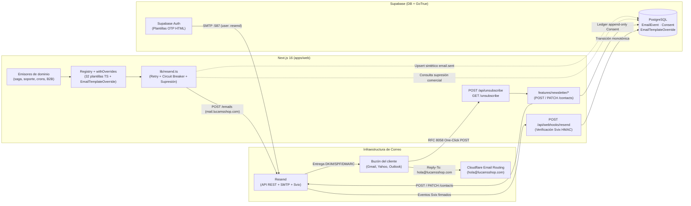
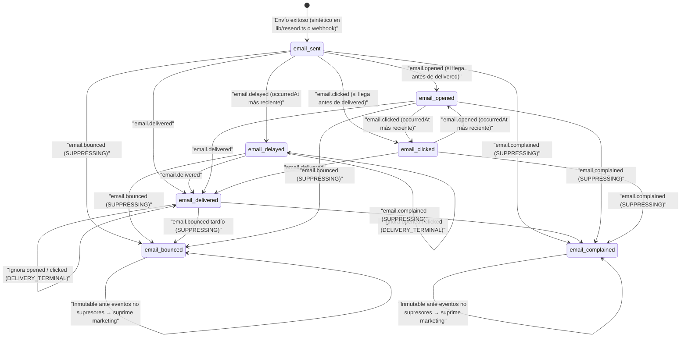

# Resend y Arquitectura de Correos — Lucams Shop

> **Documento vivo.** Fuente canónica del subsistema de correo electrónico de **Lucams Shop**: transporte REST nativo sobre Resend, aislamiento de dominios de envío y recepción, sincronización de contactos y baja en un clic (RFC 8058), webhook firmado con Svix, catálogo completo de las **32 plantillas registradas en código**, las **2 plantillas OTP de Supabase Auth** vía SMTP de Resend, correos operativos inline y sistema de personalización en `/admin/email-templates`.

---

## 1. Visión general y topología de correo

Lucams Shop opera toda su mensajería saliente sobre **Resend** mediante tres canales desacoplados según el origen del mensaje, evitando instalar SDKs pesados en el runtime de Next.js:

1. **API REST transaccional y comercial (`POST https://api.resend.com/emails`)**: cliente HTTP nativo en `apps/web/lib/resend.ts` (`fetch` con `AbortSignal.timeout(15_000)`), reintentos exponenciales, circuit breaker por instancia, idempotencia determinista y supresión previa de rebotes/quejas en envíos comerciales.
2. **API REST de Contactos y Segmentos (`POST /contacts`, `PATCH /contacts/{email}`)**: sincronización de suscriptores del boletín en `apps/web/features/newsletter/service.ts` y `unsubscribe.ts`, manteniendo a PostgreSQL (`Consent` con `scope = 'NEWSLETTER'`) como fuente única de verdad legal bajo la Ley 1581 de 2012 y a Resend como encargado del tratamiento.
3. **Relay SMTP para Supabase Auth (`smtp.resend.com:587`)**: aprovisionado de forma reproducible con `scripts/supabase-auth-email-config.mjs` contra la Management API de Supabase para que GoTrue entregue los códigos OTP de registro y recuperación desde `@mail.lucamsshop.com`.



---

## 2. Arquitectura de dominios: envío aislado vs recepción

Para blindar la reputación del dominio principal `lucamsshop.com` y evitar que respuestas de clientes se pierdan en un buzón inexistente, la arquitectura separa estrictamente el dominio emisor del dominio receptor:

| Rol                                             | Dirección / Dominio                                                                                      | Infraestructura                                                                                                                                                                                                                                                                                                                                                                        | Variable / Setting                                                  |
| ----------------------------------------------- | -------------------------------------------------------------------------------------------------------- | -------------------------------------------------------------------------------------------------------------------------------------------------------------------------------------------------------------------------------------------------------------------------------------------------------------------------------------------------------------------------------------- | ------------------------------------------------------------------- |
| **Envío saliente (`From`)**                     | `Lucams Shop <hola@mail.lucamsshop.com>` (desarrollo sin dominio: `Lucams Shop <onboarding@resend.dev>`) | Subdominio dedicado en **Resend** con registros SPF, DKIM (`resend._domainkey.mail`), MX de rebotes (`feedback-smtp`) y `_dmarc.mail`.                                                                                                                                                                                                                                                 | `EMAIL_FROM` (`PROD_REQUIRED` en `apps/web/lib/env.ts`)             |
| **Recepción de respuestas (`Reply-To` global)** | `hola@lucamsshop.com`                                                                                    | **Cloudflare Email Routing** en el apex `lucamsshop.com` (ver [`./cloudflare.md`](./cloudflare.md)). El subdominio `mail.lucamsshop.com` **no recibe correo humano**.                                                                                                                                                                                                                  | `EMAIL_REPLY_TO` (`PROD_REQUIRED` en `apps/web/lib/env.ts`)         |
| **Sobrescritura contextual de `Reply-To`**      | Correo del cliente solicitante o `CONTACT_EMAIL`                                                         | Avisos internos al equipo (`order-admin-notification`, `support-ticket-internal`, `quote-admin-notification`, `b2b-inquiry-admin-notification`, y avisos internos inline de retracto/garantía) fijan `replyTo` al email del cliente para responder con un clic. Los correos de soporte al cliente (`support-ticket-closed`, `support-ticket-reply`) fijan `replyTo` a `CONTACT_EMAIL`. | `SendEmailInput.replyTo` → fallback `EMAIL_REPLY_TO`                |
| **Buzón interno de alertas y avisos**           | `hola@lucamsshop.com` (default)                                                                          | Recibe notificaciones internas de nuevos pedidos, cotizaciones, oportunidades B2B y alertas operativas críticas.                                                                                                                                                                                                                                                                       | Setting CMS `ALERT_EMAIL` (y `CONTACT_EMAIL` para posventa/soporte) |

### Validación de arranque y sonda de salud (`GET /api/health/resend`)

1. **Fail-fast en arranque (`apps/web/lib/env.ts`)**: cuando `VERCEL_ENV === "production"`, `validateEnv()` exige `RESEND_API_KEY`, `RESEND_WEBHOOK_SECRET`, `EMAIL_FROM` y `EMAIL_REPLY_TO` dentro de `PROD_REQUIRED` (tanto en modo `catalog` como en `full`). Si falta cualquiera, el servidor aborta el arranque antes de servir tráfico.
2. **Sonda en vivo (`apps/web/app/api/health/resend/route.ts`)**: consulta `GET https://api.resend.com/domains` con timeout de `5_000 ms` (sin gastar cuota de envío; protegida con rate limit de 30 req/min por IP hasheada). Mediante `buildSenderReport()`, extrae el dominio de `EMAIL_FROM` y verifica:
   - Que `EMAIL_FROM` esté definido y contenga un correo válido.
   - Que el dominio exista en esa cuenta de Resend y su estado sea exactamente `"verified"`.
   - Que `EMAIL_REPLY_TO` esté definido.
     Si la API responde `200` pero cualquiera de esas invariantes falla (por ejemplo, si quedó `onboarding@resend.dev` o falta `EMAIL_REPLY_TO`), el endpoint devuelve HTTP `200` con `status: "warn"` y el diagnóstico exacto en `sender.detail`, alimentando `/admin/integraciones` y `/status` (ver [`../OBSERVABILITY.md`](../OBSERVABILITY.md)).

---

## 3. Cliente HTTP nativo y resiliencia (`apps/web/lib/resend.ts`)

El módulo `apps/web/lib/resend.ts` implementa `sendEmail(input: SendEmailInput): Promise<SendEmailResult>` directamente sobre `fetch` contra `https://api.resend.com/emails` sin depender del paquete npm `resend`.

### 3.1 Contrato de entrada y salida

```ts
export type SendEmailInput = {
  to: string | string[];
  subject: string;
  html: string;
  text: string; // obligatorio para entregabilidad y clientes texto-plano
  from?: string;
  replyTo?: string;
  idempotencyKey?: string;
  tags?: Array<{ name: string; value: string }>;
  headers?: Record<string, string>; // List-Unsubscribe / List-Unsubscribe-Post
  commercial?: boolean; // activa supresión previa por bounce/complaint
};

export type SendEmailResult =
  { sent: true; id: string } | { sent: false; reason: string; skipped?: boolean; status?: number };
```

### 3.2 Orden exacto de guardas, resiliencia e idempotencia

Cada llamada a `sendEmail` atraviesa secuencialmente las siguientes etapas:

1. **Kill-switch de entornos de prueba (`EMAIL_SEND_DISABLED=1`)**:
   - Si `process.env.EMAIL_SEND_DISABLED === "1"`, registra `email.send.disabled_by_env` y retorna inmediatamente `{ sent: false, reason: "disabled-by-env", skipped: true }` sin tocar la red.
   - Se activa globalmente en `apps/web/tests/setup-env.ts` para impedir que suites de integración disparen correos reales cuando el entorno local tiene una `RESEND_API_KEY` viva. Los tests unitarios de `lib/resend.test.ts` que prueban el transporte desactivan la variable explícitamente con `vi.stubEnv`.
2. **Stub de desarrollo sin llave (`!RESEND_API_KEY`)**:
   - En `NODE_ENV === "production"`, registra error `email.send.no_key_in_prod` y retorna `{ sent: false, reason: "no-api-key", skipped: true }`.
   - En desarrollo, registra `email.send.dev_stub` en nivel `info` y retorna el mismo resultado `skipped: true` para no bloquear flujos locales.
3. **Circuit breaker en memoria por instancia serverless**:
   - Mantiene una ventana deslizante de los últimos **10** resultados (`breaker.recentResults`).
   - Cuando la ventana acumula **≥ 6 muestras** y la tasa de fallos supera el **50 %** (`fails / total > 0.5`), abre el circuito durante **30 segundos** (`openUntil = Date.now() + 30_000`) y emite `resend.circuit_open`.
   - Mientras está abierto, `sendEmail` aborta de inmediato con `{ sent: false, reason: "circuit-open", skipped: true }`. Los jobs por lotes (`cart-recovery`, `review-request`, `back-in-stock`) detectan `reason === "circuit-open"`, detienen el lote sin marcar los registros como enviados y reintentan en el siguiente ciclo de `pg_cron`.
4. **Filtro de supresión previa para envíos comerciales (`commercial: true`)**:
   - Si `input.commercial` es `true`, consulta `EmailEvent` buscando cualquier antecedente `type IN ('email.bounced', 'email.complained')` para los destinatarios (`to`). Si la consulta a BD falla, cae de forma segura a `null` para no tumbar el proceso.
   - Si existe antecedente supresor, registra `email.send.suppressed_commercial` y retorna `{ sent: false, reason: "suppressed", skipped: true }`.
   - **Diferenciación legal y operativa**: los correos **transaccionales puros** (confirmación de pedido, envío de guía, retracto, garantía, recuperación, soporte) **no** marcan `commercial: true` y siempre intentan entregarse. Por su parte, la elegibilidad de audiencia comercial por consentimiento (`NewsletterSubscriber` con estado `"active"` vs `"unsubscribed"`) se gobierna en el ledger append-only `Consent` (`scope = 'NEWSLETTER'`) tanto en `isNewsletterSubscribed()` como en la compuerta SQL dura de `/admin/marketing/segmentos` (ver [`../domains/crm-b2b-and-loyalty.md`](../domains/crm-b2b-and-loyalty.md)).
5. **Timeout y reintentos con backoff exponencial**:
   - Cada petición HTTP usa `AbortSignal.timeout(15_000)` (**15 s**).
   - Ejecuta hasta **4 intentos totales** con esperas `backoffMs = [0, 1000, 2000, 4000]` (inmediato + 3 reintentos a 1 s, 2 s y 4 s).
   - Solo reintenta fallos transitorios: error de red/timeout (`status === undefined`), `HTTP >= 500` o rate limit `HTTP 429`. Cualquier otro `4xx` (`400`, `401`, `403`, `409`, `422`) corta el bucle de inmediato.
6. **Idempotencia y escape determinista `:r2` ante cambio de payload**:
   - Cuando el emisor suministra `idempotencyKey`, se envía como cabecera `Idempotency-Key` (Resend retiene claves de idempotencia durante ~24 h y devuelve error cuando se reutiliza la misma clave con un cuerpo modificado; fuente oficial: [Resend Send Email API — Idempotency Key](https://resend.com/docs/api-reference/emails/send-email), verificado 2026-08-11).
   - En reintentos de la saga de pedidos puede ocurrir que el primer intento corriera antes de existir transportadora (`shippingCarrier: null`) y el reintento posterior ya incluya la transportadora asignada. Resend rechaza el segundo intento porque el body cambió (`"idempotency key has been used"` + `"doesn't match"`).
   - `lib/resend.ts` detecta ese mensaje exacto y ejecuta **un único reintento adicional** con la clave determinista `${idempotencyKey}:r2` (evento `email.send.success_idempotency_retry`), evitando que la confirmación quede bloqueada sin abrir la puerta a envíos duplicados infinitos.
7. **Evento sintético de salida (`recordSentEvent`)**:
   - Tras cualquier envío exitoso (`2xx`), hace `prisma.emailEvent.upsert` con `where: { resendId: id }`, `update: {}` y `create: { type: "email.sent", metadata: { synthetic: true, source: "lib/resend.ts" } }`.
   - Permite a `/admin/observability` distinguir entre «la tienda no está enviando correos» y «los correos salen pero el webhook de Svix no llega», sin pisar jamás un estado `delivered` o `bounced` si el webhook llegó antes que el `upsert` local (`update: {}`).

### 3.3 Límites del proveedor a considerar

- En el plan **Free** de Resend aplican topes de **3.000 correos/mes** y **100 correos/día**, restringidos a envío desde `onboarding@resend.dev` hasta verificar dominio propio; el plan **Pro** (\$20 USD/mes, ver [`../OPERATIONS.md`](../OPERATIONS.md)) habilita dominios personalizados y 50.000 correos/mes ([Resend Pricing](https://resend.com/pricing), `[pendiente verificación]` de vigencia tarifaria antes de escalar volumen).

---

## 4. Resend Contacts, Segments y Baja en un clic (RFC 8058)

### 4.1 Sincronización con Resend Contacts & Segments (`features/newsletter/service.ts`)

Resend depreció su antigua API de _Audiences_ (`/audiences/{id}/contacts`) en favor del modelo unificado de **Contacts + Segments** ([Resend Create Contact API](https://resend.com/docs/api-reference/contacts/create-contact), verificado 2026-05-13 y contrastado contra `api.resend.com` el 2026-08-06).

El flujo de alta (`subscribeNewsletterAction` → `subscribeNewsletter`) opera bajo **single opt-in verificable** conforme a la Ley 1581 de 2012 (ver [`../COMPLIANCE.md`](../COMPLIANCE.md)):

1. **Defensa en el borde (`features/newsletter/actions.ts`)**: valida `SubscribeSchema` (Zod), verifica Cloudflare Turnstile (`verifyTurnstileToken`) y aplica doble rate limit en PostgreSQL: **5 intentos/hora por IP** (20 en dev) y **2 intentos/hora por email** (10 en dev).
2. **Idempotencia local sobre el ledger `Consent`**: la API `POST https://api.resend.com/contacts` se comporta como un _upsert_ devolviendo `201` en contactos repetidos (aunque el cliente también tolera `409`/`422`). Por eso `isNewsletterSubscribed(normalizedEmail)` verifica primero en PostgreSQL si existe un `Consent` con `scope = "NEWSLETTER"`, `accepted = true`, `version = "v1-2026-05-12"` **sin** una fila posterior con `accepted = false`. Si ya está vigente, no llama a Resend ni reenvía bienvenida.
3. **Creación en Resend (`POST https://api.resend.com/contacts`, timeout 10 s)**:
   - Envía `{ email, unsubscribed: false }` y, si `RESEND_NEWSLETTER_SEGMENT_ID` está configurada, adjunta `segments: [{ id: segmentId }]`.
   - Si `RESEND_API_KEY` no está configurada (entorno local), hace _soft-fail_: registra el consentimiento en PostgreSQL de todos modos para no perder la prueba legal.
4. **Persistencia legal y contacto CRM**: enlaza o resuelve el `Contact` mediante `resolveConsentContact(..., { verificationSource: "NEWSLETTER_SUBSCRIBE" })` e inserta la fila en `Consent` con IP y `User-Agent`.
5. **Correo de bienvenida diferido (`after()`)**: si el suscriptor es nuevo, programa mediante `after()` de `next/server` el envío de `newsletter-welcome` (garantizando que Vercel no congele la función serverless antes de despachar el correo), con `commercial: true` y cabeceras `List-Unsubscribe`.

### 4.2 Baja criptográfica y One-Click Unsubscribe (RFC 2369 + RFC 8058)

Gmail y Yahoo exigen a remitentes comerciales soportar baja automática en un clic mediante las cabeceras estándar **RFC 2369** (`List-Unsubscribe`) y **RFC 8058** (`List-Unsubscribe-Post: List-Unsubscribe=One-Click`) ([RFC 8058 — Signaling One-Click Functionality for List Email Headers](https://datatracker.ietf.org/doc/html/rfc8058), verificado 2026-07-26).

La implementación vive en `apps/web/features/newsletter/unsubscribe.ts`:

- **Firma stateless ligada a `CSRF_SECRET`**: `computeUnsubscribeToken(email)` calcula `SHA-256("${email.trim().toLowerCase()}:${CSRF_SECRET}").slice(0, 32)` (exige `CSRF_SECRET` no vacío; sin fallback inseguro) y `verifyUnsubscribeToken` compara con `crypto.timingSafeEqual`.
- **Parámetro opaco sin PII en logs (`u`)**: `encodeUnsubscribeParam(email)` empaqueta `base64url(normalizedEmail) + "." + token`. Así la dirección de correo no viaja en texto claro en URLs, historiales ni access logs.
- **Inyección en los 4 flujos comerciales**: `buildCommercialEmailHeaders(email, siteUrl)` genera:
  ```http
  List-Unsubscribe: <https://lucamsshop.com/api/unsubscribe?u=...>
  List-Unsubscribe-Post: List-Unsubscribe=One-Click
  ```
  Se adjunta en `newsletter-welcome`, `cart-recovery`, `review-request` y `back-in-stock`, además del enlace visible «Cancelar suscripción» en el pie del correo (`renderEmailLayout`).
- **Dos superficies de baja complementarias**:
  1. **Automatizada para clientes de correo (`POST /api/unsubscribe?u=...`)**: endpoint público sin sesión, protegido con rate limit de **30 req/min por IP hasheada** (`ipKey("unsubscribe", ip)`). Decodifica `u`, ejecuta `unsubscribeNewsletter()` y responde `200 { ok: true }` de manera idempotente (o `400` si el token es inválido).
  2. **Humana en navegador (`GET /unsubscribe?u=...`, `apps/web/app/unsubscribe/page.tsx`)**: Server Component con `robots: noindex, nofollow` que ejecuta la baja en un solo clic al abrir la página (conserva compatibilidad con el formato legacy `?email=&token=`).
- **Efecto de `unsubscribeNewsletter(email, token)`**:
  1. Inserta una nueva fila en el ledger append-only `Consent` con `scope = "NEWSLETTER"`, `accepted = false` y `revokesId = lastAccepted.id` (nunca muta ni borra la aceptación histórica), marcando el `Contact` con `verificationSource: "HMAC_UNSUBSCRIBE"`.
  2. Sincroniza el procesador externo ejecutando `PATCH https://api.resend.com/contacts/${encodeURIComponent(email)}` con `{ unsubscribed: true }` y timeout de `10_000 ms` (ignora `404` si el contacto solo existía localmente). Esta misma función (`markResendContactUnsubscribed`) la reutiliza el flujo de borrado de cuenta de cliente (`deleteCustomerAccount`).

---

## 5. Webhook de eventos Svix (`POST /api/webhooks/resend`)

Resend publica eventos de entregabilidad y apertura mediante **Svix** hacia `apps/web/app/api/webhooks/resend/route.ts` ([Resend Webhooks Documentation](https://resend.com/docs/dashboard/webhooks), verificado 2026-08-01).

### 5.1 Seguridad perimetral y verificación criptográfica

1. **Límite estricto de tamaño de cuerpo (`128 KB`)**: lee el stream crudo mediante `readBodyWithLimit(req, 128 * 1024)`. Si supera 128 KB responde `413 Payload too large` antes de tocar criptografía o JSON.
2. **Verificación Svix HMAC-SHA256 (`verifySvixSignature`)**:
   - En `NODE_ENV === "production"`, si falta `RESEND_WEBHOOK_SECRET`, falla cerrado (`401`). En desarrollo sin secreto permite pruebas locales con `curl`.
   - Exige las tres cabeceras `svix-id`, `svix-timestamp` y `svix-signature`.
   - **Ventana anti-replay**: valida que `|nowSec - Number(svixTimestamp)| <= 300` (**5 minutos**, tolerancia oficial recomendada por Svix).
   - **Cálculo de firma**: decodifica en Base64 los bytes posteriores al prefijo `whsec_` de `RESEND_WEBHOOK_SECRET`, firma el mensaje canónico `${svix-id}.${svix-timestamp}.${rawBody}` con `HMAC-SHA256` en Base64 y compara con `timingSafeEqual` contra cualquiera de las firmas `v1,<base64>` separadas por espacio en `svix-signature` (soportando rotación de secretos sin tiempo muerto).
   - **Auditoría de rechazos**: toda firma inválida registra un `SecurityEvent` durable (`WEBHOOK_INVALID_SIGNATURE` con `metadata: { source: "resend" }` e IP hasheada). Tres o más rechazos en 5 minutos disparan la alerta `security_webhook_invalid` (ver [`../SECURITY.md`](../SECURITY.md)).
3. **Minimización de PII en `EmailEvent.metadata`**: nunca persiste el payload completo de Svix (que puede incluir cabeceras, enlaces clicados o `User-Agent`). Solo almacena `{ dataKeys: Object.keys(event.data).sort(), bodyHash: sha256(rawBody).slice(0, 16) }`. El cron `lucams-purge-event-logs` purga los registros mayores a **180 días**.

### 5.2 Máquina de estados no degradante en `EmailEvent`

La tabla `EmailEvent` mantiene **una única fila por correo enviado** (`resendId = event.data.email_id`). Como los webhooks distribuidos pueden llegar desordenados y los eventos de lectura (`opened`/`clicked`) ocurren después de la entrega, el procesamiento aplica cinco invariantes:

1. **Blindaje de estados supresores (`SUPPRESSING = ["email.bounced", "email.complained"]`)**: una vez que un correo queda en `email.bounced` o `email.complained`, **ningún evento no supresor** puede sobrescribirlo jamás. Esto garantiza que el filtro comercial de `lib/resend.ts` suprima de inmediato cualquier envío de marketing posterior a ese destinatario.
2. **Blindaje de estados terminales de entrega (`DELIVERY_TERMINAL = ["email.bounced", "email.complained", "email.delivered", "email.delayed"]`)**: un evento de interacción (`ENGAGEMENT = ["email.opened", "email.clicked"]`) **nunca pisa** un estado terminal de entrega. Así, un correo entregado y luego abierto sigue contabilizándose como `email.delivered` en las métricas de entregabilidad de 7 días (`email_bounce_rate` alerta en `/admin/observability` si `bounced / (delivered + bounced) > 5%` con al menos 20 eventos terminales).
3. **Monotonicidad temporal**: si `existing.occurredAt > occurredAt` (entrega retrasada o reintento viejo), el evento entrante se descarta sin mutar la fila.
4. **Respuesta anti-tormenta**: si ocurre un error interno inesperado en base de datos, registra `webhook.resend.process_failed` y devuelve HTTP `200 { ok: false }` para evitar reintentos indefinidos de Svix.
5. **Supresión Lifecycle inmediata**: tras persistir un rebote o queja firmado, el webhook cancela los mensajes Lifecycle pendientes del destinatario y suprime sus inscripciones activas. Los mensajes `SENT` conservan el historial y `EmailEvent` acredita el resultado de entrega.



---

## 6. Catálogo exhaustivo de plantillas y correos del sistema

### 6.1 Convenciones de diseño y seguridad de enlaces (`layout.ts`)

Todas las plantillas de código residen en `apps/web/features/emails/templates/*.ts` y delegan la envoltura HTML a `renderEmailLayout()` (`apps/web/features/emails/layout.ts`):

- **Cero dependencias React Email**: funciones TypeScript puras que devuelven `{ subject, html, text, replyTo? }` con **CSS 100 % inline** sobre tablas HTML (`max-width: 560px`, fondo crema `#FFF8F0`, encabezado en gradiente `#7C6AAD → #3D2E5C` con wordmark `Lucams Shop` y acento `#E85B9F`, fuente de sistema).
- **Cumplimiento legal automático en el pie**: resuelve desde CMS `CONTACT_EMAIL`, `COPYRIGHT_YEAR`, `COPYRIGHT_TAGLINE` y `LEGAL_ENTITY_LINE` (identificación del responsable conforme a Ley 1581 art. 12 y Ley 1480 art. 50) y añade el bloque «Cancelar suscripción · Ley 1581 de 2012» únicamente cuando la plantilla pasa `unsubscribeUrl`.
- **Resolución canónica de URL (`getSiteUrl()`)**: prioriza `NEXT_PUBLIC_SITE_URL` del despliegue actual sobre el setting CMS `SITE_URL`, garantizando que correos emitidos en Preview/STG enlacen al entorno de STG y no a `lucamsshop.com`.
- **Política de tokens públicos post-pago**: dado que `Order.publicAccessTokenHash` se almacena hasheado en reposo, los correos posteriores (`order-shipped`, `order-payment-failed`, `design-rejected`) envían `publicTrackingToken: null` y dirigen el botón principal a `/rastrear` (número de orden `LCM-YYYY-NNNN` + correo). En `order-confirmation`, los clientes registrados enlazan a `/mi-cuenta/pedidos/<number>`, los invitados Wompi reciben un token público recién rotado (`/pedido/<token>`) y los invitados contraentrega (COD) caen a `/rastrear` para no invalidar el enlace abierto en su navegador. En `order-delivered` y `review-request`, el CTA enlaza a `/resena/<token>` (token HMAC stateless con vigencia de 30 días, `features/reviews/review-token.ts`). En regalos (`isGift = true`), `order-confirmation` oculta importes monetarios.

### 6.2 Las 32 plantillas registradas en `apps/web/features/emails/registry.ts`

Las **32 plantillas** listadas a continuación están envueltas con `withOverrides(id, fn)` y admiten personalización de `SUBJECT`, `PREHEADER` y `HEADING` desde `/admin/email-templates`. Todos los montos numéricos que reciben las plantillas (`total`, `subtotal`, `shipping`, `discount`, `amount`, `unitPrice`, `lineTotal`) viajan en **centavos COP (`Int`)**.

#### Grupo 1: Pedidos (9 plantillas)

| #   | `id` (archivo `.ts`)       | Nombre en Admin                       | Audiencia             | Disparador y módulo emisor                                                                                                                                                                            | `Idempotency-Key`                       | Comercial | Tokens `{campo}` admitidos en overrides                                                                                                                                           |
| --- | -------------------------- | ------------------------------------- | --------------------- | ----------------------------------------------------------------------------------------------------------------------------------------------------------------------------------------------------- | --------------------------------------- | --------- | --------------------------------------------------------------------------------------------------------------------------------------------------------------------------------- |
| 1   | `order-confirmation`       | Confirmación de pedido                | Cliente               | Orden pasa a `PAID` (saga `sendOrderConfirmationOnce` en `features/orders/emails.ts`, tras webhook Wompi `APPROVED` o creación COD; sella `confirmationSentAt` solo tras envío exitoso).              | `<orderNumber>-confirmation`            | No        | `orderNumber`, `customerName`, `total`, `subtotal`, `shipping`, `discount`, `shippingCarrier`, `shippingAddress`, `accountOrderUrl`, `paymentMethod`                              |
| 2   | `order-shipped`            | Pedido enviado                        | Cliente               | Orden pasa a `SHIPPED` con guía (`sendOrderShipped` en `features/orders/emails.ts`, vía webhook Aveonline, `tracking-sync` o despacho manual).                                                        | `<orderNumber>-shipped`                 | No        | `orderNumber`, `customerName`, `carrier`, `trackingNumber`, `trackingUrl`, `estimatedDays`, `publicTrackingToken`                                                                 |
| 3   | `order-delivered`          | Pedido entregado                      | Cliente               | Transportadora reporta entrega `DELIVERED` (`sendOrderDelivered` en `features/orders/emails.ts`). Incluye CTA directo a `/resena/<token>`.                                                            | `<orderNumber>-delivered`               | No        | `orderNumber`, `customerName`, `reviewUrl`, `fallbackUrl`                                                                                                                         |
| 4   | `order-payment-declined`   | Pago no aprobado (pedido vivo)        | Cliente               | Webhook Wompi `DECLINED` o `ERROR` mientras la orden sigue en `PENDING_PAYMENT` (`sendOrderPaymentDeclined`; claim atómico en `Order.paymentFailedNotifiedAt` con enfriamiento anti-spam de **6 h**). | `<orderNumber>-payment-declined-<txId>` | No        | `orderNumber`, `customerName`, `total`, `reason`                                                                                                                                  |
| 5   | `order-payment-failed`     | Pago fallido (pedido cancelado)       | Cliente               | Transición pre-pago a `CANCELLED` por rechazo definitivo (`sendOrderPaymentFailed` en `features/orders/emails.ts`).                                                                                   | `<orderNumber>-payment-failed`          | No        | `orderNumber`, `customerName`, `total`, `reason`, `publicTrackingToken`                                                                                                           |
| 6   | `order-cancelled`          | Pedido cancelado                      | Cliente               | Cancelación manual desde `/admin/pedidos` o cancelación post-pago (`sendOrderCancelled` en `features/orders/emails.ts`).                                                                              | `<orderNumber>-cancelled`               | No        | `orderNumber`, `customerName`, `reason`                                                                                                                                           |
| 7   | `order-returned`           | Pedido devuelto por la transportadora | Cliente               | Webhook Aveonline `RETURNED` o `EXCEPTION` (`notifyOrderReturned` en `features/orders/emails.ts`; genera además alerta in-app para decisión humana).                                                  | `<orderNumber>-returned`                | No        | `orderNumber`, `customerName`                                                                                                                                                     |
| 8   | `refund-issued`            | Reembolso emitido                     | Cliente               | Admin confirma devolución manual del dinero y marca `REFUNDED` (`sendOrderRefunded` en `features/orders/emails.ts`).                                                                                  | `<orderNumber>-refunded`                | No        | `orderNumber`, `customerName`, `amount`, `reason`                                                                                                                                 |
| 9   | `order-admin-notification` | Aviso interno: pedido pagado          | Admin (`ALERT_EMAIL`) | Saga post-pago / confirmación COD (`notifyNewOrderToAdmin` en `features/orders/emails.ts`). `Reply-To` = correo del cliente; incluye datos de regalo si `isGift`.                                     | `order:admin-notification:<orderId>`    | No        | `orderId`, `orderNumber`, `customerName`, `customerPhone`, `customerEmail`, `city`, `department`, `paymentMethod`, `subtotal`, `shipping`, `shippingCarrier`, `discount`, `total` |

#### Grupo 2: Retracto — Ley 1480 art. 47 / Ley 2439 (`features/retract/emails.ts`, 4 plantillas)

| #   | `id` (archivo `.ts`) | Nombre en Admin      | Audiencia | Disparador y módulo emisor                                                                                                                              | `Idempotency-Key`       | Comercial | Tokens `{campo}` admitidos en overrides                          |
| --- | -------------------- | -------------------- | --------- | ------------------------------------------------------------------------------------------------------------------------------------------------------- | ----------------------- | --------- | ---------------------------------------------------------------- |
| 10  | `retract-received`   | Retracto recibido    | Cliente   | Al radicar solicitud de retracto en cuenta o como invitado en `/pedido/[token]` (`sendRetractRequested`). Sirve como acuse legal de fecha cierta.       | `retract-<id>-received` | No        | `orderNumber`, `customerName`, `productName`                     |
| 11  | `retract-approved`   | Retracto aprobado    | Cliente   | Admin aprueba solicitud en `/admin/retractos` (`sendRetractApproved`), enviando instrucciones de devolución y plazo legal máximo de 15 días calendario. | `retract-<id>-approved` | No        | `orderNumber`, `customerName`, `productName`                     |
| 12  | `retract-rejected`   | Retracto rechazado   | Cliente   | Admin rechaza solicitud con nota obligatoria (`sendRetractRejected`, p. ej. bien personalizado hecho a la medida o fuera de término).                   | `retract-<id>-rejected` | No        | `orderNumber`, `customerName`, `productName`, `rejectionNote`    |
| 13  | `retract-refunded`   | Retracto reembolsado | Cliente   | Admin confirma reembolso del retracto (`sendRetractRefunded`, exclusivo `SUPERADMIN` + MFA reciente).                                                   | `retract-<id>-refunded` | No        | `orderNumber`, `customerName`, `productName`, `amount`, `method` |

#### Grupo 3: Reactivación y marketing (5 plantillas)

| #   | `id` (archivo `.ts`) | Nombre en Admin           | Audiencia            | Disparador y módulo emisor                                                                                                                                                                           | `Idempotency-Key`                                  | Comercial                              | Tokens `{campo}` admitidos en overrides                                                |
| --- | -------------------- | ------------------------- | -------------------- | ---------------------------------------------------------------------------------------------------------------------------------------------------------------------------------------------------- | -------------------------------------------------- | -------------------------------------- | -------------------------------------------------------------------------------------- |
| 14  | `cart-recovery`      | Recuperación de carrito   | Cliente              | Cron `lucams-cart-recovery` (inactividad ≥ 4 h por defecto) o envío manual individual/masivo desde `/admin/carritos` (`features/cart/recovery-service.ts`). Rota `recoverTokenHash` en cada intento. | `cart-recovery-<id>-<n>`                           | **Sí** (RFC 8058 + supresión)          | `recoverToken`, `unsubscribeUrl`                                                       |
| 15  | `back-in-stock`      | ¡Volvió! (aviso de stock) | Suscriptor           | Cron `lucams-back-in-stock` (`features/back-in-stock/service.ts`) cuando una variante activa recupera stock > 0, acotado en FIFO al stock real disponible.                                           | `back-in-stock-<subId>`                            | **Sí** (RFC 8058 + supresión)          | `productName`, `productSlug`, `unsubscribeUrl`                                         |
| 16  | `review-request`     | Solicitud de reseña       | Cliente              | Cron `lucams-review-request` (~7 a 30 días tras entrega `DELIVERED`, `features/reviews/review-request-service.ts`). Sella `Order.reviewRequestedAt`.                                                 | `<orderNumber>-review-request`                     | **Sí** (RFC 8058 + supresión)          | `orderNumber`, `customerName`, `reviewToken`, `unsubscribeUrl`                         |
| 17  | `newsletter-welcome` | Bienvenida al newsletter  | Suscriptor           | Alta nueva en `subscribeNewsletterAction` (`features/newsletter/actions.ts`, vía `after()`).                                                                                                         | `newsletter:welcome:<token>`                       | **Sí** (RFC 8058 + supresión)          | `email`, `unsubscribeToken`                                                            |
| 18  | `referral-reward`    | Recompensa de referidos   | Referente y referido | Primer pedido pagado con código de referido (`features/referrals/service.ts`): emite dos correos independientes con cupón personal de un solo uso.                                                   | `referral:<id>:referee` y `referral:<id>:referrer` | No (transaccional de beneficio ganado) | `role`, `couponCode`, `percent`, `validDays`, `orderNumber`, `firstName`, `friendName` |

#### Grupo 4: Moderación (1 plantilla)

| #   | `id` (archivo `.ts`) | Nombre en Admin                | Audiencia | Disparador y módulo emisor                                                                                                            | `Idempotency-Key`                          | Comercial | Tokens `{campo}` admitidos en overrides                                       |
| --- | -------------------- | ------------------------------ | --------- | ------------------------------------------------------------------------------------------------------------------------------------- | ------------------------------------------ | --------- | ----------------------------------------------------------------------------- |
| 19  | `design-rejected`    | Diseño rechazado en moderación | Cliente   | Rechazo de contenido personalizado en `/admin/disenos` (`features/moderation/emails.ts`) por derechos de autor o contenido prohibido. | `<orderNumber>-design-rejected-<designId>` | No        | `orderNumber`, `customerName`, `productName`, `reason`, `publicTrackingToken` |

#### Grupo 5: Soporte y garantía (7 plantillas)

| #   | `id` (archivo `.ts`)      | Nombre en Admin               | Audiencia               | Disparador y módulo emisor                                                                                                                                                  | `Idempotency-Key`             | Comercial | Tokens `{campo}` admitidos en overrides                                 |
| --- | ------------------------- | ----------------------------- | ----------------------- | --------------------------------------------------------------------------------------------------------------------------------------------------------------------------- | ----------------------------- | --------- | ----------------------------------------------------------------------- |
| 20  | `support-ticket-received` | Soporte: acuse al cliente     | Cliente                 | Apertura de ticket en `/contacto`, `/mi-cuenta/soporte` o tarjeta posventa invitada en `/pedido/[token]` (`features/support/actions.ts` y `app/pedido/[token]/actions.ts`). | `support:received:<ticketId>` | No        | `customerName`, `ticketId`, `subject`, `message`                        |
| 21  | `support-ticket-internal` | Soporte: aviso interno        | Admin (`CONTACT_EMAIL`) | Apertura del mismo ticket; copia interna con contexto e IP. `Reply-To` = correo del cliente.                                                                                | `support:internal:<ticketId>` | No        | `ticketId`, `customerName`, `customerEmail`, `subject`, `message`, `ip` |
| 22  | `support-ticket-closed`   | Soporte: cierre al cliente    | Cliente                 | Transición real a `CLOSED` en `/admin/soporte` (`features/support/admin-service.ts`). `Reply-To` = `CONTACT_EMAIL`.                                                         | `support:closed:<ticketId>`   | No        | `customerName`, `ticketId`, `subject`                                   |
| 23  | `support-ticket-reply`    | Soporte: respuesta del equipo | Cliente                 | Mensaje público del agente en el hilo `/admin/soporte/[id]` (`features/support/thread-service.ts`, excluye notas internas). `Reply-To` = `CONTACT_EMAIL`.                   | `support:reply:<messageId>`   | No        | `customerName`, `ticketId`, `subject`, `replyBody`                      |
| 24  | `warranty-received`       | Garantía recibida             | Cliente                 | Radicación de reclamo de garantía legal Ley 1480 en cuenta o `/pedido/[token]` (`notifyWarrantyClaimCreated` en `features/warranty/notify.ts`).                             | `warranty-<id>-received`      | No        | `customerName`, `claimId`, `orderNumber`, `productName`, `description`  |
| 25  | `warranty-resolved`       | Garantía resuelta             | Cliente                 | Resolución del reclamo en `/admin/garantias` (`notifyWarrantyResolved`: reposición, reparación o reembolso).                                                                | `warranty-<id>-resolved`      | No        | `customerName`, `claimId`, `productName`, `resolutionType`, `note`      |
| 26  | `warranty-rejected`       | Garantía rechazada            | Cliente                 | Rechazo motivado del reclamo en `/admin/garantias` (`notifyWarrantyRejected`, exige nota de motivo).                                                                        | `warranty-<id>-rejected`      | No        | `customerName`, `claimId`, `orderNumber`, `productName`, `reason`       |

#### Grupo 6: Cuenta (1 plantilla)

| #   | `id` (archivo `.ts`)    | Nombre en Admin             | Audiencia          | Disparador y módulo emisor                                                                                                                                                                          | `Idempotency-Key`                        | Comercial | Tokens `{campo}` admitidos en overrides                  |
| --- | ----------------------- | --------------------------- | ------------------ | --------------------------------------------------------------------------------------------------------------------------------------------------------------------------------------------------- | ---------------------------------------- | --------- | -------------------------------------------------------- |
| 27  | `account-exists-notice` | Aviso: correo ya registrado | Titular del correo | Intento de registro en `/registro` con un correo ya existente (`app/(auth)/registro/actions.ts`). El formulario responde idéntico para evitar enumeración de cuentas y avisa en privado al titular. | _(sin clave; envío puntual por intento)_ | No        | _(ninguno — plantilla estática sin datos interpolables)_ |

#### Grupo 7: Cotizaciones y Empresas / Eventos B2B (3 plantillas)

| #   | `id` (archivo `.ts`)             | Nombre en Admin                         | Audiencia             | Disparador y módulo emisor                                                                                                                                  | `Idempotency-Key`                        | Comercial | Tokens `{campo}` admitidos en overrides                                                                                                                                                           |
| --- | -------------------------------- | --------------------------------------- | --------------------- | ----------------------------------------------------------------------------------------------------------------------------------------------------------- | ---------------------------------------- | --------- | ------------------------------------------------------------------------------------------------------------------------------------------------------------------------------------------------- |
| 28  | `quote-admin-notification`       | Aviso interno: cotización nueva         | Admin (`ALERT_EMAIL`) | Creación de cotización en modo catálogo (`features/quotes/emails.ts`). Incluye enlace `wa.me` directo al cliente y `Reply-To` a su correo si lo suministró. | `quote:admin-notification:<quoteId>`     | No        | `quoteId`, `quoteNumber`, `customerName`, `customerWhatsapp`, `customerEmail`, `city`, `department`, `notes`, `total`                                                                             |
| 29  | `b2b-inquiry-received`           | Confirmación de solicitud B2B / Eventos | Solicitante B2B       | Envío exitoso de `/empresas-y-eventos` (`sendB2bInquiryEmails` vía `after()` en `features/opportunities/emails.ts`), confirmando radicado `OP-XXXXXX`.      | `opportunity:client-received:<oppId>`    | No        | `opportunityNumber`, `contactName`, `organizationName`, `eventLabel`, `expectedUnits`, `city`, `department`, `eventDateLabel`, `notes`                                                            |
| 30  | `b2b-inquiry-admin-notification` | Aviso interno: nueva oportunidad B2B    | Admin (`ALERT_EMAIL`) | Creación de la misma `Opportunity` en `/empresas-y-eventos`. `Reply-To` al solicitante, enlace `wa.me` y acceso directo a `/admin/oportunidades/<id>`.      | `opportunity:admin-notification:<oppId>` | No        | `opportunityId`, `opportunityNumber`, `contactName`, `contactEmail`, `contactWhatsapp`, `organizationName`, `nit`, `eventLabel`, `expectedUnits`, `city`, `department`, `eventDateLabel`, `notes` |

#### Grupo 8: Administración (1 plantilla)

| #   | `id` (archivo `.ts`)     | Nombre en Admin                                 | Audiencia             | Disparador y módulo emisor                                                                                                                                                                                    | `Idempotency-Key`                                                                     | Comercial | Tokens `{campo}` admitidos en overrides                                                                                                                        |
| --- | ------------------------ | ----------------------------------------------- | --------------------- | ------------------------------------------------------------------------------------------------------------------------------------------------------------------------------------------------------------- | ------------------------------------------------------------------------------------- | --------- | -------------------------------------------------------------------------------------------------------------------------------------------------------------- |
| 31  | `fiscal-threshold-alert` | Alerta interna: vigilancia fiscal (umbral DIAN) | Admin (`ALERT_EMAIL`) | Cron diario `lucams-fiscal-watch` (`features/fiscal-watch/service.ts`, ADR-196) al cruzar 90 % o 100 % de un umbral DIAN (3 500 UVT: facturación electrónica o IVA por tarjeta). Una vez por cruce y por año. | _(dedup por cruce en `AlertState["fiscal-watch:<regla>:<año>"]`, sin clave de envío)_ | No        | `ruleName`, `legalBasis`, `action`, `year`, `levelLabel`, `thresholdUvt`, `currentCop`, `thresholdCop`, `currentPct`, `projectedCop`, `projectedPct`, `uvtCop` |

#### Grupo 9: Lifecycle Journeys (1 plantilla)

| #   | `id` (archivo `.ts`) | Nombre en Admin                | Audiencia         | Disparador y módulo emisor                                                                                                                     | `Idempotency-Key`                 | Comercial                                 | Tokens `{campo}` admitidos en overrides                                          |
| --- | -------------------- | ------------------------------ | ----------------- | ---------------------------------------------------------------------------------------------------------------------------------------------- | --------------------------------- | ----------------------------------------- | -------------------------------------------------------------------------------- |
| 32  | `lifecycle-message`  | Mensaje de recorrido Lifecycle | Contacto elegible | Paso configurado en `/admin/lifecycle` y ejecutado por `lucams-lifecycle` (`features/lifecycle/runner.ts`). La clasificación depende del paso. | `<enrollmentId>:<stepId>:<cycle>` | Según el paso; comercial incluye RFC 8058 | `subject`, `heading`, `preheader`, `body`, `ctaLabel`, `ctaUrl`, `recipientName` |

Cada mensaje conserva una instantánea del contenido del paso, overrides, nombre del destinatario, clasificación comercial y ruta contextual usados al crearlo; editar la plantilla, el paso o el contacto no cambia un envío pendiente de reintento. El enlace de atribución es estable y se guarda solo como hash. El cupo diario global se reserva antes del envío y `EmailEvent.resendId` alimenta las métricas Lifecycle de entrega, rebote, queja y diferido. Un evento firmado `email.bounced` o `email.complained` suprime inscripciones y cancela pendientes de inmediato. En `VERCEL_ENV=preview` o con `LIFECYCLE_DRY_RUN=1`, el motor marca `DRY_RUN` y no llama a Resend.

> **Nota sobre tokens nulos en tiempo de envío**: `interpolateOverrideTokens` reemplaza únicamente valores escalares `string` o `number`. Si un token documentado llega como `null` en una variante concreta de envío real (por ejemplo `publicTrackingToken` cuando cae al fallback `/rastrear`), el placeholder `{publicTrackingToken}` quedaría literal; por ello se recomienda usar en asuntos y titulares tokens siempre presentes como `{orderNumber}` o `{customerName}`.

---

### 6.3 Plantillas HTML de Supabase Auth (2 plantillas OTP vía SMTP Resend)

Los correos de autenticación los emite directamente **GoTrue** (Supabase Auth) a través del servidor SMTP de Resend (`smtp.resend.com:587`), nunca desde el código de Next.js. Para evitar que el _link prefetching_ automático de clientes corporativos y Gmail consuma enlaces de un solo uso antes de que la persona haga clic, ambos flujos usan **códigos OTP numéricos** (`{{ .Token }}`) sin enlaces de confirmación ([Supabase Auth — Email Templates](https://supabase.com/docs/guides/auth/auth-email-templates), verificado 2026-09-18).

| Archivo canónico                            | Flujo GoTrue                            | Asunto configurado                                       | Variables Go Template                                  | Espejos de entorno local / CI                                                                                        |
| ------------------------------------------- | --------------------------------------- | -------------------------------------------------------- | ------------------------------------------------------ | -------------------------------------------------------------------------------------------------------------------- |
| `supabase/auth-templates/confirmation.html` | Confirmación de alta (`signup`)         | `Tu código de confirmación 💜 Lucams Shop`               | `{{ .Token }}` (código OTP en caja punteada `#7C6AAD`) | `supabase-local/supabase/templates/confirmation.html` y `.github/ci/localstack/supabase/templates/confirmation.html` |
| `supabase/auth-templates/recovery.html`     | Recuperación de contraseña (`recovery`) | `Tu código para restablecer tu contraseña — Lucams Shop` | `{{ .Token }}` (código OTP en caja punteada `#E85B9F`) | `supabase-local/supabase/templates/recovery.html` y `.github/ci/localstack/supabase/templates/recovery.html`         |

#### Sincronización declarativa (`scripts/supabase-auth-email-config.mjs`)

El script idempotente aplica de una sola pasada sobre cualquier proyecto cloud de Supabase (`PATCH https://api.supabase.com/v1/projects/<ref>/config/auth`) tanto el transporte SMTP como las dos plantillas HTML y luego relee la configuración para verificar que quedó persistida:

```bash
SUPABASE_ACCESS_TOKEN=sbp_xxx RESEND_API_KEY=re_xxx \
  node scripts/supabase-auth-email-config.mjs --ref <project-ref>
```

Parámetros exactos que fija en GoTrue:

- `smtp_host = "smtp.resend.com"`, `smtp_port = "587"`, `smtp_user = "resend"`, `smtp_pass = RESEND_API_KEY`.
- `smtp_sender = "hola@mail.lucamsshop.com"`, `smtp_sender_name = "Lucams Shop"`.
- `smtp_admin_email = "hola@mail.lucamsshop.com"` (**crítico**: GoTrue construye la cabecera `From` real a partir de `smtp_admin_email`; si no pertenece al subdominio verificado `@mail.lucamsshop.com`, Resend rechaza el envío).
- `rate_limit_email_sent = 30` correos/hora (reemplaza el tope por defecto de 2/hora de Supabase que bloqueaba registros reales).

> Además de estas dos plantillas OTP sincronizadas por script, la notificación pasiva de seguridad **Password changed** en Supabase Dashboard está personalizada con la identidad visual de Lucams Shop (más detalle de autenticación en [`./supabase.md`](./supabase.md)).

---

### 6.4 Correos operativos e internos inline (fuera de `registry.ts`)

Existen cuatro emisores puntuales de uso exclusivamente interno hacia los buzones del equipo (`ALERT_EMAIL` / `CONTACT_EMAIL`) cuyo HTML mínimo se construye inline porque su estructura es técnica y no requiere edición comercial en `/admin/email-templates`:

1. **Alertas operativas críticas del ciclo de 5 min (`apps/web/features/observability/alerts.ts`)**:
   - Todas las reglas evaluadas por `/api/cron/alerts` escriben **siempre** una notificación in-app en `/admin/notificaciones` (deduplicada por `key`).
   - Sin embargo, `dispatchAlerts()` envía correo (`sendAlertEmail` → `ALERT_EMAIL`, ventana anti-spam de **30 min** en `AlertState` que solo se sella si Resend confirma `sent: true`) **únicamente cuando en el lote hay al menos una alerta de severidad `"crítica"`**.
   - Las **únicas 2 reglas críticas** de `evaluateAlerts()` son:
     - `reconciliation`: existen órdenes vivas con `needsReconciliation = true`.
     - `pending_payment_wompi_stale`: órdenes Wompi en `PENDING_PAYMENT` que superaron `PENDING_PAYMENT_EXPIRY_HOURS` (24 h) sin que el cron `expire-pending-orders` las haya procesado.
   - Todas las demás reglas (`errors_spike`, `webhooks_stuck`, `security_admin_login_fails`, `security_webhook_invalid`, `cron_stale_*`, `email_bounce_rate`, `backup_stale`, `uptime_monitor_failing`, `uptime_monitor_stale`, `capacity_storage_high`, `capacity_db_high`) son de severidad `"alta"` o `"media"`: quedan registradas en `/admin/notificaciones` y solo viajan por correo como contexto adjunto si coinciden en el mismo ciclo con una crítica.
   - El **resumen diario (`features/observability/daily-summary.ts`)** **no envía correo electrónico**: publica exclusivamente en `/admin/notificaciones` (`dedupKey: "daily_summary"`, guarda de 12 h) a las 08:00 `America/Bogota` (`0 13 * * *` UTC).
2. **Alertas críticas del vigilante de dominio (`apps/web/features/observability/domain-watch.ts`)**:
   - Reutiliza `sendAlertEmail()` cuando el workflow mensual `.github/workflows/domain-watch.yml` detecta un evento crítico: cambio de nameservers (`domain_nameservers_changed`), cambio de estado EPP (`domain_status_changed`) o cruce de umbral de expiración (`domain_expiry`: 60/30/14/7/3/1 días; ver [`./github-and-ops.md`](./github-and-ops.md)). La falla de consulta RDAP (`domain_rdap_failing`) es severidad `"alta"` (solo in-app).
3. **Avisos internos inline de posventa (`CONTACT_EMAIL`)**:
   - `sendRetractRequested` (`features/retract/emails.ts`): envía aviso interno con `idempotencyKey: retract-<id>-internal` y `Reply-To` al cliente recordando el vencimiento legal de reembolso (15 días calendario, Ley 2439 de 2024).
   - `notifyWarrantyClaimCreated` (`features/warranty/notify.ts`): envía aviso interno con `idempotencyKey: warranty-<id>-internal` y `Reply-To` al cliente (con escape HTML estricto de la descripción libre del consumidor).
4. **Monitor externo de uptime desde Supabase STG (`scripts/monitor-uptime-stg.sql` y respaldo manual `apps/web/scripts/uptime-monitor.mjs`)**:
   - Corre cada 10 min dentro del proyecto Supabase de STG sondeando los 5 healthchecks de PRD; si una ruta falla en 2 corridas consecutivas (~20 min), dispara `POST https://api.resend.com/emails` directamente desde SQL (`pg_net`) usando secretos del Vault de STG, con enfriamiento anti-spam de 30 min en `uptime_monitor_state`.

---

## 7. Personalización en `/admin/email-templates` y previsualización aislada

### 7.1 Modelo `EmailTemplateOverride` y caché (`features/emails/overrides.ts`)

El módulo `/admin/email-templates` permite editar sin redespliegue los textos visibles más sensibles de las 32 plantillas registradas, manteniendo intactos el layout inline-CSS y los bloques legales:

- **Acceso RBAC + MFA**: tanto las páginas como las Server Actions (`saveEmailOverrideAction`, `sendTestEmailAction` en `apps/web/app/admin/(panel)/email-templates/actions.ts`) y la ruta de preview exigen rol **`SUPERADMIN`** con MFA verificado (`ADMIN_ROLE_SETS.SUPER`).
- **Claves acotadas**: tabla Prisma `EmailTemplateOverride` con clave compuesta `@@unique([templateId, key])`, donde `key` pertenece a `EMAIL_OVERRIDE_KEYS = ["SUBJECT", "PREHEADER", "HEADING"]` y `value` admite hasta 500 caracteres. Enviar `value` vacío elimina la fila (`deleteMany`) y restaura al instante el texto base del código.
- **Sanitización XSS y fallback total**:
  - `replacePreheader` y `replaceHeading` pasan el texto interpolado por `escapeHtml()` (`&`, `<`, `>`, `"`, `'`), impidiendo inyección de etiquetas o atributos HTML aunque una cuenta admin escribiera marcado crudo.
  - `getEmailOverrides(templateId)` envuelve la consulta Prisma en `unstable_cache` con tag `"email-overrides"` y `revalidate: 3600` (capturando el invariante `E469` de Next.js 16 cuando se ejecuta en Vitest o scripts fuera de un request HTTP). Si la base de datos no responde o no hay overrides, devuelve `{}` y el correo sale con el copy original del código: **un override jamás puede romper un envío transaccional**.
- **Invalidación y auditoría**: cada guardado o limpieza invoca `updateTag("email-overrides")`, revalida las rutas del panel y registra `email_template.override_save` o `email_template.override_clear` en `AdminActionLog`. El botón «Enviarme una prueba» envía el `renderSample()` (con overrides aplicados y asunto prefijado `[PRUEBA]`) al correo del `SUPERADMIN` autenticado y audita `email_template.test_send`.

### 7.2 Previsualizadores: Admin CSP Sandbox vs Galería Dev (`/internal/correos`)

| Superficie                           | Ruta                                                                         | Protección de acceso y aislamiento                                                                                                                                                                                                     | Qué renderiza                                                                                                  |
| ------------------------------------ | ---------------------------------------------------------------------------- | -------------------------------------------------------------------------------------------------------------------------------------------------------------------------------------------------------------------------------------- | -------------------------------------------------------------------------------------------------------------- |
| **Preview en vivo del editor Admin** | `GET /admin/email-templates/[id]/preview` (y `/admin/carritos/[id]/preview`) | `verifyAdminRouteAccess` (`SUPERADMIN` + MFA + control de inactividad) + cabecera HTTP `Content-Security-Policy: EMAIL_PREVIEW_SANDBOX_CSP` aplicada tanto en el Route Handler como en `apps/web/proxy.ts` (`isSandboxedPreviewPath`). | `tpl.renderSample()` (**con** overrides de BD aplicados), servido en documento aislado para `<iframe src>`.    |
| **Preview de Lifecycle**             | `GET /admin/lifecycle/[id]/preview?stepId=<cuid>`                            | `lifecycle:manage` + MFA + control de inactividad y la misma CSP sandbox.                                                                                                                                                              | Paso y overrides reales, CTA interno directo y baja de muestra; el token de atribución solo se crea al enviar. |
| **Galería interna de desarrollo**    | `GET /internal/correos` (`apps/web/app/internal/correos/page.tsx`)           | Bloqueada de raíz en cualquier despliegue de Vercel (`if (process.env.VERCEL_ENV) notFound()` → `404` tanto en Preview como en Production) + `robots: noindex, nofollow` + `<iframe sandbox="" srcDoc={...}>`.                         | Plantillas base puras (**sin** overrides) comparando variantes Invitado vs Con cuenta vs Contraentrega.        |

Directiva exacta de `EMAIL_PREVIEW_SANDBOX_CSP` (`apps/web/lib/security-headers.ts`):

```http
Content-Security-Policy: sandbox; default-src 'none'; img-src 'self' data: https: http:; style-src 'unsafe-inline' https://fonts.googleapis.com; font-src 'self' data: https://fonts.gstatic.com; frame-ancestors 'self'; base-uri 'none'; form-action 'none'
```

Incluso si alguien abriera la URL del preview directamente en una pestaña del navegador fuera del `<iframe>`, la directiva `sandbox` fuerza un origen opaco y bloquea por completo scripts, formularios y navegación saliente.

---

## 8. Variables de entorno

| Variable                       | Obligatoriedad (`lib/env.ts`) | Ámbito                                      | Propósito                                                                                                                                           |
| ------------------------------ | ----------------------------- | ------------------------------------------- | --------------------------------------------------------------------------------------------------------------------------------------------------- |
| `RESEND_API_KEY`               | `PROD_REQUIRED`               | Server-only (+ GitHub/CLI para Auth config) | Bearer token `re_...` para `POST /emails`, `/contacts`, `GET /domains` y contraseña SMTP de Supabase Auth.                                          |
| `RESEND_WEBHOOK_SECRET`        | `PROD_REQUIRED`               | Server-only                                 | Secreto Svix `whsec_...` para verificar firmas HMAC-SHA256 en `POST /api/webhooks/resend`.                                                          |
| `EMAIL_FROM`                   | `PROD_REQUIRED`               | Server-only                                 | Remitente por defecto: `"Lucams Shop <hola@mail.lucamsshop.com>"` en producción; `"Lucams Shop <onboarding@resend.dev>"` en local.                  |
| `EMAIL_REPLY_TO`               | `PROD_REQUIRED`               | Server-only                                 | Buzón real receptor de respuestas de clientes (`"hola@lucamsshop.com"` vía Cloudflare Email Routing).                                               |
| `RESEND_NEWSLETTER_SEGMENT_ID` | Opcional                      | Server-only                                 | UUID del Segment en Resend Contacts al que se asocian las altas del boletín (`POST /contacts`).                                                     |
| `EMAIL_SEND_DISABLED`          | Opcional (solo tests/local)   | Server-only                                 | En `"1"` activa el kill-switch de `lib/resend.ts`: omite toda llamada de red y retorna `{ sent: false, reason: "disabled-by-env", skipped: true }`. |
| `CSRF_SECRET`                  | `CoreEnv` (siempre)           | Server-only                                 | Clave secreta para firmar y verificar los tokens de baja `u` (`computeUnsubscribeToken`) y tokens stateless de reseña.                              |
| `LIFECYCLE_DRY_RUN`            | Opcional (E2E/contingencia)   | Server-only                                 | En `"1"`/`"true"` marca Lifecycle `DRY_RUN`, sin Resend ni tareas. `VERCEL_ENV=preview` lo fuerza siempre.                                          |

> **Precaución en Staging (`Preview` de Vercel)**: como STG comparte una `RESEND_API_KEY` capaz de entregar correos reales para validar flujos E2E, los 5 jobs `pg_cron` que emiten correo automático (`alerts`, `daily-summary`, `review-request`, `cart-recovery`, `back-in-stock`) permanecen **desagendados en STG** y listados en `CRON_JOBS_DISABLED` (ver [`../OPERATIONS.md`](../OPERATIONS.md)). `lucams-lifecycle` puede seguir programado porque su `DRY_RUN` está forzado por `VERCEL_ENV=preview` y jamás llama a Resend.

---

## 9. Checklist paso a paso en Resend Dashboard

Sigue esta lista al aprovisionar un entorno nuevo o auditar la configuración productiva:

1. **Verificar subdominio de envío (`mail.lucamsshop.com`)**:
   - En **Resend Dashboard → Domains → Add Domain**, registra `mail.lucamsshop.com` (región `us-east-1`).
   - Copia los registros generados (`TXT` SPF en `mail`, `TXT` DKIM en `resend._domainkey.mail`, `MX` de feedback en `mail` y `TXT` DMARC en `_dmarc.mail`) en la zona DNS de Cloudflare con **Proxy desactivado (DNS only / nube gris)** (detalle exacto en [`./cloudflare.md`](./cloudflare.md)).
   - Pulsa **Verify DNS Records** hasta que el estado marque `Verified`.
   - Comprueba que `hola@lucamsshop.com` esté activo en **Cloudflare Email Routing** antes de fijar `EMAIL_REPLY_TO`.
2. **Emitir API Key (`RESEND_API_KEY`)**:
   - En **API Keys → Create API Key**, genera una llave con permiso de envío y contactos sobre la cuenta (`Sending access` si no se gestionan contactos desde esa llave, o `Full access` porque la app consume `GET /domains` en el healthcheck y `POST/PATCH /contacts` en el boletín).
   - Cárgala como Encrypted Environment Variable en Vercel (`Production` y `Preview`; ver [`./vercel.md`](./vercel.md)).
3. **Crear Segment de boletín (`RESEND_NEWSLETTER_SEGMENT_ID`)**:
   - En **Audience / Contacts → Segments → Create Segment**, crea el segmento `Newsletter Lucams Shop`.
   - Copia su identificador y configúralo en `RESEND_NEWSLETTER_SEGMENT_ID` en Vercel.
4. **Configurar Webhook Svix (`RESEND_WEBHOOK_SECRET`)**:
   - En **Webhooks → Add Webhook**, define el Endpoint URL `https://lucamsshop.com/api/webhooks/resend`.
   - Suscribe `email.sent`, `email.delivered`, `email.delivery_delayed`, `email.bounced`, `email.complained`, `email.opened`, `email.clicked` y `email.failed`; nunca uses el grupo global `emails`.
   - Copia el **Signing Secret** (`whsec_...`) y guárdalo en `RESEND_WEBHOOK_SECRET` en Vercel (`Production`).
   - Envía un evento de prueba desde el panel de Resend y verifica que responda `200 {"ok":true}`.
   - En STG, crea un webhook separado con endpoint `https://lucams-shop-git-develop-jullieth93s-projects.vercel.app/api/webhooks/resend?x-vercel-protection-bypass=$VERCEL_BYPASS_TOKEN` y los mismos ocho eventos. Guarda su `signing_secret` en `RESEND_WEBHOOK_SECRET` de Vercel Preview (`develop`), redeploya y valida con un evento firmado `email.delivered` que se elimina después. El bypass no sustituye la firma Svix.
5. **Vincular SMTP y plantillas OTP en Supabase Auth**:
   - Ejecuta desde tu máquina con el token de administración de Supabase:
     ```bash
     SUPABASE_ACCESS_TOKEN=sbp_xxx RESEND_API_KEY=re_xxx \
       node scripts/supabase-auth-email-config.mjs --ref <project-ref>
     ```
   - Confirma en la salida del script que `smtp_host = smtp.resend.com:587`, `remitente = Lucams Shop <hola@mail.lucamsshop.com>` y `plantillas OTP = aplicadas ({{ .Token }} presente) ✓`.
6. **Verificación integral post-despliegue**:
   - Consulta `https://lucamsshop.com/api/health/resend` y comprueba `{"status":"ok","sender":{"domain":"mail.lucamsshop.com","domainStatus":"verified","ok":true}}`.
   - Entra a `/admin/email-templates`, abre cualquier plantilla y pulsa **Enviarme una prueba** para confirmar recepción real con DKIM/SPF/DMARC alineados y el registro del evento en `/admin/observability`.

---

## Documentos relacionados

- [Índice de integraciones](./README.md)
- [Cloudflare (DNS, Email Routing, Turnstile y R2)](./cloudflare.md)
- [Supabase (PostgreSQL, Auth OTP y Storage)](./supabase.md)
- [Vercel (Variables de entorno y despliegues)](./vercel.md)
- [GitHub Actions y Operaciones externas](./github-and-ops.md)
- [Checkout, Pagos y Envíos](../domains/checkout-payments-shipping.md)
- [Posventa, Soporte, Retractos y Garantías](../domains/post-sale-and-support.md)
- [CRM, B2B y Fidelización](../domains/crm-b2b-and-loyalty.md)
- [Observabilidad, Healthchecks y Alertas](../OBSERVABILITY.md)
- [Seguridad, CSP y Secretos](../SECURITY.md)
- [Cumplimiento legal (Ley 1581 y Ley 1480)](../COMPLIANCE.md)
