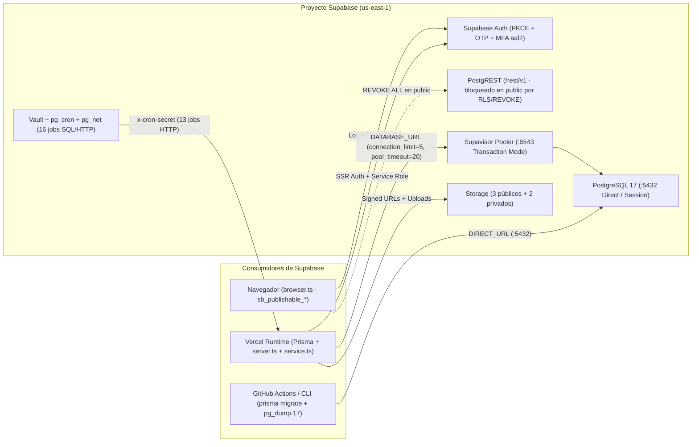

# Supabase — PostgreSQL 17, Prisma, Auth, Storage, RLS y Procesos Programados

> **Documento vivo.** Referencia técnica canónica de **Lucams Shop** para la plataforma Supabase: topología multi-entorno, pooling con Supavisor y Prisma, autenticación con códigos OTP y MFA `aal2`, los 5 buckets de Storage, postura RLS _deny-by-default_, Supabase Vault y el inventario completo de los **19 procesos programados** del sistema. Para el modelo de dominio general consulta [`../ARCHITECTURE.md`](../ARCHITECTURE.md); para controles de seguridad revisa [`../SECURITY.md`](../SECURITY.md).

---

## 1. Topología de los 3 entornos

Lucams opera tres entornos aislados sobre **PostgreSQL 17** (los planes alojados corren en AWS `us-east-1`, co-localizados con las funciones `iad1` de Vercel; ver [`./vercel.md`](./vercel.md)):

| Entorno                | Identificador (`project_ref` / ID)                     | Región / Puertos                                                     | Propósito y llaves                                                                                                                                                                                                                                                                                                                                               |
| ---------------------- | ------------------------------------------------------ | -------------------------------------------------------------------- | ---------------------------------------------------------------------------------------------------------------------------------------------------------------------------------------------------------------------------------------------------------------------------------------------------------------------------------------------------------------- |
| **Producción (`PRD`)** | `zxkucphbsfygakgxcnik`                                 | `us-east-1` (Virginia del Norte)                                     | Base de datos viva de `lucamsshop.com`. Usa llaves modernas de Supabase (`sb_publishable_*` en `NEXT_PUBLIC_SUPABASE_ANON_KEY` y `sb_secret_*` en `SUPABASE_SERVICE_ROLE_KEY`; doc oficial: https://supabase.com/docs/guides/api/api-keys, verificado 2026-10-20). La introspección del esquema OpenAPI en `/rest/v1/` está bloqueada para la llave publishable. |
| **Staging (`STG`)**    | `mjbdiqdkykhsixvqlrrp`                                 | `us-east-1` (Virginia del Norte)                                     | Respalda los despliegues Preview de Vercel (`develop` y PRs). Tiene desprogramados los 5 crons que emiten correos a clientes y aloja además el job `uptime-monitor-prd` que vigila externamente a Producción cada 10 minutos.                                                                                                                                    |
| **Local (`Podman`)**   | `lucams-local` (`supabase-local/supabase/config.toml`) | API Kong `:54321` · DB `:54322` · Studio `:54323` · Mailpit `:54324` | Stack local reproducible sobre contenedores Podman (`major_version = 17`, `site_url = "http://192.168.20.180:4000"`). Captura todos los correos OTP/Auth en el buzón local `:54324` sin consumir cuota de Resend.                                                                                                                                                |

---

## 2. Conexiones, Supavisor Pooling y Prisma (`packages/db/src/index.ts`)

### Separación `DATABASE_URL` vs `DIRECT_URL`

En entornos serverless está prohibido conectar funciones de aplicación directo a PostgreSQL sin pooler (doc oficial Supavisor: https://supabase.com/docs/guides/database/connecting-to-postgres#connection-pooler, verificado 2026-10-20):

| Variable       | Puerto / Modo                                                  | Consumidores autorizados                                                                                                                                          |
| -------------- | -------------------------------------------------------------- | ----------------------------------------------------------------------------------------------------------------------------------------------------------------- |
| `DATABASE_URL` | `:6543` con `?pgbouncer=true` (**Supavisor Transaction Mode**) | Exclusivamente el runtime de `apps/web` y `@lucams/db` (`PrismaClient`). Desactiva _prepared statements_ incompatibles con multiplexación por transacción.        |
| `DIRECT_URL`   | `:5432` (**Session / Direct Connection**)                      | `prisma migrate deploy`, `prisma migrate dev`, scripts administrativos de mantenimiento y `pg_dump` 17 en `.github/workflows/backup.yml` (`BACKUP_DATABASE_URL`). |

### Inyección automática de límites de pool (`withConnectionLimit`)

Al instanciar `PrismaClient` en `packages/db/src/index.ts`, la función `withConnectionLimit()` parsea `DATABASE_URL` y asegura dos parámetros si no vienen declarados en la cadena de conexión:

- **`connection_limit=5`** (configurable vía `PRISMA_CONNECTION_LIMIT`, rango válido `1..50`): acota las conexiones simultáneas por instancia Node.js en Vercel para no saturar el pool de Supavisor durante picos de tráfico concurrente, manteniendo paralelismo suficiente para los `Promise.all` de Server Components.
- **`pool_timeout=20`** (configurable vía `PRISMA_POOL_TIMEOUT`, rango válido `1..120`, en segundos): duplica el default de 10 s de Prisma para absorber arranques en frío de Supavisor sin fallar prematuramente.

### Extensión `$allOperations` de reintento (`runWithDbRetry`)

El cliente exportado `prisma` aplica `$extends({ query: { $allOperations } })` mediante `runWithDbRetry`:

- **Errores reintentables (`RETRYABLE_CODES`)**:
  - `P1001`: _Can't reach database server_ (corte de red o micro-reinicio del pooler).
  - `P1017`: _Server has closed the connection_ (socket reciclado por Supavisor).
  - `P2024`: _Timed out fetching a new connection from the connection pool_.
  - Detecta tanto `err.code` en errores de consulta como cadenas `"P1001"` / `"Can't reach database server"` en `PrismaClientInitializationError`.
- **Política de espera**: hasta **3 intentos totales** con backoff lineal `300 ms * attempt` (`300 ms` antes del 2.º intento, `600 ms` antes del 3.º).
- **Limitación arquitectónica en transacciones interactivas**: `prisma.$transaction(async (tx) => ...)` fija una única sesión de base de datos al iniciar el callback. Si Supavisor o PostgreSQL cortan esa conexión (`P1001`/`P1017`) a mitad del callback, toda la transacción queda abortada en el servidor y **no puede salvarse reintentando una operación individual sobre `tx`**. Los flujos críticos (como `processPaidOrder` en [`../domains/checkout-payments-shipping.md`](../domains/checkout-payments-shipping.md)) mantienen las transacciones `$transaction` cortas e idempotentes.

---

## 3. Los 3 clientes de Supabase (`apps/web/lib/supabase/`)

El SDK `@supabase/supabase-js` / `@supabase/ssr` **no se usa para consultar tablas del modelo de negocio** (eso es responsabilidad exclusiva de Prisma). Su uso está restringido a **Supabase Auth** y **Supabase Storage** a través de tres clientes con fronteras estrictas:

| Cliente                 | Archivo                                                            | Credencial                                           | Contexto y reglas de privilegio                                                                                                                                                                                                                                                         |
| ----------------------- | ------------------------------------------------------------------ | ---------------------------------------------------- | --------------------------------------------------------------------------------------------------------------------------------------------------------------------------------------------------------------------------------------------------------------------------------------- |
| **Browser**             | `apps/web/lib/supabase/browser.ts` (`createSupabaseBrowserClient`) | `NEXT_PUBLIC_SUPABASE_ANON_KEY` (`sb_publishable_*`) | Solo Client Components para flujos interactivos de Auth (login con contraseña, verificación OTP, enrolamiento y reto MFA TOTP). **Cero permisos SQL en `public`**.                                                                                                                      |
| **Server SSR**          | `apps/web/lib/supabase/server.ts` (`createSupabaseServerClient`)   | `NEXT_PUBLIC_SUPABASE_ANON_KEY` + cookies HTTP       | RSC, Server Actions y Route Handlers. Lee el JWT/sesión actual (`auth.getUser()`, `mfa.getAuthenticatorAssuranceLevel()`). En RSC puros ignora silenciosamente escrituras en `setAll` porque el refresco de cookies ya ocurrió en `proxy.ts`.                                           |
| **Service Role (Lazy)** | `apps/web/lib/supabase/service.ts` (`supabaseService`)             | `SUPABASE_SERVICE_ROLE_KEY` (`sb_secret_*`)          | Protegido con `import "server-only"`, `persistSession: false` y `autoRefreshToken: false`. Expuesto mediante un `Proxy` perezoso para no romper `next build` sin secretos. Reservado **únicamente** para Storage privado y `auth.admin.*` tras validar permisos de negocio en servidor. |

---

## 4. Supabase Auth — PKCE, OTP, Plantillas, MFA `aal2` y Staff

### Flujo PKCE + Códigos OTP (anti-prefetch de clientes de correo)

1. **Intercambio PKCE**: los flujos basados en redirección intercambian `code` por sesión en `/auth/callback` (`exchangeCodeForSession`).
2. **Confirmación de registro y recuperación por código OTP (`/confirmar-codigo`)**: los escáneres corporativos y el prefetch de enlaces en clientes como Gmail/Outlook visitan automáticamente las URLs de los correos, consumiendo los enlaces mágicos de un solo uso antes de que la persona haga clic. Por ello, las plantillas de Auth entregan el **código numérico OTP de 6 dígitos (`{{ .Token }}`)** como mecanismo primario de verificación en `/confirmar-codigo`.
3. **Plantillas HTML versionadas y sincronización por API**:
   - Los diseños viven en `supabase/auth-templates/confirmation.html` y `supabase/auth-templates/recovery.html` con identidad visual de **Lucams**.
   - El script `scripts/supabase-auth-email-config.mjs` consulta o aplica (`--check` / `--apply`) la configuración contra la Management API (`https://api.supabase.com/v1/projects/{ref}/config/auth` autenticada con `SUPABASE_ACCESS_TOKEN`), inyectando las plantillas HTML, los asuntos en español y el transporte **SMTP de Resend** (`smtp.resend.com`, puerto `465`, remitente `EMAIL_FROM`; ver [`./resend-and-emails.md`](./resend-and-emails.md)).

### MFA TOTP (`aal2`) obligatorio para administradores

Todo acceso al panel `/admin/*` exige doble factor TOTP en tres anillos:

1. **Perímetro (`apps/web/proxy.ts`)**: si el usuario autenticado en `/admin/*` no posee ningún factor TOTP en estado `verified` (`supabase.auth.mfa.listFactors()`), fuerza redirección HTTP a `/admin/seguridad?enroll=required`.
2. **Autorización de sesión (`getCurrentAdmin` / `requireAdminAction`)**: verifica que el JWT tenga nivel efectivo **`aal2`** y que exista fila correspondiente en `public."AdminUser"` con `isActive = true` y `deletedAt IS NULL`.
3. **Reautenticación reciente (`requireRecentMfa` en `lib/admin-reauth.ts`)**: operaciones sensibles o financieras (promover/cambiar rol de administradores en `/admin/usuarios`, emitir reembolsos en `/admin/pedidos/[number]`, regenerar códigos de emergencia de `AdminRecoveryCode`) exigen una verificación TOTP fresca; si la elevación envejeció, la acción devuelve `{ reauthRequired: true }` para abrir el modal TOTP antes de ejecutar.

### Sincronización con `public."Customer"` / `public."AdminUser"` y `provisionStaffAdmin`

> **Nota crítica de esquema**: en la base de datos de Lucams **no existe una tabla `public.User`**. Las identidades de aplicación se dividen en **`public."Customer"`** (compradores) y **`public."AdminUser"`** (equipo interno), ambas enlazadas a `auth.users.id` mediante `supabaseUserId` (`@unique`). Asimismo, **no existen triggers SQL sobre `auth.users`** (la migración `00000000000004_sync_auth_users_delete.sql` los eliminó deliberadamente porque GoTrue HTTP `admin.deleteUser` falla con HTTP `500` cuando un trigger custom referencia tablas en `public`).

- **Clientes (`Customer`)**: se crean o enlazan explícitamente en servidor al completar registro/OTP o callback (`/confirmar-codigo`, `/auth/callback`), reclamando pedidos previos de invitado (`claimGuestOrders`), adoptando borradores del Estudio (`adoptAnonDraftDesigns`) y recuperando el carrito vivo (`recoverCustomerCartSessionId`).
- **Equipo interno (`provisionStaffAdmin` en `apps/web/features/admin-users/service.ts`)**:
  1. Da de alta o reactiva una fila `AdminUser` **sin crear registro en `Customer`**.
  2. Si el correo ya existe en `Customer` o en `auth.users`, reutiliza su `supabaseUserId`.
  3. Si no existe en `auth.users`, lo aprovisiona con `supabaseService.auth.admin.inviteUserByEmail(normalizedEmail)` (con fallback a `createUser({ email_confirm: true })` en entornos locales sin mailer externo) y emite el log de auditoría `event: "service-role-write"`, `operation: "admin.provision_staff_auth_user"`.
  4. Marca `isStaff = true` en cualquier `Contact` del CRM que comparta ese correo para excluir compras internas (_dogfooding_) de los cálculos de RFM y LTV.

---

## 5. Supabase Storage — Inventario canónico de los 5 buckets

La lógica centralizada de lectura/escritura vive en `apps/web/lib/storage.ts` y el proxy de diseños en `apps/web/app/api/design-preview/[...path]/route.ts`.

| Bucket              | Visibilidad                                             | Límite SQL (`file_size_limit`) | MIME permitidos                                                     | Políticas RLS en `storage.objects`                                                                                                                                  | Uso, derivados y TTL de Signed URLs                                                                                                                                                                                                                                                                                                                                                                                                                                                                                                                  |
| ------------------- | ------------------------------------------------------- | ------------------------------ | ------------------------------------------------------------------- | ------------------------------------------------------------------------------------------------------------------------------------------------------------------- | ---------------------------------------------------------------------------------------------------------------------------------------------------------------------------------------------------------------------------------------------------------------------------------------------------------------------------------------------------------------------------------------------------------------------------------------------------------------------------------------------------------------------------------------------------- |
| `product-images`    | **Público** (`public = true`)                           | `5 MB` (`5 242 880 B`)         | `image/jpeg`, `image/png`, `image/webp`, `image/avif`               | `SELECT` público; `INSERT`/`UPDATE`/`DELETE` restringidos a `public.is_active_admin()` (mig `005`).                                                                 | Fotos del catálogo (`≤2000 px`, WebP `q82`), artes maestros de galería prediseñada (acepta hasta `15 MB` en memoria y comprime a WebP `≤4000 px q90` < `5 MB`) y miniaturas con marca de agua `thumbs/<uuid>.webp` (`≤800 px q78`). URLs públicas directas cacheadas 7 días por Next Image.                                                                                                                                                                                                                                                          |
| `cms-media`         | **Público** (`public = true`)                           | `5 MB` (`5 242 880 B`)         | `image/jpeg`, `image/png`, `image/webp`, `image/avif`               | `SELECT` público; escritura exclusiva `public.is_active_admin()` (mig `020`).                                                                                       | Mediateca editorial de banners, íconos y bloques del CMS v2 (`/admin/contenido`).                                                                                                                                                                                                                                                                                                                                                                                                                                                                    |
| `customer-uploads`  | **Privado** (`public = false`)                          | `10 MB` (`10 485 760 B`)       | `image/jpeg`, `image/png`, `image/webp`, `image/heic`, `image/heif` | **Cero políticas de cliente** (mig `013` revocó `authenticated` para evitar abuso directo de cuota); solo `is_active_admin()` en SQL. Acceso vía `supabaseService`. | Fotografías subidas por compradores en el Estudio. Valida magic bytes reales, convierte HEIC→JPEG, purga EXIF/GPS con `sharp-safe`, guarda `metadata.owner_id` y genera derivado liviano `.canvas.webp` (`≤800 px q82`). **Signed URLs con TTL de `3 600 s` (1 h)**. Purgado automático por crons de retención.                                                                                                                                                                                                                                      |
| `design-previews`   | **Privado** (`public = false`, mig `046` `LUC-SEC-001`) | `3 MB` (`3 145 728 B`)         | `image/png`, `image/webp`, `image/jpeg`                             | `SELECT` público **eliminado** en mig `046`; solo `is_active_admin()` en SQL. Lectura exclusiva vía proxy de aplicación.                                            | Mosaicos y páginas por unidad de diseños personalizados (contienen rostros/fotos privadas). Servido **únicamente** por `GET /api/design-preview/[...path]` (`Cache-Control: private, max-age=300`), que autoriza dueño (`customerId` o `cart_session`), admin activo o capability tokens HMAC (`?st=`, `?qt=`, `?ot=`), respondiendo `404` si no autoriza. En UI usa `<Image unoptimized>`.                                                                                                                                                          |
| `production-assets` | **Privado** (`public = false`)                          | `30 MB` (`31 457 280 B`)       | `image/png`, `image/tiff`, `application/pdf`                        | Solo `public.is_active_admin()` en SQL (mig `006`). Segregación fina de roles ejecutada en servidor antes de firmar URLs.                                           | Aloja dos activos críticos del pedido: 1) **Artes de impresión a 300 DPI** (PNG/TIFF generados por `RenderJob`), accesibles por `PRINT_WORKSHOP` (vía ZIP en `/admin/pedidos/[number]/produccion` o signed URL de **`3 600 s`**); 2) **Copias propias de guías PDF de envío** en `shipping-labels/<orderId>.pdf` (`Order.labelPath`), restringidas a `FULFILLMENT` / `OPERATIONS_MANAGER` / `ADMIN` / `SUPERADMIN` (bloqueadas a `PRINT_WORKSHOP` para no exponer dirección/teléfono del destinatario) y auditadas con `order.print_shipping_guide`. |

---

## 6. Postura RLS, privilegios SQL, Rate Limit y auditoría

### Defensa en profundidad en PostgreSQL (migraciones `002`..`054`)

1. **RLS universal (`rowsecurity = true`)**: el 100 % de las tablas del esquema `public` (incluyendo tablas operativas, ledger de pagos, CRM, `ShipmentEvent` en mig `054` y `_prisma_migrations`) tienen Row Level Security habilitado.
2. **Función `public.is_active_admin()`**: `SECURITY DEFINER` con `SET search_path = public` fijo (endurecido en mig `027` y `030`), verifica que `auth.uid()::text` corresponda a un `AdminUser` activo y no eliminado.
3. **Revocación total de `GRANT` en `public` (mig `022`, `026`, `038`)**:
   - `anon` y `authenticated` tienen **cero privilegios** (`REVOKE ALL`) sobre todas las tablas, secuencias y rutinas públicas no explícitas. Aunque una política RLS tuviera un error lógico, PostgREST rechaza la consulta en la capa de permisos SQL.
   - `service_role` tiene **cero privilegios DML** (`SELECT`, `INSERT`, `UPDATE`, `DELETE`) sobre tablas de `public` porque toda consulta relacional entra por Prisma (`postgres`).
4. **Event Trigger DDL automático (`00000000000014` + `00000000000049_enforce_revoke_on_new_tables.sql`)**:
   - El event trigger `enforce_rls_on_new_table_trg` se dispara en cada `CREATE TABLE`, `CREATE TABLE AS` o `SELECT INTO` dentro de `public` y ejecuta `public.enforce_rls_on_new_table()`, activando `ENABLE ROW LEVEL SECURITY` y ejecutando `REVOKE ALL ON TABLE ... FROM anon, authenticated, service_role` dentro de la misma transacción DDL. Es imposible desplegar una tabla nueva abierta por olvido.
5. **Aislamiento de extensiones (`00000000000029_move_pg_net_to_extensions.sql`)**: `pg_net` vive en el esquema `extensions` (no en `public`).

### Rate Limiter atómico en SQL (`public.rate_limit_buckets`)

Por mandato arquitectónico (sin Redis externo), el control de frecuencia vive en PostgreSQL (migración `00000000000003_rate_limit.sql`, consumido desde `apps/web/lib/rate-limit.ts`):

- **Tabla**: `public.rate_limit_buckets (key text, window_start timestamptz, count integer, PRIMARY KEY (key, window_start))`.
- **Función SQL**: `public.rate_limit_check(p_key text, p_limit integer, p_window_seconds integer)` (invocada por `rateLimit()` en `apps/web/lib/rate-limit.ts` vía `prisma.$queryRaw` con casts explícitos `::text` y `::int`). Calcula el inicio del bucket alineado a `p_window_seconds`, hace `INSERT ... ON CONFLICT (key, window_start) DO UPDATE SET count = count + 1` y devuelve `(allowed boolean, current_count int, reset_at timestamptz)` en un único round-trip atómico.
- **Degradación y limpieza**: si la consulta devolviera una fila vacía anómala, `lib/rate-limit.ts` aplica `fail-open` registrando `rate_limit.empty_row`. El job SQL diario `lucams-purge-rate-limits` (mig `047`) elimina cubetas con más de 7 días de antigüedad (`public.purge_rate_limit_buckets()`).

### Auditoría automatizada (`packages/db/scripts/verify-security-posture.mjs`)

Script de solo lectura (`SELECT` contra `pg_tables`, `information_schema.role_table_grants`, `pg_proc`, `pg_extension` y `pg_event_trigger`) que verifica 5 invariantes y devuelve código de salida `!= 0` ante cualquier regresión:

1. `0` tablas en `public` con `rowsecurity = false`.
2. `0` privilegios concedidos a `anon` o `authenticated` en `public`.
3. `0` privilegios DML concedidos a `service_role` en `public`.
4. `0` funciones `SECURITY DEFINER` en `public` sin `SET search_path` fijo, y extensión `pg_net` fuera de `public`.
5. Event trigger `enforce_rls_on_new_table_trg` activo (`tgenabled = 'O'`) e incluyendo `REVOKE ALL` en su cuerpo.

---

## 7. Supabase Vault y los 18 Procesos Programados

### Secretos almacenados en `vault.decrypted_secrets`

Ningún secreto ni URL se escribe en texto plano dentro de `cron.job`. Los bloques SQL leen en tiempo de ejecución desde **Supabase Vault** (`vault.decrypted_secrets`):

| Proyecto Supabase | Nombre exacto en `vault.secrets` | Consumidor SQL                           | Propósito                                                                                                     |
| ----------------- | -------------------------------- | ---------------------------------------- | ------------------------------------------------------------------------------------------------------------- |
| **PRD** y **STG** | `cron_base_url`                  | Migraciones `015`..`048` (`pg_cron` app) | URL base sin barra final (`https://lucamsshop.com` en PRD; URL Preview en STG).                               |
| **PRD** y **STG** | `cron_secret`                    | Migraciones `015`..`048` (`pg_cron` app) | Enviado en el header `x-cron-secret` hacia `GET /api/cron/*` (idéntico a `CRON_SECRET` de Vercel).            |
| **Solo STG**      | `cron_vercel_bypass`             | Migraciones `023`..`048` (`pg_cron` app) | Secreto de _Protection Bypass for Automation_, enviado como `x-vercel-protection-bypass` cuando existe.       |
| **Solo STG**      | `monitor_prd_base_url`           | `scripts/monitor-uptime-stg.sql`         | URL pública de Producción (`https://lucamsshop.com`) sondeada cada 10 min desde STG.                          |
| **Solo STG**      | `monitor_cron_secret`            | `scripts/monitor-uptime-stg.sql`         | `CRON_SECRET` de **Producción** para autenticar `/api/health/crons` y `POST /api/cron/monitor-heartbeat`.     |
| **Solo STG**      | `monitor_resend_api_key`         | `scripts/monitor-uptime-stg.sql`         | API key de Resend para disparar correos de caída/recuperación directo desde STG aunque Vercel PRD esté caído. |
| **Solo STG**      | `monitor_email_from`             | `scripts/monitor-uptime-stg.sql`         | Remitente verificado para las alertas del monitor externo.                                                    |
| **Solo STG**      | `monitor_alert_email`            | `scripts/monitor-uptime-stg.sql`         | Buzón destinatario de alertas críticas de caída de PRD.                                                       |

---

### A. Los 13 jobs HTTP `pg_cron` + `pg_net` en Producción

Todos invocan `extensions.net.http_get` con `timeout_milliseconds := 25000` (o `55000` en jobs pesados) enviando `x-cron-secret`. En **Staging**, los 5 jobs que envían correos (`alerts`, `daily-summary`, `review-request`, `cart-recovery`, `back-in-stock`) están desprogramados y listados en `CRON_JOBS_DISABLED` para que `/api/health/crons` los reporte como `disabled: true` en vez de vencidos.

| #   | Nombre en `cron.job`             | Expresión UTC        | Hora Colombia (`UTC-5`)            | Ruta `GET /api/cron/...`            | `maxDuration` | Optimización SQL / Propósito                                                                                                                                                                                                                                                   |
| --- | -------------------------------- | -------------------- | ---------------------------------- | ----------------------------------- | ------------- | ------------------------------------------------------------------------------------------------------------------------------------------------------------------------------------------------------------------------------------------------------------------------------ |
| 1   | `lucams-process-render-jobs`     | `* * * * *`          | Cada 1 min                         | `/api/cron/process-render-jobs`     | `60 s`        | **SQL _idle-skip_ (mig `048`)**: consulta `public."RenderJob"` (`PENDING` con `nextRunAt <= now()` o `PROCESSING` colgado `>5 min`). Si la cola está vacía, **no invoca Vercel** y actualiza directo `AlertState['cron:process-render-jobs']` con `"idle (cola vacía)"`.       |
| 2   | `lucams-alerts`                  | `*/5 * * * *`        | Cada 5 min                         | `/api/cron/alerts`                  | Default       | Evalúa reglas de observabilidad (`reconciliation`, `webhooks_stuck`, `cron_stale_*`, `backup_stale`, `uptime_monitor_*`, `security_*`) y despacha alertas. _(Apagado en STG)_.                                                                                                 |
| 3   | `lucams-cms-publish-scheduled`   | `*/5 * * * *`        | Cada 5 min                         | `/api/cron/cms-publish-scheduled`   | Default       | **SQL _idle-skip_ (mig `048`)**: verifica si existen filas `CmsFieldVersion` con `status = 'SCHEDULED'` y `scheduledFor <= now()`. Si no hay vencidas, omite el HTTP GET y registra `"idle (sin versiones vencidas)"` en `AlertState`.                                         |
| 4   | `lucams-tracking-sync`           | `4,19,34,49 * * * *` | Cada 15 min (`:04, :19, :34, :49`) | `/api/cron/tracking-sync`           | `60 s`        | Polling de respaldo logístico (`obtenerEstadoAuth`, lote de hasta 25 órdenes `FULFILLING`/`SHIPPED` `<90 d`, excluyendo `INTERNO-*`; mig `044`). Ver [`./aveonline.md`](./aveonline.md).                                                                                       |
| 5   | `lucams-back-in-stock`           | `*/30 * * * *`       | Cada 30 min                        | `/api/cron/back-in-stock`           | Default       | Notifica suscriptores de `StockNotification` cuando una variante agotada recupera inventario. _(Apagado en STG)_.                                                                                                                                                              |
| 6   | `lucams-cart-recovery`           | `0 * * * *`          | Cada hora (`:00`)                  | `/api/cron/cart-recovery`           | Default       | Detecta carritos abandonados elegibles y envía secuencia de recuperación con enlace firmado. _(Apagado en STG)_.                                                                                                                                                               |
| 7   | `lucams-expire-pending-orders`   | `23 * * * *`         | Cada hora (`:23`)                  | `/api/cron/expire-pending-orders`   | Default       | Auto-cancela órdenes `WOMPI` en `PENDING_PAYMENT` con `>24 h` (`PENDING_PAYMENT_EXPIRY_HOURS`), verificando antes en la API de Wompi para auto-sanar cobros aprobados sin webhook (mig `032`). Ver [`./wompi.md`](./wompi.md).                                                 |
| 8   | `lucams-purge-event-logs`        | `0 3 * * *`          | `22:00` (día ant.)                 | `/api/cron/purge-event-logs`        | Default       | Retención de datos (Ley 1581): purga `WebhookEvent` (`180 d`), `EmailEvent`, `ErrorLog`, `SecurityEvent` y `FunnelEventDaily` (`365 d`).                                                                                                                                       |
| 9   | `lucams-purge-anon-designs`      | `0 8 * * *`          | `03:00`                            | `/api/cron/purge-anon-designs`      | Default       | Limpia diseños anónimos expirados, carritos vacíos (`>7 d`) / inactivos (`>60 d`) y sus archivos en `customer-uploads` y `design-previews`.                                                                                                                                    |
| 10  | `lucams-purge-delivered-designs` | `0 9 * * *`          | `04:00`                            | `/api/cron/purge-delivered-designs` | Default       | Purga activos pesados de impresión (`production-assets` y fotos originales) de pedidos ya entregados tras vencer su ventana operativa de posventa/garantía (mig `035`).                                                                                                        |
| 11  | `lucams-daily-summary`           | `0 13 * * *`         | `08:00`                            | `/api/cron/daily-summary`           | Default       | Envía el resumen operativo diario (ventas, órdenes en reconciliación, expiradas `no_txid` para cruce con Wompi, stock bajo). _(Apagado en STG)_.                                                                                                                               |
| 12  | `lucams-review-request`          | `0 17 * * *`         | `12:00`                            | `/api/cron/review-request`          | Default       | Envía invitación de reseña con token firmado de un solo uso para pedidos `DELIVERED` elegibles. _(Apagado en STG)_.                                                                                                                                                            |
| 13  | `lucams-fiscal-watch`            | `5 12 * * *`         | `07:05`                            | `/api/cron/fiscal-watch`            | Default       | Vigilancia fiscal proactiva (`ADR-196`, mig `055`): mide el año civil colombiano contra los umbrales DIAN de 3 500 UVT (facturación electrónica e IVA por tarjeta), proyecta el cierre anual y alerta 70 %/90 %/100 % (email al owner en 90 %/100 %, una vez por cruce y año). |

---

### B. Las 3 rutas `POST /api/cron/*` invocadas externamente

Estas rutas **no son disparadas por el `pg_cron` de PRD**, sino por productores externos autenticados con el header `x-cron-secret` (techo de body `8 KB`):

| #   | Ruta en `apps/web`                 | Productor externo                                                                                              | Frecuencia UTC / CO                       | Registro en `AlertState` y vigilancia                                                                                                                                                                                                                                                                            |
| --- | ---------------------------------- | -------------------------------------------------------------------------------------------------------------- | ----------------------------------------- | ---------------------------------------------------------------------------------------------------------------------------------------------------------------------------------------------------------------------------------------------------------------------------------------------------------------- |
| 14  | `POST /api/cron/backup-heartbeat`  | GitHub Actions `.github/workflows/backup.yml` (ver [`./github-and-ops.md`](./github-and-ops.md))               | Diario `13 7 * * *` (`02:13` CO)          | Actualiza `AlertState["backup:last-success"]` (`recordBackupHeartbeat`). Vigilado por `getBackupHealth()`: alerta `backup_stale` si supera **`36 horas`** sin éxito.                                                                                                                                             |
| 15  | `POST /api/cron/domain-watch`      | GitHub Actions `.github/workflows/domain-watch.yml` (runners Azure; Verisign bloquea TLS saliente de `pg_net`) | Mensual `23 11 5 * *` (día 5, `06:23` CO) | Valida payload RDAP con Zod, compara nameservers/status EPP/días para expiración contra baseline en `AlertState["domain-watch:*"]` y escribe latido `AlertState["cron:domain-watch"]` (intervalo `31 días` en `CRON_JOBS`).                                                                                      |
| 16  | `POST /api/cron/monitor-heartbeat` | Job `uptime-monitor-prd` en **Supabase Staging** (`scripts/monitor-uptime-stg.sql`)                            | Cada 10 min `*/10 * * * *`                | Sondea en 2 fases asíncronas (`pg_net`) los 5 endpoints de salud de PRD (`/api/health`, `/db`, `/storage`, `/crons`, `/all`). Alerta directo vía Resend al 2.º fallo consecutivo y reporta resumen a `AlertState["uptime-monitor:last-run"]` (`getMonitorHealth()`, alerta `uptime_monitor_stale` si `>30 min`). |

---

### C. Los 3 jobs SQL puros en `pg_cron`

Corren íntegramente dentro de PostgreSQL sin despertar funciones serverless en Vercel:

| #   | Nombre en `cron.job`                 | Expresión UTC | Hora Colombia      | Migración     | Qué ejecuta en SQL                                                                                                                                                                                                                                                       |
| --- | ------------------------------------ | ------------- | ------------------ | ------------- | ------------------------------------------------------------------------------------------------------------------------------------------------------------------------------------------------------------------------------------------------------------------------ |
| 17  | `lucams-purge-rate-limits`           | `29 5 * * *`  | `00:29`            | `047` + `048` | Llama `public.purge_rate_limit_buckets()` (`DELETE` de ventanas `>7 días`) y escribe su propio latido en `public."AlertState"` (`key = 'cron:purge-rate-limits'`, `lastDetail = 'purged N buckets (>7d)'`). Reemplazó y desprogramó el job antiguo `rate_limit_cleanup`. |
| 18  | `lucams-internal-cron-history-purge` | `17 4 * * *`  | `23:17` (día ant.) | `043`         | `DELETE FROM cron.job_run_details WHERE end_time < now() - INTERVAL '14 days'` (evita crecimiento indefinido por los jobs cada 1 y 5 min).                                                                                                                               |
| 19  | `lucams-internal-net-response-purge` | `43 4 * * *`  | `23:43` (día ant.) | `043`         | `DELETE FROM net._http_response WHERE created < now() - INTERVAL '1 day'` (purga cuerpos HTTP temporales retenidos por `pg_net`).                                                                                                                                        |

---

### D. Monitoreo Dead-Man Switch (`features/observability/cron-heartbeat.ts`)

`CRON_JOBS` en `apps/web/features/observability/cron-heartbeat.ts` vigila **15 entradas** con clave `cron:<name>` en la tabla `AlertState`: los **13 jobs HTTP** (#1–#13) + **`purge-rate-limits`** (#17, escrito desde SQL) + **`domain-watch`** (#15, escrito desde GHA). Un job no deshabilitado entra en estado `stale` cuando `Date.now() - lastSuccessAt > 2 * intervalMs` (o si nunca registró primera corrida), haciendo que `GET /api/health/crons` devuelva `HTTP 503` y activando las reglas `cron_stale_<job>` en `/admin/observability` y `/status`.

---

## 8. Checklist paso a paso en Supabase Dashboard

Usa este procedimiento al auditar o aprovisionar un entorno de Supabase para Lucams:

### Paso 1 — Proyecto, Región y Llaves API

- [ ] Crear el proyecto en región **`us-east-1` (North Virginia)** con PostgreSQL 17.
- [ ] En **Project Settings → API**, copiar `Project URL`, llave `sb_publishable_*` (`NEXT_PUBLIC_SUPABASE_ANON_KEY`) y llave `sb_secret_*` (`SUPABASE_SERVICE_ROLE_KEY`).
- [ ] En **Project Settings → Database → Connection string**, copiar la URI de **Transaction Pooler (`:6543`)** agregando `?pgbouncer=true` para `DATABASE_URL`, y la URI de **Session/Direct (`:5432`)** para `DIRECT_URL`.

### Paso 2 — Esquema Prisma y Migraciones SQL (RLS, Storage, Crons)

- [ ] Ejecutar `pnpm --filter @lucams/db exec prisma migrate deploy` usando `DIRECT_URL`.
- [ ] Aplicar en orden las migraciones SQL de `supabase/migrations/00000000000002_*.sql` a `00000000000054_*.sql` (habilitan RLS, revocan grants, crean los 5 buckets con sus límites/MIME, instalan el event trigger `enforce_rls_on_new_table_trg` y registran los jobs `pg_cron`).
- [ ] Ejecutar `node packages/db/scripts/verify-security-posture.mjs` y confirmar que las 5 invariantes de seguridad pasan sin errores.

### Paso 3 — Extensiones y Secretos en Supabase Vault

- [ ] En **Database → Extensions**, verificar activas `pg_cron`, `pg_net` (esquema `extensions`), `supabase_vault`, `pgcrypto` y `pg_trgm`.
- [ ] En **SQL Editor** (o **Project Settings → Vault**), crear los secretos requeridos con `SELECT vault.create_secret('<valor>', '<nombre>');`:
  - En **PRD**: `cron_base_url` (`https://lucamsshop.com`) y `cron_secret`.
  - En **STG**: `cron_base_url`, `cron_secret`, `cron_vercel_bypass` y, para el monitor externo hacia PRD, `monitor_prd_base_url`, `monitor_cron_secret`, `monitor_resend_api_key`, `monitor_email_from`, `monitor_alert_email`, aplicando luego `scripts/monitor-uptime-stg.sql`.

### Paso 4 — Configuración de Auth, SMTP y MFA

- [ ] En **Authentication → URL Configuration**, fijar `Site URL` (`https://lucamsshop.com` en PRD) y agregar en `Redirect URLs` `/auth/callback` y `/confirmar-codigo`.
- [ ] Ejecutar `SUPABASE_ACCESS_TOKEN=... node scripts/supabase-auth-email-config.mjs --apply` (y verificar con `--check`) para sincronizar SMTP de Resend y las plantillas `confirmation.html` y `recovery.html` con código OTP.
- [ ] En **Authentication → Multi-Factor**, verificar habilitado **TOTP (App Authenticator)**.

### Paso 5 — Verificación de Storage y Health Checks

- [ ] En **Storage**, confirmar que existen los 5 buckets con la visibilidad exacta: `product-images` (`Public`), `cms-media` (`Public`), `customer-uploads` (`Private`), `design-previews` (`Private`) y `production-assets` (`Private`).
- [ ] Verificar `GET /api/health/db`, `GET /api/health/storage` y `GET /api/health/crons` (con header `x-cron-secret`) respondiendo `HTTP 200`.
