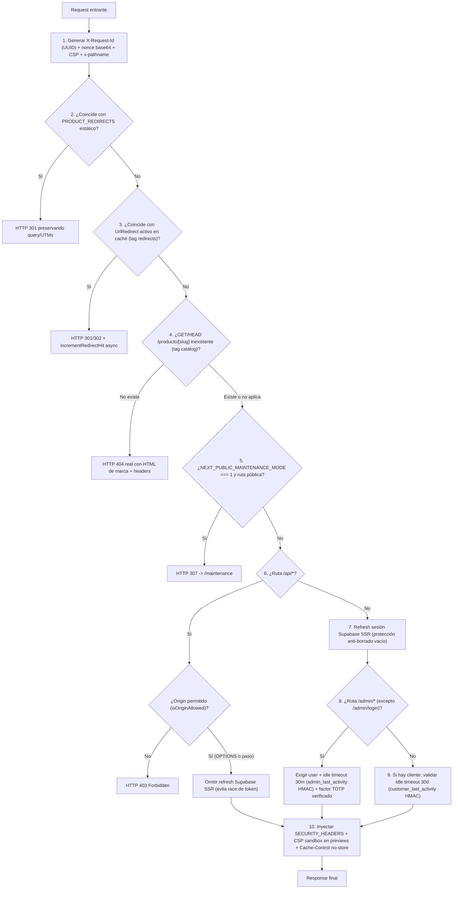

# Vercel y Next.js 16 — Infraestructura Serverless, Proxy y Caché

> **Documento vivo.** Especificación canónica del despliegue de **Lucams Shop** en Vercel Pro, configuración de funciones serverless, binarios nativos, pipeline perimetral `proxy.ts`, políticas CSP/headers, estrategia de caché en Next.js 16 y validación de arranque. Para reglas de seguridad transversal consulta [`../SECURITY.md`](../SECURITY.md); para operaciones y runbooks revisa [`../OPERATIONS.md`](../OPERATIONS.md).

---

## 1. Configuración del proyecto en Vercel

Lucams Shop se despliega como un monorepo `pnpm` sobre **Vercel Pro** (requerido para uso comercial según los términos de servicio de Vercel; verificado 2026-10-20 en https://vercel.com/docs/limits/fair-use-guidelines).

| Parámetro en Vercel           | Valor exacto                                                  | Fuente / Justificación técnica                                                                                                                                                                                                                  |
| ----------------------------- | ------------------------------------------------------------- | ----------------------------------------------------------------------------------------------------------------------------------------------------------------------------------------------------------------------------------------------- |
| **Root Directory**            | `apps/web`                                                    | Aislar la app Next.js dentro del monorepo (`pnpm-workspace.yaml` declara `apps/*` y `packages/*`). Vercel detecta automáticamente `pnpm-lock.yaml` en la raíz del repositorio.                                                                  |
| **Framework Preset**          | `Next.js` (`next@16.4.3`)                                     | Declarado también en `apps/web/vercel.json`: `{"$schema": "https://openapi.vercel.sh/vercel.json", "framework": "nextjs"}`.                                                                                                                     |
| **Node.js Version**           | `22.x`                                                        | Requisito fijado en `package.json` raíz (`"engines": { "node": ">=22.0.0" }`).                                                                                                                                                                  |
| **Package Manager**           | `pnpm@11.0.9`                                                 | Fijado mediante el campo `"packageManager": "pnpm@11.0.9"` en `package.json` (Corepack habilitado).                                                                                                                                             |
| **Install Command**           | _Default de Vercel_ (`pnpm install --frozen-lockfile`)        | Ejecutado desde la raíz del workspace para instalar tanto `apps/web` como `@lucams/db`.                                                                                                                                                         |
| **Build Command**             | _Default del paquete_ (`pnpm run build` en `apps/web`)        | Ejecuta `pnpm --filter @lucams/db exec prisma generate && next build`, garantizando el cliente Prisma generado antes de compilar rutas y Server Actions.                                                                                        |
| **Function Region**           | `iad1` (`us-east-1`, Washington, D.C.)                        | Co-localizada en la misma región AWS (`us-east-1`) que los proyectos Supabase de Producción y Staging (ver [`./supabase.md`](./supabase.md)), manteniendo la latencia TCP/TLS hacia Supavisor en ~1–3 ms.                                       |
| **Ramas de despliegue**       | `production` → **Production** · `develop` + PRs → **Preview** | Ambas ramas están protegidas por ruleset en GitHub (ver [`./github-and-ops.md`](./github-and-ops.md)).                                                                                                                                          |
| **Server Actions Body Limit** | `32mb`                                                        | Configurado en `apps/web/next.config.ts` (`experimental.serverActions.bodySizeLimit: "32mb"`) para admitir cargas de fotografías de alta resolución en el Estudio antes de su normalización con `sharp`.                                        |
| **Image Optimization**        | `minimumCacheTTL: 604_800` (7 días)                           | Configurado en `next.config.ts` sobre `*.supabase.co/storage/v1/object/public/**` (las imágenes en Storage son prácticamente inmutables). En desarrollo local habilita `dangerouslyAllowLocalIP` únicamente cuando `NODE_ENV !== "production"`. |

---

## 2. Las 9 rutas con `maxDuration` extendido

En Vercel Pro, las funciones Node.js permiten configurar el tiempo máximo de ejecución por ruta (doc oficial: https://vercel.com/docs/functions/configuring-functions/duration, verificado 2026-10-20). En lugar de duplicar glob patterns frágiles en `apps/web/vercel.json`, **Lucams declara el presupuesto en cada segmento mediante Route Segment Config (`export const maxDuration = ...`)**, que `next build` compila directamente en `.next/server/functions-config-manifest.json`. Las Server Actions invocadas desde una página heredan el `maxDuration` exportado por el `page.tsx` de ese segmento.

| #   | Archivo de ruta (`apps/web/app/...`)                 | `maxDuration` | Por qué requiere presupuesto extendido                                                                                                                                                                                                                                                                                                |
| --- | ---------------------------------------------------- | ------------- | ------------------------------------------------------------------------------------------------------------------------------------------------------------------------------------------------------------------------------------------------------------------------------------------------------------------------------------- |
| 1   | `api/webhooks/wompi/route.ts`                        | `60 s`        | Ejecuta `processPaidOrder`: transición atómica de stock + autenticación fría en Aveonline (`~10–16 s` con retry) + `createShipment` (`timeoutMs: 20_000`, **no idempotente**) + archivado de PDF (`12 s`). Cortar la función a mitad de `createShipment` dejaría una guía facturada huérfana y provocaría doble guía en el reintento. |
| 2   | `api/cron/process-render-jobs/route.ts`              | `60 s`        | Worker asíncrono de la cola `RenderJob` que descarga fotos originales desde `customer-uploads`, renderiza láminas de impresión a **300 DPI** con `@napi-rs/canvas` y sube PNGs pesados al bucket `production-assets`.                                                                                                                 |
| 3   | `api/cron/tracking-sync/route.ts`                    | `60 s`        | Polling de convergencia logística: consulta secuencialmente `obtenerEstadoAuth` (`timeoutMs: 5_000` + retry) hasta para **25 pedidos activos** (`FULFILLING`/`SHIPPED`), persiste `ShipmentEvent` y dispara transiciones/correos.                                                                                                     |
| 4   | `admin/(panel)/pedidos/[number]/produccion/route.ts` | `60 s`        | Descarga en servidor todos los PNGs a 300 DPI de la orden desde `production-assets`, compone la lámina guía `armado.png` cuando aplica y empaqueta el archivo `.zip` en memoria con `JSZip` para el taller.                                                                                                                           |
| 5   | `admin/(panel)/pedidos/[number]/page.tsx`            | `60 s`        | Aloja las Server Actions operativas del detalle de pedido: `retryShipmentAction` (`createShipment` de `20 s` no idempotente + auth fría) y regeneración server-side de mosaicos/tiles de producción.                                                                                                                                  |
| 6   | `checkout/envio/page.tsx`                            | `45 s`        | Ejecuta `quoteShipping` durante el render SSR: autenticación en Aveonline (`2 × 5 s` máx.) + `cotizarDoble` (`timeoutMs: 15_000 × 2` intentos ≈ `30 s` peor caso). Con `45 s` la aplicación alcanza a capturar timeouts y mostrar la tarifa en caché o el aviso recuperable en lugar de un HTTP `504` de plataforma.                  |
| 7   | `checkout/pago/page.tsx`                             | `60 s`        | Aloja la Server Action `finalizeCheckout`: en pagos contraentrega (`COD`) ejecuta `processPaidOrder` completo (`createShipment` `20 s` en línea); en pagos Wompi sincroniza intentos previos contra la API (`resolveWompiPaymentReference`).                                                                                          |
| 8   | `checkout/gracias/page.tsx`                          | `60 s`        | Verifica activamente `getTransaction(txId)` contra Wompi y, si el comprador regresó antes de que llegara el webhook, ejecuta el fallback idempotente `processPaidOrder` completo (incluyendo creación de guía Aveonline).                                                                                                             |
| 9   | `estudio/[slug]/page.tsx`                            | `60 s`        | Aloja `finalizeDesignAction`: compresión/subida de vistas previas con `sharp`, encolado de `RenderJob` con impulso inmediato (_kick_ acotado de `8 s`) o renderizado síncrono de respaldo a 300 DPI cuando la cola no está disponible.                                                                                                |

---

## 3. Binarios nativos en serverless (`sharp` y `@napi-rs/canvas`)

### Empaquetado externo y pin de seguridad

`apps/web/next.config.ts` declara:

```ts
serverExternalPackages: ["@napi-rs/canvas", "sharp"],
```

Esto impide que el bundler de Next.js reempaquete los addons nativos `.node` (binarios Linux `x64` / `glibc` ejecutados en el runtime Node.js 22 de Vercel).

La versión de `sharp` está fijada de forma **exacta** en `"0.35.5"` tanto en `apps/web/package.json` como en `pnpm-workspace.yaml` (`overrides: { sharp: "0.35.5" }`), asegurando la versión parcheada de `libvips` frente a `GHSA-f88m-g3jw-g9cj` y `GHSA-wq5f-xc86-pv6w`.

### Wrapper obligatorio `features/personalization/sharp-safe.ts` y regla ESLint

En Lucams está **prohibido** importar `"sharp"` directamente en rutas, servicios o componentes. Todo procesamiento raster pasa por **`apps/web/features/personalization/sharp-safe.ts`**:

1. **Bloqueo de decoders innecesarios en `libvips`**: al inicializarse el módulo ejecuta:
   ```ts
   sharp.block({
     operation: ["VipsForeignLoadNsgif", "VipsForeignLoadTiff", "VipsForeignLoadVips"],
   });
   ```
   Deshabilita formatos multipágina/complejos que ningún flujo de cliente necesita, reduciendo superficie de vulnerabilidades nativas.
2. **Presupuesto estricto anti-bombas de descompresión (`SHARP_LIMITS`)**: cada instancia se abre con `limitInputPixels: 25_000_000` (~`5000 × 5000 px`, ~`100 MB` RGBA en RAM), `limitInputChannels: 4`, `pages: 1` y `failOn: "warning"` (rechaza imágenes truncadas o corruptas).
3. **Limpieza automática de metadatos EXIF/GPS**: `normalizeRasterImage`, `compressPreviewImage` (tope `3 MB` para `design-previews`), `encodeGalleryMasterWebp` (`≤4000 px`, `q90`) y `encodeGalleryThumbWebp` (`≤800 px`, `q78`) aplican `.rotate()` según orientación EXIF y recodifican sin llamar `.withMetadata()`, purgando coordenadas GPS y seriales de cámara (cumplimiento Ley 1581).
4. **Guardia estática en CI (`apps/web/eslint.config.mjs`)**: la regla `no-restricted-imports` rompe `pnpm lint` si cualquier archivo fuera de `features/personalization/sharp-safe.ts` (o tests) importa `"sharp"`. En el mismo archivo, `no-restricted-syntax` prohíbe leer directamente los headers `x-forwarded-for`, `x-real-ip` o `x-vercel-forwarded-for` fuera de `apps/web/lib/client-ip.ts` (que en Vercel prioriza `x-real-ip`, inyectado y sobrescrito por el borde de plataforma, evitando falsificación de IP en el rate limiter).
5. **Nota operativa de memoria en contenedores calientes**: si en el futuro se incorpora procesamiento por lotes concurrentes de imágenes dentro de una misma invocación, debe evaluarse `sharp.cache(false)` y `sharp.concurrency(1)` dentro de `sharp-safe.ts` para evitar fragmentación del asignador nativo en funciones con RAM acotada.

---

## 4. Tipografías locales y PWA Manifest

### Estrategia dual de tipografías (`.subset.woff2` vs `.ttf` server-side)

Para lograr **cero llamadas externas a Google Fonts** (privacidad + rendimiento) y a la vez paridad visual exacta entre el lienzo Konva del navegador y el motor de impresión a 300 DPI en `@napi-rs/canvas`, las fuentes viven en `apps/web/assets/fonts/` y se incluyen explícitamente en el tracing serverless de `apps/web/next.config.ts`:

```ts
outputFileTracingIncludes: {
  "/**": ["./assets/fonts/**"],
},
```

| Grupo de fuentes                      | Archivos en `apps/web/assets/fonts/`                                                                    | Dónde se cargan                                                                           | Comportamiento                                                                                                                |
| ------------------------------------- | ------------------------------------------------------------------------------------------------------- | ----------------------------------------------------------------------------------------- | ----------------------------------------------------------------------------------------------------------------------------- |
| **Web global (Storefront)**           | `Fredoka.subset.woff2` (~64 KB, `--font-display`) e `Inter.subset.woff2` (~66 KB, `--font-sans`)        | `apps/web/app/layout.tsx` vía `next/font/local`                                           | Subconjunto Latin + Latin-Ext con precarga automática y `display: "swap"`.                                                    |
| **Estudio (Navegador bajo demanda)**  | `Baloo2.ttf`, `Caveat.ttf`, `DancingScript.ttf`, `Nunito.ttf`, `PatrickHand.ttf`, `PlayfairDisplay.ttf` | `apps/web/app/estudio/fonts.ts` vía `next/font/local` (`preload: false`)                  | No emiten `<link rel="preload">` en la tienda; el Estudio dispara `document.fonts.load()` solo al entrar a `/estudio/[slug]`. |
| **Renderizador 300 DPI (Serverless)** | Los 8 archivos `.ttf` completos (`Fredoka.ttf`, `Inter.ttf` + las 6 del Estudio)                        | Funciones Node.js (`@napi-rs/canvas` `GlobalFonts`) gracias a `outputFileTracingIncludes` | `@napi-rs/canvas` requiere tablas TrueType completas (`.ttf`) en disco local del contenedor serverless.                       |

### PWA Manifest (`apps/web/app/manifest.ts`)

Next.js sirve `/manifest.webmanifest` dinámicamente desde `apps/web/app/manifest.ts`:

- `name: "Lucams"`, `short_name: "Lucams"`, `lang: "es-CO"`, `start_url: "/"`, `display: "standalone"`.
- Paleta oficial: `background_color: "#FFF8F0"` (crema) y `theme_color: "#7C6AAD"` (púrpura).
- Íconos en `public/`: `/icon-192.png` (`192x192`), `/icon-512.png` (`512x512`) e `/icon-maskable-512.png` (`512x512`, `purpose: "maskable"`).
- **Sin bloqueo de `orientation`**: permite rotar a horizontal en tabletas y móviles dentro del Estudio de personalización y visores 3D.
- **Descripción adaptativa**: usa `isCatalogMode()` para no prometer compra en línea si la tienda corre en modo catálogo.
- **Sin Service Worker**: decisión deliberada para evitar cachés obsoletas de chunks tras despliegues o retención accidental de vistas privadas en dispositivos compartidos.

---

## 5. Pipeline perimetral en `apps/web/proxy.ts` y seguridad HTTP

En **Next.js 16**, `middleware.ts` fue reemplazado por **`apps/web/proxy.ts`** (ejecutado en el runtime Node.js sobre todas las rutas que coinciden con `matcher`: excluye únicamente `_next/static`, `_next/image`, `favicon.ico` y archivos estáticos `.svg/.png/.jpg/.jpeg/.gif/.webp/.ico/.woff/.woff2`).



### Detalle de las capas de `proxy.ts`, `security-headers.ts` y `origin.ts`

1. **Trazabilidad, Nonce y Anti-Spoofing**:
   - Reutiliza el `x-request-id` entrante o genera `crypto.randomUUID()`, devolviéndolo en el response.
   - Genera un `nonce` criptográfico de 16 bytes en base64 por petición e inyecta `x-nonce` y `content-security-policy` en los headers del request (para que Next.js 16 firme automáticamente sus scripts inline de hidratación RSC) y en el response.
   - Sobrescribe siempre `x-pathname` con `request.nextUrl.pathname` para impedir que un cliente externo falsifique la ruta evaluada por el RBAC de layouts en `/admin`.
2. **Redirecciones SEO (Estáticas y Dinámicas) + 404 Real en PDP**:
   - Evalúa primero `PRODUCT_REDIRECTS` (`lib/product-redirects.ts`) y luego la tabla `UrlRedirect` cacheada con `unstable_cache` (tag `"redirects"`), preservando parámetros de atribución (`utm_*`, `gclid`, `fbclid`) sin pisar los query params propios del destino (`preserveIncomingQuery`) y registrando impactos con `incrementRedirectHit` fire-and-forget.
   - En `/producto/[slug]` (`GET`/`HEAD`), verifica el slug contra `getStorefrontProductSlugs()` (tag `"catalog"`, `fail-open` si la DB fallara) y responde un **HTTP `404` real** (`buildProductNotFoundHtml`) antes de que el streaming de `loading.tsx` fuerce un `HTTP 200` (_soft-404_ en Google Search Console).
3. **Modo Mantenimiento (`NEXT_PUBLIC_MAINTENANCE_MODE === "1"`)**:
   - Redirige con `307` hacia `/maintenance` todo el tráfico público, dejando exentos `/maintenance`, `/admin/*` (operación interna), `/api/health/*` (monitores de uptime) y `/_next/*`.
4. **CORS estricto en `/api/*` (`apps/web/lib/origin.ts`)**:
   - Solo autoriza `https://lucamsshop.com`, `https://www.lucamsshop.com`, despliegues Preview propios (`^https://lucams-shop(-[a-z0-9][a-z0-9-]*-jullieth93s-projects)?\.vercel\.app$`) y `http://localhost:<puerto>` únicamente cuando `NODE_ENV === "development"`.
   - Cualquier petición con header `Origin` fuera de la lista recibe **`HTTP 403 Forbidden`** tanto en `OPTIONS` preflight como en métodos normales. Cuando el origen es válido, añade `Access-Control-Allow-Origin`, `Vary: Origin` y `Access-Control-Allow-Credentials: true`.
5. **Política Dinámica de Content Security Policy (`apps/web/lib/security-headers.ts`)**:
   - `buildContentSecurityPolicy({ nonce })`: `default-src 'self'`, `script-src 'self' 'nonce-<nonce>' 'strict-dynamic' https://challenges.cloudflare.com` (añade `'unsafe-eval'` solo en desarrollo), `frame-src 'self' https://challenges.cloudflare.com https://checkout.wompi.co`, `connect-src 'self' https://*.supabase.co wss://*.supabase.co https://challenges.cloudflare.com` (más loopback en dev), `object-src 'none'`, `frame-ancestors 'self'`, `base-uri 'self'`, `form-action 'self' https://checkout.wompi.co`, `upgrade-insecure-requests` en producción.
   - **Apertura condicional GA4**: solo si `NEXT_PUBLIC_GA_MEASUREMENT_ID` está configurada se habilitan `googletagmanager.com` y `*.google-analytics.com` / `analytics.google.com`.
   - **Apertura condicional Vercel Live**: solo cuando `VERCEL_ENV === "preview"` se habilitan `https://vercel.live`, `wss://ws-us3.pusher.com` y assets asociados para comentarios de QA en Previews; en Producción permanece cerrado.
   - **Sandbox para previsualización de correos (`EMAIL_PREVIEW_SANDBOX_CSP`)**: en `/admin/carritos/[id]/preview` y `/admin/email-templates/[slug]/preview`, sustituye la CSP por `default-src 'none'; style-src 'unsafe-inline'; img-src https: data:; font-src https: data:; base-uri 'none'; form-action 'none'`, neutralizando ejecución de scripts dentro del `<iframe>` de vista previa.
6. **Headers permanentes (`SECURITY_HEADERS`) y Control de Caché Privada**:
   - `Strict-Transport-Security: max-age=63072000; includeSubDomains; preload` (2 años).
   - `X-Frame-Options: SAMEORIGIN`, `X-Content-Type-Options: nosniff`, `Referrer-Policy: strict-origin-when-cross-origin`.
   - `Permissions-Policy: camera=(), microphone=(), geolocation=(), payment=(), usb=(), interest-cohort=()`.
   - `Cross-Origin-Opener-Policy: same-origin` y `Cross-Origin-Resource-Policy: same-site`.
   - En peticiones `GET` a `/mi-cuenta*`, `/checkout*` y `/admin*` (sin sobreescribir descargas de archivos), fuerza `Cache-Control: private, no-store`.
7. **Gestión de sesiones, timeouts de inactividad y MFA en `/admin/*`**:
   - **Exclusión de `/api/*` en refresh SSR**: `proxy.ts` no refresca tokens de Supabase en `/api/*` para evitar carreras de invalidación del refresh token de un solo uso frente a fetches concurrentes de la UI. Además, el `setAll` ignora borrados vacíos de cookies `sb-*-auth-token` durante carreras de refresco paralelo (_anti-phantom-logout_).
   - **Timeout de inactividad de clientes (`30 días`)**: cookie `customer_last_activity` firmada con HMAC (`lib/customer-session-activity.ts`). Si expira o la firma es inválida, ejecuta `signOut({ scope: "global" })` y limpia cookies `sb-*`.
   - **Protección de `/admin/*`**: exige usuario autenticado, aplica timeout deslizante firmado con HMAC de **30 minutos** en `admin_last_activity` (ignorando prefetches RSC para no mantener viva una pestaña desatendida) y verifica que la cuenta tenga al menos un factor TOTP verificado (`mfa.listFactors()`), redirigiendo por HTTP a `/admin/seguridad?enroll=required` si aún no lo enroló. Adicionalmente, `getCurrentAdmin()` y `requireAdminAction()` en el layout/acciones de `/admin` validan en base de datos que exista fila `AdminUser` con `isActive = true`, `deletedAt = null` y nivel de aseguramiento **`aal2`** efectivo en el JWT.

---

## 6. Rutas internas exclusivas de desarrollo (`/internal/*`)

Las herramientas de inspección visual para desarrollo existen en el árbol de rutas pero están bloqueadas herméticamente en cualquier despliegue de Vercel (**Preview** y **Production**):

| Ruta                                 | Archivo                                                   | Propósito en local                                                                                                |
| ------------------------------------ | --------------------------------------------------------- | ----------------------------------------------------------------------------------------------------------------- |
| `/internal/3d-preview`               | `apps/web/app/internal/3d-preview/page.tsx`               | Banco de pruebas interactivo de escenas 3D (`react-three-fiber`) de productos magnéticos.                         |
| `/internal/correos`                  | `apps/web/app/internal/correos/page.tsx`                  | Catálogo local para inspeccionar el renderizado HTML/texto de las 29 plantillas React Email con datos sintéticos. |
| `/internal/plantilla-preview/[slug]` | `apps/web/app/internal/plantilla-preview/[slug]/page.tsx` | Previsualizador de geometrías y zonas seguras de plantillas del Estudio.                                          |

Las tres páginas declaran `robots: { index: false, follow: false }` y abren su componente servidor con:

```ts
if (process.env.VERCEL_ENV) notFound();
```

Dado que Vercel inyecta automáticamente `VERCEL_ENV` (`"production"` o `"preview"`) en todos sus entornos alojados y la variable solo está ausente en `pnpm dev` / builds locales, estas rutas devuelven `HTTP 404` fuera del entorno local.

---

## 7. Estrategia de caché en Next.js 16 (`unstable_cache` y Tags)

Lucams utiliza `unstable_cache` de `next/cache` para lecturas públicas intensivas o perimetrales, combinada con invalidación inmediata por etiqueta en las mutaciones administrativas:

- **`updateTag(tag)`**: usada dentro de **Server Actions** (`"use server"`) para expirar de inmediato la entrada cacheada en la misma petición donde el administrador guarda un cambio (_read-your-own-writes_).
- **`revalidateTag(tag, "max")`**: firma obligatoria de 2 argumentos en Next.js 16 para revalidación _stale-while-revalidate_ o desde Route Handlers.

### Inventario canónico de tags de caché

| Tag               | Clave(s) `unstable_cache`                                                                                               | Revalidate TTL  | Dónde se lee                                                                                                                          | Dónde se invalida                                                                                                                                                                                                           |
| ----------------- | ----------------------------------------------------------------------------------------------------------------------- | --------------- | ------------------------------------------------------------------------------------------------------------------------------------- | --------------------------------------------------------------------------------------------------------------------------------------------------------------------------------------------------------------------------- |
| `cms`             | `cms-snapshot-v2`                                                                                                       | `3 600 s` (1 h) | `apps/web/lib/cms.ts` (snapshot completo de los 168 campos CMS + settings operativas en 1 sola consulta Prisma).                      | `updateTag("cms")` en Server Actions de `/admin/contenido`, `/admin/envios`, `/admin/fidelizacion`, `/admin/carritos/configuracion` y `/admin/lifecycle`.                                                                   |
| `catalog`         | `public-products-list`, `public-product-detail`, `public-categories`, `public-occasions`, `storefront-product-slugs-v1` | `3 600 s` (1 h) | `apps/web/lib/catalog.ts` y `apps/web/features/products/public-service.ts` (listados, PDP, mega-menú y validación 404 en `proxy.ts`). | `updateTag("catalog")` en `/admin/productos`, `/admin/categorias`, `/admin/ocasiones`, moderación de reseñas y `revalidateTag("catalog", "max")` tras decrementar/reponer stock en `saga.ts` (`invalidateCatalogListings`). |
| `redirects`       | `active-url-redirects`                                                                                                  | `300 s` (5 min) | `apps/web/features/redirects/service.ts` (`lookupActiveRedirectCached`, invocado en cada petición por `proxy.ts`).                    | `updateTag("redirects")` al crear, activar/desactivar o eliminar redirecciones en `/admin/redirecciones`.                                                                                                                   |
| `gallery-thumbs`  | `admin-gallery-design-thumbs`                                                                                           | `3 600 s` (1 h) | `apps/web/app/admin/(panel)/disenos/` (miniaturas firmadas/optimizadas del catálogo de diseños prediseñados).                         | `updateTag("gallery-thumbs")` al crear, editar o reordenar diseños de galería en `/admin/disenos`.                                                                                                                          |
| `email-overrides` | `email-template-overrides`                                                                                              | `3 600 s` (1 h) | `apps/web/features/emails/overrides.ts` (textos editables de asunto, preheader e intro de las 29 plantillas de correo).               | `updateTag("email-overrides")` al guardar o restaurar una plantilla en `/admin/email-templates`.                                                                                                                            |

### Reglas críticas de `unstable_cache` en Next.js 16

1. **Solo estructuras serializables en JSON**: `unstable_cache` serializa y deserializa el valor de retorno como JSON. **Jamás caches instancias de `Set`, `Map` o `Date` crudas** (tras el primer hit de caché, un `Set` vuelve como `{}` y rompe `.has()`). Cachea siempre arreglos primitivos (`string[]`) y reconstruye el `Set` en memoria fuera de `unstable_cache` (tal como hace `getStorefrontProductSlugs()` en `lib/catalog.ts`).
2. **Fallback fuera del contexto incremental**: cuando un módulo se ejecuta desde scripts CLI o workers fuera del ciclo HTTP de Next.js, `unstable_cache` lanza `incrementalCache missing`. `apps/web/lib/cms.ts` captura explícitamente ese error y consulta `loadPublishedSnapshotUncached()` directo contra Prisma.

---

## 8. Validación de arranque e instrumentación (`instrumentation.ts` + `lib/env.ts`)

Al iniciar cada instancia Node.js en Vercel (`NEXT_RUNTIME === "nodejs"`), `apps/web/instrumentation.ts` ejecuta dos tareas (omitiéndolas durante `NEXT_PHASE === "phase-production-build"`):

1. **`validateEnv()` (`apps/web/lib/env.ts`)**: validación _fail-fast_ por niveles:
   - **`CoreEnv` (siempre obligatorias)**: `DATABASE_URL`, `NEXT_PUBLIC_SUPABASE_URL` (`http(s)` válido), `NEXT_PUBLIC_SUPABASE_ANON_KEY`, `NEXT_PUBLIC_APP_URL` y `NEXT_PUBLIC_WA_NUMBER` (`10–15` dígitos).
   - **Reglas estrictas cuando `NODE_ENV === "production"`**:
     - Exige `NEXT_PUBLIC_STORE_MODE` explícito (`"catalog"` o `"full"`).
     - Exige `PROD_REQUIRED`: `SUPABASE_SERVICE_ROLE_KEY`, `RESEND_API_KEY`, `EMAIL_FROM`, `TURNSTILE_SECRET_KEY`, `NEXT_PUBLIC_TURNSTILE_SITE_KEY`, `CRON_SECRET` (`≥32` caracteres), `CART_RECOVERY_SECRET` (`≥32` caracteres), `CHECKOUT_COOKIE_SECRET` (`≥32` caracteres) y `PREVIEW_SHARE_SECRET` (`≥32` caracteres).
     - Rechaza arrancar si `WOMPI_DISABLE_TIMESTAMP_CHECK === "true"` (escape hatch permitido únicamente fuera de producción).
   - **`FULL_MODE_REQUIRED` (cuando `NODE_ENV === "production"` y `NEXT_PUBLIC_STORE_MODE === "full"`)**: exige `WOMPI_PUBLIC_KEY`, `WOMPI_PRIVATE_KEY`, `WOMPI_INTEGRITY_SECRET`, `WOMPI_EVENTS_SECRET`, `AVEONLINE_USUARIO`, `AVEONLINE_CLAVE` y `AVEONLINE_WEBHOOK_SECRET`.
2. **Warm-up de Supavisor**: dispara `prisma.$queryRaw\`SELECT 1\`` en segundo plano para abrir el socket TLS hacia el pooler antes de que llegue la primera petición real del comprador.
3. **Captura global de errores (`onRequestError`)**: persiste cualquier excepción no controlada de RSC, Route Handlers o Server Actions en la tabla `ErrorLog` (`captureServerError`), alimentando `/admin/observability` sin depender de Sentry.

---

## 9. Checklist paso a paso en Vercel Dashboard

Usa esta lista al auditar la configuración actual o levantar un proyecto equivalente desde cero:

### Paso 1 — Proyecto, Build y Región

- [ ] En **Settings → General**, verificar **Root Directory** = `apps/web`, **Framework Preset** = `Next.js` y **Node.js Version** = `22.x`.
- [ ] En **Settings → Functions**, confirmar **Function Region** = `Washington, D.C., USA (East) - iad1` y **Fluid Compute** activo según el plan Pro.
- [ ] En **Settings → Git**, confirmar **Production Branch** = `production`.

### Paso 2 — Dominios y Redirección Canónica

- [ ] En **Settings → Domains**, registrar `lucamsshop.com` como dominio primario asociado a la rama `production` (registros A/CNAME en Cloudflare en modo **DNS Only** / nube gris para que Vercel gestione TLS y HTTP/3 directo; ver [`./cloudflare.md`](./cloudflare.md)).
- [ ] Registrar `www.lucamsshop.com` con redirección permanente **`308 Permanent Redirect`** hacia `https://lucamsshop.com`.

### Paso 3 — Deployment Protection y Bypass para Automatización

- [ ] En **Settings → Deployment Protection**, mantener activa **Vercel Authentication** para _Preview Deployments_ (protege el entorno Staging/Preview de indexación e intrusos).
- [ ] En la misma sección, habilitar **Protection Bypass for Automation** y generar el secreto (Vercel lo expone automáticamente a la propia app como `VERCEL_AUTOMATION_BYPASS_SECRET`).
- [ ] Copiar ese exacto valor en dos lugares externos que consumen Previews/STG con el header `x-vercel-protection-bypass`:
  1. GitHub Actions Secret `VERCEL_BYPASS_TOKEN` (usado por `.github/workflows/post-deploy-smoke.yml` y `domain-watch.yml` cuando aplica).
  2. Secreto `cron_vercel_bypass` en `vault.decrypted_secrets` de **Supabase Staging** (usado por los jobs `pg_cron` de STG; en la propia app `lib/health-self-fetch.ts` acepta `VERCEL_AUTOMATION_BYPASS_SECRET` o `VERCEL_BYPASS_TOKEN`).

### Paso 4 — Variables de Entorno Separadas por Scope

- [ ] En **Settings → Environment Variables**, separar estrictamente los scopes **Production** vs **Preview**:
  - **Production**: `NEXT_PUBLIC_APP_URL=https://lucamsshop.com`, `NEXT_PUBLIC_STORE_MODE=full`, credenciales de Supabase PRD (`zxkucphbsfygakgxcnik`), llaves `WOMPI_*` de producción (`WOMPI_ENV=production`), cuenta real de Aveonline (`AVEONLINE_ENV=production`, `AVEONLINE_GENERATE_REAL=true`), `NEXT_PUBLIC_GA_MEASUREMENT_ID`, Turnstile real y secretos HMAC únicos de ≥32 caracteres.
  - **Preview**: `NEXT_PUBLIC_APP_URL` de preview/staging, credenciales de Supabase STG (`mjbdiqdkykhsixvqlrrp`), llaves sandbox de Wompi (`WOMPI_ENV=sandbox`), cuenta demo de Aveonline (`AVEONLINE_ENV=test`, `AVEONLINE_GENERATE_REAL=false`) y `CRON_JOBS_DISABLED=alerts,daily-summary,review-request,cart-recovery,back-in-stock`.
  - Confirmar que **jamás** exista una variable `NEXT_PUBLIC_WOMPI_*` ni `WOMPI_DISABLE_TIMESTAMP_CHECK=true` en Production.

### Paso 5 — Smoke Post-Deploy

- [ ] Al desplegar en Preview o Production, verificar que el workflow `.github/workflows/post-deploy-smoke.yml` termine en verde: espera `deployment_status == success`, consulta `GET /api/health`, `GET /api/health/db`, `GET /` (verificando headers CSP/HSTS) y `GET /productos` enviando `x-vercel-protection-bypass` cuando corre contra Preview.
- [ ] En Producción, validar manualmente `https://lucamsshop.com/api/health/all` (`status: "ok"`) y revisar `/admin/integraciones`.
