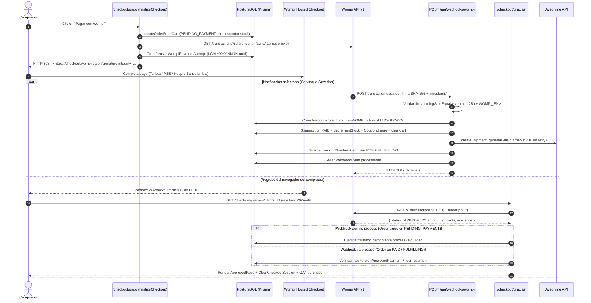

# Wompi — Pasarela de Pagos, Ledger de Intentos, Webhooks y Reconciliación

> **Documento vivo.** Especificación técnica canónica de la integración de pagos en línea de **Lucams Shop** con **Wompi Colombia** (Bancolombia): Hosted Web Checkout, firmas SHA-256 de integridad y eventos, ledger transaccional de intentos, webhook idempotente, verificación activa en `/checkout/gracias` y flujo auditado de reembolsos. Para la máquina de estados del pedido y contraentrega revisa [`../domains/checkout-payments-shipping.md`](../domains/checkout-payments-shipping.md); para controles criptográficos consulta [`../SECURITY.md`](../SECURITY.md).

---

## 1. Arquitectura Hosted Web Checkout (`checkout.wompi.co`)

Lucams integra Wompi detrás del puerto `PaymentProvider` (`apps/web/features/payments/provider.ts`, seleccionado por `PAYMENT_PROVIDER="wompi"`) e implementado por `WompiPaymentProvider` (`apps/web/features/payments/wompi.ts`) sobre el cliente de bajo nivel `apps/web/lib/wompi.ts` (`import "server-only"`).

### Decisiones estructurales de seguridad y UX

1. **Modalidad Hosted Web Checkout (`https://checkout.wompi.co/p/`)**: el comprador ingresa los datos sensibles de tarjeta, PSE, Nequi o Botón Bancolombia directamente en el dominio certificado PCI-DSS de Wompi (doc oficial: https://docs.wompi.co/docs/colombia/widget-checkout-web/, verificada 2026-07-28). Lucams jamás toca PAN, CVV ni credenciales bancarias.
2. **Cero variables `NEXT_PUBLIC_WOMPI_*`**: las cuatro llaves (`WOMPI_PUBLIC_KEY`, `WOMPI_PRIVATE_KEY`, `WOMPI_INTEGRITY_SECRET`, `WOMPI_EVENTS_SECRET`) y el selector `WOMPI_ENV` (`sandbox` | `production`) viven **exclusivamente en el servidor**. Aunque `public-key` viaja como parámetro en la URL firmada hacia Wompi, construir la URL en servidor (`buildCheckoutUrl`) impide filtrar secretos por error al bundle cliente y permite rotar llaves o alternar entornos sin recompilar.
3. **Prefill completo del comprador (`customer-data:*`)**: para evitar que el cliente vuelva a digitar datos ya capturados en `/checkout/datos`, `buildCheckoutUrl` envía:
   - `customer-data:email`
   - `customer-data:full-name`
   - `customer-data:phone-number-prefix="57"` + `customer-data:phone-number` (últimos 10 dígitos nacionales limpios)
   - `customer-data:legal-id` (solo dígitos) + `customer-data:legal-id-type` (`CC`, `CE`, `NIT`, `PP`, `TI`, `DNI`, `RG`, `OTHER`)
4. **Omisión deliberada de `redirect-url` en `localhost`**: el WAF de CloudFront de Wompi responde `HTTP 403 Forbidden` si el parámetro `redirect-url` contiene `localhost`, `127.0.0.1` o `0.0.0.0` (regla anti _open-redirect_ del proveedor). `buildCheckoutUrl` evalúa `/\b(localhost|127\.0\.0\.1|0\.0\.0\.0)\b/i`: en desarrollo local omite `redirect-url` registrando `wompi.checkout_url.redirect_omitted` (Wompi muestra su comprobante propio), mientras que en Preview y Production envía `https://<dominio>/checkout/gracias`.

### Ambientes y endpoints REST

| `WOMPI_ENV`                | Base REST API (`apiUrl`)         | Prefijo de llaves esperado                                  | `event.environment` esperado en Webhook |
| -------------------------- | -------------------------------- | ----------------------------------------------------------- | --------------------------------------- |
| `sandbox` (default seguro) | `https://sandbox.wompi.co/v1`    | `pub_test_`, `prv_test_`, `test_integrity_`, `test_events_` | `"test"`                                |
| `production`               | `https://production.wompi.co/v1` | `pub_prod_`, `prv_prod_`, `prod_integrity_`, `prod_events_` | `"prod"`                                |

---

## 2. Firma de integridad SHA-256 y montos en centavos COP (`Int`)

Por mandato global del proyecto, todos los valores monetarios (`Order.total`, `subtotal`, `discount`, `shipping`, `WompiPaymentAttempt.amountInCents`) se almacenan y operan como **enteros en centavos COP (`Int`)**, nunca flotantes. Un pedido de `$45.000 COP` equivale exactamente a `4500000` centavos, coincidiendo sin conversiones con `amount-in-cents` de Wompi.

### Cálculo de la firma de integridad

Wompi exige firmar los parámetros de creación del checkout con **SHA-256 plano (no HMAC)** para impedir que el comprador altere el monto o la moneda en la URL antes de pagar (doc oficial: https://docs.wompi.co/docs/colombia/widget-checkout-web/#paso-3-genera-una-firma-de-integridad, verificada 2026-07-28):

```text
Formato general Wompi:
SHA256("<reference><amountInCents>COP<expirationTime?><WOMPI_INTEGRITY_SECRET>")
```

En `generateIntegritySignature` (`apps/web/lib/wompi.ts`), Lucams no envía `expiration-time` en la URL del Web Checkout (la expiración y rotación de intentos la gobierna nuestro ledger en servidor), por lo que la cadena exacta firmada es:

```ts
const concat = `${input.reference}${input.amountInCents}${input.currency}${integritySecret}`;
const signature = crypto.createHash("sha256").update(concat).digest("hex");
```

El digest hexadecimal de 64 caracteres se adjunta en el parámetro `signature:integrity`.

---

## 3. Ledger de intentos (`WompiPaymentAttempt` / `WompiPaymentTransaction`) y rotación de referencias

### Por qué existe el ledger

Wompi bloquea una `reference` tras el primer intento fuera de su ventana interna de reintento (~3 minutos, `WOMPI_REFERENCE_RETRY_WINDOW_MS`) o si el monto de la orden cambia (p. ej., al aplicar/quitar un cupón o Puntos Lucams en `/checkout/pago`), devolviendo el error _"La referencia ya ha sido usada"_. Sin embargo, rotar la referencia a ciegas en cada clic arriesga un **doble cobro** si el intento anterior dejó una transferencia PSE en estado `PENDING` o una tarjeta `APPROVED` cuyo webhook aún no llegó.

El módulo `apps/web/features/orders/payment-reference.ts` resuelve este problema mediante dos tablas con RLS _deny-by-default_ (migración `00000000000042_wompi_payment_ledger.sql`):

| Modelo Prisma             | Claves únicas                                         | Rol en el ledger                                                                                                                                                               |
| ------------------------- | ----------------------------------------------------- | ------------------------------------------------------------------------------------------------------------------------------------------------------------------------------ |
| `WompiPaymentAttempt`     | `reference @unique` · `@@unique([orderId, sequence])` | Representa cada referencia presentada al comprador (`amountInCents`, `currency`, `status`: `OPEN`, `IN_FLIGHT`, `APPROVED`, `FAILED`, `SUPERSEDED`, `REVIEW`).                 |
| `WompiPaymentTransaction` | `externalId @unique` (ID de transacción Wompi)        | Espeja cada transacción real creada en Wompi bajo ese intento (`status`, `paymentMethodType`, `statusMessage`, `providerCreatedAt`, `providerFinalizedAt`, `firstApprovedAt`). |

### Formato y resolución de referencias

- **Intentos nuevos (`buildUniqueWompiReference`)**: generan `${order.number}-${randomUUID()}` (ej. `LCM-2026-0042-9b1deb4d-...`), garantizando unicidad global e irrepetibilidad criptográfica entre reintentos.
- **Compatibilidad hacia atrás (`buildWompiReference` / `findOrderIdByWompiReference`)**: el buscador resuelve primero por match exacto en `WompiPaymentAttempt.reference` y, como respaldo para formatos previos (`LCM-YYYY-NNNN`, `LCM-YYYY-NNNN-2`), consulta `Order.wompiReference`, `Order.number` exacto o el prefijo base extraído por `extractOrderNumberFromWompiReference` (`/^((?:LCM)-\d{4}-\d+?)(?:-|$)/`).
- **Árbol de decisión de `resolveWompiPaymentReference(orderId)` antes de abrir Wompi**:
  1. Sincroniza el intento vigente llamando `listTransactionsByReference(attempt.reference)` (`GET /v1/transactions?reference=...`), persistiendo **todas** las transacciones retornadas (nunca decide solo por `data[0]`, rechaza colecciones paginadas truncadas y descarta transacciones históricas anteriores a `order.createdAt - 60 s`).
  2. **Si existe `APPROVED`**: actualiza el intento a `APPROVED`, guarda `Order.wompiTransactionId` (prendiendo `needsReconciliation` si hubiera más de una captura) y corta el flujo redirigiendo a `/checkout/gracias?id=<txId>` (`ORDER_ALREADY_PAID`).
  3. **Si existe `PENDING`**: marca el intento `IN_FLIGHT`, guarda `Order.wompiTransactionId` y redirige a `/checkout/gracias?id=<txId>` (`PAYMENT_IN_FLIGHT`), impidiendo abrir un segundo pago mientras PSE/Nequi procesa.
  4. **Si existe `VOIDED` o desfase de monto/moneda**: marca el intento en `REVIEW` + `Order.needsReconciliation = true` y bloquea cobros nuevos hasta revisión humana.
  5. **Si falla la consulta a Wompi (`lookup_failed`)**: **jamás rota a ciegas**; aborta con `PAYMENT_INIT_FAILED` pidiendo intentar en unos minutos.
  6. **Si no hay transacciones en Wompi (`empty`) y el monto no cambió**: reutiliza la referencia `OPEN` actual (`ready`).
  7. **Si solo hay estados fallidos terminales (`DECLINED`/`ERROR`) o cambió el total**: marca el intento previo como `SUPERSEDED` y crea `sequence + 1` con nueva referencia `${order.number}-${randomUUID()}`.

### Flujo completo: Pago + Webhook + Redirección a `/checkout/gracias`



---

## 4. Resiliencia del cliente REST (`apps/web/lib/wompi.ts`)

| Parámetro             | Valor configurado                                              | Detalle de implementación                                                                                                                                                                                    |
| --------------------- | -------------------------------------------------------------- | ------------------------------------------------------------------------------------------------------------------------------------------------------------------------------------------------------------ |
| **Circuit Breaker**   | `wompiCB` (`name: "wompi"`, `threshold: 5`, `resetMs: 30_000`) | Instancia por contenedor serverless (`lib/circuit-breaker.ts`). Al 5.º fallo consecutivo corta en seco durante 30 s con `CircuitOpenError`.                                                                  |
| **Política de Retry** | `withRetry` (`attempts: 3`, `baseMs: 200`, `maxMs: 5_000`)     | Envuelve por fuera a `wompiCB.exec(...)` en `getTransaction` y `listTransactionsByReference` (ambos `GET` idempotentes).                                                                                     |
| **Timeout HTTP**      | `5 000 ms` (`fetchWithTimeout`)                                | Aplicado a `GET /v1/transactions/{id}` y `GET /v1/transactions?reference=...` con `cache: "no-store"` y `Authorization: Bearer ${WOMPI_PRIVATE_KEY}`.                                                        |
| **Sonda de salud**    | `6 000 ms` (`probeWompiHealth`)                                | `GET /v1/merchants/${WOMPI_PUBLIC_KEY}`. Verifica que las llaves correspondan al `WOMPI_ENV` activo sin tocar llave privada ni crear transacciones. En modo catálogo sin llaves retorna `status: "skipped"`. |

---

## 5. Webhook `POST /api/webhooks/wompi`

Ruta: `apps/web/app/api/webhooks/wompi/route.ts` (`runtime = "nodejs"`, `dynamic = "force-dynamic"`, **`maxDuration = 60`**; `GET` responde `405 Method Not Allowed`).

### Capas de defensa y validación (en orden exacto de ejecución)

1. **Techo de payload (`64 KB`)**: lee el cuerpo crudo con `readBodyWithLimit(req, 64 * 1024)` (`LUC-SEC-007`). Si supera `64 KB` responde `HTTP 413` sin parsear JSON.
2. **Verificación criptográfica de firma (`verifyWebhookSignature`)**:
   - Wompi firma los eventos con **SHA-256 plano (no HMAC)** sobre propiedades dinámicas (doc oficial: https://docs.wompi.co/docs/colombia/eventos/#verificacion-de-la-firma-de-eventos, verificada 2026-07-28):
     ```text
     SHA256( valores(data, signature.properties[]) + timestamp + WOMPI_EVENTS_SECRET )
     ```
   - `extractValueByPath` resuelve cada ruta declarada en `event.signature.properties` (típicamente `["transaction.id", "transaction.status", "transaction.amount_in_cents"]`) sobre `event.data`, concatena `String(event.timestamp)` y `WOMPI_EVENTS_SECRET`, y compara el digest SHA-256 con `signature.checksum` mediante `crypto.timingSafeEqual`.
   - Si falta alguna variable `WOMPI_*` (ej. modo catálogo), responde `HTTP 503`. Si la firma es inválida, registra en `SecurityEvent` (`WEBHOOK_INVALID_SIGNATURE`, guardando en logs solo un `bodyHash` SHA-256 truncado a 16 caracteres sin exponer el payload) y responde **`HTTP 401`**.
3. **Ventana anti-replay de 25 horas (`90 000 s`) + guarda fail-fast**:
   - Wompi reintenta la entrega hasta **3 veces** si no recibe `HTTP 200` — a los **30 minutos, 3 horas y 24 horas** (doc oficial de eventos Wompi, verificada 2026-07-28) — reenviando **el mismo `timestamp` original** porque forma parte del checksum firmado.
   - Por ello `TIMESTAMP_WINDOW_SEC = 25 * 60 * 60` (`90 000 s`): admite los 3 reintentos legítimos de Wompi y rechaza con `401` (`WEBHOOK_INVALID_SIGNATURE`, `reason: "timestamp_out_of_window"`) cualquier replay más antiguo.
   - `WOMPI_DISABLE_TIMESTAMP_CHECK=true` omite únicamente el chequeo de antigüedad en suites de prueba locales; `validateEnv()` en `apps/web/lib/env.ts` **aborta el arranque en producción** si esta variable está en `"true"`.
4. **Coincidencia estricta de entorno (`getWompiExpectedWebhookEnv()`)**:
   - Derivada de `WOMPI_ENV` (`"production"` → exige `event.environment === "prod"`; `"sandbox"` → exige `"test"`), **nunca** de `NODE_ENV` (en Vercel Preview `NODE_ENV` es `"production"` pero `WOMPI_ENV` es `"sandbox"`). Esta guarda jamás se desactiva con `WOMPI_DISABLE_TIMESTAMP_CHECK`. Si no coincide, responde `HTTP 401`.
5. **Deduplicación atómica en `WebhookEvent` y sanitización `LUC-SEC-009`**:
   - Clave `externalId = "${transaction.id}-${transaction.status}-${event.timestamp}"` bajo `source = "WOMPI"`.
   - Si `existing?.processedAt` no es nulo, responde `200 { ok: true, note: "already processed" }`.
   - Si dos entregas idénticas compiten en paralelo y el `create` perdedor recibe Prisma `P2002` en `@@unique([source, externalId])`, devuelve `200` limpio sin disparar doble saga.
   - **Privacidad (`LUC-SEC-009`)**: el campo `WebhookEvent.payload` aplica una **allowlist estricta** (`event`, `timestamp`, `data.transaction.{id, status, reference, amount_in_cents, currency}` y `bodyHash` de 16 chars), asegurando **cero persistencia de PII financiera o datos del pagador** en la base de datos y backups (retención 180 días en `purge-event-logs`).
6. **Protección contra transacciones históricas y manipulación de monto**:
   - Si `isWompiTransactionOlderThanOrder(order, transaction)` es verdadero, marca el evento procesado y lo ignora (`200`).
   - Si `transaction.amount_in_cents !== order.total`, prende `Order.needsReconciliation = true` con el desfase exacto en pesos, sella `processedAt` y responde `200` sin despachar.

### Matriz de manejo por estado de transacción en el Webhook

| `transaction.status`                                                                                                                      | Acción ejecutada en la orden                                                | Estado resultante y efectos secundarios                                                                                                                                                                                                                                                                                |
| ----------------------------------------------------------------------------------------------------------------------------------------- | --------------------------------------------------------------------------- | ---------------------------------------------------------------------------------------------------------------------------------------------------------------------------------------------------------------------------------------------------------------------------------------------------------------------- |
| **`APPROVED`**                                                                                                                            | `processPaidOrder({ orderId, wompiTransactionId })`                         | Transición atómica `PENDING_PAYMENT → PAID` + decremento de stock (`InventoryLog`) + diseños `READY → USED_IN_ORDER` + consumo atómico de cupón + limpieza de carrito; envía correo de confirmación, alerta admin, acredita referidos/puntos y crea guía Aveonline (o `INTERNO-*` en `LUCAMS`) pasando a `FULFILLING`. |
| **`APPROVED` anómalo** (orden expirada/`CANCELLED`, sin stock en carrera, segundo cobro `txId` distinto o orden ya confirmada como `COD`) | `markNeedsReconciliation` / `flagForeignApprovedPayment` + alerta inmediata | **No pierde trazabilidad financiera**: prende `Order.needsReconciliation = true` explicando el caso exacto (reembolsar cobro tardío/duplicado o producir stock) y notifica al panel `/admin/pedidos`.                                                                                                                  |
| **`DECLINED` / `ERROR`**                                                                                                                  | No-op de estado + `sendOrderPaymentDeclined`                                | **Mantiene la orden en `PENDING_PAYMENT`** (no se movió dinero y el comprador puede reintentar en el widget o desde `/checkout/pago`). Envía correo amable idempotente por `txId` y con _cooldown_ por orden.                                                                                                          |
| **`VOIDED`**                                                                                                                              | `processFailedPaymentOrder`                                                 | Si la orden ya capturó dinero, exige que `tx.id === order.wompiTransactionId` (impide que un intento viejo anule una compra pagada por otra tx). Transiciona a `REFUNDED` (desde `PAID`/`DELIVERED`) o `CANCELLED` (desde `FULFILLING`/`SHIPPED`/`PENDING_PAYMENT`), repone stock y avisa al cliente.                  |
| **`PENDING`**                                                                                                                             | `updateMany` condicional sobre `Order.wompiTransactionId`                   | Guarda `transaction.id` (solo si sigue `PENDING_PAYMENT`, `paymentMethod = "WOMPI"` y `wompiTransactionId = null`) para que `expire-pending-orders` verifique el cobro real antes de cancelar si el webhook final se perdiera.                                                                                         |
| **Excepción inesperada en saga**                                                                                                          | Catch de seguridad en `route.ts`                                            | Prende `Order.needsReconciliation = true`, **NO sella `WebhookEvent.processedAt`** (activa alerta `webhooks_stuck` y visibiliza el evento pendiente; al resolverse manualmente `sealManuallyResolvedWebhookEvents` lo sella) y responde `HTTP 200` a Wompi.                                                            |

---

## 6. Verificación activa en `/checkout/gracias` y convergencia por Cron

Cuando Wompi redirige al comprador a `/checkout/gracias?id=TX_ID&env=...&status=...` (`apps/web/app/checkout/gracias/page.tsx`, `maxDuration = 60`):

1. **Cero confianza en query params**: ignora `status` y `env` de la URL; extrae solo `id` (`txId`). En modo catálogo o sin `id`, redirige a `/`.
2. **Rate limit anti-amplificación**: limita a **`20` consultas cada `5 minutos` por IP** (`gracias:ip:<ip>`). Si se excede, renderiza `VerifyingPage` sin invocar la API privada de Wompi.
3. **Consulta directa (`getTransaction(txId)`) y tolerancia a fallos**: si la API de Wompi sufre un timeout o error transitorio en el instante en que regresa el comprador, muestra `LookupRetryPage` con `<AutoRefresh />` («estamos verificando tu pago»), **jamás** una pantalla de pago rechazado que induzca un segundo cobro.
4. **Fallback idempotente `processPaidOrder`**: si `tx.status === "APPROVED"`, el monto coincide (`tx.amount_in_cents === order.total`) y la orden aún está en `PENDING_PAYMENT` porque el cliente regresó antes que el webhook, `/checkout/gracias` ejecuta `processPaidOrder` en línea. Si el webhook llega milisegundos después, las tres barreras de idempotencia (transacción de stock `StockAlreadyAppliedError`, `Order.trackingNumber` y claim `Order.shipmentClaimedAt`) evitan doble descuento de inventario y doble guía.
5. **Tercera capa de convergencia (`GET /api/cron/expire-pending-orders`)**: cada hora al minuto `:23`, `expireStalePendingOrders` (`apps/web/features/orders/expire-pending.ts`) revisa órdenes `WOMPI` en `PENDING_PAYMENT` con más de **`24 horas`** (`PENDING_PAYMENT_EXPIRY_HOURS`) y `needsReconciliation = false`. Antes de cancelar una orden con `wompiTransactionId`, consulta el estado real en Wompi: si descubre un `APPROVED` huérfano, ejecuta `processPaidOrder` (`healed`); si la API de Wompi falla al verificar, cancela pero prende `needsReconciliation = true` para revisión humana; y las expiradas sin `txId` (`no_txid`) se reportan en el resumen diario (`daily-summary`) para contraste contable.

---

## 7. Flujo operativo de reembolsos (Manual en Portal Wompi + Registro en Admin)

Por diseño de seguridad financiera, **Lucams no ejecuta reembolsos ni anulaciones automáticas por API contra Wompi**. Todo movimiento de devolución de dinero exige intervención humana verificada en dos pasos:

1. **Devolución real del dinero (fuera de la app)**:
   - Ingresa al **Portal de Comercios de Wompi** (`comercios.wompi.co`), localiza la transacción por `wompiTransactionId` o referencia `LCM-YYYY-NNNN...` y ejecuta la anulación/reembolso parcial o total (o realiza transferencia bancaria manual cuando el medio de pago original como PSE/efectivo así lo requiera).
2. **Registro contable y logístico en `/admin/pedidos/[number]` (`refundOrderAction`)**:
   - Exclusivo para el rol **`SUPERADMIN`** con **reautenticación MFA `aal2` reciente** (`requireRecentMfa()`).
   - Abre la acción **Reembolsar** en el detalle del pedido (habilitada solo en estados `PAID` o `DELIVERED`; `transitionOrderAction` bloquea cualquier cambio manual directo a `REFUNDED`).
   - Marca el checkbox obligatorio **`moneyReturned`** (_«Confirmo que el dinero ya fue devuelto al cliente»_) y documenta el motivo. Sin ese checkbox el servidor rechaza la operación.
   - `refundOrder` ejecuta atómicamente: transición a `REFUNDED`, reposición idempotente de inventario en `InventoryLog`, liberación del cupón si aplicaba, sello de `Order.refundMoneyConfirmedAt` / `refundMoneyConfirmedBy`, registro en `AdminActionLog` (`action: "order.refund"`) y envío del correo transaccional `refund-issued` al comprador.

---

## 8. Checklist paso a paso en el Portal de Comercios Wompi

Sigue esta guía al configurar o auditar los ambientes **Sandbox** y **Producción** en https://comercios.wompi.co:

### Paso 1 — Obtención de las 4 llaves por ambiente

- [ ] Ingresar a **comercios.wompi.co** y seleccionar el interruptor de ambiente (**Pruebas / Sandbox** para Preview/local; **Producción** para `lucamsshop.com`).
- [ ] En **Desarrolladores → Llaves del API para integración**, copiar las **4 credenciales** exactas y cargarlas en Vercel (ver [`./vercel.md`](./vercel.md)):
  - **Llave pública** (`pub_test_...` / `pub_prod_...`) → `WOMPI_PUBLIC_KEY`
  - **Llave privada** (`prv_test_...` / `prv_prod_...`) → `WOMPI_PRIVATE_KEY`
  - **Secreto de integridad** (`test_integrity_...` / `prod_integrity_...`) → `WOMPI_INTEGRITY_SECRET`
  - **Secreto de eventos** (`test_events_...` / `prod_events_...`) → `WOMPI_EVENTS_SECRET`
- [ ] Configurar `WOMPI_ENV=sandbox` en Preview/Development y `WOMPI_ENV=production` en Production.

### Paso 2 — Configuración de la URL de Eventos (Webhook)

- [ ] En **Desarrolladores → Seguimiento de transacciones (URL de Eventos)**:
  - En **Producción**, registrar: `https://lucamsshop.com/api/webhooks/wompi`
  - En **Pruebas / Sandbox**, registrar la URL estable de Staging/Preview accesible públicamente (nota: si Preview tiene activa _Vercel Authentication_, Wompi no envía el header de bypass de Vercel; para validar webhooks end-to-end en Sandbox asegúrate de apuntar a un dominio Preview sin reto SSO en `/api/webhooks/wompi` o valida la convergencia vía `/checkout/gracias`).
- [ ] Verificar que el evento `transaction.updated` esté habilitado.

### Paso 3 — Métodos de pago habilitados

- [ ] En **Configuración → Medios de pago**, confirmar activos los medios ofrecidos en el checkout de Lucams:
  - Tarjetas de crédito y débito (Visa, Mastercard, American Express).
  - PSE (transferencia bancaria interbancaria).
  - Nequi.
  - Botón Bancolombia / Transferencia Bancolombia.

### Paso 4 — Verificación en vivo sin cargos reales

- [ ] Consultar `GET https://lucamsshop.com/api/health/wompi` y confirmar respuesta `HTTP 200` con `{ "status": "ok", "env": "production" }`.
- [ ] Revisar en `/admin/integraciones` que la tarjeta **Wompi** aparezca en verde (`OK`) con el ambiente esperado.
